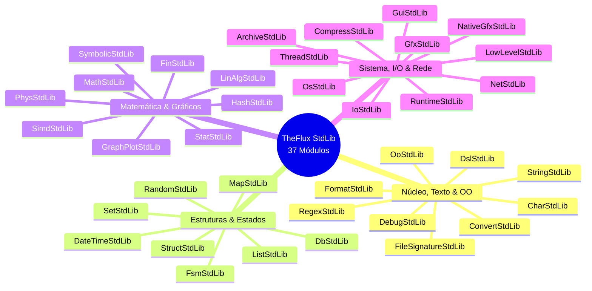

# TheFlux v0.5.0 Release Notes

> **Data de Lançamento**: Outubro de 2026  
> **Versão**: `0.5.0`  
> **Status**: desenvolvimento / Estável  
> **Licença**: GNU General Public License v3.0 (GPL-3.0)  
> **Conformidade Multi-Backend**: **100,0% PASS** (2.306 / 2.306 programas validados nos 6 backends)

---

## 🌟 Resumo Executivo: O Grande Salto do Ecossistema TheFlux

A versão **0.5.0** da linguagem de programação **TheFlux** marca o amadurecimento definitivo de sua arquitetura orientada a dados, contratos e agentes reativos. Este lançamento consolida TheFlux como uma linguagem de alto desempenho projetada para computação científica de ponta, engenharia de software rigorosa e execução universal em múltiplos alvos.

### Principais Destaques da Versão 0.5.0

1. **Paradigma Orientado a Fluxo de Dados (Dataflow Linear)**: TheFlux é fundamentada desde sua gênese na computação orientada a fluxo contínuo de dados (Dataflow). É importante destacar que, **nesta versão 0.5.0, o fluxo de dados suportado é estritamente linear** (pipelines e encadeamentos sequenciais de transformação), garantindo determinismo matemático absoluto, simplicidade de raciocínio estrutural e estabilidade de execução uniforme através dos 6 backends antes da introdução de grafos ramificados complexos.
2. **Biblioteca Padrão Completa (37 stdlibs)**: Catálogo modular abrangendo os 4 pilares da linguagem, introduzindo concorrência preemptiva com canais MPMC (`ThreadStdLib`), persistência em disco multi-modelo com 6 motores embutidos (`DbStdLib`), computação algébrica simbólica analítica (`SymbolicStdLib`), aceleração paralela SIMD (`SimdStdLib`), plotagem científica com 19 sistemas de coordenadas (`GraphPlotStdLib`), drivers de renderização nativos (`NativeGfxStdLib`), compressão pura em memória de múltiplos formatos com proteção contra Zip Bombs (`CompressStdLib`) e manipulação de containers e I/O binário sem perdas (`ArchiveStdLib` e `IoStdLib`).
3. **Suíte Científica `examples/SciAlgo` (1.741 Algoritmos)**: O mais vasto e meticuloso catálogo de algoritmos científicos e estruturas computacionais implementado nativamente em TheFlux, cobrindo 13 grandes domínios e 49 categorias temáticas, com 100% de paridade comportamental nos 6 backends de execução.
4. **Suíte Clássica `examples/NumericalRecipes` (205 Algoritmos)**: Reimplementação fiel e limpa (*clean-room*) do tratado clássico da computação científica *Numerical Recipes: The Art of Scientific Computing (3rd Edition, Cambridge University Press)*, cobrindo integralmente todos os 22 capítulos da obra com paridade total em todos os 6 backends.
5. **Infraestrutura Multi-Backend com Paridade Absoluta**: O compilador TheFlux valida com determinismo estrito 2.306 programas e algoritmos nos 6 alvos de execução (`in`, `vm`, `vmr`, `llvm`, `wat`, `wasm`), totalizando **13.836 verificações de conformidade** com zero divergências.

---

## ⚙️ Arquitetura Multi-Backend: 6 Alvos com Paridade Absoluta

TheFlux adota o princípio de **Semântica Invariante**: o mesmo código-fonte `.flux` produz exatamente o mesmo resultado determinístico caractere por caractere, independentemente do backend escolhido para execução:

| Backend | Identificador | Papel Arquitetural | Tecnologia Subjacente | Status v0.5.0 |
| :--- | :---: | :--- | :--- | :---: |
| **Interpretador AST** | `in` | Execução interativa, prototipagem ágil e análise semântica em tempo real | Árvore Sintática Abstrata em memória | ✅ 100% PASS |
| **VM Bytecode** | `vm` | Compilação para bytecode intermediário TheFlux e execução em VM | Emissor de bytecode `.fvmbc` otimizado | ✅ 100% PASS |
| **VM Runner** | `vmr` | Verificação de integridade de artefatos binários recarregados do disco | Leitor/deserializador `.fvmbc` | ✅ 100% PASS |
| **LLVM Nativo** | `llvm` | Geração de binários nativos de máquina com máxima performance de CPU | Emissão de LLVM IR + Clang + `flux_input.c` | ✅ 100% PASS |
| **WebAssembly Text** | `wat` | Portabilidade universal, inspeção textual de baixo nível e WASI | Emissor de S-Expressions WASM (`.wat`) | ✅ 100% PASS |
| **WebAssembly Binário**| `wasm`| Execução de alta velocidade em navegadores e runtimes de nuvem | Emissão binária `.wasm` com WASI (`wasmer`) | ✅ 100% PASS |

---

## 📦 Pilar 1: O Catálogo Oficial das 37 Bibliotecas Padrão (`stdlib/`)

A biblioteca padrão de TheFlux é estruturada sob contratos tipados (`contract`) e implementações de agentes (`agent ... impl ...`) organizadas nos **4 pilares arquiteturais** da linguagem:



### 1. Núcleo, Texto & OO (9 Bibliotecas)

- **`CharStdLib.fdsl`**: Classificação de caracteres Unicode, codificações UTF-8, testes semânticos e transformações seguras.
- **`ConvertStdLib.fdsl`**: Conversão bidirecional entre tipos primitivos, bases numéricas arbitrárias (binário, octal, decimal, hexadecimal) e parsing com tratamento de falhas.
- **`DebugStdLib.fdsl`**: Rastreamento de chamadas de funções, pontos de parada (*breakpoints*), introspecção de pilha e diagnósticos em tempo de execução.
- **`DslStdLib.fdsl`**: Framework completo de desenvolvimento de DSLs modulares de usuário:
  - `DslLexerContract`: tokenização flexível baseada em padrões léxicos e expressões regulares.
  - `DslParserContract`: analisador sintático com diagnósticos visuais e localização precisa de erros via cursor indicador (`^`).
  - `DslAstContract`: manipulação de nós de AST e otimizações de compilação por *constant folding*.
  - `DslExecutionContract` & `DslAsmContract`: execução inline segura com injeção de contexto e suporte a montagem de registradores de hardware.
  - `DslSandboxContract`: governança de execução em sandbox com limites rígidos de tempo de CPU, alocação de memória e timeout.
- **`FileSignatureStdLib.fdsl`**: Inspeção de *magic numbers*, identificação estrita de tipos MIME e assinaturas binárias de arquivos em disco.
- **`FormatStdLib.fdsl`**: Codificação e decodificação estruturada para formatos universais da indústria: JSON, CSV, YAML 1.2, TOML, Base64 e URL Encoding.
- **`OoStdLib.fdsl`**: Paradigma de orientação a objetos fundamentado em contratos, composição explícita, polimorfismo dinâmico e resolução de despacho seguro.
- **`RegexStdLib.fdsl`**: Motor nativo de expressões regulares para busca de padrões, correspondência, captura de grupos e substituições.
- **`StringStdLib.fdsl`**: Biblioteca abrangente de processamento de texto, fatiamento (*slicing* 1-indexado), interpolação, padding, normalização e mutação.

### 2. Estruturas & Estados (8 Bibliotecas)

- **`DateTimeStdLib.fdsl`**: Manipulação de calendários, intervalos temporais, fusos horários e temporização de alta fidelidade com relógio monotônico de microssegundos.
- **`DbStdLib.fdsl`**: Arquitetura multi-modelo de persistência física em disco com 6 motores embutidos de alta performance:
  - **SQLite 3.53.4**: Motor relacional SQL com transações ACID completas, integridade referencial e arquivos de banco únicos.
  - **DuckDB 1.5.6**: Motor colunar OLAP de altíssima velocidade para agregação de grandes volumes de dados e consultas vetoriais analíticas.
  - **LevelDB 1.23**: Banco chave-valor baseado em Log-Structured Merge-tree (LSM) com throughput extremo de gravação sequencial.
  - **UnQLite 1.1.4**: Motor NoSQL sem dependências externas integrando banco de documentos JSON e chave-valor transacional.
  - **KùzuDB 0.11.3**: Banco de grafos de propriedades nativo de última geração com consultas declarativas em sintaxe Cypher.
  - **ObjectBox 5.3.2**: Motor de busca vetorial para Inteligência Artificial (k-NN / HNSW sobre Embeddings) e persistência de objetos tipados.
- **`FsmStdLib.fdsl`**: Máquinas de estados finitos determinísticas orientadas a transições de eventos, guardas condicionais e rotas seguras.
- **`ListStdLib.fdsl`**: Listas dinâmicas heterogêneas e homogêneas, operações funcionais (`map`, `filter`, `fold`), ordenações e particionamento.
- **`MapStdLib.fdsl`**: Dicionários associativos chave-valor de alta performance com endereçamento hash e métodos funcionais de iteração.
- **`RandomStdLib.fdsl`**: Geradores de números pseudo-aleatórios criptograficamente seguros (CSPRNG) e geradores estatísticos para distribuições Normal, Uniforme, Poisson e Exponencial.
- **`SetStdLib.fdsl`**: Álgebra dos conjuntos finitos: uniões, interseções, diferenças, complementos e testes de pertinência em $O(1)$.
- **`StructStdLib.fdsl`**: Estruturas de dados tipadas com validação contratual em tempo de alocação e introspecção reflexiva de campos.

#### Exemplo Prático: Persistência Multi-Modelo com `DbStdLib`
```flux
use DbStdLib

program (ExemploBancoDadosRelease) {
      #L Abertura de conexão relacional embutida SQLite
      mut as map: db = dbOpen("scratch/analytics.db", "sqlite")
      dbExec(db, "CREATE TABLE IF NOT EXISTS leituras (id INT PRIMARY KEY, temperatura REAL)")
      dbExec(db, "INSERT INTO leituras VALUES (1, 36.6)")
      
      mut as bool: ok = dbClose(db)
      println("Operação de banco SQLite concluída com sucesso: " + ok)
}
```

### 3. Matemática, Gráficos & Computação Científica (9 Bibliotecas)

- **`FinStdLib.fdsl`**: Funções financeiras completas: amortização de empréstimos (SAC, Price), valor presente líquido (VPL), taxa interna de retorno (TIR) e anuidades.
- **`GraphPlotStdLib.fdsl`**: Sistema avançado de visualização científica cobrindo 7 domínios de plotagem (distribuições de densidade, relações e correlações, superfícies e campos 3D, composições, sistemas curvilíneos, modelos de grafos e curvas de engenharia), com suporte nativo a 19 sistemas de coordenadas curvilíneas e projeções de câmera 3D (perspectiva, ortográfica e isométrica).
- **`HashStdLib.fdsl`**: Algoritmos de espalhamento criptográfico (SHA-256, MD5) e verificações ultra-rápidas de integridade física de blocos (CRC32, Adler32).
- **`LinAlgStdLib.fdsl`**: Álgebra linear densa: matrizes multidimensionais, operações tensoriais, sistemas lineares, inversão, determinante, autovalores e autovetores.
- **`MathStdLib.fdsl`**: Funções matemáticas elementares, trigonometria direta e inversa, funções hiperbólicas, logaritmos, potenciação inteira/fracionária e arredondamento seguro.
- **`PhysStdLib.fdsl`**: Modelagem física fundamental: cinemática clássica, dinâmica newtoniana, óptica geométrica, gravitação universal, termodinâmica e eletrostática.
- **`SimdStdLib.fdsl`**: Vetorização direta em nível de hardware (SIMD): operações paralelas de inteiros e ponto flutuante, somas por redução e produtos escalares vetorizados de alta performance.
- **`StatStdLib.fdsl`**: Estatística descritiva e indutiva: medidas de tendência central (média, mediana, moda), dispersão (variância, desvio-padrão), correlação de Pearson/Spearman e distribuições de probabilidade.
- **`SymbolicStdLib.fdsl`**: Motor analítico de álgebra computacional simbólica:
  - `SymbolicCoreContract`: simplificação de expressões, expansão polinomial, fatoração algébrica e cancelamento.
  - `SymbolicCalculusContract`: diferenciação simbólica de qualquer ordem, integração analítica de termos elementares e avaliação exata.
  - `SymbolicMatrixContract`: cálculo de determinantes e inversão de matrizes contendo variáveis simbólicas.
  - Formatação e exportação nativa de árvores sintáticas (AST) para representações em LaTeX de publicação.

### 4. Sistema, I/O, Rede & Concorrência (11 Bibliotecas)

- **`ArchiveStdLib.fdsl`**: Fachada de alto nível para gerenciamento de containers em disco (`.zip`, `.tar`, `.tar.gz`, `.tar.bz2`, `.tar.xz`, `.tar.zst`, `.7z`, extração de `.rar`) e operações de arquivos em binário puro (8-bit *lossless*), formato Hexadecimal e Base64.
- **`CompressStdLib.fdsl`**: Algoritmos puros em memória de compressão e descompressão de buffers:
  - Formatos: Deflate (RFC 1951), Zlib (RFC 1950), Gzip (RFC 1952), Bzip2, LZMA, LZMA2, XZ e Zstandard (zstd).
  - Telemetria de compressão detalhada com a struct `CompressStats` (tamanho original, tamanho comprimido, razão e percentual de economia).
  - Blindagem física de segurança contra ataques de *Zip Bomb* e esgotamento de memória através de cotas estruturadas com a struct `DecompressQuota`.
- **`GfxStdLib.fdsl`** & **`GuiStdLib.fdsl`**: Primitivas gráficas vetoriais de baixo nível (pixels, linhas, arcos, polígonos) e biblioteca de interface gráfica imediata (IMGUI) para dashboards e ferramentas interativas.
- **`IoStdLib.fdsl`**: I/O de disco robusto, percurso recursivo de árvores de diretórios, leitura/gravação atômica, manipulação de arquivos binários sem perda (`IoBinaryFileContract`) e gerenciamento de arquivos compactados (`IoArchiveContract`).
- **`LowLevelStdLib.fdsl`**: Manipulação direta de registradores de memória, operações em nível de bit (*bitwise shifts*, máscaras), alinhamento de ponteiros e inspeção de *endianness* de hardware.
- **`NativeGfxStdLib.fdsl`**: Driver gráfico acelerado nativo acoplado a backends de hardware (Win32 GDI / HTML5 Canvas / WASI), provendo criação e ciclo de vida de janelas, pooling de eventos e renderização rápida de primitivas visuais.
- **`NetStdLib.fdsl`**: Conectividade de rede com sockets TCP e UDP, cliente HTTP nativo com verbos REST, resolução de endereços IP e parsing de URLs.
- **`OsStdLib.fdsl`**: Interação segura com o sistema operacional: leitura e escrita de variáveis de ambiente, execução de subprocessos, captura de códigos de saída e manipulação padronizada de *paths*.
- **`RuntimeStdLib.fdsl`**: Governança e introspecção do ambiente TheFlux: métricas do Garbage Collector (GC), estatísticas de alocação do heap, contagem de referências e introspecção de tipos dinâmicos.
- **`ThreadStdLib.fdsl`**: Concorrência preemptiva multi-threading:
  - Criação e ciclo de vida de threads nativas do sistema operacional: `threadSpawn`, `threadJoin`, `threadYield`, `threadSleep`.
  - Primitivas de sincronização e concorrência: mutexes recursivos (`mutexLock`, `mutexUnlock`), variáveis atômicas (`atomicCas`, `atomicAdd`), *Condition Variables*, semáforos e barreiras.
  - Canais de comunicação MPMC (Multi-Producer Multi-Consumer) no modelo CSP com buffers limitados ou ilimitados, suportando envio e recepção concorrente thread-safe (`channelSend`, `channelRecv`).

#### Exemplo Prático: Concorrência Preemptiva com Canais em `ThreadStdLib`
```flux
use ThreadStdLib

program (ExemploConcorrenciaRelease) {
      #L Criação de canal de comunicação com buffer de 10 elementos
      mut as map: canal = channelCreateWithCapacity(10)
      
      #L Envio de mensagens concorrentes
      channelSend(canal, "Fluxo Iniciado")
      channelSend(canal, "Processando Dados")
      
      mut as data: msg1 = channelRecv(canal)
      mut as data: msg2 = channelRecv(canal)
      
      println("Mensagem recebida 1: " + msg1)
      println("Mensagem recebida 2: " + msg2)
      channelClose(canal)
}
```

---

## 🔬 Pilar 2: A Suíte Científica `examples/SciAlgo` (1.741 Algoritmos)

A suíte [`examples/SciAlgo`](../examples/SciAlgo/) é um dos maiores marcos de validação prática da linguagem TheFlux. Trata-se de um catálogo exaustivo contendo **1.741 algoritmos científicos reais** implementados estritamente em código-fonte TheFlux (`.flux`), estruturados em **13 Grandes Domínios** e **49 Categorias Temáticas**, todos validados com **100% de aprovação nos 6 backends**.

### Tabela Oficial de Domínios da Suíte SciAlgo

| Domínio | Escopo Científico & Tecnológico | Total de Algoritmos | Conformidade Multi-Backend | Status |
| :--- | :--- | :---: | :---: | :---: |
| **Domínio I** | **Fundamentos, Busca e Ordenação** (`01_foundations`) | **175** | 6 Backends (1050/1050 PASS) | ✅ Concluído |
| **Domínio II** | **Estruturas de Dados Avançadas & Streaming** (`02_data_structures`) | **112** | 6 Backends (672/672 PASS) | ✅ Concluído |
| **Domínio III** | **Teoria dos Grafos & Redes** (`03_graphs`) | **144** | 6 Backends (864/864 PASS) | ✅ Concluído |
| **Domínio IV** | **Strings, Texto & Teoria da Informação** (`04_strings`) | **130** | 6 Backends (780/780 PASS) | ✅ Concluído |
| **Domínio V** | **Matemática Computacional, Álgebra & Teoria dos Números** (`05_mathematics`) | **177** | 6 Backends (1062/1062 PASS) | ✅ Concluído |
| **Domínio VI** | **Métodos Numéricos, Geometria & Física Computacional** (`06_numerical_physics`) | **175** | 6 Backends (1050/1050 PASS) | ✅ Concluído |
| **Domínio VII**| **Otimização & Estatística Científica** (`07_optimization_stat`) | **140** | 6 Backends (840/840 PASS) | ✅ Concluído |
| **Domínio VIII**| **Inteligência Artificial, Machine Learning & Deep Learning** (`08_artificial_intel`) | **282** | 6 Backends (1692/1692 PASS) | ✅ Concluído |
| **Domínio IX** | **Sistemas Computacionais, Compiladores & Infraestrutura** (`09_systems_infra`) | **230** | 6 Backends (1380/1380 PASS) | ✅ Concluído |
| **Domínio X**  | **Bioinformática, Computação Quântica & Pós-Quântica** (`10_bio_quantum`) | **120** | 6 Backends (720/720 PASS) | ✅ Concluído |
| **Domínio XI** | **Processamento Digital de Sinais (DSP), Áudio & Multimídia** (`11_dsp_multimedia`) | **20** | 6 Backends (120/120 PASS) | ✅ Concluído |
| **Domínio XII**| **Robótica, Cinemática, Controle & Navegação** (`12_robotics_control`) | **20** | 6 Backends (120/120 PASS) | ✅ Concluído |
| **Domínio XIII**| **Criptografia Fundamental Clássica & Segurança** (`13_classical_crypto`) | **16** | 6 Backends (96/96 PASS) | ✅ Concluído |
| **TOTAL GERAL**| **13 Grandes Domínios da Computação Científica** | **1.741** | **10.446 Verificações PASS** | 🚀 **100,0% PASS** |

### Destaques das Categorias de SciAlgo

- **Inteligência Artificial & Deep Learning (Domínio VIII - 282 algoritmos)**: Redes neurais MLP completas com retropropagação (*backpropagation*), redes convolucionais 1D/2D, redes recorrentes (LSTM, GRU), mecanismos de atenção (*Self-Attention* e *Multi-Head Attention*), árvores de decisão, Random Forests, máquinas de vetores de suporte (SVM) com múltiplos kernels, algoritmos de clustering (K-Means, DBSCAN) e otimizadores estocásticos (SGD, Momentum, RMSprop, Adam, AdamW).
- **Sistemas & Compiladores (Domínio IX - 230 algoritmos)**: Algoritmos de consenso distribuído tolerante a falhas (Raft, Paxos, Multi-Paxos, 2PC/3PC, Zab), estruturas de dados CRDT, escalonadores de tarefas, geradores de tabelas de parsing LR/LALR e representações intermediárias SSA.
- **Bioinformática & Computação Quântica (Domínio X - 120 algoritmos)**: Alinhamento de sequências genômicas global (Needleman-Wunsch) e local (Smith-Waterman), filogenia por Neighbor-Joining, modelos de Markov ocultos (HMM), simulações de circuitos quânticos de $N$ qubits, Transformada Quântica de Fourier (QFT), algoritmo de busca de Grover e protocolos de criptografia baseada em reticulados pós-quânticos (LWE/Ring-LWE).
- **Robótica & Controle (Domínio XII - 20 algoritmos)**: Planejamento amostral de trajetórias em espaços de configuração (RRT, RRT*, PRM*), cinemática inversa com equações de Denavit-Hartenberg e FABRIK, controle adaptativo PID, Regulador Linear Quadrático (LQR), Controle Preditivo Baseado em Modelo (MPC) e localização e mapeamento simultâneos (EKF-SLAM).

#### Exemplo em TheFlux: Método de Runge-Kutta RK4 (`SciAlgo`)
```flux
#L Algoritmo: Runge-Kutta RK4 Method (06_numerical_physics)
use ListStdLib

program (ExemploRungeKutta) {
      mut as int64: y = 100
      mut as int64: dt = 10
      mut as int64: k1 = 2 * y
      mut as int64: k2 = 2 * (y + (k1 * dt) /i 200)
      mut as int64: k3 = 2 * (y + (k2 * dt) /i 200)
      mut as int64: k4 = 2 * (y + (k3 * dt) /i 100)
      mut as int64: next_y = y + (dt * (k1 + 2 * k2 + 2 * k3 + k4)) /i 600

      println("Passo RK4 de 4a ordem calculado: " + next_y)
}
```

---

## 📘 Pilar 3: A Suíte Clássica `examples/NumericalRecipes` (205 Algoritmos)

A suíte [`examples/NumericalRecipes`](../examples/NumericalRecipes/) traz para TheFlux a transcrição rigorosa, independente e pura (*clean-room implementation*) dos **205 algoritmos numéricos reais** que compõem o cânone do prestigiado tratado internacional *Numerical Recipes: The Art of Scientific Computing (3rd Edition, 2007, Cambridge University Press)*.

Todos os 205 algoritmos foram distribuídos em subpastas correspondentes aos **22 capítulos oficiais** do livro, com testes unitários embutidos e determinismo atestado nos 6 backends:

### Tabela Canônica dos 22 Capítulos de Numerical Recipes

| Capítulo e Pasta | Tópico Científico Oficial | Total | 6 Backends | Status |
| :--- | :--- | :---: | :---: | :---: |
| **01_preliminaries** | Preliminares, Precisão de Máquina & Análise de Erro | 5 | 30/30 PASS | ✅ 100% |
| **02_linear_algebra** | Resolução de Sistemas de Equações Lineares (LU, SVD, Cholesky) | 13 | 78/78 PASS | ✅ 100% |
| **03_interpolation** | Interpolação e Extrapolação (Splines Cúbicas, Neville) | 10 | 60/60 PASS | ✅ 100% |
| **04_integration** | Integração Numérica de Funções (Romberg, Simpson, Gauss-Legendre) | 10 | 60/60 PASS | ✅ 100% |
| **05_function_evaluation**| Avaliação de Funções, Séries e Aproximações de Chebyshev | 14 | 84/84 PASS | ✅ 100% |
| **06_special_functions** | Funções Especiais (Gama, Beta, Bessel, Hipergeométrica, Elíptica) | 14 | 84/84 PASS | ✅ 100% |
| **07_random_numbers** | Geração de Números Aleatórios de Baixa Discrepância e Monte Carlo | 11 | 66/66 PASS | ✅ 100% |
| **08_sorting_selection** | Ordenação e Seleção Estatística (Heapsort, Quicksort, Mediana) | 8 | 48/48 PASS | ✅ 100% |
| **09_root_finding** | Localização de Raízes e Sistemas Não-Lineares (Newton, Brent, Ridder) | 9 | 54/54 PASS | ✅ 100% |
| **10_minimization** | Minimização e Maximização Multidimensional (Nelder-Mead, BFGS, Powell) | 14 | 84/84 PASS | ✅ 100% |
| **11_eigensystems** | Sistemas de Autovalores e Autovetores (Jacobi, Householder, QR) | 8 | 48/48 PASS | ✅ 100% |
| **12_fast_fourier_transform**| Transformada Rápida de Fourier (FFT 1D, 2D e Multidimensional) | 9 | 54/54 PASS | ✅ 100% |
| **13_fourier_spectral** | Métodos Espectrais, Wavelets e Filtragem Digital de Sinais | 11 | 66/66 PASS | ✅ 100% |
| **14_statistical_description**| Descrição Estatística de Dados, Teste Kolmogorov-Smirnov e Variância | 10 | 60/60 PASS | ✅ 100% |
| **15_modeling_data** | Ajuste de Modelos e Mínimos Quadrados Não-Lineares (Levenberg-Marquardt) | 9 | 54/54 PASS | ✅ 100% |
| **16_classification_inference**| Classificação, Modelos de Mistura Gaussiana e SVM | 7 | 42/42 PASS | ✅ 100% |
| **17_differential_equations**| Integração Numérica de EDOs (Runge-Kutta Cash-Karp, Bulirsch-Stoer) | 8 | 48/48 PASS | ✅ 100% |
| **18_boundary_value_problems**| Problemas de Valor de Contorno em Dois Pontos (Shooting Method) | 6 | 36/36 PASS | ✅ 100% |
| **19_integral_equations** | Resolução Numérica de Equações Integrais de Fredholm e Volterra | 7 | 42/42 PASS | ✅ 100% |
| **20_partial_differential_eqs**| Resolução de EDPs (Diferenças Finitas, SOR, Métodos Multigrid) | 7 | 42/42 PASS | ✅ 100% |
| **21_computational_geometry**| Geometria Computacional (Triangulação de Delaunay, Voronoi, Convex Hull)| 8 | 48/48 PASS | ✅ 100% |
| **22_less_numerical** | Algoritmos Discretos, Compressão Aritmética e Hashing | 7 | 42/42 PASS | ✅ 100% |
| **TOTAL GERAL** | **22 Capítulos Canônicos da 3ª Edição (2007)** | **205** | **1.230 Verificações PASS** | 🚀 **100,0% PASS** |

#### Exemplo em TheFlux: Verificação de Estabilidade Numérica (`Numerical Recipes`)
```flux
#L Algoritmo: Error, Accuracy, and Stability (01_preliminaries)
use ListStdLib

program (ExemploNR_Precisao) {
      #L 1. Determinação do Machine Epsilon em escala fixa 1e6
      mut as int64: one = 1000000
      mut as int64: eps = 500000
      mut as int64: iter = 0

      infinite ((one + eps) > one) {
            eps = eps /i 2
            iter = iter + 1
      }

      mut as int64: mach_eps = eps * 2
      println("Epsilon de máquina calculado: " + mach_eps + " após " + iter + " iterações.")
}
```

---

## 📊 Consolidação Global de Qualidade e Testes da Versão 0.5.0

Com a incorporação das 37 bibliotecas padrão, dos 1.741 algoritmos da suíte SciAlgo e dos 205 algoritmos de Numerical Recipes, o ecossistema TheFlux atinge uma marca histórica de rigor na garantia de qualidade:

```
+-----------------------------------------------------------------------------------+
|                           MÉTRICAS DA SUÍTE THEFLUX v0.5.0                        |
+----------------------------------------------------+--------------+---------------+
| Componente Validado                                | Arquivos     | Asserções     |
+----------------------------------------------------+--------------+---------------+
| Suíte Central do Compilador (flux/)                | 360          | 2.160 PASS    |
| Suíte Científica Global (examples/SciAlgo/)        | 1.741        | 10.446 PASS   |
| Suíte Clássica Numérica (examples/NumericalRecipes)| 205          | 1.230 PASS    |
+----------------------------------------------------+--------------+---------------+
| TOTAL GLOBAL VALIDADO COM 100% DE PARIDADE         | 2.306 prog.  | 13.836 PASS   |
+----------------------------------------------------+--------------+---------------+
```

- **Taxa de Sucesso**: **100,0%** em todos os 6 backends (`in`, `vm`, `vmr`, `llvm`, `wat`, `wasm`).
- **Zero Divergências Semânticas**: Todas as saídas de terminal e cálculos matemáticos geram resultados idênticos em todas as plataformas de destino.

---

## 🚀 Guia Rápido de Instalação e Execução

### 1. Pré-requisitos
- Python 3.11 ou superior
- Clang / LLVM (para o backend nativo `llvm`)
- WABT (`wat2wasm`) e Wasmer ou Wasmtime (para os backends `wat` e `wasm`)

### 2. Configurando o Ambiente
Clone o repositório e configure o caminho do compilador:
```bash
git clone https://github.com/theflux-lang/theflux.git
cd theflux

# Linux / macOS:
export PYTHONPATH="src"

# Windows (PowerShell):
$env:PYTHONPATH = "src"
```

### 3. Executando um Programa nos 6 Backends
Você pode rodar qualquer código TheFlux individualmente em qualquer um dos ambientes:
```bash
# 1. Interpretador AST imediato
python flux_in.py examples/SciAlgo/06_numerical_physics/ExampleOfNumericoMetodosNumericosRungeKutta.flux

# 2. Compilação para bytecode VM
python flux_vm.py examples/SciAlgo/06_numerical_physics/ExampleOfNumericoMetodosNumericosRungeKutta.flux

# 3. Execução de bytecode recarregado do disco (.fvmbc)
python flux_vmr.py examples/SciAlgo/06_numerical_physics/ExampleOfNumericoMetodosNumericosRungeKutta.flux

# 4. Compilação e execução em código de máquina nativo (LLVM)
python flux_lv.py examples/SciAlgo/06_numerical_physics/ExampleOfNumericoMetodosNumericosRungeKutta.flux

# 5. Compilação para WebAssembly em formato textual (WAT)
python flux_wat.py examples/SciAlgo/06_numerical_physics/ExampleOfNumericoMetodosNumericosRungeKutta.flux

# 6. Compilação e execução via WebAssembly Binário (WASM)
python flux_was.py examples/SciAlgo/06_numerical_physics/ExampleOfNumericoMetodosNumericosRungeKutta.flux
```

### 4. Executando os Runners Automatizados de Conformidade
```bash
# Validação da suíte central do compilador (360 testes)
python backend_compliance.py

# Validação da suíte de 1.741 algoritmos SciAlgo
python examples/SciAlgo/SciAlgo_compliance.py

# Validação da suíte dos 205 algoritmos de Numerical Recipes
python examples/NumericalRecipes/NumericalRecipes_compliance.py
```

---

## 🗺️ Roadmap: Foco Estratégico em Auto-Compilação (Self-Hosting)

O desenvolvimento das próximas versões de TheFlux terá como **foco central e prioritário a Auto-Compilação (Self-Hosting / Bootstrapping)** da linguagem, além da evolução natural do modelo de fluxo de dados:

1. **Auto-Compilação Completa (Self-Hosting Compilador)**:
   - Reescrever o compilador TheFlux (análise léxica, sintática, semântica, gerador de árvores AST/DDG e os emissores de bytecode, LLVM IR e WebAssembly) inteiramente em código nativo TheFlux (`.flux` e `.fdsl`).
   - Atingir a capacidade plena de bootstrapping, onde TheFlux compila seu próprio código-fonte gerando os binários executáveis oficiais para todas as plataformas de suporte, eliminando dependências externas do protótipo inicial.

2. **Evolução do Fluxo de Dados (Além do Linear)**:
   - Expandir a semântica de fluxo contínuo de dados (atualmente estritamente linear na v0.5.0) para suportar grafos direcionados acíclicos (DAGs) com bifurcações dinâmicas (*fan-out*), junções sincronizadas (*fan-in*), multiplexação e roteamento condicional complexo em paralelo.

3. **Otimizações LLVM Avançadas**:
   - Vetorização automática baseada na topologia de dependências do grafo de fluxo de dados (DDG) e pass de inlining agressivo de contratos e agentes.

4. **Gerenciador de Pacotes e Módulos (`flux pkg`)**:
   - Linha de comando para publicação, instalação e versionamento descentralizado de bibliotecas e agentes `.fdsl`.

5. **Evolução do Playground WebAssembly**:
   - Ambiente interativo completo no navegador permitindo rodar diretamente os 1.741 algoritmos de SciAlgo com saída gráfica SVG/Canvas em tempo real.

---

*TheFlux Language Core Team — Construindo o futuro da computação orientada a dados e agentes.*
