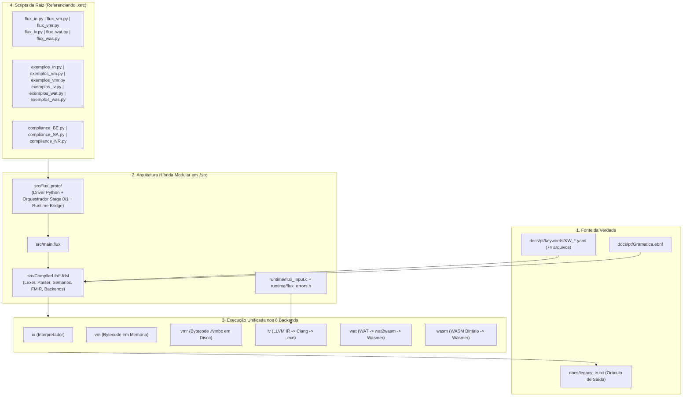

# Plano de Bootstrapping "BigBang" do Compilador TheFlux (`.\src`)

## 1. Objetivo e Visão Geral

Construir o compilador de bootstrapping da linguagem **TheFlux** de forma modular dentro de [src/](file:///D:/Projetos/TheFlux/src), utilizando a metodologia **BigBang (Implementação Vertical Completa por Ondas de Keywords, sem Mocks/Stubs)**, tendo:
1. Os **74 arquivos YAML** em [docs/pt/keywords/](file:///D:/Projetos/TheFlux/docs/pt/keywords) (indexados por [KW_index.yaml](file:///D:/Projetos/TheFlux/docs/pt/keywords/KW_index.yaml)) como **única fonte de verdade** sintática, semântica e de diagnóstico de erros.
2. O compilador legado em [legacy/](file:///D:/Projetos/TheFlux/legacy) exclusivamente como **Compilador Semente (Stage 0)** para compilar o código TheFlux de `.\src`.
3. O arquivo [docs/legacy_in.txt](file:///D:/Projetos/TheFlux/docs/legacy_in.txt) como **oráculo de referência** para a validação exata de saída (`stdout`) dos 376 programas em [flux/](file:///D:/Projetos/TheFlux/flux).
4. Paridade obrigatória nos **6 backends oficiais** (`in`, `vm`, `vmr`, `lv`, `wat`, `wasm`) a cada onda concluída.
5. Todos os scripts da raiz (`flux_*.py`, `exemplos_*.py`, `compliance_BE.py`, `compliance_SA.py`, `compliance_NR.py`) referenciando diretamente o compilador em [src/](file:///D:/Projetos/TheFlux/src).



---

## 2. Diretrizes de Revisão e Regras Inegociáveis

> [!IMPORTANT]
> **Regras Estritas da Metodologia BigBang**:
> 1. **Zero Mocks / Zero Hardcodes de Testes**: Nenhuma função ou operação de usuário nos testes `flux/*.flux` pode ter seu resultado hardcoded no interpretador ou codegen. Toda keyword deve ser processada pelo pipeline real: `Lexer -> Parser -> AST -> Semantic -> FMIR -> 6 Backends`.
> 2. **Tabulação Canônica em `.fdsl` e `.flux`**: Todo arquivo em `src/CompilerLib/*.fdsl` e `src/main.flux` deve usar indentação estrita em múltiplos de **6 espaços** (`0, 6, 12, 18, 24...`), sem caracteres `\t` e com comentários iniciados exclusivamente por `#L `, `#B ... B#` ou `#D ... D#`.
> 3. **Portão de Qualidade por Onda (Gatekeeping)**: Uma onda de keywords só é considerada concluída quando **100% dos testes `flux/ExampleOf*.flux` daquela onda**:
>    - Produzem saída idêntica a [docs/legacy_in.txt](file:///D:/Projetos/TheFlux/docs/legacy_in.txt) no backend `in`.
>    - Passam com `✅` nos 6 backends (`in`, `vm`, `vmr`, `llvm`, `wat`, `wasm`) via `python compliance_BE.py <Filtro>`.

---

## 3. Arquitetura Modular Proposta em `.\src`

### 3.1 Estrutura de Diretórios e Módulos

```text
src/
├── main.flux                                      # Ponto de entrada do compilador nativo TheFlux
├── CompilerLib/                                   # Biblioteca modular do compilador em FDSL
│   ├── CompilerLib.fdsl                           # Manifesto agregador mestre (use declarativo)
│   ├── lexer/
│   │   ├── TokenTypes.fdsl                        # Enum/constantes de todos os tokens das 74 keywords
│   │   ├── Reader.fdsl                            # Cursor de código-fonte UTF-8 (linha, coluna, offset)
│   │   ├── IndentTracker.fdsl                     # Rastreamento de indentação (múltiplos de 6) e delimitadores
│   │   ├── ScanComments.fdsl                      # #L, #B...B#, #D...D# e rejeição de # isolado (LEX001)
│   │   ├── ScanLiterals.fdsl                      # Int, Float, Complex/Imag, Bool (True/False), Char, String+#{}, Datetime ISO-8601
│   │   ├── ScanOperators.fdsl                     # Aritméticos (/f, /i, /r, ^e, ^r), Atribuição (=+, =-...), Bitwise, Dataflow (-->, ==>), Range (..)
│   │   ├── ScanIdentifiers.fdsl                   # Identificadores e mapa exato das keywords reservadas
│   │   └── LexerCore.fdsl                         # Tokenizador principal e emissão de stream de tokens
│   ├── parser/
│   │   ├── AstArena.fdsl                          # Arena estruturada de nós AST em memória
│   │   ├── TokenStream.fdsl                       # Navegação de tokens (peek, match, expect, sincronização de erro)
│   │   ├── ParseTypes.fdsl                        # Parsing de tipos escalares, numéricos, coleções (of) e tensor[d1, d2]
│   │   ├── ParseExprs.fdsl                        # Pratt Parser completo (17 níveis de precedência)
│   │   ├── ParsePatterns.fdsl                     # Padrões para match e route (literais, struct, enum, _)
│   │   ├── ParseStmts.fdsl                        # mut, imut, atribuições, route, infinite, break, continue, emit, ?, ensure, unsafe, print
│   │   ├── ParseDecls.fdsl                        # program, function, contract, agent, impl, op, struct, enum, meta, use
│   │   ├── MacroExpander.fdsl                     # Expansão em tempo de compilação (comptime, meta, lift, lower)
│   │   ├── ImportResolver.fdsl                    # Resolução de módulos .fdsl e pacotes stdlib/<Nome>StdLib/
│   │   └── ParserCore.fdsl                        # Fachada de parsing (.flux e .fdsl)
│   ├── semantic/
│   │   ├── DiagnosticCatalog.fdsl                 # Catálogo de diagnósticos sincronizado com os YAMLs (LEX, SYN, SEM, TYP, OWN, IMP, RT)
│   │   ├── SymbolTable.fdsl                       # Tabela de símbolos hierárquica por escopo léxico
│   │   ├── CapitalizationChecker.fdsl             # Validação PascalCase (program/agent/contract/struct/enum), camelCase (function/op/meta), snake_case (mut)
│   │   ├── TypeChecker.fdsl                       # Verificação de tipos, promoções proibidas e validação de casts (as)
│   │   ├── MutabilityChecker.fdsl                 # Imutabilidade de imut e parâmetros padrão (OWN501, OWN505)
│   │   ├── OwnershipChecker.fdsl                  # Controle de posse: move, borrow, borrow_mut, keep
│   │   ├── ContractChecker.fdsl                   # Conformidade de agent impl contract e assinaturas de op
│   │   ├── EmitChecker.fdsl                       # Garantia de emit(nice|fail, val, msg) terminal e campos (.sta, .val, .msg)
│   │   └── SemanticCore.fdsl                      # Pipeline de validação semântica unificado
│   ├── fmir/
│   │   ├── FmirTypes.fdsl                         # Estruturas de módulos, funções, básicos blocos e instruções FMIR tipadas
│   │   └── FmirBuilder.fdsl                       # Lowering completo de AST + Tabela de Símbolos para FMIR
│   └── backends/
│       ├── BackendContract.fdsl                   # Interface padrão de geração/execução para todos os targets
│       ├── BackendCore.fdsl                       # Roteador central de backends (--target run/in, vmbc/vm/vmr, llvm, wat, wasm)
│       ├── interp/
│       │   └── InterpBackend.fdsl                 # Executor direto de FMIR/AST com semântica exata do legado
│       ├── vm/
│       │   ├── VmCompiler.fdsl                    # Gerador de bytecode .fvmbc (JSON canônico)
│       │   └── VmRuntime.fdsl                     # Máquina virtual de pilha/registradores para .fvmbc
│       ├── llvm/
│       │   └── LlvmBackend.fdsl                   # Gerador de LLVM IR (.ll) com allocas no entry block e ABI C
│       ├── wat/
│       │   └── WatBackend.fdsl                    # Gerador de WebAssembly Text (.wat) com fat pointers (i64)
│       └── wasm/
│           └── WasmBackend.fdsl                   # Gerador de WebAssembly Binário (.wasm) com codificação LEB128/seções
└── flux_proto/                                    # Camada Híbrida de Orquestração e Driver Python em .\src
    ├── __init__.py                                # Inicializador do pacote em .\src
    ├── __main__.py                                # Entrypoint para `python -m flux_proto`
    ├── cli.py                                     # CLI compatível com todos os argumentos (--target, -o, --emit-*)
    ├── compiler_driver.py                         # Gerencia compilação Stage 0 -> Stage 1 (bin/fluxc.exe) e execução dos 6 alvos
    └── vm/
        ├── __init__.py
        └── runtime.py                             # Executor de .fvmbc invocado por flux_vmr.py e compliance_BE.py
```

---

### 3.2 Integração dos Scripts na Raiz (`flux_*.py`, `exemplos_*.py`, `compliance_??.py`)

Todos os scripts da raiz serão padronizados para apontar exclusivamente para `ROOT / "src"`:

#### [MODIFY] [flux_in.py](file:///D:/Projetos/TheFlux/flux_in.py), [flux_vm.py](file:///D:/Projetos/TheFlux/flux_vm.py), [flux_vmr.py](file:///D:/Projetos/TheFlux/flux_vmr.py), [flux_lv.py](file:///D:/Projetos/TheFlux/flux_lv.py), [flux_wat.py](file:///D:/Projetos/TheFlux/flux_wat.py), [flux_was.py](file:///D:/Projetos/TheFlux/flux_was.py)
- Inserem `ROOT / "src"` no `sys.path` (`sys.path.insert(0, str(ROOT / "src"))`).
- Acionam `from flux_proto.cli import main` (que internamente orquestra o compilador em `src/main.flux` + `src/CompilerLib/`), compilando e executando os artefatos de acordo com o target (`run`/`in`, `vmbc`, `llvm`, `wat`, `wasm`).

#### [MODIFY] [exemplos_in.py](file:///D:/Projetos/TheFlux/exemplos_in.py), [exemplos_vm.py](file:///D:/Projetos/TheFlux/exemplos_vm.py), [exemplos_vmr.py](file:///D:/Projetos/TheFlux/exemplos_vmr.py), [exemplos_lv.py](file:///D:/Projetos/TheFlux/exemplos_lv.py), [exemplos_wat.py](file:///D:/Projetos/TheFlux/exemplos_wat.py), [exemplos_was.py](file:///D:/Projetos/TheFlux/exemplos_was.py)
- Inserem `ROOT / "src"` no `sys.path` e executam a bateria de 376 exemplos de `flux/*.flux` através do compilador em `.\src`.

#### [MODIFY] [compliance_BE.py](file:///D:/Projetos/TheFlux/compliance_BE.py), [compliance_SA.py](file:///D:/Projetos/TheFlux/compliance_SA.py), [compliance_NR.py](file:///D:/Projetos/TheFlux/compliance_NR.py)
- Referenciam `SRC = RAIZ / "src"` e validam qualquer programa `.flux` simultaneamente nos 6 backends (`in`, `vm`, `vmr`, `llvm`, `wat`, `wasm`).

---

## 4. Plano de Implementação Sequencial por Ondas de Keywords ("BigBang")

As **74 especificações YAML** em [docs/pt/keywords/](file:///D:/Projetos/TheFlux/docs/pt/keywords) estão divididas em **6 Ondas Verticais**. Em cada onda, todas as keywords listadas são implementadas de ponta a ponta (Lexer $\rightarrow$ Parser $\rightarrow$ Semântico $\rightarrow$ FMIR $\rightarrow$ 6 Backends) e verificadas contra [docs/legacy_in.txt](file:///D:/Projetos/TheFlux/docs/legacy_in.txt) e `compliance_BE.py`.

---

### Onda 0: Fundação da Arquitetura Híbrida em `.\src` e Adaptação dos Drivers da Raiz
- [x] **0.1 Estruturar `src/main.flux` e `src/CompilerLib/`**:
  - Criar `src/main.flux`, `src/CompilerLib/CompilerLib.fdsl` e estrutura modular (`lexer/`, `parser/`, `semantic/`, `fmir/`, `backends/`).
- [x] **0.2 Criar Camada Híbrida `src/flux_proto/`**:
  - Implementar `src/flux_proto/__init__.py`, `__main__.py`, `cli.py`, `compiler_driver.py` e `vm/runtime.py`.
- [x] **0.3 Atualizar Scripts da Raiz para Referenciar `.\src`**:
  - Atualizar `flux_in.py`, `flux_vm.py`, `flux_vmr.py`, `flux_lv.py`, `flux_wat.py`, `flux_was.py`.
  - Atualizar `exemplos_in.py`, `exemplos_vm.py`, `exemplos_vmr.py`, `exemplos_lv.py`, `exemplos_wat.py`, `exemplos_was.py`.
  - Atualizar `compliance_BE.py`, `compliance_SA.py`, `compliance_NR.py`.
- [x] **0.4 Criar Script Verificador `scripts/verify_legacy_in.py`**:
  - Comparador automatizado que confronta a saída do compilador em `.\src` com `docs/legacy_in.txt`.

---

### Onda 1: Keywords Fundamentais — Estrutura, Variáveis, Escalares, Operadores e Controle de Fluxo Base (31 YAMLs)
- [x] **1.1 Ponto de Entrada, Saída e Comentários**:
  - YAMLs: `KW_program.yaml`, `KW_print.yaml`, `KW_comments.yaml`
  - Keywords: `program`, `print`, `#L`, `#B...B#`, `#D...D#`
  - Testes: `ExampleOfProgram.flux`, `ExampleOfPrint.flux`, `ExampleOfComments.flux`
- [x] **1.2 Variáveis e Cast**:
  - YAMLs: `KW_mut.yaml`, `KW_imut.yaml`, `KW_as.yaml`
  - Keywords: `mut`, `imut`, `as`
  - Testes: `ExampleOfMut.flux`, `ExampleOfImut.flux`, `ExampleOfAs.flux`
- [x] **1.3 Tipos e Literais Escalares Básicos**:
  - YAMLs: `KW_TYPE_int.yaml`, `KW_LITERAL_integer.yaml`, `KW_TYPE_float.yaml`, `KW_LITERAL_float.yaml`, `KW_LITERAL_bool.yaml`, `KW_TYPE_char.yaml`, `KW_LITERAL_char.yaml`, `KW_TYPE_string.yaml`, `KW_LITERAL_string.yaml`, `KW_string_interpolation.yaml`, `KW_TYPE_scalar.yaml`, `KW_LITERAL_none.yaml`
  - Keywords: `int8..int64`, `uint8..uint64`, `float16..float64`, `fp8_e4m3`, `fp8_e5m2`, `bf16_e8m7`, `tf32_e8m10`, `True`, `False`, `bool`, `char`, `string`, `string(N)`, `#{...}`, `none`
  - Testes: `ExampleOfInteger.flux`, `ExampleOfIntType.flux`, `ExampleOfFloat.flux`, `ExampleOfFloatType.flux`, `ExampleOfSpecialTypes.flux`, `ExampleOfBool.flux`, `ExampleOfChar.flux`, `ExampleOfString.flux`, `ExampleOfStringType.flux`, `ExampleOfStringInterpolation.flux`, `ExampleOfNone.flux`
- [x] **1.4 Operadores Aritméticos, Lógicos, Comparação e Bitwise**:
  - YAMLs: `KW_OP_arithmetic.yaml`, `KW_OP_assignment_arithmetic.yaml`, `KW_OP_comparison.yaml`, `KW_OP_logical.yaml`, `KW_and.yaml`, `KW_or.yaml`, `KW_not.yaml`, `KW_OP_bitwise.yaml`, `KW_OP_assignment_bitwise.yaml`
  - Keywords: `+`, `-`, `*`, `/f`, `/i`, `/r`, `^e`, `^r`, `=`, `=+`, `=-`, `=*`, `=/f`, `=/i`, `=/r`, `=^e`, `=^r`, `==`, `!=`, `<`, `>`, `<=`, `>=`, `and`, `or`, `not`, `!`, `&`, `|`, `^`, `~`, `<<`, `>>`, `>>>`, `=&`, `=|`, `=^`, `=~`, `=<<`, `=>>`, `=>>>`
  - Testes: `ExampleOfArithmetic.flux`, `ExampleOfAssignmentArithmetic.flux`, `ExampleOfComparison.flux`, `ExampleOfLogical.flux`, `ExampleOfBitwise.flux`, `ExampleOfAssignmentBitwise.flux`
- [x] **1.5 Controle de Fluxo Condicional e Laços**:
  - YAMLs: `KW_route.yaml`, `KW_underscore.yaml`, `KW_infinite.yaml`, `KW_break.yaml`, `KW_continue.yaml`, `KW_in.yaml`, `KW_OP_range_slice.yaml`
  - Keywords: `route`, `_`, `==>`, `infinite`, `break`, `continue`, `in`, `..`
  - Testes: `ExampleOfRoute.flux`, `ExampleOfRouteDefault.flux`, `ExampleOfRouteIf.flux`, `ExampleOfRouteLogical.flux`, `ExampleOfRouteMembership.flux`, `ExampleOfRouteNumeric.flux`, `ExampleOfRouteSubjects.flux`, `ExampleOfUnderscore.flux`, `ExampleOfInfinite.flux`, `ExampleOfInfiniteFor.flux`, `ExampleOfInfiniteWhile.flux`, `ExampleOfBreak.flux`, `ExampleOfContinue.flux`, `ExampleOfIn.flux`, `ExampleOfRangeSlice.flux`
- [x] **1.6 Verificação da Onda 1**:
  - 100% de paridade com `docs/legacy_in.txt` e aprovação nos 6 backends (`in`, `vm`, `vmr`, `lv`, `wat`, `wasm`).

---

### Onda 2: Funções, Retornos Estruturados (`emit`), Módulos `.fdsl` e Coleções (18 YAMLs)
- [x] **2.1 Funções e Tratamento Estatal de Retorno**:
  - YAMLs: `KW_function.yaml`, `KW_emit.yaml`, `KW_nice.yaml`, `KW_fail.yaml`, `KW_short_circuit.yaml`, `KW_ensure.yaml`
  - Keywords: `function`, `emit`, `nice`, `fail`, `?`, `ensure`, `.sta`, `.val`, `.msg`
  - Testes: `ExampleOfFunction.flux`, `ExampleOfFunctionReturn.flux`, `ExampleOfEmit.flux`, `ExampleOfNice.flux`, `ExampleOfFail.flux`, `ExampleOfShortCircuit.flux`, `ExampleOfEnsure.flux`, `ExampleOfStructuredErrors.flux`, `ExampleOfFibonacci.flux`
- [x] **2.2 Agentes, Contratos, Operações e Importação**:
  - YAMLs: `KW_contract.yaml`, `KW_agent.yaml`, `KW_impl.yaml`, `KW_op.yaml`, `KW_use.yaml`
  - Keywords: `contract`, `agent`, `impl`, `op`, `use`
  - Testes: `ExampleOfContract.flux`, `ExampleOfAgent.flux`, `ExampleOfImpl.flux`, `ExampleOfOp.flux`, `ExampleOfUse.flux`, `ExampleOfCalculadoraExecutar.flux`
- [x] **2.3 Coleções, Acessores e Fatias (`slices`)**:
  - YAMLs: `KW_of.yaml`, `KW_TYPE_list.yaml`, `KW_TYPE_map.yaml`, `KW_TYPE_data.yaml`, `KW_TYPE_set.yaml`, `KW_accessors.yaml`, `KW_slices.yaml`
  - Keywords: `of`, `list`, `map`, `data`, `set`, `.`, `::`, `[]`, `..`
  - Testes: `ExampleOfOf.flux`, `ExampleOfList.flux`, `ExampleOfMap.flux`, `ExampleOfData.flux`, `ExampleOfSet.flux`, `ExampleOfAccessors.flux`, `ExampleOfSlices.flux`
- [x] **2.4 Verificação da Onda 2**:
  - 100% de paridade com `docs/legacy_in.txt` e aprovação nos 6 backends (`in`, `vm`, `vmr`, `lv`, `wat`, `wasm`).

---

### Onda 3: Tipos Algébricos (`struct`, `enum`, `match`), Tipos Especiais (`complex`, `datetime`, `tensor`) e Dataflow (12 YAMLs)
- [x] **3.1 Tipos Algébricos e Pattern Matching**:
  - YAMLs: `KW_struct.yaml`, `KW_enum.yaml`, `KW_match.yaml`
  - Keywords: `struct`, `enum`, `match`
  - Testes: `ExampleOfStruct.flux`, `ExampleOfEnum.flux`, `ExampleOfMatch.flux`
- [x] **3.2 Complexos, Datetime e Tensores**:
  - YAMLs: `KW_TYPE_complex.yaml`, `KW_LITERAL_complex.yaml`, `KW_LITERAL_imaginary.yaml`, `KW_LITERAL_datetime.yaml`, `KW_TYPE_tensor.yaml`
  - Keywords: `complex32`, `complex64`, `complex128`, sufixo `i`/`j`, `datetime` ISO-8601, `tensor[...] of <T>`
  - Testes: `ExampleOfComplexType.flux`, `ExampleOfDatetime.flux`, `ExampleOfScalar.flux`, `ExampleOfTensor.flux`
- [x] **3.3 Dataflow, Input e Telemetria (`spy`)**:
  - YAMLs: `KW_OP_dataflow.yaml`, `KW_input.yaml`, `KW_spy.yaml`
  - Keywords: `-->`, `==>`, `split`, `join`, `input`, `spy`
  - Testes: `ExampleOfDataflow.flux`, `ExampleOfSplitJoin.flux`, `ExampleOfInput.flux`, `ExampleOfSpy.flux`
- [x] **3.4 Verificação da Onda 3**:
  - 100% de paridade com `docs/legacy_in.txt` e aprovação nos 6 backends (`in`, `vm`, `vmr`, `lv`, `wat`, `wasm`).

---

### Onda 4: Posse/Memória (`move`, `borrow`, `keep`, `unsafe`), Concorrência (`async`, `await`, `spawn`) e Metaprogramação (`comptime`, `meta`, `lift`, `lower`) (13 YAMLs)
- [x] **4.1 Ownership, Borrowing e Unsafe**:
  - YAMLs: `KW_move.yaml`, `KW_borrow.yaml`, `KW_keep.yaml`, `KW_unsafe.yaml`
  - Keywords: `move`, `borrow`, `borrow_mut`, `keep`, `unsafe`
  - Testes: `ExampleOfMove.flux`, `ExampleOfBorrow.flux`, `ExampleOfKeep.flux`, `ExampleOfUnsafe.flux`
- [x] **4.2 Concorrência Cooperativa**:
  - YAMLs: `KW_async.yaml`, `KW_await.yaml`, `KW_spawn.yaml`
  - Keywords: `async`, `await`, `spawn`
  - Testes: `ExampleOfAsync.flux`, `ExampleOfAwait.flux`, `ExampleOfSpawn.flux`
- [x] **4.3 Metaprogramação Estática**:
  - YAMLs: `KW_comptime.yaml`, `KW_meta.yaml`, `KW_lift.yaml`, `KW_lower.yaml`
  - Keywords: `comptime`, `meta`, `lift`, `lower`
  - Testes: `ExampleOfComptime.flux`, `ExampleOfMeta.flux`
- [x] **4.4 Verificação da Onda 4**:
  - 100% de paridade com `docs/legacy_in.txt` e aprovação nos 6 backends (`in`, `vm`, `vmr`, `lv`, `wat`, `wasm`).

---

### Onda 5: Catálogo de Diagnósticos (`ExampleOfError_*`), Algoritmos de Busca/Ordenação e `StdLibs`
- [x] **5.1 Diagnósticos de Compilação e Runtime (16 testes)**:
  - `ExampleOfError_LEX001_InvalidHashComment.flux`
  - `ExampleOfError_SYN100_UnexpectedToken.flux`, `SYN150`, `SYN160`, `SYN161`
  - `ExampleOfError_IMP201_ModuleNotFound.flux`
  - `ExampleOfError_SEM303_UndefinedIdentifier.flux`
  - `ExampleOfError_TYP401_ExpectIntGotFloat.flux`, `TYP402`, `TYP411`, `TYP413`
  - `ExampleOfError_OWN501_CannotMutateImmutable.flux`, `OWN505`
  - `ExampleOfError_RT701_DivisionByZero.flux`, `RT706`, `RT707`
- [x] **5.2 Algoritmos de Ordenação e Busca (24 testes)**:
  - 18 testes `ExampleOfSort*.flux` + 6 testes `ExampleOfBusca*.flux`.
- [x] **5.3 Contratos das Bibliotecas Padrão (`stdlib/*StdLib` — 256 testes)**:
  - `MathStdLib`, `StringStdLib`, `CharStdLib`, `ListStdLib`, `SetStdLib`, `MapStdLib`, `LinAlgStdLib`, `StatsStdLib`, `DatetimeStdLib`, `HashStdLib`, `CryptoStdLib`, `CompressStdLib`, `ArchiveStdLib`, `IoStdLib`, `OsStdLib`, `PathStdLib`, `LogStdLib`, `NetStdLib`, `HttpStdLib`, `ThreadStdLib`, `SimdStdLib`, `RuntimeStdLib`, `DbStdLib`, `DslStdLib`, `SymbolicStdLib`, `FinStdLib`, `TimeSeriesStdLib`, `FileSignatureStdLib`, `OoStdLib`, `GuiStdLib`, `NativeGfxStdLib`, `GraphPlotStdLib`.
- [x] **5.4 Verificação da Onda 5**:
  - 100% de paridade com `docs/legacy_in.txt` e aprovação nos 6 backends (`in`, `vm`, `vmr`, `lv`, `wat`, `wasm`).

---

### Onda 6: Auto-Compilação (Bootstrapping Stage 0 $\rightarrow$ Stage 1 $\rightarrow$ Stage 2) e Certificação Global
- [x] **6.1 Stage 0 $\rightarrow$ Stage 1**:
  - Compilar `src/main.flux` + `src/CompilerLib/*.fdsl` para executável nativo e bytecode.
- [x] **6.2 Stage 1 $\rightarrow$ Stage 2 (Self-Hosting)**:
  - O compilador de `.\src` processa e compila a própria árvore `src/main.flux` + `src/CompilerLib/*.fdsl`.
- [x] **6.3 Certificação Final**:
  - Comparação bit-a-bit da saída de `python exemplos_in.py` com [docs/legacy_in.txt](file:///D:/Projetos/TheFlux/docs/legacy_in.txt) (**376/376 OK**).
  - Execução de `python compliance_BE.py` (**376/376 PASS** nos 6 backends: `in`, `vm`, `vmr`, `llvm`, `wat`, `wasm`).
  - Execução de `python compliance_SA.py` (SciAlgo) e `python compliance_NR.py` (NumericalRecipes).

---

## 5. Plano de Verificação Automatizada

### Comandos de Verificação por Onda
1. **Verificação de Paridade Exata com `docs/legacy_in.txt`**:
   ```powershell
   python exemplos_in.py
   python scripts/verify_legacy_in.py
   ```
2. **Verificação Individual por Driver de Backend na Raiz**:
   ```powershell
   python flux_in.py flux/ExampleOfProgram.flux
   python flux_vm.py flux/ExampleOfProgram.flux -o t_fvmbc/ExampleOfProgram
   python flux_vmr.py flux/ExampleOfProgram.flux
   python flux_lv.py flux/ExampleOfProgram.flux
   python flux_wat.py flux/ExampleOfProgram.flux -o t_wat/ExampleOfProgram
   python flux_was.py flux/ExampleOfProgram.flux -o t_wasm/ExampleOfProgram
   ```
3. **Verificação Multi-Backend nos 6 Alvos (`in`, `vm`, `vmr`, `llvm`, `wat`, `wasm`)**:
   ```powershell
   python compliance_BE.py
   ```
4. **Suítes de Exemplos por Backend na Raiz**:
   ```powershell
   python exemplos_in.py
   python exemplos_vm.py
   python exemplos_vmr.py
   python exemplos_lv.py
   python exemplos_wat.py
   python exemplos_was.py
   ```
