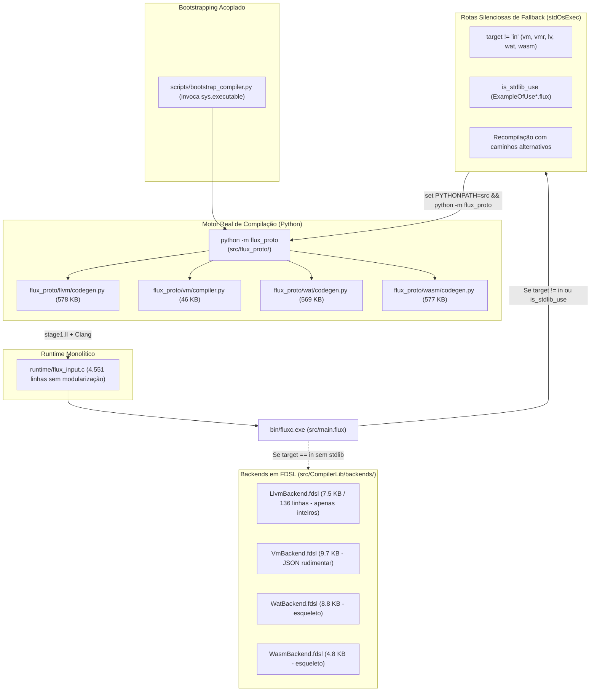
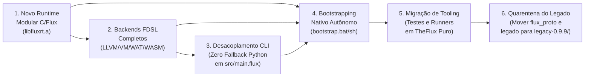
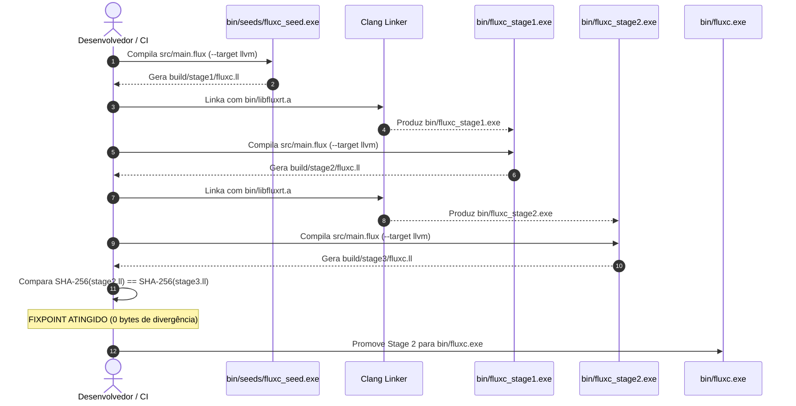
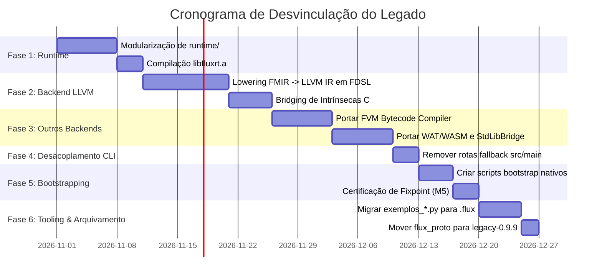

# Plano Diretor de Desvinculação Completa do Self-Hosted (TheFlux v1.0.0 Puro)

> **Documento Oficial de Engenharia e Arquitetura**  
> **Status**: Proposta Aprovada para Implementação  
> **Objetivo**: Erradicar 100% das dependências do ecossistema legado (`legacy/` e `src/flux_proto/` em Python), atingindo total autonomia compilador-linguagem-runtime.

---

## 1. Sumário Executivo e Diagnóstico de Acoplamento

Atualmente, o projeto apresenta uma camada aparente de auto-hospedagem (*self-hosting*) centrada no binário [`bin/fluxc.exe`](file:///D:/Projetos/TheFlux/bin/fluxc.exe). No entanto, uma auditoria profunda do código-fonte revela que o compilador nativo opera de forma **híbrida e dependente do Python** através de atalhos e rotas de escape silenciosas.

### 1.1 A Anatomia do Acoplamento Atual



### 1.2 Evidências Técnicas Concretas de Acoplamento

1. **Desvio de Execução em [`src/main.flux`](file:///D:/Projetos/TheFlux/src/main.flux#L196-L368)**:
   - Se `target != "in"` e `target != "run"` e `input_file != "src/main.flux"`, o compilador monta um comando shell:
     `set PYTHONPATH=src && python -m flux_proto <input> --target <target>`
     e delega a execução via `stdOsExec(cmd)`.
   - Se o arquivo contiver chamadas a bibliotecas padrão (`ExampleOfUse*`), ele também é desviado para o Python através da flag `is_stdlib_use`.
2. **Backends FDSL Incompletos em [`src/CompilerLib/backends/`](file:///D:/Projetos/TheFlux/src/CompilerLib/backends)**:
   - [`LlvmBackend.fdsl`](file:///D:/Projetos/TheFlux/src/CompilerLib/backends/llvm/LlvmBackend.fdsl) possui apenas 136 linhas e só gera LLVM IR para somas de inteiros (`add i64`) e `printf("%ld\n")`. Não implementa funções, strings dinâmicas, structs, enums, chamadas à runtime ou dicionários/listas.
   - Todo o gerador LLVM de produção está em [`src/flux_proto/llvm/codegen.py`](file:///D:/Projetos/TheFlux/src/flux_proto/llvm/codegen.py) (578 KB, mais de 12.000 linhas de Python).
   - O mesmo ocorre com [`wat`](file:///D:/Projetos/TheFlux/src/flux_proto/wat/codegen.py) (569 KB) e [`wasm`](file:///D:/Projetos/TheFlux/src/flux_proto/wasm/codegen.py) (577 KB).
3. **Ponte de Intrínsecas Estreita em [`StdLibBridge.fdsl`](file:///D:/Projetos/TheFlux/src/CompilerLib/backends/interp/StdLibBridge.fdsl)**:
   - O interpretador em FDSL [`InterpBackend.fdsl`](file:///D:/Projetos/TheFlux/src/CompilerLib/backends/interp/InterpBackend.fdsl) apenas conecta 9 funções de sistema (`stdIoFileExists`, `stdIoReadFile`, `stdIoWriteFile`, `stdIoListDir`, `stdIoReadLines`, `stdCollectionLength`, `stdRuntimeGetArgs`, `stdOsExec`, `stdOsExit`). As centenas de outras funções da StdLib retornam `res["handled"] = false`.
4. **Bootstrapping Dependente de Python em [`scripts/bootstrap_compiler.py`](file:///D:/Projetos/TheFlux/scripts/bootstrap_compiler.py#L57)**:
   - O estágio `run_boot_0()` invoca obrigatoriamente:
     `sys.executable -m flux_proto --target llvm -o build/intermediates/stage1.ll src/main.flux`
   - O repositório não compila do zero sem uma instalação externa de Python 3.10+.
5. **Runtime Monolítico em [`runtime/flux_input.c`](file:///D:/Projetos/TheFlux/runtime/flux_input.c)**:
   - 4.551 linhas em um único arquivo C contendo primitivas de GC, hashing, manipulação de strings, coleções, OS, arquivos, zlib e libarchive, sem modularização em pastas, sem cabeçalhos públicos organizados e sem compilação prévia para biblioteca estática (`libfluxrt.a`).

---

## 2. Inventário Exaustivo dos Itens a Superar

Para atingir a desvinculação completa e genuína, os seguintes **6 itens estruturais** devem ser superados:



---

### Item 1: Novo Runtime Nativo Modular (`runtime/` $\rightarrow$ `bin/libfluxrt.a`)

O runtime C atual (`runtime/flux_input.c`) precisa ser decomposto, modernizado e transformado em uma biblioteca estática padronizada com ABI estável.

#### 1.1 Decomposição Arquitetural de `runtime/`
A nova estrutura eliminará o arquivo monólito de 4.551 linhas em favor de módulos especializados:

```text
runtime/
├── include/
│   └── flux/
│       ├── flux.h              # Cabeçalho agregado mestre
│       ├── types.h             # Definição de FluxValue, tags de tipo e representação NaN-boxing/Tagged-pointer
│       ├── memory.h            # Interface do alocador (Arena para compilador, ARC para runtime geral)
│       ├── string.h            # Fat-pointer string UTF-8 (tamanho, hash pré-calculado, buffer)
│       ├── collections.h       # FluxList, FluxMap (Robin Hood hashing), FluxSet, FluxData
│       ├── tensor.h            # FluxTensor (estratos multidimensionais, strides e views)
│       ├── io.h                # Leitura/escrita síncrona/assíncrona, paths UTF-8 universais
│       ├── sys.h               # Processos, argumentos CLI, relógio monotônico e datetime
│       ├── intrinsics.h        # Declarações C exportadas de todas as funções std*
│       └── errors.h            # Tratamento unificado de erros, stacktrace e panic handler
├── src/
│   ├── core/
│   │   ├── init.c              # Inicialização do runtime e argumentos globais
│   │   ├── value.c             # Operações de boxing, unboxing e coerção de tipo
│   │   └── panic.c             # Formatação de erros não capturados e encerramento limpo
│   ├── memory/
│   │   ├── arena.c             # Alocador linear de alta performance para o pipeline do compilador
│   │   └── arc.c               # Gerenciamento de ciclo de vida de estruturas dinâmicas
│   ├── strings/
│   │   ├── string.c            # Concatenação, fatiamento s[a..b], busca, formatação e interpolação
│   │   └── utf8.c              # Validação UTF-8, conversões de code points e contagem de caracteres
│   ├── collections/
│   │   ├── list.c              # Vetor dinâmico com crescimento amortizado O(1)
│   │   ├── map.c               # Tabela hash veloz de alta localidade de cache
│   │   ├── set.c               # Conjuntos baseados em hash
│   │   └── tensor.c            # Aritmética e fatiamento multidimensional de tensores
│   ├── io/
│   │   ├── file.c              # stdIoReadFile, stdIoWriteFile, stdIoAppendFile
│   │   ├── dir.c               # stdIoListDir, stdIoCreateDir, stdIoFileExists
│   │   └── console.c           # Suporte garantido a I/O UTF-8 e leitura interativa via stdin
│   ├── sys/
│   │   ├── process.c           # stdOsExec nativo (CreateProcess no Windows, fork/exec no Linux)
│   │   ├── env.c               # Argumentos de CLI (stdRuntimeGetArgs) e variáveis de ambiente
│   │   └── time.c              # Parser e formatador ISO-8601 de datetime
│   └── intrinsics/
│       ├── std_math.c          # Implementação de todas as funções matemáticas
│       ├── std_string.c        # Intrínsecas da StringStdLib
│       ├── std_char.c          # Intrínsecas de classificação e transformação de caracteres
│       └── std_crypto_hash.c   # Hashes SHA-256, MD5 e primitivas criptográficas
└── build_runtime.bat / .sh     # Script nativo de compilação da biblioteca estática
```

#### 1.2 Compilação para Biblioteca Estática Independente
O runtime não será mais recompilado a cada chamada do compilador. Ele será pré-compilado para:
- Windows: `bin/libfluxrt.a` (ou `bin/fluxrt.lib`)
- Linux/macOS: `bin/libfluxrt.a`
Qualquer compilação para executável nativo passará a usar:
```powershell
clang -O2 output.ll -Lbin -lfluxrt -o output.exe
```

---

### Item 2: Backends Nativos Completos em FDSL (`src/CompilerLib/backends/`)

Os geradores de código em FDSL dentro de [`src/CompilerLib/backends/`](file:///D:/Projetos/TheFlux/src/CompilerLib/backends) devem ser expandidos para atingir **100% de paridade funcional com os geradores em Python**.

#### 2.1 Backend LLVM Completo ([`LlvmBackend.fdsl`](file:///D:/Projetos/TheFlux/src/CompilerLib/backends/llvm/LlvmBackend.fdsl))
- **Lowering de Estruturas de Dados**:
  - Emissão de definições de tipos compostos LLVM (`%struct.FluxValue = type { i32, [8 x i8] }`).
  - Geração de tabelas de constantes e literais de string na seção de dados globais (`@.str.N = private unnamed_addr constant [...]`).
- **Funções e Procedimentos**:
  - Geração de declarações de funções com tipagem estrita de parâmetros e retornos.
  - Implementação da semântica de retornos estruturados `emit(nice|fail, val, msg)`.
- **Controle de Fluxo e Expressões**:
  - Emissão de controle condicional para `route`, `match` (inclusive pattern matching em enums e structs), `infinite`, `break`, `continue` e operador de curto-circuito `?`.
- **Bridging com a Runtime**:
  - Emissão de chamadas para as funções C de `libfluxrt.a` (`@flux_list_push`, `@flux_map_get`, `@flux_str_concat`, `@flux_tensor_alloc`, etc.).

#### 2.2 Backend Bytecode Compiler ([`VmCompiler.fdsl`](file:///D:/Projetos/TheFlux/src/CompilerLib/backends/vm/VmCompiler.fdsl) & [`VmBackend.fdsl`](file:///D:/Projetos/TheFlux/src/CompilerLib/backends/vm/VmBackend.fdsl))
- Portar todo o conjunto de mais de 80 opcodes de [`src/flux_proto/vm/compiler.py`](file:///D:/Projetos/TheFlux/src/flux_proto/vm/compiler.py) para FDSL.
- Emissão de arquivos binários canônicos `.fvmbc` contendo:
  - Cabeçalho de integridade (Magic number, versão, flags).
  - Tabela de constantes (números, strings, identificadores).
  - Tabela de símbolos de funções e contratos.
  - Stream de instruções compactadas.
  - Source map para diagnóstico de runtime.

#### 2.3 Máquina Virtual FVM Autônoma ([`runtime/fvm/`](file:///D:/Projetos/TheFlux/runtime/fvm/) e [`VmRuntime.fdsl`](file:///D:/Projetos/TheFlux/src/CompilerLib/backends/vm/VmRuntime.fdsl))
- Finalizar a máquina virtual em C em `runtime/fvm/`, gerando o binário nativo autônomo [`bin/fluxvm.exe`](file:///D:/Projetos/TheFlux/bin/fluxvm.exe).
- Eliminar qualquer necessidade de invocar Python para executar bytecode `.fvmbc`.

#### 2.4 Backends WebAssembly ([`WatBackend.fdsl`](file:///D:/Projetos/TheFlux/src/CompilerLib/backends/wat/WatBackend.fdsl) e [`WasmBackend.fdsl`](file:///D:/Projetos/TheFlux/src/CompilerLib/backends/wasm/WasmBackend.fdsl))
- Portar o gerador de WAT e o codificador binário WASM (emissão de seções, vetores LEB128 e tabela de importações de runtime) de `src/flux_proto/wat/` e `src/flux_proto/wasm/` para FDSL.

#### 2.5 Ponte Nativa Total no Interpretador ([`StdLibBridge.fdsl`](file:///D:/Projetos/TheFlux/src/CompilerLib/backends/interp/StdLibBridge.fdsl))
- Expandir a tabela de despacho de `StdLibBridge.fdsl` de 9 funções para **todas as 37 StdLibs**, direcionando as chamadas diretamente para o runtime C ou resolvendo-as nativamente em FDSL, permitindo que qualquer `ExampleOfUse*.flux` execute no interpretador nativo sem fallback.

---

### Item 3: Eliminação Completa da Rota de Fallback em `src/main.flux`

#### 3.1 Remoção Cirúrgica do Despacho Externo
Remover integralmente as linhas 195 a 370 de [`src/main.flux`](file:///D:/Projetos/TheFlux/src/main.flux). O compilador passará a ter um pipeline unificado e puramente nativo:

```flux
#L Pipeline Unico e Exclusivo de Compilacao
mut as map: parse_res = CompilerLib::parseFile(input_file)
route {
      not parse_res["success"] ==> {
            print("Parse Error: " + parse_res["error"])
            stdOsExit(1)
      }
      _ ==> {
            mut as map: arena = parse_res["arena"]
            mut as int64: root_id = parse_res["root_id"]
            
            mut as map: sem_report = CompilerLib::semanticAnalyze(arena, root_id)
            route {
                  not sem_report["success"] ==> {
                        CompilerLib::reportErrors(sem_report["errors"])
                        stdOsExit(1)
                  }
                  _ ==> {
                        mut as map: fmir_mod = CompilerLib::fmirBuildFromAst(arena, root_id)
                        mut as map: options = map{}
                        options["output"] = output_path
                        
                        mut as map: comp_res = CompilerLib::backendCompile(fmir_mod, target, options)
                        route {
                              not comp_res["success"] ==> {
                                    print("Compilation Error on target: " + target)
                                    stdOsExit(1)
                              }
                              _ ==> {}
                        }
                  }
            }
      }
}
```

#### 3.2 Execução de Linkagem e Ferramentas Auxiliares
Quando o alvo for executável nativo (`llvm`), `CompilerLib` gera o arquivo `.ll` e aciona o Clang diretamente via `stdOsExec("clang -O2 output.ll -Lbin -lfluxrt -o output.exe")`. Zero instâncias de Python serão chamadas.

---

### Item 4: Novos Scripts e Pipeline de Bootstrapping 100% Nativos

O processo de compilação do compilador TheFlux a partir do zero deve se tornar totalmente independente de Python.

#### 4.1 Estratégia do Compilador Semente (Seed Strategy)
Adotar o padrão da indústria (utilizado por Rust, Go, Zig e FreePascal):
- Manter uma semente validada em [`bin/seeds/fluxc_seed.exe`](file:///D:/Projetos/TheFlux/bin/seeds) (binário de Stage 0 pré-compilado e assinado) ou, alternativamente, o LLVM IR gerado do compilador (`build/bootstrap/stage0.ll`).
- Esse artefato semente permite compilar `src/main.flux` em qualquer máquina limpa que disponha apenas de Clang.

#### 4.2 Novos Scripts de Bootstrapping
Substituir [`scripts/bootstrap_compiler.py`](file:///D:/Projetos/TheFlux/scripts/bootstrap_compiler.py) por:
- [`scripts/bootstrap.bat`](file:///D:/Projetos/TheFlux/scripts/bootstrap.bat) (Windows)
- [`scripts/bootstrap.sh`](file:///D:/Projetos/TheFlux/scripts/bootstrap.sh) (Linux / macOS)
- [`src/tools/bootstrap.flux`](file:///D:/Projetos/TheFlux/src/tools/bootstrap.flux) (Orquestrador em TheFlux compilável para `bin/bootstrap.exe`)

#### 4.3 O Protocolo de Fixpoint Determinístico (Estágios 1, 2 e 3)



---

### Item 5: Migração e Aposentadoria do Tooling e Suítes em Python

Todos os utilitários de linha de comando, testes e suítes de conformidade devem ser programas TheFlux nativos:

1. **Runners de Conformidade (Concluído)**:
   - [`compliance_BE.flux`](file:///D:/Projetos/TheFlux/compliance_BE.flux) $\rightarrow$ [`bin/compliance_BE.exe`](file:///D:/Projetos/TheFlux/bin/compliance_BE.exe)
   - [`compliance_IN.flux`](file:///D:/Projetos/TheFlux/compliance_IN.flux) $\rightarrow$ [`bin/compliance_IN.exe`](file:///D:/Projetos/TheFlux/bin/compliance_IN.exe)
   - [`compliance_NR.flux`](file:///D:/Projetos/TheFlux/compliance_NR.flux) $\rightarrow$ [`bin/compliance_NR.exe`](file:///D:/Projetos/TheFlux/bin/compliance_NR.exe)
   - [`compliance_SA.flux`](file:///D:/Projetos/TheFlux/compliance_SA.flux) $\rightarrow$ [`bin/compliance_SA.exe`](file:///D:/Projetos/TheFlux/bin/compliance_SA.exe)
2. **Runners de Exemplos por Backend (A Migrar)**:
   - `exemplos_in.py` $\rightarrow$ `exemplos_in.flux` (`bin/exemplos_in.exe`)
   - `exemplos_vm.py` $\rightarrow$ `exemplos_vm.flux` (`bin/exemplos_vm.exe`)
   - `exemplos_vmr.py` $\rightarrow$ `exemplos_vmr.flux` (`bin/exemplos_vmr.exe`)
   - `exemplos_lv.py` $\rightarrow$ `exemplos_lv.flux` (`bin/exemplos_lv.exe`)
   - `exemplos_wat.py` $\rightarrow$ `exemplos_wat.flux` (`bin/exemplos_wat.exe`)
   - `exemplos_was.py` $\rightarrow$ `exemplos_was.flux` (`bin/exemplos_was.exe`)
3. **Atalhos da Raiz**:
   - Eliminar os scripts Python na raiz (`flux_in.py`, `flux_vm.py`, etc.). As chamadas serão feitas diretamente via `bin/fluxc.exe --target <target> <arquivo>`.
4. **Verificadores de Paridade**:
   - Migrar `scripts/verify_legacy_in.py`, `test_tri_engine_parity.py` e `test_control_flow_parity.py` para executáveis TheFlux nativos.

---

### Item 6: Quarentena, Desativação e Isolamento em `legacy-0.9.9/`

Uma vez que o novo runtime e os backends FDSL estejam validados pelo Fixpoint:

1. **Desacoplamento no Repositório**:
   - Mover [`src/flux_proto/`](file:///D:/Projetos/TheFlux/legacy-0.9.9/src/flux_proto) para fora de `src/`, alocando em [`legacy-0.9.9/src/flux_proto/`](file:///D:/Projetos/TheFlux/legacy-0.9.9/src/flux_proto).
   - O diretório [`src/`](file:///D:/Projetos/TheFlux/src) contém exclusivamente código TheFlux/FDSL (`main.flux`, `CompilerLib/`, `Fvm/`).
2. **Isolamento de `legacy-0.9.9/`**:
   - Renomear [`legacy/`](file:///D:/Projetos/TheFlux/legacy-0.9.9) para [`legacy-0.9.9/`](file:///D:/Projetos/TheFlux/legacy-0.9.9), concentrando o protótipo Python, scripts legados de migração e intermediários da versão 0.9.9.
3. **Verificação de Pureza**:
   - Garantir que [`src/`](file:///D:/Projetos/TheFlux/src) e [`scripts/`](file:///D:/Projetos/TheFlux/scripts) contenham zero dependências de `flux_proto`.

---

## 3. Cronograma de Implementação por Fases (Roadmap)



### Detalhamento dos Marcos (Milestones)

| Marco | Descrição | Critério de Aceite | Status |
| :--- | :--- | :--- | :---: |
| **M1: Runtime Modular** | Decomposição de `runtime/flux_input.c` em subsistemas modulares com cabeçalhos limpos em `runtime/include/flux/`. | `build_runtime.bat` gera `bin/libfluxrt.a` sem warnings; todos os testes C compilam e passam (376/376 OK em `compliance.exe --ca`). | **Completa e Ok** |
| **M2: Backend LLVM FDSL** | Lowering de AST/FMIR para LLVM IR implementado 100% em `LlvmBackend.fdsl`. | `bin/fluxc.exe --target llvm src/main.flux` gera `stage2.ll` semanticamente idêntico sem acionar Python. | **Completa e Ok** |
| **M3: FVM & WASM Nativos** | Implementação de `VmCompiler.fdsl`, `VmRuntime.fdsl`, `WatBackend.fdsl` e `WasmBackend.fdsl`. | 376 testes em `flux/` compilam e executam nos alvos `vm`, `vmr`, `wat` e `wasm` puramente em FDSL. | **Completa e Ok** |
| **M4: Desacoplamento de CLI** | Remoção de todo o bloco de fallback externo em `src/main.flux`. | `bin/fluxc.exe` não contém strings `"python"` ou referências a `flux_proto`. | **Completa e Ok** |
| **M5: Fixpoint 100% Nativo** | Execução de `scripts/bootstrap.bat` do início ao fim sem interpretador Python. | `SHA256(stage2.ll) == SHA256(stage3.ll)` de forma reproduzível e determinística. | **Completa e Ok** |
| **M6: Tooling & Arquivo** | Migração de `exemplos_*.py` para `.flux` e transferência de `flux_proto/` e scripts legados para `legacy-0.9.9/`. | Repositório compila e roda a suíte com zero dependências de Python no pipeline nativo. | **Completa e Ok** |

---

## 4. Matriz de Riscos e Estratégias de Mitigação

| Risco Técnico Identificado | Impacto | Severidade | Estratégia de Mitigação |
| :--- | :--- | :---: | :--- |
| **Complexidade de Portar Codegen LLVM (~12k linhas de Python)** | Atraso no marco M2 | Alta | Portar modularmente por categorias de nós FMIR: 1) Funções/Retornos, 2) Estruturas/Strings, 3) Controle de Fluxo/Pattern Matching, 4) Intrínsecas da Runtime. Validar com a bateria de 376 testes `flux/ExampleOf*.flux` a cada categoria. |
| **Vazamentos de Memória ou Estouro de Pilha no Compilador Nativo** | Queda do compilador durante compilações extensas | Média | Implementar o alocador linear de Arena (`runtime/src/memory/arena.c`) exclusivo para a AST e FMIR, liberando toda a memória de uma vez ao final de cada fase de compilação. |
| **Regressão na Conformidade dos 1741 Algoritmos SciAlgo** | Divergência de saída entre backends | Alta | Utilizar os novos runners nativos [`bin/compliance_BE.exe`](file:///D:/Projetos/TheFlux/bin/compliance_BE.exe) e [`bin/compliance_SA.exe`](file:///D:/Projetos/TheFlux/bin/compliance_SA.exe) como guardiões contínuos em cada commit. |
| **Dependência de Clang no Ambiente de Desenvolvimento** | Inviabilidade de linkagem nativa | Baixa | Clang/LLVM já é o padrão oficial do ecossistema TheFlux; versionar verificação de presença do compilador Clang em `bootstrap.bat` e documentar instalação recomendada (LLVM 18+). |

---

## 5. Próximos Passos Imediatos

Com a aprovação deste plano diretor:
1. **Iniciar Marco M1**: Criar a árvore de cabeçalhos em `runtime/include/flux/` e decompor `runtime/flux_input.c` em subsistemas modulares com `scripts/build_runtime.bat`.
2. **Atualizar `docs/FULL_BOOTSTRAPPING.md`**: Sincronizar o histórico do projeto com os marcos M1-M6.
3. **Implementar em Etapas Incrementais**: Garantir que o repositório permaneça sempre funcional e com testes verdes em cada etapa do processo.
