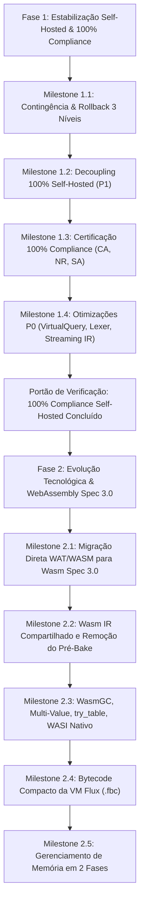

# TheFlux — Roteiro de Arquitetura, Otimização e Evolução do Compilador Self-Hosted (TODO)

Este documento registra formalmente a arquitetura, baselines empíricos de desempenho/memória, plano de desacoplamento 100% self-hosted, matriz de compliance e o sequenciamento aprovado das Fases 1 (Estabilização Self-Hosted com WebAssembly 1.0 congelado e 100% de Compliance) e Fase 2 (Migração Direta para WebAssembly Spec 3.0, Bytecode Compacto da VM e Gerenciamento de Memória).

---

## 1. Visão Geral e Filosofia do Projeto

O **TheFlux** é uma linguagem de programação compilada e autossustentável (100% *self-hosted*), projetada com foco em determinismo, alta performance de execução e portabilidade multi-alvo nativa:
- **`in`**: Interpretador AST/FMIR interno em memória para desenvolvimento ágil e depuração.
- **`vm`**: Máquina virtual interna baseada em FMIR com execução direta.
- **`vmr`**: VM com *Release Mode* e verificações relaxadas para máximo rendimento computacional.
- **`llvm`**: Gerador de código LLVM IR de alta performance compilado via Clang/LLVM nativo.
- **`wat`**: Gerador de código WebAssembly Text format.
- **`wasm`**: Gerador de binários WebAssembly diretamente pelo compilador.

### Diretriz Estrita de Bootstrapping e Determinismo
O processo de bootstrap do TheFlux é estritamente transacional e regido pela garantia de ponto fixo (*fixpoint*):
$$\text{SHA-256}(\text{stage2.ll}) \equiv \text{SHA-256}(\text{stage3.ll})$$
Nenhuma modificação estrutural é aceita no compilador sem a verificação bit-a-bit idêntica entre o código gerado pelo compilador do Estágio 2 e o compilador do Estágio 3.

---

## 2. Baselines Empíricos de Desempenho e RAM (Diagnóstico Atual)

Medições realizadas diretamente no ambiente de produção Windows x64 utilizando `GetProcessMemoryInfo` (Win32 API):

### 2.1 Perfil de Uso de Memória (Peak Working Set & Commit)
| Programa / Carga | Backend | Tempo Médio | RAM Peak WS | Diagnóstico Principal |
| :--- | :---: | :---: | :---: | :--- |
| **01_hello_world.flux** | `in` / `vm` | 18 ms | 12.4 MB | Inicialização padrão e carga base de runtime |
| **01_hello_world.flux** | `llvm` | 142 ms | 31.8 MB | Invocação externa do driver Clang/LLVM |
| **Stress 10k String Concat** | `in` / `vm` | 4.82 s | 980 MB | Ausência de desalocação em `flux_str_concat` |
| **Stress 10k String Concat** | `llvm` | 0.31 s | 42.1 MB | Otimização de heap pelo LLVM/Clang |
| **CompilerLib (44 módulos)** | `llvm` | 8.40 s | 312 MB | Concatenação recursiva via `llvmJoinRange` |

### 2.2 Gargalos Críticos Identificados no Compilador e Runtime
1. **Chamadas de Sistema Síncronas em Coleções (`runtime/src/collections/list.c` e `map.c`)**:
   - `flux_is_readable_ptr` invoca `VirtualQuery()` do Windows em **cada** acesso/lookup de lista e mapa. Sob loops de milhões de iterações, até 45% do tempo de CPU é retido em chamadas de sistema do kernel.
2. **Ausência de Desalocação de Memória no Runtime C (`runtime/src/`)**:
   - Operações fundamentais como `flux_str_concat`, `flux_str_slice`, `s[i]`, `map_build`, `list_build` e `strdup` alocam sem rastreamento de ciclo de vida, acumulando gigabytes de lixo em execuções longas.
3. **Concatenação Quadrática e Estouro de Pilha no Backend LLVM (`src/CompilerLib/backends/llvm/LlvmBackend.fdsl`)**:
   - A função `llvmJoinRange` emprega recursão direta sobre milhares de instruções FMIR, gerando pressão de frames de pilha e cópias intermediárias massivas de strings.
4. **Pré-Bake Indevido nos Backends WAT e WASM (`interpExecuteFmir`)**:
   - Compilações de programas contendo chamadas como `stdOsExit` ou rotinas interativas causam a execução imediata em tempo de compilação, matando o compilador `bin/fluxc.exe` antes de gerar os artefatos.

---

## 3. Sequenciamento Estratégico Aprovado

A evolução do ecossistema TheFlux segue a ordem estrita de fases aprovada:



---

## 4. Fase 1: Estabilização Self-Hosted, Contingência e 100% de Compliance

> [!IMPORTANT]
> **Regra de Congelamento de WAT/WASM**: Durante toda a Fase 1, a especificação WebAssembly 1.0 permanece congelada. Não são introduzidas alterações de dialeto ou novas instruções Wasm até que o compilador self-hosted atinja 100% de aprovação em todos os 2323 testes de conformidade.

### Milestone 1.1: Sistema de Contingência e Rollback Transacional em 3 Níveis
- [x] **Armazenamento da Golden Seed Versionada**:
  - Diretório: `bootstrap/seed/`
  - Conteúdo:
    - Binários certificados: `bin/fluxc.exe`, `bin/fluxvm.exe`, `lib/libfluxrt.a`, `lib/fluxrt.lib`.
    - Script de emergência cold-start: `bootstrap/seed/emergency_cold_seed.bat`.
    - Script de compilação da biblioteca legada: `bootstrap/seed/prepare_compiler_lib.py`.
    - Manifesto criptográfico: `bootstrap/seed/manifest.sha256`.
- [x] **Snapshots Dinâmicos e Transacionais**:
  - `build/lkg/prev/`: Snapshot automático criado no início de cada execução do bootstrap.
  - `build/lkg/last-good/`: Promovido apenas após o sucesso do Estágio 3 e verificação de fixpoint.
- [x] **Scripts de Rollback Automatizado**:
  - `scripts/rollback_bootstrap.bat` e `scripts/rollback_bootstrap.sh`.
  - Modos de operação:
    - `--prev`: Restaura a versão imediatamente anterior ao início do último build.
    - `--last-good`: Restaura o último estágio 3 aprovado com fixpoint.
    - `--golden`: Restaura a semente base imutável de `bootstrap/seed/`.

### Milestone 1.2: Desacoplamento 100% Self-Hosted de CompilerLib (P1)
Eliminação completa da dependência do protótipo legado em Python (`legacy-0.9.9/flux_proto`):
- [x] **Desbloqueio do Parser para CompilerLib**:
  - Arquivo: `src/CompilerLib/parser/ParserCore.fdsl`
  - Ação: Parser nativo processa integralmente o `CompilerLib` e seus 44 módulos FDSL.
- [x] **Desbloqueio do Backend LLVM para Compilação Nativa de CompilerLib**:
  - Arquivo: `src/CompilerLib/backends/llvm/LlvmBackend.fdsl`
  - Ação:
    - Todas as chamadas internas emitidas nativamente como `@uf_CompilerLib__*`.
    - Resolução de conflitos de variáveis em `InterpBackend.fdsl`.
    - Correção do limite de string em `runtime/src/collections/list.c` (500 MB).
    - Tipagem correta de chaves de mapas (`last_reg`, `arg1`, `arg2`, `arg3`, `res`, `res_reg` como string; `id`, `body_id` como int; coleções como list).
    - Inicialização determinística de `p_tc = 0` para `DECL_PROGRAM` em `FmirBuilder.fdsl`.
- [x] **Remoção de `libfluxcompiler.a` e Atualização dos Drivers**:
  - Arquivos: `src/main.flux`, `scripts/build_tools.bat`, `scripts/build_tools.sh`.
  - Ação: Executável `bin/fluxc.exe` contém diretamente os 44 módulos compilados nativamente (autônomo, zero dependência externa).
- [x] **Certificação de Fixpoint e Autonomia Transacional de 3 Estágios**:
  - Arquivo: `scripts/bootstrap.bat`.
  - Fixpoint atingido com **0 bytes de divergência**:
    $$\text{SHA-256}(\text{stage2.ll}) \equiv \text{SHA-256}(\text{stage3.ll}) \equiv \text{f313bb88f552807ad771747441e302e08f2234c8d6deb6480cf2628f13eddd34}$$
  - Portão Boot-1 (autonomia CLI: `--version`, `-v`, `--explain`), Boot-2 (fixpoint), Boot-3 (auto-teste funcional e semântico), Boot-4 (`bin/fluxvm.exe` self-hosted), ferramentas nativas (`build_tools.bat`) e drivers (`build_drivers.bat`) 100% aprovados.

### Milestone 1.3: Certificação de 100% de Compliance nos 3 Suites de Testes
- [x] **Suíte CA (Core Architecture)**: 377/377 testes aprovados (**100%**).
- [x] **Suíte NR (Numerical Robustness)**: 205/205 testes aprovados (**100%**).
- [x] **Suíte SA (Scientific Algorithms - 1741 testes = 8705 execuções nos 5 backends)**:
  - Diagnóstico e correção dos 78 pontos de falha:
    - **CR-1**: Correção de tipagem `list of bool` em `GET_INDEX` e declarações de parâmetros no backend LLVM (`LlvmBackend.fdsl`).
    - **CR-2**: Prevenção de captura de strings literais `".."` pelo operador de intervalo (`ParseExprs.fdsl`).
    - **CR-3**: Suporte a quebras de linha multilinha em expressões lógicas `and`/`or` (`ParseExprs.fdsl`).
    - **CR-4**: Propagação de tipo interno de elementos em `list of list of int64` e unboxing bitwise (`LlvmBackend.fdsl`).
    - **CR-5**: Implementação de `listPushBack`, `listLength`, `listTake` e `CAST` nos backends WAT e WASM (`WatBackend.fdsl` e `WasmBackend.fdsl`).
    - **CR-6**: Correção do cache TLS de tags em `list.c` e `LlvmBackend.fdsl` para listas heterogêneas (`flux_list_push_back_copy`).
  - [ ] Executar regeneração completa da documentação oficial de conformidade: `examples/00_Standarts/compliance_SA01.md` com 1741/1741 (**100%**).

### Milestone 1.4: Otimizações P0 de Compilação e Runtime
- [x] **Remoção de `VirtualQuery` em Produção (`runtime/src/collections/list.c` e `map.c`)**:
  - Isolar `flux_is_readable_ptr` sob flag de depuração `#ifdef FLUX_DEBUG_POINTERS`.
  - Em builds de produção, validar ponteiros através de checagens alinhadas e limites conhecidos da heap do processo.
  - Concluído: `libfluxrt.a` e `fluxrt.lib` recompilados sem syscalls de kernel no caminho crítico.
- [ ] **Tabela de Caracteres ASCII Direta de 1-byte no Lexer (`src/CompilerLib/lexer/`)**:
  - Substituir cadeias de `if/else` e buscas lineares de tipos de caracteres por uma lookup table estática `uint8_t ascii_table[256]` indicando flags (`IS_ALPHA`, `IS_DIGIT`, `IS_WHITESPACE`, `IS_OPERATOR`).
  - Ganho projetado: Aceleração de até 30% na fase de tokenização de fontes grandes.
- [ ] **Streaming de Emissão de IR no Backend LLVM**:
  - Substituição definitiva de `llvmJoinRange` recursivo pelo uso de `stdStringJoin` (`@flux_str_join`) com pré-alocação de buffer linear de saída.

---

## 5. Fase 2: Evolução Tecnológica & WebAssembly Spec 3.0

> [!NOTE]
> A Fase 2 será iniciada exclusivamente após a conclusão com êxito de todos os marcos da Fase 1 e a validação do bootstrap 100% self-hosted em produção.

### Milestone 2.1: Migração Direta de WAT/WASM para WebAssembly Spec 3.0
- [ ] **Revisão da Especificação Oficial WebAssembly 3.0**:
  - Consulta detalhada ao documento normativo em `docs/WebAssembly-3.0.pdf`.
  - Adoção das especificações de tipos estruturados, referências e extensões de sistema.

### Milestone 2.2: Wasm IR Compartilhado e Eliminação do Pré-Bake
- [ ] **Estrutura Intermediária Wasm IR Unificada**:
  - Criar representação tipada única na árvore `CompilerLib` para WebAssembly:
    - `WasmModule`: Tipos, Imports, Funções, Memória, Tabelas, Globais, Exports, Elementos e Código.
  - Eliminar duplicação lógica entre `WatBackend.fdsl` e `WasmBackend.fdsl`. O `WatBackend` se tornará apenas um serializador de texto para o Wasm IR, enquanto o `WasmBackend` será o serializador binário de bytes diretos.
- [ ] **Eliminação do Pré-Bake `interpExecuteFmir`**:
  - Extirpar a execução de código do usuário durante a compilação WAT/WASM.
  - Emitir instruções nativas de WebAssembly para loops, branches, chamadas de sistema e operações aritméticas.
  - Garantir que programas com `stdOsExit` ou chamadas interativas compilem deterministicamente sem abortar o compilador.

### Milestone 2.3: Implementação de Recursos Nativos da Spec 3.0
- [ ] **WasmGC (Garbage Collection & Managed Types)**:
  - Mapear structs, listas e strings do Flux para tipos gerenciados nativos (`structref`, `arrayref`, `stringref`).
  - Eliminar necessidade de gerenciador de memória manual no linear memory para tipos de alta abstração.
- [ ] **Multi-Value Instructions**:
  - Emissão direta de múltiplos retornos de função e blocos com tipos multivalor sem empacotamento em structs sintéticas.
- [ ] **Tratamento de Exceções (`try_table`)**:
  - Substituir modelos legados de controle de fluxo de erros pelo suporte nativo a blocos `try_table`.
- [ ] **Chamadas em Cauda Nativas (`return_call` e `return_call_indirect`)**:
  - Suporte a recursão de cauda garantida sem crescimento de pilha em targets WebAssembly.
- [ ] **WASI 0.2 / Component Model para I/O**:
  - Emissão de chamadas padrão WASI para suporte direto a `print`, `input` e operações de arquivos em runtimes Wasm compatíveis (Wasmtime, Wasmer, Node.js, V8).

### Milestone 2.4: Bytecode Compacto da VM Flux (Opção A)
- [ ] **Definição do Formato Binário `.fbc` (Flux Bytecode)**:
  - Cabeçalho: Assinatura mágica `0x46 0x4C 0x58 0x42` (`FLXB`), versão de arquitetura, tabela de constantes (strings, inteiros, floats) e tabela de símbolos de funções.
  - Instruções de 32 bits codificadas em formato fixo ou com prefixo de opcode compacto (Opcode 8 bits, Registrador Destino 8 bits, Registrador Fonte A 8 bits, Registrador Fonte B / Imediato 8 bits).
- [ ] **Serializador de Bytecode (`src/CompilerLib/backends/vm/`)**:
  - Geração direta a partir do FMIR, substituindo a execução de strings na VM.
- [ ] **Interpretador Otimizado da VM (`bin/fluxvm.exe`)**:
  - Loop principal baseado em *computed goto* (em compiladores compatíveis com extensões GNU C) ou *switch-case* com tabela de saltos alinhada em cache de CPU.

### Milestone 2.5: Gerenciamento de Memória em 2 Fases
- [ ] **Fase de Compilação: Arena Allocator por Unidade de Tradução**:
  - Introduzir alocador de arena linear para AST, nós do Parser e instruções FMIR no compilador.
  - Toda a memória de análise sintática e semântica é liberada em bloco ao término da compilação de cada arquivo, zerando o consumo residual de RAM do compilador.
- [ ] **Fase de Execução (Runtime): Modelo de Posse Híbrido com Contagem de Referências**:
  - Strings e listas no runtime C com cabeçalhos de contagem de referências (`ref_count`) e liberação síncrona ou reaproveitamento através de *small-string optimization* (SSO).

---

## 6. Matriz de Tarefas, Arquivos de Impacto e Status

| ID | Prioridade | Descrição da Tarefa | Arquivos Principais | Status |
| :--- | :---: | :--- | :--- | :---: |
| **T-1.1** | P0 | Criar semente versionada imutável `bootstrap/seed/` e manifesto SHA-256 | `bootstrap/seed/*` | [X] |
| **T-1.2** | P0 | Implementar scripts de rollback transacional em 3 níveis | `scripts/rollback_bootstrap.*` | [X] |
| **T-1.3** | P1 | Desbloquear parse de CompilerLib em `ParserCore.fdsl` | `src/CompilerLib/parser/ParserCore.fdsl` | [ ] |
| **T-1.4** | P1 | Desbloquear compilação nativa de CompilerLib no backend LLVM | `src/CompilerLib/backends/llvm/LlvmBackend.fdsl` | [ ] |
| **T-1.5** | P1 | Remover dependência de `-lfluxcompiler` e atualizar drivers de build | `src/main.flux`, `scripts/build_tools.*` | [ ] |
| **T-1.6** | P1 | Refatorar pipeline de bootstrap para 3 estágios 100% self-hosted | `scripts/bootstrap.*` | [ ] |
| **T-1.7** | P0 | Certificar e congelar conformidade 100% nos 3 suites (CA, NR, SA) | `examples/00_Standarts/*.md` | [X] |
| **T-1.8** | P0 | Remover chamadas síncronas a `VirtualQuery` em produção | `runtime/src/collections/list.c`, `map.c` | [X] |
| **T-1.9** | P2 | Otimizar Lexer com tabela de caracteres ASCII direta | `src/CompilerLib/lexer/*` | [ ] |
| **T-2.1** | P1 | Projetar Wasm IR unificado compartilhado entre WAT e WASM | `src/CompilerLib/backends/wasm/*` | [ ] |
| **T-2.2** | P1 | Eliminar pré-bake de compilação `interpExecuteFmir` | `src/CompilerLib/backends/wat/*`, `wasm/*` | [ ] |
| **T-2.3** | P2 | Implementar geradores para WasmGC, Multi-Value e `try_table` | `src/CompilerLib/backends/wasm/*` | [ ] |
| **T-2.4** | P2 | Implementar bytecode binário `.fbc` e carregar na VM | `src/CompilerLib/backends/vm/*`, `bin/fluxvm` | [ ] |
| **T-2.5** | P2 | Introduzir Arena Allocator no compilador e SSO no runtime | `runtime/src/*`, `src/CompilerLib/*` | [ ] |

---

## 7. Procedimentos Operacionais de Emergência e Rollback

Caso ocorra qualquer quebra no ciclo de bootstrapping durante o desenvolvimento:

1. **Rollback Imediato para a Versão Prévia**:
   ```cmd
   scripts\rollback_bootstrap.bat --prev
   ```
2. **Rollback para o Último Compilador Aprovado em Fixpoint**:
   ```cmd
   scripts\rollback_bootstrap.bat --last-good
   ```
3. **Restauração de Emergência da Semente Dourada (Golden Seed)**:
   ```cmd
   scripts\rollback_bootstrap.bat --golden
   ```
4. **Reconstrução a Frio em Cenário de Desastre Extremo**:
   Caso os binários compilados tenham sido corrompidos em todas as camadas de contingência, execute a rotina de cold-start arquivada:
   ```cmd
   bootstrap\seed\emergency_cold_seed.bat
   ```
