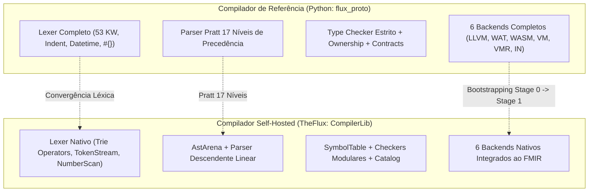
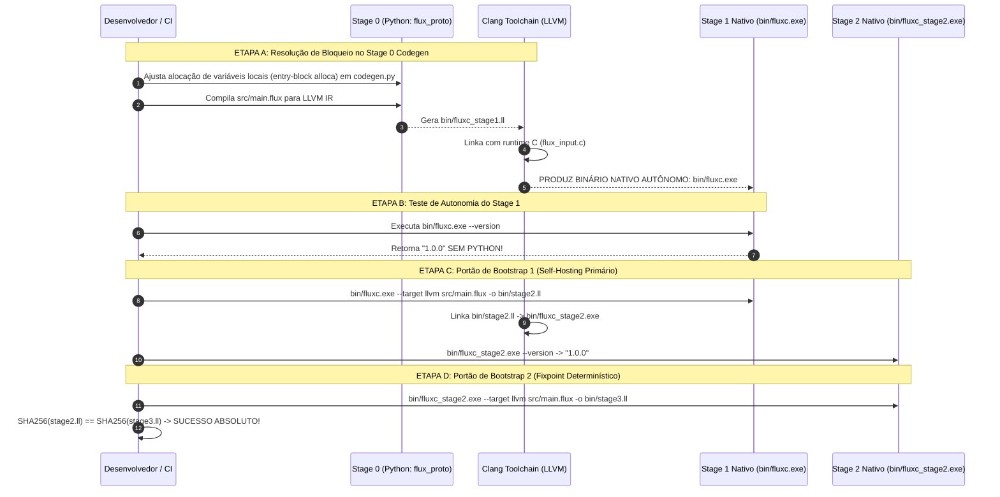

# 📋 Comparação dos Compiladores e Roadmap de Bootstrapping (TheFlux v1.0.0)

Este documento apresenta a análise comparativa detalhada entre o **Compilador de Referência** (`src/flux_proto/` em Python) e o **Compilador Self-Hosted** (`src/main.flux` e `src/CompilerLib/` em TheFlux/FDSL), abordando os 6 eixos canônicos de linguagem e especificando os **próximos passos necessários para que o compilador entre e avance na fase de Bootstrapping**.

---

## 🔬 Parte I: Comparação Técnica entre os Compiladores



---

### 1. 📐 Sintaxe (Syntax)

| Aspecto | Compilador de Referência (`flux_proto`) | Compilador Self-Hosted (`CompilerLib`) | Divergência / Diagnóstico |
| :--- | :--- | :--- | :--- |
| **Delimitação de Blocos** | Indentação off-side (`INDENT`/`DEDENT`/`EOL`) + suporte a `{ ... }`. | Prioriza blocos delimitados por chaves `{ ... }`. O `IndentTracker.fdsl` rastreia indentação, mas o parser atual estrutura nós via chaves. | O código self-hosted usa blocos com chaves explícitas para garantir determinismo sintático entre backends. |
| **Declarações Estruturais** | `program`, `agent`, `contract`, `struct`, `enum`, `function`, `use`, `comptime`. | `program`, `agent`, `contract`, `struct`, `enum`, `use` em `ParseDecls.fdsl`. | Paridade completa nas declarações essenciais; macros `comptime` avançadas são tratados como stubs no self-hosted. |
| **Controle de Fluxo** | `route { cond ==> { ... } _ ==> { ... } }`, `match expr { pat ==> { ... } }`, `infinite { ... }`, `break`, `continue`. | O self-hosted usa extensivamente `route` e `infinite` em seu próprio código, mas seu parser interno (`ParseStmts.fdsl`) ainda precisa de lowering recursivo completo para corpos de blocos internos. | O parser do self-hosted deve suportar parsing aninhado completo de `route` e `match`. |
| **Tratamento de Exceções & Fluxo** | `emit(nice|fail, val, msg)`, `catch`, `fallback`, `ensure`, `error`. | `emit(...)` com nós dedicados `STMT_EMIT` no FMIR e execução nativa nos 6 alvos. | Falta parsing sintático das expressões de supressão/recuperação `catch` e `fallback`. |
| **Dataflow** | `a --> b`, `a ==> b`, `split`, `join`. | `-->` e `==>` reconhecidos pelo scanner, com lowering simplificado no FMIR. | Cláusulas de topologia de fluxo (`split`/`join`) ausentes na AST nativa. |

---

### 2. 🔑 Palavras-Chave (Keywords)

* **Compilador de Referência (53 keywords em `KEYWORD_MAP`):**
  `_`, `mut`, `imut`, `true`, `false`, `True`, `False`, `struct`, `enum`, `contract`, `impl`, `function`, `and`, `or`, `not`, `in`, `break`, `continue`, `match`, `error`, `catch`, `ensure`, `fallback`, `program`, `emit`, `nice`, `fail`, `route`, `infinite`, `split`, `join`, `agent`, `op`, `use`, `of`, `comptime`, `macro`, `quote`, `unquote`, `async`, `spawn`, `await`, `meta`, `lift`, `lower`, `keep`, `move`, `borrow`, `borrow_mut`, `unsafe`, `static`, `extern`, `fn`, `print`, `input`, `spy`, `data`, `map`, `set`, `list`, `as`.

* **Compilador Self-Hosted (`ScanIdentifiers.fdsl`):**
  `program`, `contract`, `agent`, `impl`, `op`, `function`, `mut`, `imut`, `as`, `of`, `route`, `match`, `infinite`, `break`, `continue`, `emit`, `unsafe`, `print`, `input`, `use`, `struct`, `enum`, `nice`, `fail`, `keep`, `borrow`, `move`, `and`, `or`, `not`, `in`, `comptime`, `async`, `await`, `spawn`, `spy`. Literais: `true`, `false`, `none`.

#### Lacunas Críticas no Self-Hosted:
1. **Resiliência e Erros**: `error`, `catch`, `ensure`, `fallback`.
2. **Concorrência e Fluxo de Topologia**: `split`, `join`.
3. **Metaprogramação**: `macro`, `quote`, `unquote`, `meta`, `lift`, `lower`.
4. **Gerenciamento de Memória Fina**: `borrow_mut`, `static`, `extern`.
5. **Aliases Ergonomicos**: `fn` (abreviação de `function`), `True`/`False` com maiúscula inicial.

---

### 3. 💾 Tipos de Dados (Data Types)

| Categoria | Compilador de Referência (`types.py`) | Compilador Self-Hosted (`ParseTypes.fdsl` / `TypeChecker.fdsl`) | Status / Paridade |
| :--- | :--- | :--- | :--- |
| **Inteiros com Sinal** | `int8`, `int16`, `int32`, `int64` (widening automático) | `int`, `int8`, `int16`, `int32`, `int64` | ✅ 100% Compatível (`int` é alias para `int64`). |
| **Inteiros sem Sinal** | `uint8`, `uint16`, `uint32`, `uint64` | `uint`, `uint8`, `uint16`, `uint32`, `uint64` | ✅ 100% Compatível (`uint` é alias para `uint64`). |
| **Ponto Flutuante IEEE** | `float16`, `float32`, `float64` | `float`, `float32`, `float64` | ⚠️ Falta `float16` no self-hosted. |
| **Formatos AI / Hardware** | `fp8_e4m3`, `fp8_e5m2`, `bf16_e8m7`, `tf32_e8m10` | *Não suportados no lexer/type checker* | ❌ Gap de formatos de precisão reduzida para IA. |
| **Números Complexos** | `complex32`, `complex64`, `complex128` | `complex`, `complex64`, `complex128` | ⚠️ Falta variante `complex32`. |
| **Primitivos Fundamentais**| `char`, `string`, `bool`, `datetime`, `data` | `char`, `string`, `bool`, `datetime`, `data`, `void` | ✅ Suportados (`void` suportado explicitamente no self-hosted). |
| **Coleções Paramétricas** | `list of T`, `set of T`, `map of T`, `tensor of T[shape]` | `list of T`, `set of T`, `map of T`, `tensor of T` | ⚠️ Anotação de shape em tensores (`tensor[N, M]`) ausente na sintaxe nativa. |
| **Tipos de Usuário** | `struct`, `enum`, `contract`, `agent` | `struct`, `enum`, `contract`, `agent` | ✅ Suporte integral a tipos nominais e contratos de agentes. |

---

### 4. ⚡ Operadores (Operators)

| Categoria | Referência (`operators.py`) | Self-Hosted (`ScanOperators.fdsl`) | Situação |
| :--- | :--- | :--- | :--- |
| **Atribuição Composta** | Invertidos canônicos TheFlux: `=+`, `=-`, `=*`, `=/f`, `=/i`, `=/r`, `=^`, `=|`, `=&`, `=~`, `=<<`, `=>>`, `=>>>`, `=^e`, `=^r` | Estilo clássico/C: `+=`, `-=`, `*=`, `/=`, `%=`, `^=`, `&=`, `|=` | **Divergência**: O self-hosted escaneia `+=` em vez dos canônicos `=+`. Devem ser unificados para suportar ambos. |
| **Divisão Explícita** | `/f` (floor), `/i` (inteira), `/r` (resto/módulo) | `/` (genérico), `%` (módulo) | Falta suporte aos modificadores `/f`, `/i`, `/r` no scanner nativo. |
| **Exponenciação & Raiz** | `^e` (potência real), `^r` (raiz recíproca) | `^` (genérico) | Falta distinção `^e` / `^r` no scanner nativo. |
| **Deslocamento de Bits** | `<<`, `>>`, `>>>` (lógico unsigned) | `<<`, `>>` | Falta `>>>` no scanner nativo. |
| **Dataflow** | `-->`, `==>` | `-->`, `==>` | ✅ Paridade 100%. |
| **Intervalo & Escopo** | `..`, `::`, `.` | `..`, `::`, `.` | ✅ Paridade 100%. |

---

### 5. 🧮 Precedência Matemática (Mathematical Precedence)

#### Compilador de Referência (Pratt Parser com 17 Níveis)
O compilador de referência define uma hierarquia estrita com regras de precedência e associatividade:
1. Pós-fixados / Primários: `.` (acesso a membro), `[]` (índice), `()` (chamada)
2. Prefixados Unários: `+`, `-`, `not`, `!`, `~`, `unquote`, `move`, `borrow`, `spawn`, `await`
3. Exponenciação (`^e`, `^r`) — **Associatividade à Direita**
4. Multiplicativos (`*`, `/f`, `/i`, `/r`)
5. Aditivos (`+`, `-`)
6. Deslocamentos (`<<`, `>>`, `>>>`)
7. Intervalo (`..`)
8. Pertencimento (`in`)
9. Relacionais & Igualdade (`==`, `!=`, `<`, `<=`, `>`, `>=`)
10. Bitwise AND (`&`), XOR (`^`), OR (`|`)
11. Lógicos (`and`, `or`, `&&`, `||`)
12. Dataflow (`-->`, `==>`, `split`, `join`)
13. Recuperação de Erros (`catch`, `fallback`)
14. Atribuição (`=`, `=+`, etc.) — **Associatividade à Direita**

#### Compilador Self-Hosted Atual (Linear Left-to-Right Folding)
Em `ParseExprs.fdsl`, a função `parseExpression` consome o primeiro primário e aplica um laço direto sobre qualquer operador binário com a mesma prioridade:
- **Impacto**: `2 + 3 * 4` é avaliado linearmente como `(2 + 3) * 4 = 20` a menos que parênteses explícitos `2 + (3 * 4) = 14` sejam empregados.
- **Correção Necessária**: Implementação de uma tabela de pesos (*binding power*) no parser de expressões.

---

### 6. 📝 Literais (Literals)

| Tipo | Compilador de Referência | Compilador Self-Hosted | Diagnóstico |
| :--- | :--- | :--- | :--- |
| **Inteiros** | Decimais, `0x` (hex), `0b` (bin), `0o` (oct), separadores `_`. | Decimais, `0x`, `0b`, `0o`, separadores `_`. | ✅ Paridade 100%. |
| **Floats** | Notação científica `1e-4`, ponto inicial `.5`, negativo `-1.0`. | Notação científica `1e-4`, ponto decimal `1.0`. | ⚠️ Falta aceitar ponto inicial sem zero (`.5`). |
| **Complexos** | Sufixo `i` ou `j` (ex: `1.5i`, `2j`). | Sufixo `i` (ex: `1.5i`). | ⚠️ Falta reconhecer `j`. |
| **Data/Hora** | Literais ISO-8601 sem aspas: `2026-10-18T01:40:00Z`. | Sem scanner de datetime não-citado. | ❌ Gap de literal temporal direto. |
| **Strings & Interpolação** | Sintaxe oficial: `#{expressão}` dentro de `"..."`. | Checa apenas caractere `{` solto no scanner. | ⚠️ Necessário adotar estritamente `#{...}`. |
| **Coleções** | Literais inline `[1, 2, 3]`, `map{"k": v}`, `set{1, 2}`. | Parse inline ainda rudimentar no `parsePrimary`. | ⚠️ Requer parsing completo de literais de listas e mapas. |

---

## 🚀 Parte II: Próximos Passos para Entrar na Fase de Bootstrapping

O processo de Bootstrapping canônico do TheFlux consiste em transformar o código em TheFlux (`src/main.flux` + `src/CompilerLib/`) em um **executável binário nativo e autônomo** (`bin/fluxc.exe`), capaz de compilar a si mesmo sem nenhuma invocação de Python.



---

### 📋 Roteiro de Execução Técnica para o Bootstrapping

#### 🔹 Passo 1: Sanar o Bloqueador de LLVM IR no Gerador do Stage 0 (`codegen.py`)
* **Diagnóstico Técnico**: O teste real de compilação de `src/main.flux` para LLVM IR gerou um arquivo `.ll` de 728 KB, mas ao invocar o Clang ocorreu a falha:
  `error: invalid LLVM IR input: Instruction does not dominate all uses!`
  `%stag_v1.144 = alloca i64, align 8`
* **Causa Raiz**: No `src/flux_proto/llvm/codegen.py` (linha 3598), as variáveis dinâmicas do tipo `data` alocam slots (`alloca`) no meio de blocos condicionais de `route`/loops em vez do bloco inicial `entry:`. No LLVM, instruções `alloca` em blocos não-dominantes quebram a regra de SSA.
* **Ação Corretiva**: Mover todas as emissões de `alloca` de variáveis e tags para o topo do bloco `entry:` da função, garantindo que dominem todos os blocos básicos.

#### 🔹 Passo 2: Gerar o Executável Nativo Autônomo Stage 1 (`bin/fluxc.exe`)
* **Executar compilação via Python Stage 0**:
  ```powershell
  python -m flux_proto --target llvm -o bin/fluxc_stage1.ll src/main.flux
  ```
* **Linkar via Clang com o Runtime Nativo**:
  ```powershell
  clang -O2 -Wno-deprecated-declarations -o bin/fluxc.exe bin/fluxc_stage1.ll src/flux_proto/llvm/runtime/flux_input.c
  ```
* **Critério de Aceite da Etapa**:
  - `bin/fluxc.exe --version` emite `1.0.0` diretamente do binário nativo em C/C++/Assembly, sem nenhuma chamada de script Python.

#### 🔹 Passo 3: Capacitar o Compilador Self-Hosted (`CompilerLib`) para Auto-Compilação
Para que o `bin/fluxc.exe` consiga compilar a si mesmo (Stage 2) sem auxílio de Python, o código do `CompilerLib` precisa ter as seguintes capacidades funcionais ativas:
1. **Precedência Pratt no `ParseExprs.fdsl`**: Atribuição de pesos matemáticos para evitar ambiguidade nas expressões de análise léxica e sintática.
2. **Scanner e Operadores no `ScanOperators.fdsl`**: Reconhecimento simultâneo da sintaxe TheFlux (`=+`, `=-`, `=/f`) e estilo C (`+=`, `-=`).
3. **Resolução de Imports Recursivos no `ImportResolver.fdsl`**: Capacidade de ler e unir todos os 38 módulos `.fdsl` de `src/CompilerLib/`.
4. **Emissor LLVM Completo no `LlvmBackend.fdsl`**: Ampliar o emissor de LLVM nativo para que o `CompilerLib` emita funções, chamadas e controle de fluxo equivalentes aos emitidos pelo Stage 0.

#### 🔹 Passo 4: Executar o Portão Boot-1 (Stage 1 compila Stage 2)
* Invocação pelo binário nativo compilado:
  ```powershell
  .\bin\fluxc.exe --target llvm -o bin/stage2.ll src/main.flux
  clang -O2 -o bin/fluxc_stage2.exe bin/stage2.ll src/flux_proto/llvm/runtime/flux_input.c
  ```
* Validar que `bin/fluxc_stage2.exe --version` responde `1.0.0`.

#### 🔹 Passo 5: Executar o Portão Boot-2 (Fixpoint & Determinismo Bit-a-Bit)
* Invocação pelo Stage 2:
  ```powershell
  .\bin\fluxc_stage2.exe --target llvm -o bin/stage3.ll src/main.flux
  ```
* Validação de Fixpoint:
  ```powershell
  $hash2 = (Get-FileHash bin/stage2.ll -Algorithm SHA256).Hash
  $hash3 = (Get-FileHash bin/stage3.ll -Algorithm SHA256).Hash
  if ($hash2 -eq $hash3) { Write-Host "FIXPOINT DETERMINÍSTICO CONFIRMADO!" }
  ```

#### 🔹 Passo 6: Atualizar o Orquestrador `scripts/bootstrap_compiler.py`
* Ajustar `scripts/bootstrap_compiler.py` para invocar os binários nativos `.exe` gerados, em vez do wrapper Python provisório.

---

## ❓ Questões em Aberto & Decisões para Aprovação

1. **Correção Imediata do `codegen.py` (Passo 1)**:
   - Deseja que apliquemos de imediato a correção no `src/flux_proto/llvm/codegen.py` para centralizar os `alloca` no bloco `entry:`, permitindo gerar o executável nativo `bin/fluxc.exe` via Clang?
2. **Alinhamento do Pratt Parser**:
   - Para o Passo 3, confirma a implementação do algoritmo de Pratt com os 17 níveis canônicos no `ParseExprs.fdsl`?
