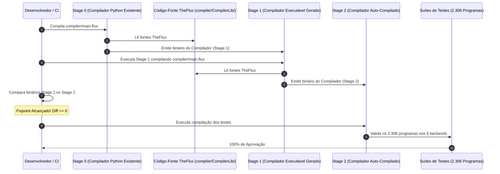

# 🏗️ TODO — Plano 2: Self-Hosting e Decomposição de Alta Granularidade dos 6 Backends

> **Status**: Em Planejamento / Pronto para Execução  
> **Objetivo**: Implementar a auto-compilação (*Self-Hosting*) da linguagem TheFlux, reescrevendo o compilador inteiramente em código TheFlux nativo (`.flux` e `.fdsl`), reorganizando a arquitetura em micro-funções puras de alta granularidade e otimizando a geração de código com paridade determinística nos 6 backends (`in`, `vm`, `vmr`, `llvm`, `wat`, `wasm`).

---

## 🎯 1. Escopo e Diretrizes do Plano

1. **Auto-Compilação Completa (*Self-Hosting*)**:
   - Desenvolver o compilador TheFlux em código TheFlux nativo, eliminando a dependência de interpretadores ou emissores externos após a conclusão do ciclo de bootstrapping.
   - O compilador TheFlux em código nativo deve ser capaz de compilar a si próprio e produzir executáveis idênticos para todas as 6 plataformas suportadas.

2. **Reorganização Modular e Alta Granularidade Funcional**:
   - Decompor blocos monolíticos de centenas de linhas em micro-funções atômicas, puras e fortemente tipadas.
   - Aproveitar a arquitetura modular de subpastas do Plano 3, organizando o compilador sob `compiler/CompilerLib/` com arquivo agregador mestre `CompilerLib.fdsl`.

3. **Paridade Determinística nos 6 Backends de Execução**:
   - Cada um dos 6 alvos de compilação contará com seu pipeline granular desacoplado:
     - `in`: Interpretador de AST nativo.
     - `vm`: Emissor e runtime de bytecode TheFlux (`.fvmbc`).
     - `vmr`: Deserializador e executor de artefatos de bytecode recarregados do disco.
     - `llvm`: Emissor de LLVM IR textual compilado via Clang com runtime C.
     - `wat`: Emissor de S-Expressions WebAssembly Text com chamadas WASI.
     - `wasm`: Emissor direto de seções binárias WebAssembly (`.wasm`).

4. **Ciclo de Bootstrapping em 3 Estágios com Validação de Fixpoint**:
   - *Stage 0 (Host Python)* -> *Stage 1 (TheFlux Executável)* -> *Stage 2 (TheFlux Auto-Compilado)*.
   - Validação de fixpoint: `diff(Stage1, Stage2) == 0`.

---

## 📐 2. Arquitetura Modular do Compilador Auto-Hospedado

```text
TheFlux/
├── compiler/
│   ├── main.flux                             # Ponto de entrada CLI do compilador auto-hospedado
│   └── CompilerLib/                          # Biblioteca modular do compilador
│       ├── CompilerLib.fdsl                  # Arquivo agregador mestre (mesmo nome da pasta)
│       ├── lexer/                            # Subpasta: Análise Léxica Granular
│       │   ├── token_types.fdsl              # Enums de TokenType e struct Token
│       │   ├── scan_numbers.fdsl             # Scanner de inteiros, floats e notação científica
│       │   ├── scan_strings.fdsl             # Scanner de strings e interpolações
│       │   ├── scan_identifiers.fdsl         # Scanner de identificadores e palavras-chave
│       │   └── lexer_core.fdsl               # Loop principal do lexer
│       ├── parser/                           # Subpasta: Análise Sintática Descendente Recursiva
│       │   ├── ast_nodes.fdsl                # Structs de todos os nós da AST e DDG
│       │   ├── parse_decls.fdsl              # Parsers de program, contract, agent, struct, enum
│       │   ├── parse_stmts.fdsl              # Parsers de mut, imut, route, infinite, emit
│       │   ├── parse_exprs.fdsl              # Parsers de expressões binárias, unárias e chamadas
│       │   └── parser_core.fdsl              # Orquestrador do parser
│       ├── semantic/                         # Subpasta: Análise Semântica e Tipagem
│       │   ├── symbol_table.fdsl             # Tabela de símbolos e escopos hierárquicos
│       │   ├── type_checker.fdsl             # Verificação e inferência estática de tipos
│       │   ├── mutability_checker.fdsl       # Validação estrita de imutabilidade e liveness
│       │   └── contract_checker.fdsl         # Validação de conformidade entre contratos e agentes
│       └── backends/                         # Subpastas: Emissores Especializados dos 6 Backends
│           ├── backend_contract.fdsl         # Contrato unificado BackendEmitterContract
│           ├── interp/                       # 1. Interpretador AST puro
│           │   ├── eval_expr.fdsl
│           │   └── eval_stmt.fdsl
│           ├── vm/                           # 2. Emissor de Bytecode VM (.fvmbc)
│           │   ├── emit_opcodes.fdsl
│           │   └── bytecode_serializer.fdsl
│           ├── vmr/                          # 3. Recarregador e Executor de Bytecode
│           │   └── bytecode_loader.fdsl
│           ├── llvm/                         # 4. Emissor de LLVM IR Textual
│           │   ├── llvm_types.fdsl
│           │   ├── llvm_instructions.fdsl
│           │   └── llvm_blocks.fdsl
│           ├── wat/                          # 5. Emissor de WebAssembly Text (.wat)
│           │   ├── wat_types.fdsl
│           │   └── wat_sexpr.fdsl
│           └── wasm/                         # 6. Emissor Direto WebAssembly Binário (.wasm)
│               ├── wasm_leb128.fdsl
│               ├── wasm_sections.fdsl
│               └── wasm_encoder.fdsl
```

---

## 🔬 3. Granularidade das Funções de Compilação

Para evitar funções monolíticas, a geração de código será dividida em micro-funções puras com responsabilidade única:

### 3.1 Micro-Emissão de Tipos
- `llvmEmitType(type_id as int64) as string`
- `watEmitType(type_id as int64) as string`
- `wasmEmitTypeByte(type_id as int64) as int64`

### 3.2 Micro-Emissão de Alocação e Acesso a Variáveis
- `llvmEmitAlloca(var_name as string, type_str as string) as string`
- `llvmEmitLoad(dest_reg as string, src_ptr as string, type_str as string) as string`
- `llvmEmitStore(val_reg as string, dest_ptr as string, type_str as string) as string`

### 3.3 Micro-Emissão de Operações Aritméticas e Lógicas
- Funções atômicas por operador: `emitAdd`, `emitSub`, `emitMul`, `emitDivInt`, `emitDivFloat`, `emitMod`, `emitBitwiseAnd`, `emitBitwiseOr`, `emitBitwiseXor`, `emitShiftLeft`, `emitShiftRight`.

### 3.4 Micro-Emissão de Controle de Fluxo
- `emitBasicBlock(label as string) as string`
- `emitBranch(target_label as string) as string`
- `emitCondBranch(cond_reg as string, true_label as string, false_label as string) as string`

---

## 🔄 4. O Ciclo de Bootstrapping em 3 Estágios



---

## 📋 5. Lista de Tarefas (Checklist de Execução)

- [ ] **Fase 1: Especificação de Contratos e Tipos Básicos**
  - [ ] Implementar `compiler/CompilerLib/CompilerLib.fdsl` (contrato agregador).
  - [ ] Implementar `compiler/CompilerLib/lexer/token_types.fdsl`.
  - [ ] Implementar `compiler/CompilerLib/parser/ast_nodes.fdsl`.
  - [ ] Implementar `compiler/CompilerLib/backends/backend_contract.fdsl`.
- [ ] **Fase 2: Frontend do Compilador em TheFlux Nativo**
  - [ ] Implementar módulos do scanner léxico em `compiler/CompilerLib/lexer/`.
  - [ ] Implementar módulos do parser descendente recursivo em `compiler/CompilerLib/parser/`.
  - [ ] Implementar tabela de símbolos e verificador de tipos em `compiler/CompilerLib/semantic/`.
- [ ] **Fase 3: Emissores de Alta Granularidade para os 6 Backends**
  - [ ] Implementar micro-avaliadores do Interpretador AST (`backends/interp/`).
  - [ ] Implementar micro-emissores de Bytecode VM (`backends/vm/` e `backends/vmr/`).
  - [ ] Implementar gerador modular de LLVM IR textual (`backends/llvm/`).
  - [ ] Implementar emissor de S-Expressions WAT (`backends/wat/`).
  - [ ] Implementar construtor binário WASM byte a byte (`backends/wasm/`).
- [ ] **Fase 4: Ponto de Entrada CLI e Orquestrador de Bootstrapping**
  - [ ] Implementar `compiler/main.flux` com tratamento de argumentos de linha de comando.
  - [ ] Criar script `scripts/bootstrap_compiler.py` para automatizar Stage 0 -> Stage 1 -> Stage 2.
- [ ] **Fase 5: Validação de Fixpoint e Conformidade dos 2.306 Testes**
  - [ ] Validar fixpoint determinístico de saída entre Stage 1 e Stage 2.
  - [ ] Rodar suíte canônica de testes do compilador (360 testes de `flux/`).
  - [ ] Rodar suíte de 1.741 algoritmos `examples/SciAlgo/`.
  - [ ] Rodar suíte de 205 algoritmos `examples/NumericalRecipes/`.
  - [ ] Confirmar 100% de aprovação nos 6 backends com o novo compilador auto-hospedado.
