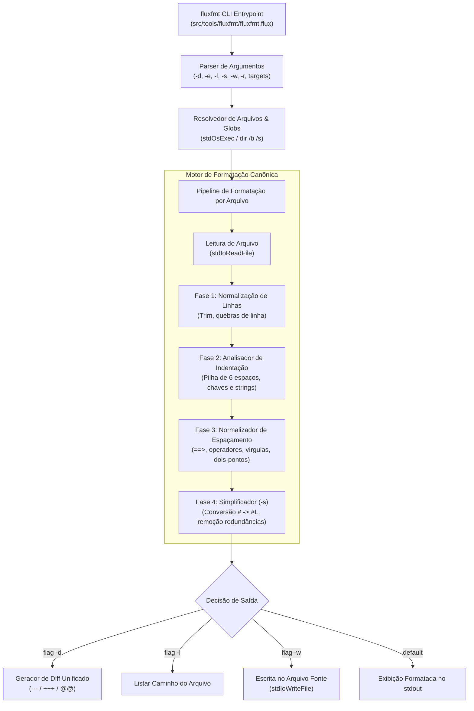

# Plano de Implementação: Utilitário de Formatação Canônica `fluxfmt`

## Visão Geral e Objetivos

O objetivo deste plano é projetar e implementar o utilitário de formatação canônica da linguagem TheFlux, denominado **`fluxfmt`** (`bin/fluxfmt.exe`), inspirado na filosofia e comportamento do `go fmt` / `gofmt`.

O utilitário será implementado como um programa autônomo em TheFlux na pasta [`.\src\tools\fluxfmt\`](file:///D:/Projetos/TheFlux/src/tools/fluxfmt/) ([`src/tools/fluxfmt/fluxfmt.flux`](file:///D:/Projetos/TheFlux/src/tools/fluxfmt/fluxfmt.flux)) e o binário final compilado será salvo obrigatoriamente na pasta [`.\bin\`](file:///D:/Projetos/TheFlux/bin/) ([`.\bin\fluxfmt.exe`](file:///D:/Projetos/TheFlux/bin/fluxfmt.exe)) utilizando o compilador self-hosted [`.\bin\fluxc.exe`](file:///D:/Projetos/TheFlux/bin/fluxc.exe).

---

## 1. Especificação de Interface de Linha de Comando (CLI)

### 1.1 Sintaxe de Invocação

```bash
fluxfmt [flags] [caminho ...]
```

### 1.2 Modos de Operação Principais

1. **Pasta Atual / Glob**:
   ```bash
   fluxfmt.exe .\*
   ```
   Varre e processa todos os arquivos `.flux` e `.fdsl` no diretório corrente (`.`).

2. **Varredura Recursiva**:
   ```bash
   fluxfmt.exe .\* -r
   ```
   Varre e processa recursivamente todos os arquivos `.flux` e `.fdsl` a partir do diretório corrente.

3. **Alvo por Projeto / Diretório / Arquivo Específico**:
   ```bash
   fluxfmt.exe <Nome>
   ```
   Processa todos os arquivos do projeto/pasta `<Nome>` (ou o arquivo específico se for apontado um arquivo individual).

4. **Ajuda e Documentação**:
   ```bash
   fluxfmt.exe help
   fluxfmt.exe -h
   fluxfmt.exe --help
   ```
   Exibe a sintaxe de uso, flags disponíveis e exemplos práticos.

5. **Versão do Utilitário**:
   ```bash
   fluxfmt.exe --version
   fluxfmt.exe -v
   fluxfmt.exe version
   ```
   Exibe a versão do formatador (`fluxfmt version 0.9.9`) e encerra a execução.

### 1.3 Flags Suportadas

Todas as opções de linha de comando aceitam prefixo simples `-` ou duplo `--` (ex: `-w` ou `--w`, `--write`), além de identificadores completos mnemônicos:

| Flag Curta | Flag Longa / `--` | Descrição | Comportamento no `fluxfmt` |
| :---: | :---: | :--- | :--- |
| **`-w`** | **`--write`** (ou `--w`) | *write result to (source) file instead of stdout* | Reescreve o arquivo fonte no disco caso haja alterações de formatação. Sem `-w` (e sem `-l`/`-d`), a saída formatada é enviada para `stdout`. |
| **`-d`** | **`--diff`** (ou `--d`) | *display diffs instead of rewriting files* | Exibe a diferença unificada (formato diff `---` / `+++` / `@@`) entre o arquivo original e o código formatado, sem alterar o disco. |
| **`-l`** | **`--list`** (ou `--l`) | *list files whose formatting differs* | Lista os caminhos dos arquivos cuja formatação difere do padrão canônico (um por linha). Pode ser combinado com `-w`. |
| **`-s`** | **`--simplify`** (ou `--s`) | *simplify code* | Aplica regras adicionais de simplificação: corrige automaticamente comentários `# ` legados para `#L `, remove linhas em branco redundantes em blocos, simplifica parênteses supérfluos e normaliza cláusulas de rotas. |
| **`-e`** | **`--all-errors`** (ou `--e`) | *report all errors* | Reporta todos os erros léxicos/estruturais encontrados em todos os arquivos examinados sem interromper a execução prematuramente. |
| **`-r`** | **`--recursive`** (ou `--r`) | *recursive directory traversal* | Percorre subdiretórios recursivamente ao expandir caminhos de pastas ou padrões glob. |
| **`-v`** | **`--version`** (ou `--v`, `version`) | *display version info* | Exibe a versão atual do formatador (`0.9.9`) e sai com código 0. |
| **`-h`** | **`--help`** (ou `help`) | *display help manual* | Exibe a mensagem de ajuda com manual de comandos e sai com código 0. |

---

## 2. Regras do Padrão Canônico de Formatação TheFlux

A formatação canônica de TheFlux segue as convenções estritas da linguagem e de sua biblioteca padrão:

1. **Indentação Estrita de 6 Espaços**:
   - Cada nível hierárquico recebe exatamente **6 espaços** (`"      "`).
   - Nível 0 (0 espaços): Declarações de topo de arquivo (`use`, `contract`, `agent`, `program`, `function`, `struct`, `enum`).
   - Nível 1 (6 espaços): Assinaturas de contrato (`op ...`), definições de operações em agentes, corpo de programas e funções.
   - Nível 2 (12 espaços): Blocos de controle (`route { ... }`, `infinite { ... }`, comandos internos).
   - Nível 3 (18 espaços): Ramos de rotas (`condicao ==> { ... }`).
   - Linhas que abrem bloco `{` mantêm a chave na mesma linha com 1 espaço prévio.
   - Linhas que fecham bloco com `}` alinham com a indentação da declaração que abriu o bloco.

2. **Espaçamento e Pontuação**:
   - Operadores binários (`=`, `==`, `!=`, `<`, `>`, `<=`, `>=`, `+`, `-`, `*`, `/i`, `/r`, `and`, `or`): exatamente um espaço antes e depois.
   - Seta de rotas (`==>`): exatamente um espaço antes e depois (`cond ==> {`).
   - Vírgulas (`,`): sem espaço antes, exatamente um espaço depois (`, `).
   - Dois-pontos em tipagem e structs (`:`): sem espaço antes, um espaço depois (`as int64: x`, `.raw: int64`).
   - Não utilização de ponto-e-vírgula (`;` proibido no TheFlux).

3. **Comentários**:
   - Comentários de linha em TheFlux devem iniciar estritamente com `#L`.
   - Na presença da flag `-s` (ou simplificação), comentários legados que comecem com `# ` ou `#[espaço]` são corrigidos automaticamente para `#L `.
   - Banners divisores de seção (ex: `#L =================================...`) iniciados na coluna 1 são preservados na coluna 1.

4. **Linhas em Branco e Final de Arquivo**:
   - Máximo de 1 linha em branco consecutiva no corpo de funções e blocos.
   - Nenhuma linha em branco imediatamente após a abertura de `{` ou antes do fechamento de `}`.
   - Exclusão rigorosa de espaços em branco ao final das linhas (*trailing whitespace*).
   - O arquivo termina com exatamente uma quebra de linha `\n`.

---

## 3. Arquitetura do Software `fluxfmt`



---

## 4. Modificações Propostas

### 4.1 Utilitário Principal

#### `[NEW]` [`src/tools/fluxfmt/fluxfmt.flux`](file:///D:/Projetos/TheFlux/src/tools/fluxfmt/fluxfmt.flux)
Implementação completa do formatador canônico contendo:
- `program (FluxFmt)`: Ponto de entrada, parser de flags (`-d`/`--diff`, `-e`/`--all-errors`, `-l`/`--list`, `-s`/`--simplify`, `-w`/`--write`, `-r`/`--recursive`, `-v`/`--version`, `-h`/`--help`), expansor de alvos e despacho.
- Funções auxiliares para:
  - `fmtResolveFiles`: Resolução de alvos com suporte a `.\*`, caminhos absolutos/relativos, projetos e recursão `-r`.
  - `fmtFormatCode`: Motor de formatação canônica com regras de indentação múltipla de 6, alinhamento de blocos e espaçamento de operadores.
  - `fmtSimplifyCode`: Regras de transformação da flag `-s`.
  - `fmtGenerateDiff`: Gerador de diff unificado para a flag `-d`.

### 4.2 Compilação e Binário

- **Comando de Compilação**:
  ```powershell
  .\bin\fluxc.exe --no-run --target llvm -o bin\fluxfmt src\tools\fluxfmt\fluxfmt.flux
  ```
- **Binário Resultante**:
  [`bin/fluxfmt.exe`](file:///D:/Projetos/TheFlux/bin/fluxfmt.exe)

---

## 5. Plano de Verificação

### 5.1 Testes Automatizados da CLI

Serão validados todos os cenários estipulados no prompt:

1. **Ajuda e Sintaxe**:
   ```powershell
   .\bin\fluxfmt.exe help
   .\bin\fluxfmt.exe -h
   ```
   - Validação: Deve exibir o manual de ajuda completo, opções de flags e código de saída 0.

2. **Formatação com Listagem (`-l`) e Diff (`-d`)**:
   ```powershell
   .\bin\fluxfmt.exe -l examples\Canon\ExampleOfRoute.flux
   .\bin\fluxfmt.exe -d examples\Canon\ExampleOfRoute.flux
   ```
   - Validação: Não altera o disco; `-l` lista apenas se houver diferença, e `-d` imprime o diff unificado.

3. **Modo Simplificação (`-s`)**:
   - Criação de um arquivo temporário de teste com comentário inválido `# teste` e espaçamento incorreto `1==1`.
   ```powershell
   .\bin\fluxfmt.exe -s -d t_sample.flux
   ```
   - Validação: Verifica se o diff mostra a transformação para `#L teste` e `1 == 1`.

4. **Escrita no Arquivo (`-w`) e Modo Recursivo (`-r`)**:
   ```powershell
   .\bin\fluxfmt.exe .\* -l
   .\bin\fluxfmt.exe <Nome> -r -l
   ```
   - Validação: Confirma que os arquivos são varridos e formatados conforme as regras canônicas de 6 espaços.

5. **Fixpoint de Formatação (Idempotência)**:
   - Formatar um arquivo com `-w`, depois executar `-l`:
   - Validação: O comando subsequente com `-l` deve retornar saída vazia (idempotência garantida: `fmt(fmt(x)) == fmt(x)`).

6. **Exibição de Versão (`--version` / `-v`)**:
   ```powershell
   .\bin\fluxfmt.exe --version
   .\bin\fluxfmt.exe -v
   ```
   - Validação: Deve imprimir a versão `fluxfmt 0.9.9` (ou `fluxfmt version 0.9.9`) e retornar código 0.

7. **Suporte a Flags com Duplo Hífen (`--`)**:
   ```powershell
   .\bin\fluxfmt.exe --help
   .\bin\fluxfmt.exe --diff examples\Canon\ExampleOfRoute.flux
   .\bin\fluxfmt.exe --list examples\Canon\ExampleOfRoute.flux
   ```
   - Validação: Confirma equivalência funcional completa entre flags curtas (`-d`, `-l`, `-w`, etc.) e longas (`--diff`, `--list`, `--write`, `--simplify`, `--recursive`, `--version`, `--help`).

---

## 6. Revisão do Usuário Necessária

> [!IMPORTANT]
> **Compatibilidade de Padrão Canônico**:
> O utilitário adotará **estritamente o padrão oficial de TheFlux**, onde cada nível de indentação é composto por **6 espaços** (`"      "`), comentários usam `#L`, e blocos `route` usam `==> {`. Caso deseje suporte opcional a tabs (`\t`) ou outro tamanho de indentação customizável além do canônico padrão de 6 espaços, isso pode ser acrescentado como flag opcional.

Por favor, revise a proposta acima e confirme para procedermos com a implementação e compilação do `bin/fluxfmt.exe`.
