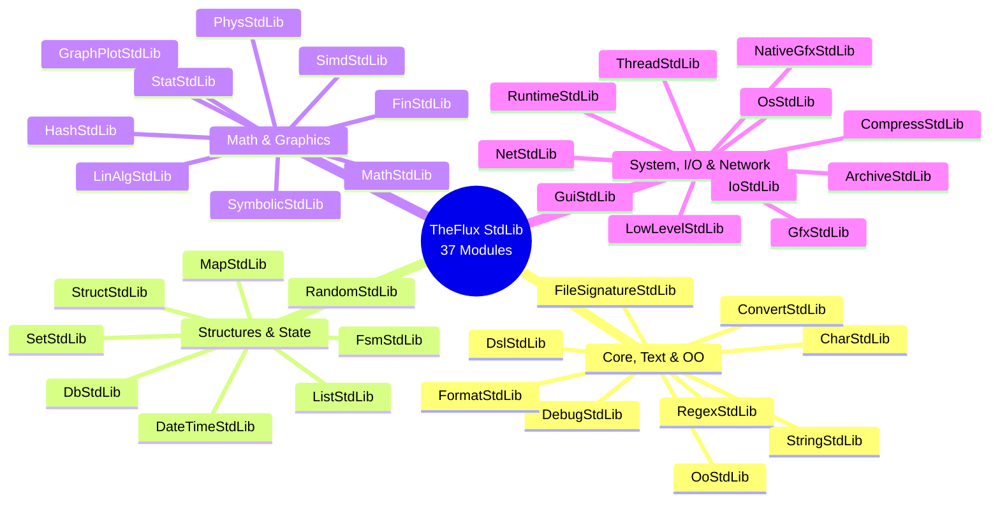

# TheFlux v0.5.0 Release Notes

> **Release Date**: October 2026  
> **Version**: `0.5.0`  
> **Status**: Development / Stable  
> **License**: GNU General Public License v3.0 (GPL-3.0)  
> **Multi-Backend Compliance**: **100.0% PASS** (2,306 / 2,306 programs validated across all 6 backends)

---

## 🌟 Executive Summary: The Major Leap for TheFlux Ecosystem

Version **0.5.0** of **TheFlux** programming language marks the definitive maturity of its data-oriented, contract-driven, and reactive agent architecture. This release establishes TheFlux as a high-performance language engineered for cutting-edge scientific computing, rigorous software engineering, and universal execution across diverse targets.

### Key Highlights of Version 0.5.0

1. **Linear Dataflow Computing Paradigm**: TheFlux is built from inception on continuous dataflow computation. Notably, **in version 0.5.0, dataflow is strictly linear** (sequential transformation pipelines and chains), guaranteeing absolute mathematical determinism, cognitive simplicity, and uniform execution stability across all 6 backends prior to introducing complex branching graph topologies.
2. **Complete Standard Library (37 stdlibs)**: A modular catalog covering the language's 4 architectural pillars, introducing preemptive concurrency with MPMC channels (`ThreadStdLib`), multi-model disk persistence with 6 embedded engines (`DbStdLib`), analytical symbolic computer algebra (`SymbolicStdLib`), hardware SIMD acceleration (`SimdStdLib`), scientific plotting with 19 coordinate systems (`GraphPlotStdLib`), native accelerated rendering drivers (`NativeGfxStdLib`), pure in-memory compression with Zip Bomb defense (`CompressStdLib`), and lossless container management and binary I/O (`ArchiveStdLib` and `IoStdLib`).
3. **Scientific Algorithms Suite `examples/SciAlgo` (1,741 Algorithms)**: The most comprehensive catalog of scientific algorithms and computational structures natively implemented in TheFlux, spanning 13 major domains and 49 thematic categories, with 100% behavioral parity across all 6 execution backends.
4. **Classical Numerical Suite `examples/NumericalRecipes` (205 Algorithms)**: A clean-room implementation of the canonical treatise *Numerical Recipes: The Art of Scientific Computing (3rd Edition, Cambridge University Press)*, covering all 22 chapters with full multi-backend parity.
5. **Multi-Backend Infrastructure with Absolute Parity**: TheFlux compiler verifies 2,306 programs and algorithms with strict determinism across 6 targets (`in`, `vm`, `vmr`, `llvm`, `wat`, `wasm`), totaling **13,836 compliance checks** with zero divergence.

---

## ⚙️ Multi-Backend Architecture: 6 Targets with Absolute Parity

TheFlux enforces the principle of **Invariant Semantics**: identical `.flux` source code yields bit-for-bit identical deterministic output character-by-character, regardless of the chosen execution target:

| Backend | Identifier | Architectural Role | Underlying Technology | Status v0.5.0 |
| :--- | :---: | :--- | :--- | :---: |
| **AST Interpreter** | `in` | Interactive execution, agile prototyping, real-time semantics | In-memory Abstract Syntax Tree | ✅ 100% PASS |
| **VM Bytecode** | `vm` | Bytecode compilation and virtual machine execution | Optimized `.fvmbc` bytecode emitter | ✅ 100% PASS |
| **VM Runner** | `vmr` | Integrity verification of reloaded disk artifacts | Streamlined `.fvmbc` deserializer | ✅ 100% PASS |
| **Native LLVM** | `llvm` | Native machine binaries with maximum CPU optimization | LLVM IR emitter + Clang + `flux_input.c` | ✅ 100% PASS |
| **WebAssembly Text** | `wat` | Universal portability, low-level inspection, WASI | WASM S-Expressions emitter (`.wat`) | ✅ 100% PASS |
| **WebAssembly Binary** | `wasm` | High-speed execution in browsers and cloud runtimes | Direct binary `.wasm` emitter (`wasmer`) | ✅ 100% PASS |

---

## 📦 Pillar 1: The Official Catalog of 37 Standard Libraries (`stdlib/`)

The standard library of TheFlux is structured around typed contracts (`contract`) and agent implementations (`agent ... impl ...`) organized into **4 architectural pillars**:



### 1. Core, Text & OO (9 Libraries)
- **`CharStdLib.fdsl`**: Unicode character classification, UTF-8 encodings, semantic predicates, and safe transformations.
- **`ConvertStdLib.fdsl`**: Bidirectional conversion between primitive types, arbitrary numeric bases (binary, octal, decimal, hex), and safe parsing.
- **`DebugStdLib.fdsl`**: Call tracing, execution breakpoints, stack introspection, and runtime diagnostics.
- **`DslStdLib.fdsl`**: Complete framework for domain-specific languages:
  - `DslLexerContract`: Flexible tokenization based on lexical patterns and regular expressions.
  - `DslParserContract`: Parser with visual diagnostics and caret-indicated error localization (`^`).
  - `DslAstContract`: AST node manipulation and constant folding optimizations.
  - `DslExecutionContract` & `DslAsmContract`: Inline execution with context injection and register assembly.
  - `DslSandboxContract`: Sandbox governance with CPU time quotas, memory allocation caps, and timeouts.
- **`FileSignatureStdLib.fdsl`**: Magic number inspection, strict MIME type detection, and binary signatures.
- **`FormatStdLib.fdsl`**: Structured encoding and decoding for industry formats: JSON, CSV, YAML 1.2, TOML, Base64, and URL Encoding.
- **`OoStdLib.fdsl`**: Contract-grounded object-oriented programming, explicit composition, dynamic polymorphism, and safe dispatch.
- **`RegexStdLib.fdsl`**: Native regular expression engine for pattern search, matching, group capture, and substitution.
- **`StringStdLib.fdsl`**: Text processing, 1-indexed slicing, interpolation, padding, normalization, and mutation.

### 2. Structures & State (8 Libraries)
- **`DateTimeStdLib.fdsl`**: Calendar calculations, intervals, time zones, and high-fidelity timing with microsecond monotonic clocks.
- **`DbStdLib.fdsl`**: Multi-model disk persistence with 6 high-performance embedded engines:
  - **SQLite 3.53.4**: Full ACID SQL relational database.
  - **DuckDB 1.5.6**: Columnar OLAP database for fast analytical queries.
  - **LevelDB 1.23**: Fast LSM key-value store.
  - **UnQLite 1.1.4**: Embedded NoSQL document and key-value store.
  - **KùzuDB 0.11.3**: Native property graph database with Cypher queries.
  - **ObjectBox 5.3.2**: Vector search engine for AI embeddings (k-NN / HNSW) and typed objects.
- **`FsmStdLib.fdsl`**: Deterministic finite state machines with event transitions, conditional guards, and safe routes.
- **`ListStdLib.fdsl`**: Heterogeneous and homogeneous dynamic lists, functional operations (`map`, `filter`, `fold`), sorting, and partitioning.
- **`MapStdLib.fdsl`**: Associative key-value dictionaries with hash addressing.
- **`RandomStdLib.fdsl`**: Cryptographically secure PRNG (CSPRNG) and statistical distributions (Normal, Uniform, Poisson, Exponential).
- **`SetStdLib.fdsl`**: Finite set algebra: union, intersection, difference, complement, and $O(1)$ membership testing.
- **`StructStdLib.fdsl`**: Typed data records with contract verification and field introspection.

### 3. Mathematics, Graphics & Scientific Computing (9 Libraries)
- **`FinStdLib.fdsl`**: Financial functions: loan amortization (SAC, Price), NPV, IRR, and annuities.
- **`GraphPlotStdLib.fdsl`**: Advanced scientific visualization across 7 plotting domains (density distributions, relationships, 3D surfaces/vector fields, compositions, curvilinear systems, graph models, engineering curves) with native support for 19 curvilinear coordinate systems and 3D camera projections (perspective, orthographic, isometric).
- **`HashStdLib.fdsl`**: Cryptographic hashing (SHA-256, MD5) and block integrity checks (CRC32, Adler32).
- **`LinAlgStdLib.fdsl`**: Dense linear algebra: multidimensional matrices, tensor operations, linear systems, inversion, determinants, eigenvalues, and eigenvectors.
- **`MathStdLib.fdsl`**: Elementary math, direct/inverse trigonometry, hyperbolic functions, logarithms, powers, and safe rounding.
- **`PhysStdLib.fdsl`**: Fundamental physics modeling: kinematics, Newtonian dynamics, geometric optics, universal gravitation, thermodynamics, electrostatics.
- **`SimdStdLib.fdsl`**: Direct hardware-level vectorization (SIMD): parallel integer and float operations, reduction sums, vectorized dot products.
- **`StatStdLib.fdsl`**: Descriptive and inductive statistics: central tendency (mean, median, mode), dispersion (variance, stddev), correlation (Pearson, Spearman), probability distributions.
- **`SymbolicStdLib.fdsl`**: Computer algebra engine: symbolic simplification, polynomial expansion, arbitrary-order symbolic differentiation, and LaTeX export.

### 4. System, I/O, Network & Concurrency (11 Libraries)
- **`ArchiveStdLib.fdsl`**: High-level archive facade (`.zip`, `.tar`, `.tar.gz`, `.tar.bz2`, `.tar.xz`, `.tar.zst`, `.7z`, `.rar` extraction) and 8-bit lossless binary I/O.
- **`CompressStdLib.fdsl`**: In-memory buffer compression/decompression: Deflate, Zlib, Gzip, Bzip2, LZMA, LZMA2, XZ, Zstandard, with `CompressStats` telemetry and `DecompressQuota` defense against Zip Bombs.
- **`GfxStdLib.fdsl` & `GuiStdLib.fdsl`**: Vector graphics primitives and immediate-mode GUI (IMGUI).
- **`IoStdLib.fdsl`**: Atomic file I/O, recursive directory walking, and lossless binary streaming.
- **`LowLevelStdLib.fdsl`**: Memory registers, bitwise shifts, masks, pointer alignment, and hardware endianness inspection.
- **`NativeGfxStdLib.fdsl`**: Hardware-accelerated graphics driver (Win32 GDI / HTML5 Canvas / WASI) with window lifecycle, event pooling, and primitive rendering.
- **`NetStdLib.fdsl`**: TCP and UDP network sockets, HTTP client with REST methods, IP address resolution, and URL parsing.
- **`OsStdLib.fdsl`**: Operating system interaction: environment variables, subprocess execution, exit codes, path normalization.
- **`RuntimeStdLib.fdsl`**: Runtime introspection: Garbage Collector metrics, heap statistics, reference counts, dynamic type inspection.
- **`ThreadStdLib.fdsl`**: Preemptive multithreading: native thread lifecycle (`threadSpawn`, `threadJoin`, `threadYield`), synchronization primitives (recursive mutexes, atomic CAS, condition variables, semaphores, barriers), and MPMC channels with bounded/unbounded CSP buffers.

---

## 🔬 Pillar 2: Scientific Algorithms Suite `examples/SciAlgo` (1,741 Algorithms)

The [`examples/SciAlgo`](../examples/SciAlgo/) suite is a major milestone of TheFlux, providing **1,741 real scientific algorithms** implemented in pure TheFlux (`.flux`), across **13 Major Domains** and **49 Thematic Categories**, verified with **100% PASS across all 6 backends**:

| Domain | Scientific Scope | Algorithms | Multi-Backend Compliance | Status |
| :--- | :--- | :---: | :---: | :---: |
| **Domain I** | **Foundations, Search & Sorting** (`01_foundations`) | **175** | 6 Backends (1050/1050 PASS) | ✅ Complete |
| **Domain II** | **Advanced Data Structures & Streaming** (`02_data_structures`) | **112** | 6 Backends (672/672 PASS) | ✅ Complete |
| **Domain III** | **Graph Theory & Networks** (`03_graphs`) | **144** | 6 Backends (864/864 PASS) | ✅ Complete |
| **Domain IV** | **Strings, Text & Information Theory** (`04_strings`) | **130** | 6 Backends (780/780 PASS) | ✅ Complete |
| **Domain V** | **Computational Math, Algebra & Number Theory** (`05_mathematics`) | **177** | 6 Backends (1062/1062 PASS) | ✅ Complete |
| **Domain VI** | **Numerical Methods, Geometry & Computational Physics** (`06_numerical_physics`) | **175** | 6 Backends (1050/1050 PASS) | ✅ Complete |
| **Domain VII**| **Optimization & Scientific Statistics** (`07_optimization_stat`) | **140** | 6 Backends (840/840 PASS) | ✅ Complete |
| **Domain VIII**| **Artificial Intelligence & Deep Learning** (`08_artificial_intel`) | **282** | 6 Backends (1692/1692 PASS) | ✅ Complete |
| **Domain IX** | **Computer Systems, Compilers & Infrastructure** (`09_systems_infra`) | **230** | 6 Backends (1380/1380 PASS) | ✅ Complete |
| **Domain X**  | **Bioinformatics & Quantum Computing** (`10_bio_quantum`) | **120** | 6 Backends (720/720 PASS) | ✅ Complete |
| **Domain XI** | **Digital Signal Processing (DSP) & Multimedia** (`11_dsp_multimedia`) | **20** | 6 Backends (120/120 PASS) | ✅ Complete |
| **Domain XII**| **Robotics, Kinematics, Control & Navigation** (`12_robotics_control`) | **20** | 6 Backends (120/120 PASS) | ✅ Complete |
| **Domain XIII**| **Classical Cryptography & Security** (`13_classical_crypto`) | **16** | 6 Backends (96/96 PASS) | ✅ Complete |
| **GRAND TOTAL**| **13 Major Scientific Domains** | **1,741** | **10,446 Verified Checks** | 🚀 **100.0% PASS** |

---

## 📘 Pillar 3: Classical Numerical Suite `examples/NumericalRecipes` (205 Algorithms)

The [`examples/NumericalRecipes`](../examples/NumericalRecipes/) suite brings a clean-room implementation of all **205 numerical algorithms** from *Numerical Recipes: The Art of Scientific Computing (3rd Edition, Cambridge University Press)* across all **22 official chapters**:

| Chapter | Scientific Topic | Algorithms | 6 Backends | Status |
| :--- | :--- | :---: | :---: | :---: |
| **01_preliminaries** | Preliminaries, Machine Precision & Error Analysis | 5 | 30/30 PASS | ✅ 100% |
| **02_linear_algebra** | Linear Equation Systems (LU, SVD, Cholesky) | 13 | 78/78 PASS | ✅ 100% |
| **03_interpolation** | Interpolation & Extrapolation (Cubic Splines, Neville) | 10 | 60/60 PASS | ✅ 100% |
| **04_integration** | Numerical Integration (Romberg, Simpson, Gauss-Legendre) | 10 | 60/60 PASS | ✅ 100% |
| **05_function_evaluation**| Function Evaluation, Series & Chebyshev Approximations | 14 | 84/84 PASS | ✅ 100% |
| **06_special_functions** | Special Functions (Gamma, Beta, Bessel, Elliptic) | 14 | 84/84 PASS | ✅ 100% |
| **07_random_numbers** | Low-Discrepancy Random Generation & Monte Carlo | 11 | 66/66 PASS | ✅ 100% |
| **08_sorting_selection** | Sorting & Selection (Heapsort, Quicksort, Median) | 8 | 48/48 PASS | ✅ 100% |
| **09_root_finding** | Root Finding & Nonlinear Systems (Newton, Brent, Ridder) | 9 | 54/54 PASS | ✅ 100% |
| **10_minimization** | Multidimensional Minimization (Nelder-Mead, BFGS, Powell) | 14 | 84/84 PASS | ✅ 100% |
| **11_eigensystems** | Eigenvalues & Eigenvectors (Jacobi, Householder, QR) | 8 | 48/48 PASS | ✅ 100% |
| **12_fast_fourier_transform**| Fast Fourier Transform (1D, 2D, Multidimensional FFT) | 9 | 54/54 PASS | ✅ 100% |
| **13_fourier_spectral** | Spectral Methods, Wavelets & Digital Filtering | 11 | 66/66 PASS | ✅ 100% |
| **14_statistical_description**| Statistical Data Description, KS Test, Variance | 10 | 60/60 PASS | ✅ 100% |
| **15_modeling_data** | Model Fitting & Nonlinear Least Squares (Levenberg-Marquardt) | 9 | 54/54 PASS | ✅ 100% |
| **16_classification_inference**| Classification, Gaussian Mixture Models & SVM | 7 | 42/42 PASS | ✅ 100% |
| **17_differential_equations**| ODE Integration (Cash-Karp Runge-Kutta, Bulirsch-Stoer) | 8 | 48/48 PASS | ✅ 100% |
| **18_boundary_value_problems**| Two-Point Boundary Value Problems (Shooting Method) | 6 | 36/36 PASS | ✅ 100% |
| **19_integral_equations** | Fredholm & Volterra Integral Equations | 7 | 42/42 PASS | ✅ 100% |
| **20_partial_differential_eqs**| PDE Solving (Finite Differences, SOR, Multigrid) | 7 | 42/42 PASS | ✅ 100% |
| **21_computational_geometry**| Computational Geometry (Delaunay, Voronoi, Convex Hull) | 8 | 48/48 PASS | ✅ 100% |
| **22_less_numerical** | Discrete Algorithms, Arithmetic Compression & Hashing | 7 | 42/42 PASS | ✅ 100% |
| **GRAND TOTAL** | **22 Canonical Chapters (3rd Edition)** | **205** | **1,230 Verified Checks** | 🚀 **100.0% PASS** |

---

## 📊 Global Quality & Verification Metrics

```
+-----------------------------------------------------------------------------------+
|                        THEFLUX v0.5.0 QUALITY METRICS                             |
+----------------------------------------------------+--------------+---------------+
| Validated Component                                | Files        | Assertions    |
+----------------------------------------------------+--------------+---------------+
| Central Compiler Suite (flux/)                     | 360          | 2,160 PASS    |
| Global Scientific Suite (examples/SciAlgo/)        | 1,741        | 10,446 PASS   |
| Classical Numerical Suite (examples/NumericalRecipes)| 205        | 1,230 PASS    |
+----------------------------------------------------+--------------+---------------+
| TOTAL VALIDATED WITH 100% PARITY                   | 2,306 prog.  | 13,836 PASS   |
+----------------------------------------------------+--------------+---------------+
```

---

## 🚀 Quick Start Guide

### 1. Prerequisites
- Python 3.11 or higher
- Clang / LLVM (for the native `llvm` target)
- WABT (`wat2wasm`) and Wasmer or Wasmtime (for `wat` and `wasm` targets)

### 2. Environment Setup
```bash
git clone https://github.com/theflux-lang/theflux.git
cd theflux

# Linux / macOS:
export PYTHONPATH="src"

# Windows (PowerShell):
$env:PYTHONPATH = "src"
```

### 3. Executing Compliance Runners
```bash
# Compiler compliance suite (376 tests including diagnostic negatives)
python backend_compliance.py

# Scientific algorithm suite (1,741 algorithms)
python examples/SciAlgo/SciAlgo_compliance.py

# Numerical Recipes suite (205 algorithms)
python examples/NumericalRecipes/NumericalRecipes_compliance.py
```

---

## 🗺️ Roadmap: Strategic Focus on Self-Hosting

1. **Full Compiler Self-Hosting**:
   - Rewrite TheFlux compiler (lexer, parser, semantic analyzer, DDG graph builder, and code generators) natively in `.flux` and `.fdsl`.
2. **Beyond Linear Dataflow**:
   - Extend linear pipelines into general Directed Acyclic Graphs (DAGs) with dynamic fan-out, fan-in, and multiplexed parallel channels.
3. **Advanced LLVM Vectorization**:
   - Auto-vectorization based on Data Dependency Graphs (DDG) and aggressive inter-procedural inlining.
4. **Package Manager (`flux pkg`)**:
   - Decentralized registry, publication, and dependency resolution for `.fdsl` libraries and agents.
