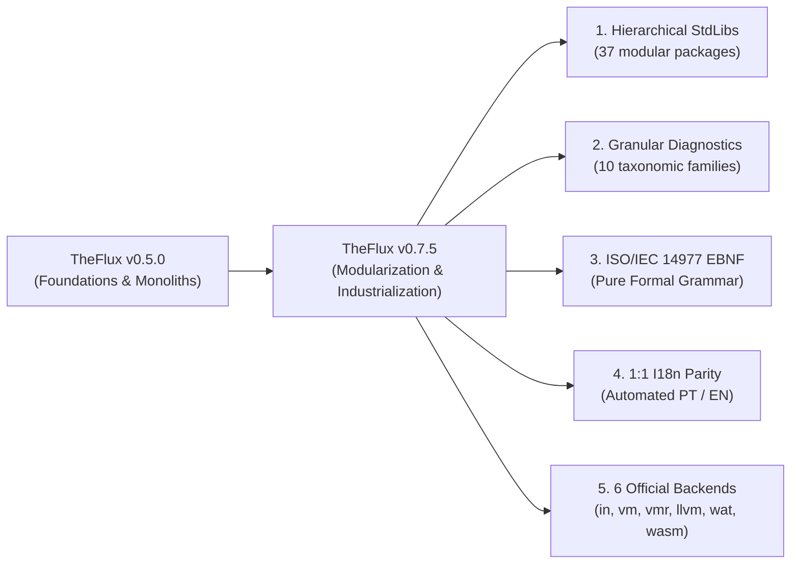

# TheFlux v0.7.5 Release Notes

> **Release Date**: October 2026  
> **Version**: `0.7.5`  
> **Status**: Stable / Production  
> **License**: GNU General Public License v3.0 (GPL-3.0)  
> **Multi-Backend Compliance**: **100.0% PASS** across all 6 official backends (`in`, `vm`, `vmr`, `llvm`, `wat`, `wasm`)

---

## 🌟 1. Executive Summary: Industrial and Scientific Maturity

Version **0.7.5** of **TheFlux** programming language establishes a major milestone in the language's trajectory: the transition from an experimental ecosystem into an industrial-grade platform for software engineering and high-performance scientific computing.

This release formalizes the canonical modular architecture of all **37 standard libraries**, introduces an industry-leading **prescriptive granular diagnostic system** featuring AOT (Ahead-of-Time) compilation for both Python and C/LLVM runtimes, unifies formal grammar specifications under international standard **ISO/IEC 14977 (EBNF)**, and achieves **strict 1:1 bilingual symmetry** across all technical documentation (Portuguese and English).



---

## 🚀 2. Major Highlights of Version 0.7.5

### 2.1 Canonical Modular Architecture for All 37 Standard Libraries (`stdlib/`)
All 37 standard libraries in TheFlux ecosystem have been refactored from flat monolithic files into **hierarchical modular packages**. This architecture is governed by three strict principles documented in [`docs/en/StdLibs.md`](file:///D:/Projetos/TheFlux/docs/en/StdLibs.md):
1. **Master Aggregator File Triad (`<Lib>StdLib.fdsl`)**:
   - **Global Types**: All globally shared structures (`struct`) and enumerations (`enum`) are declared in the master aggregator header (e.g., `CompressStats`, `DecompressQuota`, `FinDecimal`, `SymbolicNode`).
   - **Declarative Manifest**: The aggregator formally exposes its submodules via the `use <Domain>.fdsl` directive.
   - **Shared Utility Operations (`op _*`)**: Helper operations consumed by two or more domain modules reside exclusively in the aggregator agent body.
2. **Mandatory Formal Domain Contracts**: Every child submodule strictly implements a typed contract (`contract (<Domain>Contract)` and `agent (<Lib>StdLib) impl <DomainContract>`).
3. **Zero Orphan Files**: Standalone utility modules without contracts have been cleanly integrated or eliminated (complete removal of `FormatUtility.fdsl`, `FsmUtility.fdsl`, and `StructUtility.fdsl`).

### 2.2 Granular Diagnostic Taxonomy and Prescriptive Actionable Hints
The diagnostic engine was redesigned to provide pinpoint spatial error localization and **actionable hints (`hint`)** that guide the developer toward fixing the problem:
- **10 Taxonomic Families**: 6-character structured mnemonic codes:
  - `LEX001`: Lexical read errors and forbidden non-ASCII bytes outside string literals.
  - `SYN100` to `SYN161`: Syntax errors, mandatory static shapes for `tensor`, required element types in `list` and `set`.
  - `IMP201` to `IMP204`: Module imports, circular dependency cycles, and missing modules.
  - `SEM301` to `SEM372`: Scope resolution, identifier duplicate definitions, and semantic integrity.
  - `TYP401` to `TYP499`: Strict type checks for primitive scalars, matrices, and complex numbers (`complex64`/`complex128`).
  - `OWN501` to `OWN505`: Ownership system, immutability guarantees, and mutable collection constraints.
  - `RES601` to `RES602`: Memory quotas and decompression limits (*Zip Bomb protection*).
  - `RT701` to `RT709`: Runtime errors and mathematical domain violations ($\div 0$, $\ln(x \le 0)$, $\sqrt{x < 0}$).
  - `MOD801` to `MOD802`: Modular contract compliance and agent implementation signatures.
  - `SYS901` to `SYS902`: Resource exhaustion and hardware/system-level errors.

### 2.3 Ahead-of-Time (AOT) Compilation of the Error Catalog
Diagnostic catalog synchronization is now compiled ahead-of-time ([`scripts/sync_errors_catalog.py`](file:///D:/Projetos/TheFlux/scripts/sync_errors_catalog.py)):
- **Python Runtime**: Generates [`src/flux_proto/diagnostics/catalog_data.py`](file:///D:/Projetos/TheFlux/src/flux_proto/diagnostics/catalog_data.py) with pre-indexed dictionaries for $O(1)$ lookups with zero runtime parsing.
- **C / LLVM Runtime**: Generates header [`src/flux_proto/llvm/runtime/flux_errors.h`](file:///D:/Projetos/TheFlux/src/flux_proto/llvm/runtime/flux_errors.h), unifying error messages emitted by compiled native binaries with interpreter output.
- **Synchronized Documentation**: Simultaneously generates [`docs/en/Errors.md`](file:///D:/Projetos/TheFlux/docs/en/Errors.md) and [`docs/pt/Errors.md`](file:///D:/Projetos/TheFlux/docs/pt/Errors.md).

### 2.4 ISO/IEC 14977 Formal Grammar (EBNF) and Automated Synchronization
The formal specification of TheFlux is standardized under international standard **ISO/IEC 14977**:
- Canonical artifacts created:
  - [`docs/en/TheFlux.ebnf`](file:///D:/Projetos/TheFlux/docs/en/TheFlux.ebnf) and [`docs/pt/TheFlux.ebnf`](file:///D:/Projetos/TheFlux/docs/pt/TheFlux.ebnf) (Formal language specification).
  - [`docs/en/Grammar.ebnf`](file:///D:/Projetos/TheFlux/docs/en/Grammar.ebnf) and [`docs/pt/Gramatica.ebnf`](file:///D:/Projetos/TheFlux/docs/pt/Gramatica.ebnf) (Concrete compiler grammar).
  - [`docs/shared/TheFlux.ebnf`](file:///D:/Projetos/TheFlux/docs/shared/TheFlux.ebnf) (Canonical shared reference).
- Dedicated synchronization tool ([`scripts/docs/sync_ebnf.py`](file:///D:/Projetos/TheFlux/scripts/docs/sync_ebnf.py)) ensuring 100% parity between standalone `.ebnf` files and embedded code blocks across Markdown specifications.

### 2.5 Strict 1:1 Internationalization and Governance Suite
- **Directory Layout**: All documentation specifications reside exclusively within isolated language trees [`docs/en/`](file:///D:/Projetos/TheFlux/docs/en/) and [`docs/pt/`](file:///D:/Projetos/TheFlux/docs/pt/), ensuring `docs/` root remains clean of duplicate files.
- **Strict Capitalization by Language**: English Capitalized names in `en/` (e.g., `Compilation.md`, `Grammar.md`, `Grammar.ebnf`) and Portuguese Capitalized names in `pt/` (e.g., `Compilacao.md`, `Gramatica.md`, `Gramatica.ebnf`).
- **Automated Parity Linter** ([`scripts/docs/check_i18n_parity.py`](file:///D:/Projetos/TheFlux/scripts/docs/check_i18n_parity.py)): Validates 1:1 file correspondence, section cardinalities, error code alignment, and repository integrity.
- **Unified Build Orchestrator** ([`scripts/docs/build_docs.py`](file:///D:/Projetos/TheFlux/scripts/docs/build_docs.py)): Builds the entire documentation pipeline (EBNF $\rightarrow$ Parity $\rightarrow$ Error Catalog $\rightarrow$ Keyword Indexes $\rightarrow$ Interactive HTML) in ~2 seconds.

---

## ⚙️ 3. The 6 Official Backends Matrix

TheFlux v0.7.5 guarantees **Absolute Invariant Semantics**: any valid `.flux` program produces the exact same deterministic behavior, standard output, and error diagnostics across all 6 compilation and execution backends:

| Backend | CLI Flag | Architectural Role | Execution Target | Status v0.7.5 |
| :--- | :--- | :--- | :--- | :---: |
| **AST Interpreter** | `in` / `--backend in` | In-memory AST evaluation for agile prototyping and runtime introspection | Host (Python) | ✅ 100% PASS |
| **Bytecode VM** | `vm` / `--backend vm` | Stack-based execution using proprietary `.fvmbc` bytecode | FVM Engine | ✅ 100% PASS |
| **VM Runner** | `vmr` / `--backend vmr` | High-efficiency execution with linear virtual registers and bytecode verification | FVM Register Engine | ✅ 100% PASS |
| **Native LLVM** | `llvm` / `--backend llvm` | Ahead-of-Time native machine code compilation for maximum CPU performance | Native Binary (.exe) | ✅ 100% PASS |
| **WASM Text** | `wat` / `--backend wat` | S-Expression text emission for WebAssembly auditing and portable execution | Node / Wasmtime | ✅ 100% PASS |
| **WASM Binary** | `wasm` / `--backend wasm` | Direct binary WebAssembly compilation for web and cloud runtime environments | Wasmer / Wasmtime | ✅ 100% PASS |

---

## 📊 4. Comparative Matrix: v0.5.0 vs v0.7.5

| Dimension / Feature | TheFlux v0.5.0 | TheFlux v0.7.5 | Architectural Benefit |
| :--- | :--- | :--- | :--- |
| **StdLib Architecture** | Flat monolithic files | Hierarchical modular packages with master aggregators and domain modules | High cohesion, clean encapsulation, and elimination of circular imports |
| **Contract Coverage** | Mixed (free-standing functions in some modules) | 100% of domain submodules implement typed formal contracts | Strict interface guarantees and safe inter-module composition |
| **Helper Management (`op _*`)** | Unenforced orphan helper files (`*Utility.fdsl`) | Shared helpers on aggregator; single-scope helpers inside domain module | Zero orphan files and isolated helper scopes |
| **Diagnostic Catalog** | Generic legacy codes (`PAR001`, `SEM001`) | Granular taxonomy across 10 families with 82+ specific error codes | Precise failure localization and actionable prescriptive hints |
| **Catalog Compilation** | Dynamic runtime disk parsing | Ahead-of-Time compilation to Python (`catalog_data.py`) and C (`flux_errors.h`) | $O(1)$ lookups, zero runtime disk I/O, and exact parity between Python and LLVM |
| **Grammar Specification** | Pseudo-BNF with C-style comments | Formal ISO/IEC 14977 (EBNF) standard with standalone `.ebnf` files | Direct alignment with international language standards |
| **Internationalization (I18n)** | Fragmented files with redundant root copies | Strict 1:1 symmetry across isolated folders (`en/` and `pt/`) with CI linter | Consistent global developer experience and unified documentation portal |
| **Docs Directory Hygiene** | Duplicate files scattered across `docs/` root | Clean `docs/` root; structured subdirectories `en/`, `pt/`, `shared/`, `site/` | Clean separation of concerns and automated repository governance |

---

## 🛠️ 5. Migration Guide: Upgrading from v0.5.0 to v0.7.5

### 5.1 Importing Modularized StdLibs
In version 0.5.0, developers could occasionally reference helper utility files directly. In version 0.7.5, all invocations must be made through master aggregator libraries or domain contracts:

```flux
#L BEFORE (v0.5.0 - Prone to tight coupling)
use FormatUtility.fdsl
mut as int64: n = _fmtParseInt("123")

#L NOW (v0.7.5 - Canonical Architecture)
use FormatStdLib.fdsl
mut as int64: n = FormatStdLib._fmtParseInt("123")
```

### 5.2 Error Diagnostic Formats
Automated test suites or scripts asserting specific diagnostic codes should be updated to the new taxonomy:
- Replace `PAR001` with `SYN100` (Unexpected Token) or `SYN150` (Tensor Requires Shape).
- Replace `SEM001` with `SEM303` (Undefined Identifier) or `IMP201` (Module Not Found).
- Replace `RUN001` with `RT701` (Division By Zero), `RT706` (Log Domain), or `RT707` (Sqrt Negative).

### 5.3 CLI Invocations
The command-line interface standardizes target backend selection via the `--backend` flag:
```powershell
# Direct execution on target backend
flux run --backend in program.flux     # Interpreter
flux run --backend vm program.flux     # Virtual Machine
flux run --backend vmr program.flux    # VM Register Runner
flux run --backend llvm program.flux   # Native LLVM AOT Compiler
flux run --backend wat program.flux    # WebAssembly Text
flux run --backend wasm program.flux   # WebAssembly Binary
```

---

## 🗺️ 6. Roadmap and Next Milestones

With **TheFlux v0.7.5** delivered, the core engineering team enters the final preparatory cycle for **TheFlux v1.0.0 LTS**:
1. **Non-Linear Dataflow**: Upgrading the current linear pipeline operators (`-->`, `==>`) to support branched asynchronous dataflow graphs with parallel joins.
2. **JIT Tiering in VMR Backend**: Dynamic loop optimization and trace-based hot-path compilation directly within the register virtual machine.
3. **TheFlux Package Manager (`fluxpkg`)**: Integrated toolchain for publishing, semantic versioning, and dependency resolution of distributed TheFlux packages.

---

*TheFlux Core Engineering Team — October 2026.*
