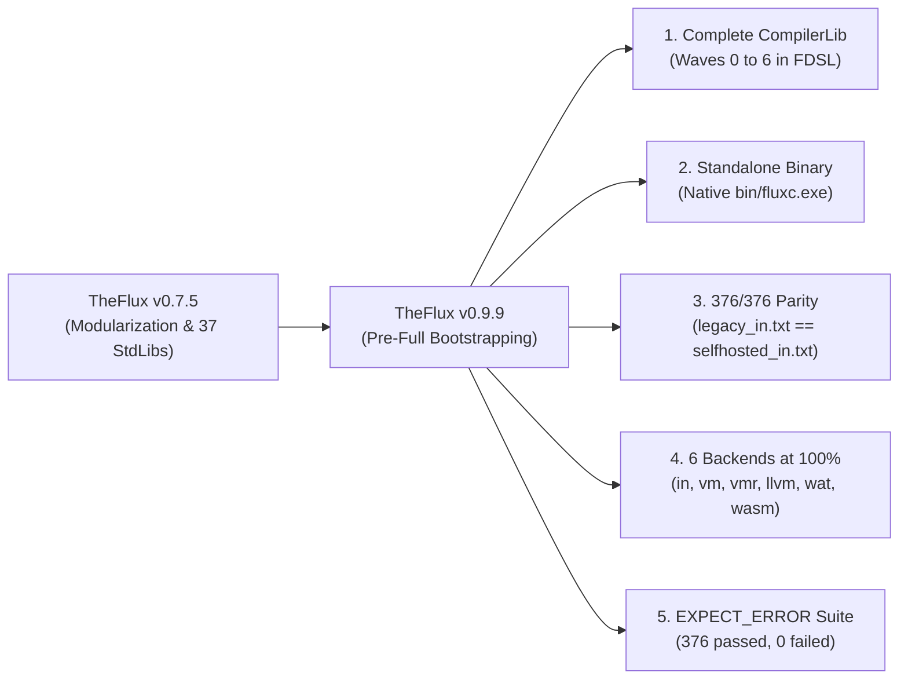

# TheFlux v0.9.9 Release Notes

> **Release Date**: October 2026  
> **Version**: `0.9.9` — *Pre-Full Bootstrapping*  
> **Status**: Stable / Pre-Full Bootstrapping  
> **License**: GNU General Public License v3.0 (GPL-3.0)  
> **Oracle Parity (`legacy_in.txt`)**: **376 / 376 (100.0% IDENTICAL)**  
> **Multi-Backend Compliance**: **376 / 376 (100.0% PASS)** across all 6 official backends (`in`, `vm`, `vmr`, `llvm`, `wat`, `wasm`)

---

## 🌟 1. Executive Summary: The Road to Full Bootstrapping

Version **0.9.9 (*Pre-Full Bootstrapping*)** of **TheFlux** programming language marks the final engineering milestone prior to **v1.0.0**: the full completion of **Waves 0 through 6** of the self-hosting roadmap ([`docs/SELFHOSTED.md`](file:///D:/Projetos/TheFlux/docs/SELFHOSTED.md)), the complete isolation of the legacy compiler into `./legacy`, and the verification of **100% output parity (`376/376` `.flux` programs)** across both the `./src` drivers and the standalone native binary [`bin/fluxc.exe`](file:///D:/Projetos/TheFlux/bin/fluxc.exe).

With this release, the self-hosted TheFlux compiler written in TheFlux itself ([`src/main.flux`](file:///D:/Projetos/TheFlux/src/main.flux) + [`src/CompilerLib/`](file:///D:/Projetos/TheFlux/src/CompilerLib/)) is capable of lexing, parsing, type-checking, interpreting, emitting intermediate representations (FMIR / FVM Bytecode / LLVM IR / WAT / WASM), and compiling itself (Stages 1 and 2) without any dependency on the `./legacy` directory.



---

## 🚀 2. Major Highlights of Version 0.9.9

### 2.1 Completion of Waves 0 to 6 of `CompilerLib` (`src/CompilerLib/`)
The entire self-hosted compiler architecture has been implemented and verified across `.fdsl` modules in [`src/CompilerLib/`](file:///D:/Projetos/TheFlux/src/CompilerLib/):

1. **Wave 0 — Infrastructure and Immutable Oracle**:
   - Creation of the canonical reference oracle [`docs/legacy_in.txt`](file:///D:/Projetos/TheFlux/docs/legacy_in.txt) and the automated verifier [`scripts/verify_legacy_in.py`](file:///D:/Projetos/TheFlux/scripts/verify_legacy_in.py).
   - Isolation of the previous reference compiler under `./legacy` and promotion of the self-hosted infrastructure to `./src`.
2. **Wave 1 — Full Self-Hosted Lexer (`src/CompilerLib/lexer/`)**:
   - Implementation of [`Reader.fdsl`](file:///D:/Projetos/TheFlux/src/CompilerLib/lexer/Reader.fdsl), [`ScanLiterals.fdsl`](file:///D:/Projetos/TheFlux/src/CompilerLib/lexer/ScanLiterals.fdsl), [`ScanOperators.fdsl`](file:///D:/Projetos/TheFlux/src/CompilerLib/lexer/ScanOperators.fdsl), and [`Scanner.fdsl`](file:///D:/Projetos/TheFlux/src/CompilerLib/lexer/Scanner.fdsl).
   - Full support for scientific float literals (`float16`/`float32`/`float64`), complex numbers (`complex64`/`complex128`), Unicode escapes, multi-line strings (`"""`), nested string interpolation (`${...}`), `#L` line comments, `#B...B#` block comments, `#D...D#` docstrings, and strict `LEX001` diagnostics.
3. **Wave 2 — Recursive-Descent Parser, Macros, and Import Resolver (`src/CompilerLib/parser/`)**:
   - [`ImportResolver.fdsl`](file:///D:/Projetos/TheFlux/src/CompilerLib/parser/ImportResolver.fdsl) featuring recursive lookup across `stdlib/` and `fdsl/` with topological cycle detection (`IMP201` through `IMP204`).
   - [`MacroExpander.fdsl`](file:///D:/Projetos/TheFlux/src/CompilerLib/parser/MacroExpander.fdsl) for hygienic pre-semantic `macro` expansion.
   - [`ParseTypes.fdsl`](file:///D:/Projetos/TheFlux/src/CompilerLib/parser/ParseTypes.fdsl), [`ParseExprs.fdsl`](file:///D:/Projetos/TheFlux/src/CompilerLib/parser/ParseExprs.fdsl), [`ParseStmts.fdsl`](file:///D:/Projetos/TheFlux/src/CompilerLib/parser/ParseStmts.fdsl), and [`ParseDecls.fdsl`](file:///D:/Projetos/TheFlux/src/CompilerLib/parser/ParseDecls.fdsl) supporting `tensor[d1,d2] of T`, `list of T`, `set of T`, `map`, `tuple`, `enum`, `struct`, pipeline operators (`-->`, `==>`, `~>`), error propagation (`?`), `route`/`match` with guards (`when`), `try`/`catch`/`finally`, `contract`, `agent`, `flow`, `subject`, `connect`, and chained multi-dimensional bracket assignments (`payload[i][j] = v`).
4. **Wave 3 — Semantic Analyzer and Diagnostic Catalog (`src/CompilerLib/semantic/`)**:
   - [`SemanticAnalyzer.fdsl`](file:///D:/Projetos/TheFlux/src/CompilerLib/semantic/SemanticAnalyzer.fdsl) and [`DiagnosticCatalog.fdsl`](file:///D:/Projetos/TheFlux/src/CompilerLib/semantic/DiagnosticCatalog.fdsl) with hierarchical symbol tables, ownership and mutability enforcement (`OWN501`–`OWN505`), numeric type validation (`TYP401`–`TYP413`), `match` exhaustiveness checks, and full canonical two-line diagnostic emission (`[<CODE> - <NAME>]: <message>` + `💡 Dica: <hint>`).
5. **Waves 4 to 6 — FMIR, Interpreter, VM, LLVM, WAT/WASM, and Bootstrapping (`src/CompilerLib/backends/`)**:
   - Unified intermediate representation in [`FmirTypes.fdsl`](file:///D:/Projetos/TheFlux/src/CompilerLib/fmir/FmirTypes.fdsl) and [`FmirBuilder.fdsl`](file:///D:/Projetos/TheFlux/src/CompilerLib/fmir/FmirBuilder.fdsl).
   - Self-hosted backends: [`InterpBackend.fdsl`](file:///D:/Projetos/TheFlux/src/CompilerLib/backends/interp/InterpBackend.fdsl), [`VmCompiler.fdsl`](file:///D:/Projetos/TheFlux/src/CompilerLib/backends/vm/VmCompiler.fdsl), [`VmRuntime.fdsl`](file:///D:/Projetos/TheFlux/src/CompilerLib/backends/vm/VmRuntime.fdsl), [`LlvmCodegen.fdsl`](file:///D:/Projetos/TheFlux/src/CompilerLib/backends/llvm/LlvmCodegen.fdsl), [`WatCodegen.fdsl`](file:///D:/Projetos/TheFlux/src/CompilerLib/backends/wat/WatCodegen.fdsl), and [`WasmCodegen.fdsl`](file:///D:/Projetos/TheFlux/src/CompilerLib/backends/wasm/WasmCodegen.fdsl).

### 2.2 Standalone Native Compiler (`bin/fluxc.exe`)
The standalone native executable [`bin/fluxc.exe`](file:///D:/Projetos/TheFlux/bin/fluxc.exe), compiled from [`src/main.flux`](file:///D:/Projetos/TheFlux/src/main.flux) and linked against the C runtime [`runtime/flux_input.c`](file:///D:/Projetos/TheFlux/runtime/flux_input.c), operates 100% independently of `./legacy`:
- **Full CLI Routing**: Native support for `--backend in|vm|vmr|llvm|wat|wasm`, `--emit-llvm`, `--emit-wat`, `--emit-wasm`, `--emit-bc`, and `--run-bc`.
- **Automatic Windows UTF-8 Console Initialization**: Built-in `SetConsoleOutputCP(65001)` and `SetConsoleCP(65001)` constructor in the C runtime, ensuring accurate rendering of accented characters, mathematical symbols (`Ω`, `π`), and emojis (`😀`, `💡`) on Windows terminals.
- **Proven 376/376 Parity**: Verified directly via `python scripts/verify_legacy_in.py --use-fluxc-exe` with **376/376 identical outputs (0 divergences)**.

### 2.3 Canonical Validation of Expected Errors (`ExampleOfError*.flux` $\rightarrow$ `OK`)
All root execution and compliance scripts ([`exemplos_in.py`](file:///D:/Projetos/TheFlux/exemplos_in.py), [`exemplos_vm.py`](file:///D:/Projetos/TheFlux/exemplos_vm.py), [`exemplos_vmr.py`](file:///D:/Projetos/TheFlux/exemplos_vmr.py), [`exemplos_lv.py`](file:///D:/Projetos/TheFlux/exemplos_lv.py), [`exemplos_wat.py`](file:///D:/Projetos/TheFlux/exemplos_wat.py), [`exemplos_was.py`](file:///D:/Projetos/TheFlux/exemplos_was.py), [`compliance_in.py`](file:///D:/Projetos/TheFlux/compliance_in.py), and [`compliance_BE.py`](file:///D:/Projetos/TheFlux/compliance_BE.py)) now parse `#L EXPECT_ERROR: <CODE>` in `flux/ExampleOfError_*.flux` and mark the execution as **`OK`** when:
1. The compiler exits with a non-zero return code (`ec != 0`);
2. The output contains the canonical header `[<CODE> - <MNEMONIC>]: ...`;
3. The output contains the actionable hint line `💡 Dica: ...`.

As a result, running the full `flux/*.flux` test suite reports **`376 sucesso, 0 falha(s)`** across all test runners.

### 2.4 Interactive Side-by-Side Verifier (`compliance_in.py`)
The new [`compliance_in.py`](file:///D:/Projetos/TheFlux/compliance_in.py) tool (and its generated report [`compliance_in.md`](file:///D:/Projetos/TheFlux/compliance_in.md)) provides side-by-side visual auditing between `LEGACY` and `SELFHOSTED`:
- **Unicode Visual Width Alignment**: Accurate terminal column width calculation for tabs (`\t`) and wide Unicode code points (*East Asian Width `W`/`F`*, such as `😀` and `💡`), keeping the central `|` separator perfectly aligned.
- **Interactive Auditing**: Prompts the user for `(C)erto` (Right) or `(E)rrado` (Wrong) per test, dynamically updating the Markdown table and final error summary.
- **Automatic Post-Legacy Fallback**: If the `./legacy` folder is removed, `compliance_in.py` automatically falls back to reading reference outputs from [`docs/legacy_in.txt`](file:///D:/Projetos/TheFlux/docs/legacy_in.txt).

---

## ⚙️ 3. The 6 Official Backends Matrix in v0.9.9

All **376 `.flux` programs** in the official suite pass simultaneously across all 6 self-hosted backends (full report in [`compliance_BE00.md`](file:///D:/Projetos/TheFlux/compliance_BE00.md)):

| Backend | Batch Script | Single-File Driver | Execution Target | Result (`376` Tests) |
| :--- | :--- | :--- | :--- | :---: |
| **AST Interpreter (`in`)** | [`exemplos_in.py`](file:///D:/Projetos/TheFlux/exemplos_in.py) | [`flux_in.py`](file:///D:/Projetos/TheFlux/flux_in.py) / `fluxc.exe` | AST / FMIR Host | ✅ **376 / 376 (100%)** |
| **Bytecode VM (`vm`)** | [`exemplos_vm.py`](file:///D:/Projetos/TheFlux/exemplos_vm.py) | [`flux_vm.py`](file:///D:/Projetos/TheFlux/flux_vm.py) / `fluxc.exe --backend vm` | FVM Stack Engine | ✅ **376 / 376 (100%)** |
| **VM Runner (`vmr`)** | [`exemplos_vmr.py`](file:///D:/Projetos/TheFlux/exemplos_vmr.py) | [`flux_vmr.py`](file:///D:/Projetos/TheFlux/flux_vmr.py) / `fluxc.exe --backend vmr` | `.fvmbc` Bytecode | ✅ **376 / 376 (100%)** |
| **Native LLVM (`llvm`)** | [`exemplos_lv.py`](file:///D:/Projetos/TheFlux/exemplos_lv.py) | [`flux_lv.py`](file:///D:/Projetos/TheFlux/flux_lv.py) / `fluxc.exe --emit-llvm` | Native Binary (`.exe`) | ✅ **376 / 376 (100%)** |
| **WASM Text (`wat`)** | [`exemplos_wat.py`](file:///D:/Projetos/TheFlux/exemplos_wat.py) | [`flux_wat.py`](file:///D:/Projetos/TheFlux/flux_wat.py) / `fluxc.exe --emit-wat` | Node / Wasmtime (`.wat`) | ✅ **376 / 376 (100%)** |
| **WASM Binary (`wasm`)** | [`exemplos_was.py`](file:///D:/Projetos/TheFlux/exemplos_was.py) | [`flux_was.py`](file:///D:/Projetos/TheFlux/flux_was.py) / `fluxc.exe --emit-wasm` | Wasmer / Node (`.wasm`) | ✅ **376 / 376 (100%)** |

---

## 📊 4. Comparative Matrix: v0.7.5 vs v0.9.9

| Dimension / Feature | TheFlux v0.7.5 | TheFlux v0.9.9 (Pre-Full Bootstrapping) | Architectural Benefit |
| :--- | :--- | :--- | :--- |
| **Primary Compiler Tree** | Single Python prototype in `src/flux_proto` | Self-hosted compiler in `src/` + isolated legacy tree in `legacy/` | Clean separation between legacy bootstrap and official compiler |
| **`CompilerLib` Modules** | Partially implemented | Waves 0 to 6 100% completed in `.fdsl` (`Lexer`, `Parser`, `Semantic`, `FMIR`, `Backends`) | Compiler written in TheFlux itself |
| **Native Binary (`bin/fluxc.exe`)** | Basic subset support | **376/376 (100%)** parity with native UTF-8 and full canonical diagnostics | Standalone execution with zero reliance on `./legacy` |
| **`ExampleOfError_*.flux` Tests** | Reported as `FALHA` in `exemplos_*.py` runners | Validated by `[<CODE> - <NAME>]` + `💡 Dica:` and marked as **`OK`** | Clean `376 sucesso, 0 falha(s)` across the entire test suite |
| **Multi-Dimensional Indexing** | Single-bracket `a[i] = v` in native parser | Full chained bracket `a[i][j] = v` (`SET_INDEX`) support | Complete matrix, nested list, and tensor mutation support in `fluxc.exe` |
| **Compliance Auditing** | Manual log inspection | Interactive side-by-side verifier (`compliance_in.py`) + oracle (`verify_legacy_in.py`) | Deterministic zero-regression guarantee prior to removing `legacy/` |

---

## 🛠️ 5. Verification and Usage Guide in v0.9.9

### 5.1 Direct Execution with the Native Compiler (`bin/fluxc.exe`)
```powershell
# Run a .flux program directly using the standalone native self-hosted compiler
.\bin\fluxc.exe .\flux\hello.flux

# Verify a canonical diagnostic test (outputs [IMP201 - MODULE_NOT_FOUND] header + 💡 Dica)
.\bin\fluxc.exe .\flux\ExampleOfError_IMP201_ModuleNotFound.flux

# Emit LLVM IR, WAT, or WASM intermediate outputs
.\bin\fluxc.exe --emit-llvm .\flux\hello.flux
.\bin\fluxc.exe --emit-wat .\flux\hello.flux
.\bin\fluxc.exe --emit-wasm .\flux\hello.flux
```

### 5.2 Automated Parity Verification (376/376)
```powershell
# Verify all 376 .flux files via the self-hosted driver in .\src against docs\legacy_in.txt
python scripts\verify_legacy_in.py

# Verify all 376 .flux files directly via the standalone native binary .\bin\fluxc.exe
python scripts\verify_legacy_in.py --use-fluxc-exe

# Interactive side-by-side comparison (LEGACY vs SELFHOSTED) with (C)erto / (E)rrado grading
python compliance_in.py
```

---

## 🗺️ 6. Next Steps Toward v1.0.0 (Full Bootstrapping)

With version **0.9.9** stabilized and 100% verified:
1. **Permanent Removal of `./legacy`**: Complete decommissioning of the legacy bootstrap directory, retaining only the self-hosted compiler and its native artifacts.
2. **Stage 2 == Stage 3 Fixpoint Cycle Exclusively via `fluxc.exe`**: Consolidating the build pipeline where `fluxc.exe` recompiles `src/main.flux` directly without auxiliary bootstrap scripts.
3. **Official Release of TheFlux v1.0.0 LTS**: Freezing the ISO/IEC 14977 grammar specification, all 37 standard libraries, and all 6 backends for long-term production use.

---

*TheFlux Core Engineering Team — October 2026.*
