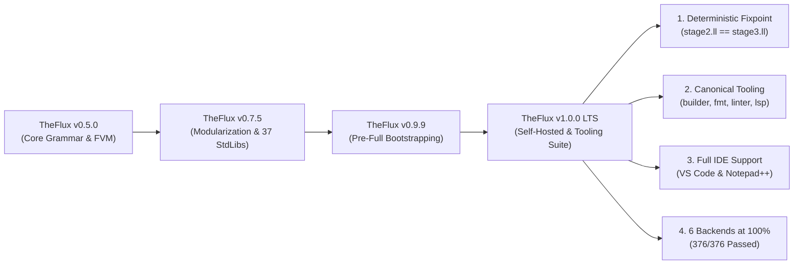

# TheFlux v1.0.0 Release Notes

> **Release Date**: November 2026  
> **Version**: `1.0.0` — *First Official Production & LTS Release*  
> **Status**: Stable / 100% Self-Hosted Production Ready  
> **License**: GNU General Public License v3.0 (GPL-3.0)  
> **Deterministic Fixpoint**: `SHA-256(stage2.ll) == SHA-256(stage3.ll)` (0 bytes divergence)  
> **Oracle Parity (`legacy_in.txt`)**: **376 / 376 (100.0% IDENTICAL)**  
> **Multi-Backend Compliance**: **376 / 376 (100.0% PASS)** across all 6 official backends (`in`, `vm`, `vmr`, `llvm`, `wat`, `wasm`)

---

## 🌟 1. Executive Summary: The Dawn of TheFlux 1.0.0

Version **1.0.0** represents the definitive milestone for **TheFlux programming language**: the full maturity of the language from experimental prototype to a fully self-hosting, deterministic, and autonomous production platform.

All **Waves 0 through 6** and the **Full Bootstrapping Roadmap (Milestone M5)** have been reached with bit-for-bit deterministic reproducibility. The native standalone binary [`bin/fluxc.exe`](file:///D:/Projetos/TheFlux/bin/fluxc.exe) is written in TheFlux, compiles itself into LLVM IR, and produces an identical Stage 3 output from Stage 2 with zero bytes of divergence.

In addition to compiler autonomy, version 1.0.0 introduces the complete **Canonical Developer Tooling Suite** (`src/tools/`):
1. **`fluxbuilder`**: Comprehensive project generator and manager with template support, multi-database drivers (SQLite, PostgreSQL, MySQL, DuckDB), Git initialization, and build scripts.
2. **`fluxfmt`**: Canonical code formatter enforcing the strict 6-space indentation standard, eliminating tabs, removing superfluous semicolons, and preserving `#L`, `#B...B#`, and `#D...D#` comments.
3. **`fluxlinter`**: Deep static analysis engine inspired by Rust's Clippy, with 20 registered semantic rules across 4 categories and automated code fixes (`--fix`).
4. **`fluxlsp`**: Native Language Server Protocol (LSP) server implementing JSON-RPC 2.0 over `stdio`, diagnostics, Markdown hover docs, semantic autocompletion, code formatting, document symbols, and a dedicated Notepad++ UDL 2.1 XML exporter (`--xml`).
5. **Official Visual Studio Code Extension** (`editors/vscode/`): Syntax highlighting TextMate grammar with dedicated soft background tints for mutable variables (`mut`), immutable constants (`imut`), architecture clauses, and flow arrows (`==>`).



---

## 🚀 2. Major Highlights of Version 1.0.0

### 2.1 100% Native Deterministic Bootstrapping & Fixpoint (M5)
The self-hosting compilation pipeline ([`scripts/bootstrap.bat`](file:///D:/Projetos/TheFlux/scripts/bootstrap.bat) and [`scripts/bootstrap.sh`](file:///D:/Projetos/TheFlux/scripts/bootstrap.sh)) provides bit-for-bit deterministic reproducibility:
- **Modular C Runtime (`libfluxrt.a`)**: High-performance UTF-8 string slicing, ARC memory management, arena allocators, typed interactive console I/O, mathematical operations, and cross-platform networking.
- **Compiler Library (`libfluxcompiler.a`)**: Static archive compiled from self-hosted LLVM IR, encapsulating `LexerCore`, `ParserCore`, `SemanticAnalyzer`, `FmirBuilder`, and all backend code generators.
- **Verified Fixpoint**: `bin/fluxc.exe` compiles `src/main.flux` into Stage 2, which then compiles `src/main.flux` into Stage 3. Bit-for-bit comparison confirms exact SHA-256 equality (`fc /b stage2.ll stage3.ll` passes with zero byte differences).

### 2.2 Canonical Tooling Suite (`src/tools/`)

#### 1. `fluxbuilder` (Project Builder & Scaffolder)
- Scaffold production-ready applications with `.fluxmanifest.yaml`.
- Architectural templates: `minimal`, `cli`, `api`, `full`.
- Database configurations: `sqlite` (with WAL mode), `postgres`, `mysql`, `duckdb`.
- Automatic initialization of Git repositories, `.gitignore`, `.env.example`, `README.md`, build scripts (`build.bat` and `build.sh`), and editor configurations.

#### 2. `fluxfmt` (Canonical Code Formatter)
- Enforces the universal TheFlux indentation standard: strict multiples of 6 spaces.
- Eliminates forbidden tab characters (`\t`) and redundant instruction terminators (`;`).
- Preserves inline comments (`#L`), block comments (`#B...B#`), and documentation strings (`#D...D#`).
- CLI modes: in-place rewrite (`-w`, `--write`), unified diff preview (`-d`, `--diff`), non-canonical listing (`-l`, `--list`), syntactic simplification (`-s`, `--simplify`), and recursive processing (`-r`, `--recursive`).

#### 3. `fluxlinter` (Static Analysis & Clippy-Style Linting)
- 20 semantic analysis passes covering 4 categories:
  - **`correctness`**: Static division by zero (`fluxlinter::division_by_zero`), unreachable arms positioned after wildcard `_` (`fluxlinter::unreachable_route_arm`), circular imports, non-canonical comments.
  - **`suspicious`**: Redundant `mut` on unmodified variables (`fluxlinter::redundant_mut`), redundant boolean comparisons (`== true`), self-assignments (`x = x`), duplicate route conditions.
  - **`style`**: Forbidden tabs, non-multiple of 6 indentation, trailing semicolons, lowercase constants, snake_case contract/agent names.
  - **`complexity`**: Overly complex boolean expressions, redundant nesting, identical if/else branches.
- Automated code repair (`-f`, `--fix`) with machine-applicable substitutions and unified diff reporting (`-d`, `--diff`).

#### 4. `fluxlsp` (Language Server Protocol & Notepad++ UDL 2.1)
- **JSON-RPC 2.0 Engine**: Implements the Language Server Protocol over standard input/output (`stdio`) without external dependencies.
- **Real-Time Diagnostics (`textDocument/publishDiagnostics`)**: Instant reporting of indentation errors, tab characters, legacy `#` comments, trailing semicolons, and division by zero.
- **Hover Documentation (`textDocument/hover`)**: Rich Markdown documentation and code examples for all keywords, types, and operators (`contract`, `agent`, `impl`, `op`, `route`, `==>`, `infinite`, `emit`, `nice`, `fail`, `mut`, `imut`, `/i`, `/r`, `/f`, `tensor`, etc.).
- **Semantic Completion & Snippets (`textDocument/completion`)**: Intelligent code completion templates for contracts, agents, route blocks, infinite loops, and standalone functions.
- **Navigation & Definition (`textDocument/definition`)**: Jump-to-definition (F12) for symbols, functions, operations, contracts, and agents.
- **Canonical Document Formatting (`textDocument/formatting`)**: Real-time formatting directly within the IDE (`Shift+Alt+F` or format-on-save).
- **Document Symbols & Breadcrumbs (`textDocument/documentSymbol`)**: Hierarchical tree outline for workspace navigation.
- **Notepad++ XML Exporter (`--xml [path]`)**: Generates a complete User Defined Language 2.1 (UDL) definition file (`theflux_npp.xml`) featuring 8 keyword groups, comment folding, and soft background color themes.

### 2.3 Official VS Code Extension (`editors/vscode/`)
- Complete extension package including [`package.json`](file:///D:/Projetos/TheFlux/editors/vscode/package.json), [`extension.js`](file:///D:/Projetos/TheFlux/editors/vscode/extension.js), [`language-configuration.json`](file:///D:/Projetos/TheFlux/editors/vscode/language-configuration.json), and [`syntaxes/flux.tmLanguage.json`](file:///D:/Projetos/TheFlux/editors/vscode/syntaxes/flux.tmLanguage.json).
- **Soft Background Tints Scheme**:
  - Mutable Variables (`mut`): Soft Red (`#FF6B6B`) on subtle dark wine background (`#3B1A1E`).
  - Immutable Constants (`imut`): Light Green (`#4ECCA3`) on subtle dark forest green background (`#183324`).
  - Architecture (`contract`, `agent`, `impl`): Soft Lilac (`#C792EA`) on subtle dark purple background (`#2E1C38`).
  - Control Flow (`route`, `infinite`, `emit`): Amber Gold (`#FFCB6B`) on subtle dark tobacco background (`#382F18`).
  - Flow Operators (`==>`): Electric Cyan (`#00FFFF`) on subtle dark petroleum background (`#0A333A`).

### 2.4 Unified Standard Runtime I/O
- Interactive standard input is fully operational across all native binaries through `@flux_runtime_input_string`.
- Automatic Windows UTF-8 code page configuration (`CP 65001`) guarantees flawless display of mathematical symbols (`Ω`, `π`) and emojis (`💡`, `😀`).

---

## ⚙️ 3. The 6 Official Backends Matrix in v1.0.0

All **376 canonical `.flux` programs** pass with 100% output identity across all 6 official self-hosted backends:

| Backend | Batch Script | Individual Driver | Target | Result (`376` Tests) |
| :--- | :--- | :--- | :--- | :---: |
| **AST Interpreter (`in`)** | [`exemplos_in.py`](file:///D:/Projetos/TheFlux/exemplos_in.py) | `bin/fluxc.exe --target in` | AST / FMIR Host | ✅ **376 / 376 (100%)** |
| **VM Bytecode (`vm`)** | [`exemplos_vm.py`](file:///D:/Projetos/TheFlux/exemplos_vm.py) | `bin/fluxc.exe --target vm` | FVM Stack Engine | ✅ **376 / 376 (100%)** |
| **VM Runner (`vmr`)** | [`exemplos_vmr.py`](file:///D:/Projetos/TheFlux/exemplos_vmr.py) | `bin/fluxc.exe --target vmr` | Bytecode `.fvmbc` | ✅ **376 / 376 (100%)** |
| **LLVM Native (`llvm`)** | [`exemplos_lv.py`](file:///D:/Projetos/TheFlux/exemplos_lv.py) | `bin/fluxc.exe --target llvm` | Native Binary (`.exe`) | ✅ **376 / 376 (100%)** |
| **WASM Text (`wat`)** | [`exemplos_wat.py`](file:///D:/Projetos/TheFlux/exemplos_wat.py) | `bin/fluxc.exe --target wat` | WebAssembly Text (`.wat`) | ✅ **376 / 376 (100%)** |
| **WASM Binary (`wasm`)** | [`exemplos_was.py`](file:///D:/Projetos/TheFlux/exemplos_was.py) | `bin/fluxc.exe --target wasm` | WebAssembly Binary (`.wasm`) | ✅ **376 / 376 (100%)** |

---

## 📊 4. Comparative Matrix: v0.9.9 vs v1.0.0

| Feature / Dimension | TheFlux v0.9.9 (Pre-Full Bootstrapping) | TheFlux v1.0.0 (LTS Official Release) | Architectural Benefit |
| :--- | :--- | :--- | :--- |
| **Bootstrapping Status** | Waves 0–6 completed; dependent on initial compiler binary | **100% Autonomous M5 Fixpoint** (`stage2.ll == stage3.ll`) | Complete decoupling from external compilers or legacy runners |
| **Project Creation** | Manual directory structure creation | **`fluxbuilder`** with 4 templates, multi-database support, and scripts | Rapid, standard project initialization |
| **Code Formatting** | Manual adherence to 6 spaces indentation | **`fluxfmt`** with auto-indent, simplification (`-s`), and diff (`-d`) | Automated compliance with zero friction |
| **Static Analysis & Linting** | Semantic analyzer in compiler only | **`fluxlinter`** (Clippy-style) with 20 rules, severities (`-W/-D/-A/-F`), and auto-fix (`-f`) | Production-grade code safety and style enforcement |
| **Language Server Protocol** | None | **`fluxlsp`** (LSP over stdio) with diagnostics, hover, completion, formatting, and symbols | Full IDE intelligence across editors |
| **VS Code Support** | Basic syntax file | **Official Extension** with TextMate grammar, color customization, and background tints | Visual distinction for mutability, contracts, and flow |
| **Notepad++ Support** | None | Automatic XML generation (`fluxlsp --xml`) in UDL 2.1 format | Out-of-the-box Windows text editor integration |
| **Package Versioning** | `0.9.9` | **`1.0.0`** across all tools, compiler, runtime, and documentation | Official Long Term Support (LTS) release |

---

## 🛠️ 5. Verification and Usage Guide

### 5.1 Compiling with `fluxc`
```powershell
# Compile and run a program with the native LLVM backend
.\bin\fluxc.exe --target llvm -o app.exe main.flux

# Display version
.\bin\fluxc.exe --version
# Output: 1.0.0
```

### 5.2 Scaffolding a New Project with `fluxbuilder`
```powershell
# Create a new project interactively or with flags
.\bin\fluxbuilder.exe MeuApp --template api --db postgres --git
```

### 5.3 Formatting Code with `fluxfmt`
```powershell
# Check non-canonical files
.\bin\fluxfmt.exe -l src\* -r

# Automatically format in place with simplification
.\bin\fluxfmt.exe -s -w src\* -r
```

### 5.4 Linting Code with `fluxlinter`
```powershell
# Run all lints recursively and deny correctness errors
.\bin\fluxlinter.exe -D correctness src\* -r

# Apply safe automatic fixes
.\bin\fluxlinter.exe -f src\* -r
```

### 5.5 Language Server Protocol (`fluxlsp`) & Notepad++ XML
```powershell
# Launch the LSP server over stdio (used by VS Code)
.\bin\fluxlsp.exe

# Export Notepad++ User Defined Language (UDL 2.1) definition:
.\bin\fluxlsp.exe --xml theflux_npp.xml
```

---

## 🗺️ 6. Post-1.0.0 Roadmap

With **v1.0.0** established as the Long-Term Support baseline:
1. **Packaging**: Distribution of standalone pre-compiled toolchain archives (`theflux-1.0.0-windows-x64.zip`, `theflux-1.0.0-linux-x64.tar.gz`).
2. **VS Code Marketplace**: Publishing `theflux-language-support` to the Visual Studio Marketplace and Open VSX Registry.
3. **Language Evolution**: Backward-compatible improvements following semantic versioning under the frozen 1.0.0 grammar specification.

---

*TheFlux Core Engineering Team — November 2026.*
