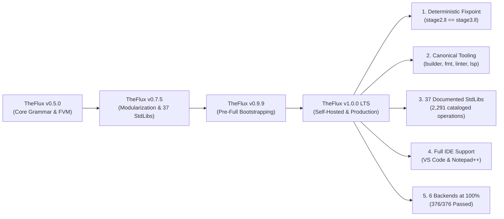

# TheFlux v1.0.0 Release Notes

> **Release Date**: November 2026  
> **Version**: `1.0.0` — *First Official Production & LTS Release*  
> **Status**: Stable / 100% Self-Hosted Production Ready  
> **License**: GNU General Public License v3.0 (GPL-3.0)  
> **Deterministic Fixpoint**: `SHA-256(stage2.ll) == SHA-256(stage3.ll)` (0 bytes divergence)  
> **Canonical Execution Parity**: **376 / 376 (100.0% IDENTICAL)**  
> **Multi-Backend Compliance**: **376 / 376 (100.0% PASS)** across all 6 official backends (`in`, `vm`, `vmr`, `llvm`, `wat`, `wasm`)

---

## 🌟 1. Executive Summary: The Dawn of TheFlux 1.0.0

Version **1.0.0** represents the definitive milestone for **TheFlux programming language**: the full transition from an experimental prototype to an autonomous, self-hosting, deterministic, production-grade platform with industrial-strength tooling.

All **Waves 0 through 6** and the **Full Bootstrapping Roadmap (Milestone M5)** have been reached with bit-for-bit deterministic reproducibility. The native standalone binary [`bin/fluxc.exe`](file:///D:/Projetos/TheFlux/bin/fluxc.exe) is written entirely in TheFlux, compiles itself into LLVM IR, and produces an identical Stage 3 output from Stage 2 with zero bytes of divergence.

In addition to compiler autonomy, version 1.0.0 consolidates:
1. **Canonical Developer Tooling Suite** (`src/tools/`):
   - **`fluxbuilder`**: Native project scaffolding, interactive wizard, non-interactive CI/CD mode, environment doctor (`--doctor`), and idempotent repair (`--repair`).
   - **`fluxfmt`**: Canonical code formatter enforcing strict 6-space indentation, eliminating tabs, converting `#` to `#L`, syntactic simplification (`-s`), and unified diff patches (`-d`).
   - **`fluxlinter`**: Deep static analysis engine inspired by Rust's Clippy, featuring 11 registered rules across 4 severity tiers (`correctness`, `suspicious`, `style`, `complexity`), granular control (`-W/-D/-A/-F`), and automated in-place fixes (`--fix`).
   - **`fluxlsp`**: Native Language Server Protocol (LSP) server implementing JSON-RPC 2.0 over `stdio`, real-time diagnostics, Markdown hover docs, semantic autocompletion, code formatting, document symbols, and a dedicated Notepad++ UDL 2.1 XML exporter (`--xml`).
2. **Complete Standard Libraries Ecosystem (`stdlib/`)**:
   - 37 standard libraries organized across the 4 Architectural Pillars, comprising 291 functional files, 254 domain contracts, and 2,291 public operations cataloged and exhaustively documented in Portuguese ([`docs/pt_BR/stdlibs/`](file:///D:/Projetos/TheFlux/docs/pt_BR/stdlibs)) and English ([`docs/en/stdlib/`](file:///D:/Projetos/TheFlux/docs/en/stdlib)).
3. **Official Visual Studio Code Extension** (`editors/vscode/`):
   - Syntax highlighting TextMate grammar with dedicated soft background tints for mutable variables (`mut`), immutable constants (`imut`), architectural declarations (`contract`, `agent`, `impl`), and flow operators (`==>`).
4. **Automated Bilingual Parity Infrastructure**:
   - Continuous verification linter in [`scripts/docs/check_i18n_parity.py`](file:///D:/Projetos/TheFlux/scripts/docs/check_i18n_parity.py) certifying 100% 1:1 symmetry across all general documentation, standard libraries, tools, formal EBNF grammars, and keyword specifications.



---

## 🚀 2. Major Highlights of Version 1.0.0

### 2.1 100% Native Deterministic Bootstrapping & Fixpoint (M5)
The self-hosting compilation pipeline ([`scripts/bootstrap.bat`](file:///D:/Projetos/TheFlux/scripts/bootstrap.bat) and [`scripts/bootstrap.sh`](file:///D:/Projetos/TheFlux/scripts/bootstrap.sh)) provides bit-for-bit deterministic reproducibility:
- **Modular C Runtime (`libfluxrt.a`)**: High-performance UTF-8 string slicing, ARC memory management, arena allocators, typed interactive console I/O, mathematical operations, and cross-platform networking.
- **Compiler Library (`libfluxcompiler.a`)**: Static archive compiled from self-hosted LLVM IR, encapsulating `LexerCore`, `ParserCore`, `SemanticAnalyzer`, `FmirBuilder`, and all backend code generators.
- **Verified Fixpoint**: `bin/fluxc.exe` compiles `src/main.flux` into Stage 2, which then compiles `src/main.flux` into Stage 3. Bit-for-bit comparison confirms exact SHA-256 equality (`fc /b stage2.ll stage3.ll` passes with zero byte differences).

### 2.2 Canonical Tooling Suite (`src/tools/`)

#### 1. [`fluxbuilder`](file:///D:/Projetos/TheFlux/docs/en/tools/fluxbuilder.md) (Scaffolding, Wizard, Integration, and Repair)
- **Interactive Terminal Wizard**: User-friendly prompts for configuring sanitized project names, initial version, author, verified e-mail, database backend (`PostgreSQL`, `SQLite`, `MySQL`, `None`), binary linkage model (`Static` or `Dynamic`), initial package dependencies, and licensing.
- **Non-Interactive Mode (CI/CD)**: Headless and instant provisioning via command-line flags (`-n`, `-y`, `--name`, `--ver`, `--author`, `--email`, `--db`, `--link`, `--pkgs`, `--license`, `--git`).
- **Idempotent Repair Mode (`--repair` / `-r`)**: Inspects and restores missing structural components (`flux.toml`, directory trees `src/`, `tests/`, `docs/`, `.gitignore`, `README.md`) without modifying or overwriting existing user code.
- **System Diagnostics Mode (`--doctor` / `-c`)**: Comprehensive health checks for the `fluxc` compiler, Clang C/LLVM toolchain, and Git version control system.

#### 2. [`fluxfmt`](file:///D:/Projetos/TheFlux/docs/en/tools/fluxfmt.md) (Canonical Code Formatter)
- **Strict 6-Space Indentation**: Universal enforcement of 6 spaces per block nesting depth, strictly forbidding raw tab characters (`\t`).
- **Syntactic Hygiene**: Normalizes legacy `#` comments to `#L`, preserves `#B...B#` block comments, and cleans trailing whitespace.
- **Code Simplification (`-s` / `--simplify`)**: Eliminates redundant outer parentheses in pattern-matching route guards (`(c) ==>` to `c ==>`).
- **Operational Modes**: In-place write (`-w`), unified diff preview (`-d`), non-canonical listing for CI quality gates (`-l`), and recursive scanning (`-r`).

#### 3. [`fluxlinter`](file:///D:/Projetos/TheFlux/docs/en/tools/fluxlinter.md) (Static Analysis & Clippy-Style Linting)
- **11 Registered Lints across 4 Severity Tiers**:
  - **`correctness`** (default: `deny`): `division_by_zero` (integer division or modulo by literal zero), `unreachable_route_arm` (route arm placed after wildcard `_`), `empty_infinite_loop` (infinite loop missing exit via `break` or `emit`).
  - **`suspicious`** (default: `warn`): `self_assignment` (redundant `x = x`), `tautological_comparison` (always-true/false comparison `a == a`), `missing_operation_emit` (agent operation missing terminal `emit`).
  - **`style`** (default: `warn`): `redundant_mut` (variable marked `mut` never modified), `legacy_comment` (legacy `#` comments instead of `#L`), `naming_convention` (contract or agent not adhering to PascalCase).
  - **`complexity`** (default: `warn`): `collapsible_route` (boolean route arm collapsible to direct expression), `superfluous_guard_parens` (redundant parentheses in guard).
- **Granular Severity Controls**: Clippy-style flags (`-W` warn, `-D` deny, `-A` allow, `-F` forbid).
- **Automated In-Place Fixes (`-f` / `--fix`)**: Safe and instant remediation directly on disk, with preview via unified diffs (`-d`).

#### 4. [`fluxlsp`](file:///D:/Projetos/TheFlux/docs/en/tools/fluxlsp.md) (Language Server Protocol & Notepad++ UDL 2.1)
- **JSON-RPC 2.0 Engine**: Pure Language Server Protocol implementation over `stdio` without external runtime dependencies.
- **Real-Time Diagnostics (`textDocument/publishDiagnostics`)**: Instant reporting of syntax errors, 6-space indentation violations, and linter warnings.
- **Rich Hover Documentation (`textDocument/hover`)**: Rich tooltips showing parameter signatures, keyword semantics, and language specifications.
- **Semantic Completion & Snippets (`textDocument/completion`)**: Intelligent code completions and semantic snippets for `route`, `infinite`, `program`, `contract`, and `agent` blocks.
- **Go-to-Definition (`textDocument/definition`)**: Direct symbol jump (F12) across functions, operations, contracts, and agents.
- **Canonical Document Formatting (`textDocument/formatting`)**: Real-time formatting directly within the IDE (`Shift+Alt+F` or format-on-save), powered by `fluxfmt`.
- **Document Symbols & Breadcrumbs (`textDocument/documentSymbol`)**: Hierarchical tree outline for workspace navigation.
- **Notepad++ XML Exporter (`--xml [path]`)**: Generates a complete User Defined Language 2.1 (UDL) definition file mapping all 74 canonical keywords, `#L` comments, and operators.

### 2.3 Bilingual Documentation for the 37 Standard Libraries (`stdlib/`)
- Complete coverage across all 37 standard libraries spanning the 4 architectural pillars in [`docs/pt_BR/stdlibs/`](file:///D:/Projetos/TheFlux/docs/pt_BR/stdlibs) and [`docs/en/stdlib/`](file:///D:/Projetos/TheFlux/docs/en/stdlib):
  - **Pillar 1 (Core, Text & OO)**: `CharStdLib`, `ConvertStdLib`, `DebugStdLib`, `DslStdLib`, `FileSignatureStdLib`, `FormatStdLib`, `OoStdLib`, `RegexStdLib`, `StringStdLib`.
  - **Pillar 2 (Structures & State)**: `CompressStdLib`, `DateTimeStdLib`, `DbStdLib`, `FsmStdLib`, `ListStdLib`, `MapStdLib`, `RandomStdLib`, `SetStdLib`, `StructStdLib`.
  - **Pillar 3 (Mathematics & Graphics)**: `FinStdLib`, `GraphPlotStdLib`, `HashStdLib`, `LinAlgStdLib`, `MathStdLib`, `PhysStdLib`, `SimdStdLib`, `StatStdLib`, `SymbolicStdLib`.
  - **Pillar 4 (System, I/O & Network)**: `ArchiveStdLib`, `GfxStdLib`, `GuiStdLib`, `IoStdLib`, `LowLevelStdLib`, `NativeGfxStdLib`, `NetStdLib`, `OsStdLib`, `RuntimeStdLib`, `ThreadStdLib`.
- Formal cataloging of **254 domain contracts** and **2,291 public operations**, detailing formal signatures, parameter types, returns, status emissions (`nice`/`fail`), and executable code examples.
- Bidirectional navigable indexes updated in [`docs/pt_BR/StdLibs.md`](file:///D:/Projetos/TheFlux/docs/pt_BR/StdLibs.md) and [`docs/en/StdLibs.md`](file:///D:/Projetos/TheFlux/docs/en/StdLibs.md).

### 2.4 Official VS Code Extension (`editors/vscode/`)
- Complete extension package including [`package.json`](file:///D:/Projetos/TheFlux/editors/vscode/package.json), [`extension.js`](file:///D:/Projetos/TheFlux/editors/vscode/extension.js), [`language-configuration.json`](file:///D:/Projetos/TheFlux/editors/vscode/language-configuration.json), and [`syntaxes/flux.tmLanguage.json`](file:///D:/Projetos/TheFlux/editors/vscode/syntaxes/flux.tmLanguage.json).
- **Soft Background Tints Scheme**:
  - Mutable Variables (`mut`): Soft Red (`#FF6B6B`) on subtle dark wine background (`#3B1A1E`).
  - Immutable Constants (`imut`): Light Green (`#4ECCA3`) on subtle dark forest green background (`#183324`).
  - Architecture (`contract`, `agent`, `impl`): Soft Lilac (`#C792EA`) on subtle dark purple background (`#2E1C38`).
  - Control Flow (`route`, `infinite`, `emit`): Amber Gold (`#FFCB6B`) on subtle dark tobacco background (`#382F18`).
  - Flow Operators (`==>`): Electric Cyan (`#00FFFF`) on subtle dark petroleum background (`#0A333A`).

### 2.5 Centralized Version Anchor (`src/version.md`)
- The version anchor specification has been unified in [`src/version.md`](file:///D:/Projetos/TheFlux/src/version.md), directly serving as the single source of version truth for compiler and tooling build scripts.

### 2.6 Unified Standard Runtime I/O
- Interactive standard input is fully operational across all native binaries through `@flux_runtime_input_string`.
- Automatic Windows UTF-8 code page configuration (`CP 65001`) guarantees flawless display of mathematical symbols (`Ω`, `π`) and emojis (`💡`, `😀`).

---

## ⚙️ 3. The 6 Official Backends Matrix in v1.0.0

All **376 canonical `.flux` programs** pass with 100% output identity across all 6 official self-hosted backends:

| Backend | Batch Script | Individual Driver | Target | Result (`376` Tests) |
| :--- | :--- | :--- | :--- | :--- | :---: |
| **AST Interpreter (`in`)** | [`exemplos_in.py`](file:///D:/Projetos/TheFlux/exemplos_in.py) | `bin/fluxc.exe --target in` | AST / FMIR Host | ✅ **376 / 376 (100%)** |
| **VM Bytecode (`vm`)** | [`exemplos_vm.py`](file:///D:/Projetos/TheFlux/exemplos_vm.py) | `bin/fluxc.exe --target vm` | FVM Stack Engine | ✅ **376 / 376 (100%)** |
| **VM Runner (`vmr`)** | [`exemplos_vmr.py`](file:///D:/Projetos/TheFlux/exemplos_vmr.py) | `bin/fluxc.exe --target vmr` | Bytecode `.fvmbc` | ✅ **376 / 376 (100%)** |
| **LLVM Native (`llvm`)** | [`exemplos_lv.py`](file:///D:/Projetos/TheFlux/exemplos_lv.py) | `bin/fluxc.exe --target llvm` | Native Binary (`.exe`) | ✅ **376 / 376 (100%)** |
| **WASM Text (`wat`)** | [`exemplos_wat.py`](file:///D:/Projetos/TheFlux/exemplos_wat.py) | `bin/fluxc.exe --target wat` | WebAssembly Text (`.wat`) | ✅ **376 / 376 (100%)** |
| **WASM Binary (`wasm`)** | [`exemplos_was.py`](file:///D:/Projetos/TheFlux/exemplos_was.py) | `bin/fluxc.exe --target wasm` | WebAssembly Binary (`.wasm`) | ✅ **376 / 376 (100%)** |

---

## 📊 4. Comparative Matrix: v0.9.9 vs v1.0.0

| Feature / Dimension | TheFlux v0.9.9 (Pre-Full Bootstrapping) | TheFlux v1.0.0 (Official LTS Release) | Architectural Benefit |
| :--- | :--- | :--- | :--- |
| **Bootstrapping Status** | Waves 0–6 completed; dependent on initial binary | **M5 100% Autonomous Fixpoint** (`stage2.ll == stage3.ll`) | Complete decoupling from external compilers or legacy scripts |
| **Project Creation** | Manual directory creation | **`fluxbuilder`** with interactive wizard, non-interactive mode, repair, and doctor | Rapid, standardized, and safe project initialization |
| **Code Formatting** | Manual adherence to 6-space indentation | **`fluxfmt`** with batch formatting, simplification (`-s`), diff (`-d`), and CI check (`-l`) | Frictionless, automated canonical compliance |
| **Static Analysis & Linter** | Internal semantic compiler analyzer | **`fluxlinter`** (Clippy-style) with 11 rules, severities (`-W/-D/-A/-F`), and auto-fix (`-f`) | Production-grade static safety and defensive coding |
| **Language Server Protocol** | None | **`fluxlsp`** (LSP over stdio) with diagnostics, hover, completion, formatting, and symbols | Full language intelligence for modern IDEs |
| **VS Code Support** | Basic syntax file | **Official Extension** with TextMate, color customizations, and soft background tints | Semantic visual emphasis for mutability, contracts, and flow |
| **Notepad++ Support** | None | Automatic XML UDL 2.1 generation via `fluxlsp --xml` | Ready integration for lightweight text editors on Windows |
| **Standard Libraries** | 37 libraries without individual modular docs | **37 Fully Documented StdLibs** (2,291 ops cataloged in PT and EN) | Complete formal reference for developers and AI agents |
| **Tooling Documentation** | None | **4 Official Tooling Guides** in `docs/*/tools/` detailing inputs, outputs, and flags | Industrial-grade production documentation |
| **I18n Parity Verification** | Basic Markdown presence check | **Continuous Automated Linter** covering docs, stdlibs, tools, EBNF, and keywords | Guaranteed 100% bilingual symmetry across repository |
| **Package Versioning** | `0.9.9` | **`1.0.0`** unified across compiler, tools, runtime, and documentation | Official release with Long-Term Support (LTS) |

---

## 🛠️ 5. Verification and Usage Guide

### 5.1 Compilation with `fluxc`
```powershell
# Compile and run a program using native LLVM backend
.\bin\fluxc.exe --target llvm -o app.exe main.flux

# Display official version
.\bin\fluxc.exe --version
# Output: 1.0.0
```

### 5.2 Scaffolding a New Project with `fluxbuilder`
```powershell
# Create project interactively
.\bin\fluxbuilder.exe MyApp

# Create project non-interactively (CI/CD)
.\bin\fluxbuilder.exe -n --name api_gateway --ver 1.0.0 --author "Dev Team" --email dev@corp.com --db PostgreSQL

# Run environment diagnostics
.\bin\fluxbuilder.exe --doctor
```

### 5.3 Formatting Code with `fluxfmt`
```powershell
# Check for non-canonical files
.\bin\fluxfmt.exe -l src\* -r

# Format and simplify code in-place on disk
.\bin\fluxfmt.exe -s -w src\* -r
```

### 5.4 Linting Code with `fluxlinter`
```powershell
# Run all lints recursively and deny correctness errors
.\bin\fluxlinter.exe -D correctness src\* -r

# Apply safe automated fixes
.\bin\fluxlinter.exe -f src\* -r
```

### 5.5 Language Server Protocol (`fluxlsp`) and Notepad++ XML
```powershell
# Start LSP server over stdio (used by VS Code)
.\bin\fluxlsp.exe

# Export Notepad++ User Defined Language (UDL 2.1) definition:
.\bin\fluxlsp.exe --xml theflux_npp.xml
```

### 5.6 Documentation & Parity Verification
```powershell
# Verify integrity of the 37 Standard Libraries documentation
python scripts/docs/generate_stdlib_docs.py --verify

# Verify integrity of the 4 canonical tools documentation
python scripts/docs/generate_tools_docs.py --verify

# Run bilingual parity linter (must report 100% parity)
python scripts/docs/check_i18n_parity.py
```

---

## 🗺️ 6. Post-1.0.0 Roadmap

With **v1.0.0** consolidated as the Long-Term Support (LTS) baseline:
1. **Distribution**: Packaging of portable toolchain binaries (`theflux-1.0.0-windows-x64.zip`, `theflux-1.0.0-linux-x64.tar.gz`).
2. **Visual Studio Marketplace**: Publication of `theflux-language-support` on the VS Code Marketplace and Open VSX Registry.
3. **Continuous Evolution**: Backward-compatible refinements adhering to strict semantic versioning under the frozen 1.0.0 grammar.

---

*TheFlux Core Engineering Team — November 2026.*
