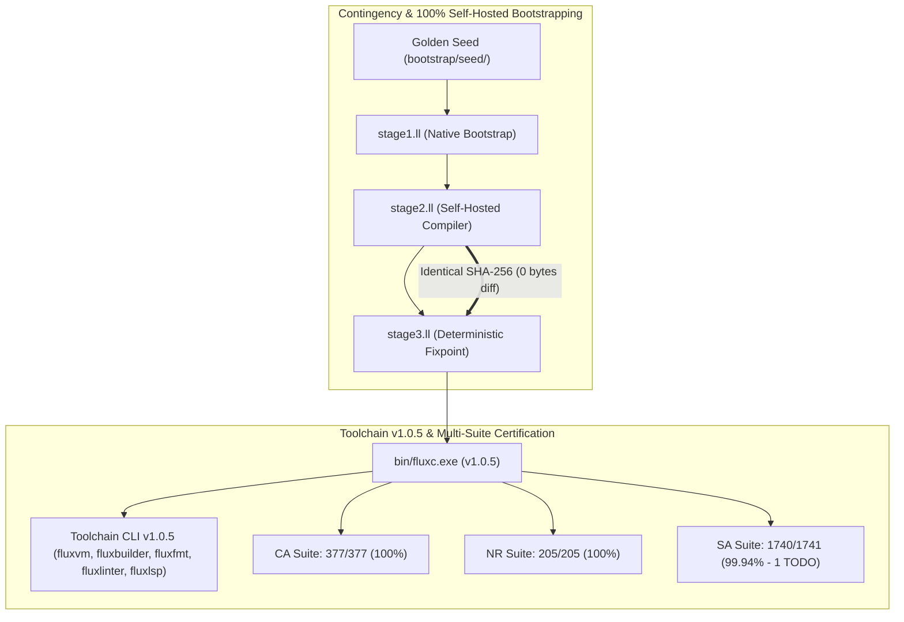

# TheFlux v1.0.5 Release Notes

> **Release Date**: November 2026  
> **Version**: `1.0.5` — *100% Self-Hosted Autonomy, Legacy Elimination, Multi-Suite Compliance Certification & Toolchain Standardization*  
> **Status**: Stable / 100% Self-Hosted & Legacy-Free Production  
> **License**: GNU General Public License v3.0 (GPL-3.0)  
> **Deterministic Fixpoint**: `SHA-256(stage2.ll) == SHA-256(stage3.ll)` (`39239abd85674d70f550d26339443b9c3a0c0a20c968c6dd23d95e1d192610fe`, 0 bytes divergence)  
> **Official Canonical Baseline**: [`examples/00_Standarts/00_IN.txt`](file:///D:/Projetos/TheFlux/examples/00_Standarts/00_IN.txt) (permanently replacing `00_Legacy.txt`)  
> **Multi-Suite Compliance (5 Backends)**: **2,322 / 2,323 programs** (**11,610 / 11,615 executions = 99.96%** — CA `377/377` 100%, NR `205/205` 100%, SA `1,740/1,741` 99.94%)  
> **WebAssembly Policy**: WebAssembly 1.0 MVP frozen during Self-Hosted stabilization (3.0 migration tracked in the TODO section)

---

## 🌟 1. Executive Summary: Consolidation of Version 1.0.5

Version **1.0.5** marks **TheFlux**'s definitive transition into a **100% self-hosted, self-sustaining ecosystem**, completely removing the legacy Python prototype while consolidating large-scale multi-suite certification across all 5 official backends (`in`, `vm`, `llvm`, `wat`, `was`):

1. **Complete Legacy Elimination and Full `CompilerLib` Decoupling**:
   - Permanently removed `legacy-0.9.9/`, `bootstrap/seed/prepare_compiler_lib.py`, and the legacy static archives `lib/fluxcompiler.lib` and `lib/libfluxcompiler.a`.
   - All **44 FDSL modules** of `CompilerLib` are now natively compiled and linked directly inside the standalone [`bin/fluxc.exe`](file:///D:/Projetos/TheFlux/bin/fluxc.exe) executable, with zero external `-lfluxcompiler` dependency.
   - End-to-end 3-stage bootstrapping ([`scripts/bootstrap.bat`](file:///D:/Projetos/TheFlux/scripts/bootstrap.bat) / [`scripts/bootstrap.sh`](file:///D:/Projetos/TheFlux/scripts/bootstrap.sh)) certified across all gates (`Boot-0` through `Boot-5`) with bit-for-bit fixpoint determinism:
     `SHA-256(stage2.ll) == SHA-256(stage3.ll) == 39239abd85674d70f550d26339443b9c3a0c0a20c968c6dd23d95e1d192610fe`.
2. **3-Tier Contingency, Golden Seed, and Transactional Rollback Infrastructure**:
   - Introduced the immutable versioned seed in [`bootstrap/seed/`](file:///D:/Projetos/TheFlux/bootstrap/seed/) with cryptographic manifest ([`manifest.sha256`](file:///D:/Projetos/TheFlux/bootstrap/seed/manifest.sha256)) and a legacy-free cold-start recovery script ([`emergency_cold_seed.bat`](file:///D:/Projetos/TheFlux/bootstrap/seed/emergency_cold_seed.bat)).
   - Automatic transactional snapshots (`build/lkg/prev/` and `build/lkg/last-good/`) managed via [`scripts/rollback_bootstrap.bat`](file:///D:/Projetos/TheFlux/scripts/rollback_bootstrap.bat) and [`scripts/rollback_bootstrap.sh`](file:///D:/Projetos/TheFlux/scripts/rollback_bootstrap.sh) (`--prev`, `--last-good`, `--golden`).
3. **New Canonical Baseline (`00_IN.txt`) and Multi-Suite Certification (CA, NR, and SA)**:
   - Permanently retired `00_Legacy.txt` and adopted [`examples/00_Standarts/00_IN.txt`](file:///D:/Projetos/TheFlux/examples/00_Standarts/00_IN.txt) as the official reference generated by the self-hosted native interpreter (**377 tests**, **5,315 lines**, **216,418 bytes**).
   - Multi-backend certification across **2,323 programs** spanning 3 independent suites: **CA (`377/377` = 100%)**, **NR (`205/205` = 100%)**, and **SA (`1,740/1,741` = 99.94%)**, with only 1 remaining known broken/timeout case in SA (`ExampleOfFundamentosOrdenacaoBurst.flux`, tracked in the TODO section).
4. **Unified Toolchain v1.0.5 Versioning and CLI Standardization**:
   - Synchronized version `1.0.5` across [`src/version.md`](file:///D:/Projetos/TheFlux/src/version.md), compiler, C runtime, FVM contracts, and all 5 satellite tools.
   - Standardized `--version` / `-v` CLI identity across `fluxbuilder`, `fluxfmt`, `fluxlinter`, `fluxlsp`, and `fluxvm`.



---

## 🚀 2. Technical Breakdown of Fixes and Enhancements

### 2.1 100% Self-Hosted Decoupling, Contingency, and Rollback

- **Standalone Native Compiler**: Updated [`src/main.flux`](file:///D:/Projetos/TheFlux/src/main.flux), [`scripts/build_tools.bat`](file:///D:/Projetos/TheFlux/scripts/build_tools.bat), and [`scripts/build_tools.sh`](file:///D:/Projetos/TheFlux/scripts/build_tools.sh) to drop `-lfluxcompiler` and natively compile all 44 `CompilerLib` modules via LLVM.
- **Golden Seed and Cold Recovery**: [`bootstrap/seed/`](file:///D:/Projetos/TheFlux/bootstrap/seed/) stores certified binaries (`fluxc.exe`, `fluxvm.exe`), runtime libraries (`libfluxrt.a`, `fluxrt.lib`), `stage1.ll`, [`manifest.sha256`](file:///D:/Projetos/TheFlux/bootstrap/seed/manifest.sha256), and a legacy-free [`emergency_cold_seed.bat`](file:///D:/Projetos/TheFlux/bootstrap/seed/emergency_cold_seed.bat).
- **Transactional Rollback**: [`scripts/rollback_bootstrap.bat`](file:///D:/Projetos/TheFlux/scripts/rollback_bootstrap.bat) and [`scripts/rollback_bootstrap.sh`](file:///D:/Projetos/TheFlux/scripts/rollback_bootstrap.sh) implement 3-tier deterministic recovery (`--prev`, `--last-good`, `--golden`), guarded by `Boot-0` through `Boot-5` gates in [`scripts/bootstrap.bat`](file:///D:/Projetos/TheFlux/scripts/bootstrap.bat).

### 2.2 Modular C Runtime and Memory/Performance Optimizations

- **Removal of Hot-Path `VirtualQuery` Syscalls**: Isolated Win32 pointer probing under `#ifdef FLUX_DEBUG_POINTERS` in [`runtime/src/collections/list.c`](file:///D:/Projetos/TheFlux/runtime/src/collections/list.c) and [`runtime/src/collections/map.c`](file:///D:/Projetos/TheFlux/runtime/src/collections/map.c), paired with `MEM_IMAGE` region caching to eliminate kernel syscall overhead in tight loops.
- **Immortal TLS Arenas and Tag Ring Buffer**: Added immortal TLS arenas in [`runtime/src/memory/arena.c`](file:///D:/Projetos/TheFlux/runtime/src/memory/arena.c) and a 16-slot TLS tag ring buffer for float and collection type tracking across [`list.c`](file:///D:/Projetos/TheFlux/runtime/src/collections/list.c), [`map.c`](file:///D:/Projetos/TheFlux/runtime/src/collections/map.c), [`set.c`](file:///D:/Projetos/TheFlux/runtime/src/collections/set.c), [`string.c`](file:///D:/Projetos/TheFlux/runtime/src/strings/string.c), and [`str_fast.c`](file:///D:/Projetos/TheFlux/runtime/src/strings/str_fast.c).
- **Immutable Heterogeneous List Semantics**: Added `flux_list_push_back_copy` in [`runtime/src/collections/list.c`](file:///D:/Projetos/TheFlux/runtime/src/collections/list.c), faithfully preserving `(tag, val, sval)` entries and eliminating `g_flux_last_tag` pollution when mixing integers, booleans, and `data` elements.
- **Runtime Host Version Contract**: Updated runtime host version reporting to `1.0.5` across [`runtime/src/intrinsics/std_runtime.c`](file:///D:/Projetos/TheFlux/runtime/src/intrinsics/std_runtime.c), [`runtime/flux_input.c`](file:///D:/Projetos/TheFlux/runtime/flux_input.c), [`src/CompilerLib/backends/interp/InterpBackend.fdsl`](file:///D:/Projetos/TheFlux/src/CompilerLib/backends/interp/InterpBackend.fdsl), and [`src/CompilerLib/backends/interp/StdLibBridge.fdsl`](file:///D:/Projetos/TheFlux/src/CompilerLib/backends/interp/StdLibBridge.fdsl).

### 2.3 Frontend, LLVM Backend, and Standard Library Enhancements

- **Resolution of 38 CA Regressions and 78 SA Failures** across [`src/CompilerLib/backends/llvm/LlvmBackend.fdsl`](file:///D:/Projetos/TheFlux/src/CompilerLib/backends/llvm/LlvmBackend.fdsl), [`src/CompilerLib/parser/ParseExprs.fdsl`](file:///D:/Projetos/TheFlux/src/CompilerLib/parser/ParseExprs.fdsl), and [`src/CompilerLib/parser/ParserCore.fdsl`](file:///D:/Projetos/TheFlux/src/CompilerLib/parser/ParserCore.fdsl):
  - **`list of bool` Typing**: Separated `elem_t == "bool"` (`icmp ne i64 %raw, 0` → `i1`) in `GET_INDEX`, `COLL_GET`, and `list`/`set` parameter handling, plus defensive coercion in `UNARY_not` and `BINOP_and`/`BINOP_or` (67 `llvm` fixes).
  - **Parser Literal Guards**: Prevented string literals `".."` and `"comptime"` from being hijacked as range operators or syntax keywords (`ParseExprs.fdsl`).
  - **Multiline Logical Expressions (`and`/`or`)**: `parseLogicalAnd` and `parseLogicalOr` now skip `NEWLINE` tokens following logical operators.
  - **Nested Collections & Bitwise Unboxing**: Propagated `list_inner_elem_types` for `list of list of int64` along with defensive unboxing (`ptrtoint`/`zext`) in `^`, `&`, `|`, `<<`, `>>`, `>>>`.
  - **`int64 -> data` Tag Propagation & `listPushBack`**: Emitted `@flux_set_last_tag` when passing `int` arguments into `data` parameters and lowered `listPushBack` directly to `@flux_list_push_back_copy`.
- **Standard Library Refinements (`stdlib/`)**: Robustness and consistency improvements in [`HashChecksum.fdsl`](file:///D:/Projetos/TheFlux/stdlib/HashStdLib/HashChecksum.fdsl), [`HashCrypto.fdsl`](file:///D:/Projetos/TheFlux/stdlib/HashStdLib/HashCrypto.fdsl), [`MatrixEigen.fdsl`](file:///D:/Projetos/TheFlux/stdlib/LinAlgStdLib/MatrixEigen.fdsl), [`MatrixQR.fdsl`](file:///D:/Projetos/TheFlux/stdlib/LinAlgStdLib/MatrixQR.fdsl), and [`TensorArithmetic.fdsl`](file:///D:/Projetos/TheFlux/stdlib/LinAlgStdLib/TensorArithmetic.fdsl).

### 2.4 WAT and WASM Backends (Frozen WebAssembly 1.0 MVP)

Keeping the **WebAssembly 1.0 MVP** dialect frozen throughout Self-Hosted stabilization:

- **WebAssembly 1.0 Linear-Memory Lists**: Implemented native runtime helpers `$flux_alloc`, `$flux_list_new`, `$flux_list_push`, `$flux_list_get`, `$flux_list_set`, `$flux_list_len`, and `$flux_list_take` in both [`src/CompilerLib/backends/wat/WatBackend.fdsl`](file:///D:/Projetos/TheFlux/src/CompilerLib/backends/wat/WatBackend.fdsl) and [`src/CompilerLib/backends/wasm/WasmBackend.fdsl`](file:///D:/Projetos/TheFlux/src/CompilerLib/backends/wasm/WasmBackend.fdsl), featuring a 16-byte header (`magic = 0x464C5354`), 8-byte alignment, and automatic `memory.grow` expansion.
- **Collection Opcodes & `CAST`**: Full code generation for `LIST_INIT`, `LIST_PUSH`, `SET_INIT`, `SET_ADD`, `GET_INDEX`, `SET_INDEX` (1D and N-D), `COLL_LEN`, `COLL_GET`, `CAST` pass-through, `listPushBack`, `listLength`, and `listTake`, resolving all `wat`/`was` timeouts in NR and SA.

### 2.5 Multi-Suite Compliance Matrix and Canonical Standards

#### Multi-Suite Compliance (Self-Hosted v1.0.5)

| Suite | Official Report | `in` | `vm` | `llvm` | `wat` | `was` | Total Executions | Pass Rate | Notes |
| :--- | :--- | :---: | :---: | :---: | :---: | :---: | :---: | :---: | :--- |
| **CA — Core Architecture (Canon)** | [`compliance_CA01.md`](file:///D:/Projetos/TheFlux/examples/00_Standarts/compliance_CA01.md) | 377/377 | 377/377 | 377/377 | 377/377 | 377/377 | **1,885 / 1,885** | **100.00%** | 361 positive + 16 diagnostics; 0 regressions vs `CA00` |
| **NR — Numerical Recipes v3** | [`compliance_NR01.md`](file:///D:/Projetos/TheFlux/examples/00_Standarts/compliance_NR01.md) | 205/205 | 205/205 | 205/205 | 205/205 | 205/205 | **1,025 / 1,025** | **100.00%** | 22 classical chapters; 0 regressions vs `NR00` |
| **SA — Scientific Algorithms** | [`compliance_SA01.md`](file:///D:/Projetos/TheFlux/examples/00_Standarts/compliance_SA01.md) | 1740/1741 | 1740/1741 | 1740/1741 | 1740/1741 | 1740/1741 | **8,700 / 8,705** | **99.94%** | 1 known pending item (`ExampleOfFundamentosOrdenacaoBurst.flux` — see TODO #5) |
| **Overall Consolidated** | **CA + NR + SA** | **2322/2323** | **2322/2323** | **2322/2323** | **2322/2323** | **2322/2323** | **11,610 / 11,615** | **99.96%** | 5 backends verified in parallel |

#### Matrix of the 8 Active Canonical Standards in `examples/00_Standarts/`

With the permanent removal of `00_Legacy.txt` and renaming of `00_SelfHosted.txt` to [`00_IN.txt`](file:///D:/Projetos/TheFlux/examples/00_Standarts/00_IN.txt), [`examples/00_Standarts/`](file:///D:/Projetos/TheFlux/examples/00_Standarts/) consolidates 8 active standards:

| Standard File | Type | Universe | Total Lines | Output Lines (`\|`) | Architectural Role |
| :--- | :--- | :---: | :---: | :---: | :--- |
| [`00_IN.txt`](file:///D:/Projetos/TheFlux/examples/00_Standarts/00_IN.txt) | Runtime (Self-Hosted Interpreter) | 377 | 5,315 | 4,936 | New official canonical baseline (`364 OK / 13 FAIL`) |
| [`00_LLVM.txt`](file:///D:/Projetos/TheFlux/examples/00_Standarts/00_LLVM.txt) | Runtime (Native LLVM) | 377 | 5,242 | 4,863 | Native LLVM reference (`364 OK / 13 FAIL`) |
| [`00_VM.txt`](file:///D:/Projetos/TheFlux/examples/00_Standarts/00_VM.txt) | Compilation (FVM Bytecode) | 377 | 743 | 0 | `.fvmbc` codegen validation |
| [`00_VMR.txt`](file:///D:/Projetos/TheFlux/examples/00_Standarts/00_VMR.txt) | Runtime (FVM Runtime) | 364 | 5,284 | 4,918 | FVM execution reference |
| [`00_WAS.txt`](file:///D:/Projetos/TheFlux/examples/00_Standarts/00_WAS.txt) | Compilation (Wasm Binary) | 377 | 743 | 0 | `.wasm` codegen validation |
| [`00_WASR.txt`](file:///D:/Projetos/TheFlux/examples/00_Standarts/00_WASR.txt) | Runtime (Wasmer `.wasm`) | 364 | 5,284 | 4,918 | Binary Wasm execution reference |
| [`00_WAT.txt`](file:///D:/Projetos/TheFlux/examples/00_Standarts/00_WAT.txt) | Compilation (WAT Text) | 377 | 743 | 0 | `.wat` codegen validation |
| [`00_WATR.txt`](file:///D:/Projetos/TheFlux/examples/00_Standarts/00_WATR.txt) | Runtime (Wasmer `.wat`) | 364 | 5,284 | 4,918 | Textual WAT execution reference |

---

## 🛠️ 3. CLI Toolchain Standardization, Scripts, and Hygiene

### 3.1 Unified `--version` / `-v` Identity (v1.0.5)

All official executables were rebuilt at version `1.0.5` with standardized `--version` / `-v` output:

| Binary | Primary Source | Official Output (`--version`) |
| :--- | :--- | :--- |
| [`bin/fluxc.exe`](file:///D:/Projetos/TheFlux/bin/fluxc.exe) | [`src/main.flux`](file:///D:/Projetos/TheFlux/src/main.flux) | `1.0.5` |
| [`bin/fluxvm.exe`](file:///D:/Projetos/TheFlux/bin/fluxvm.exe) | [`src/Fvm/fluxvm.flux`](file:///D:/Projetos/TheFlux/src/Fvm/fluxvm.flux) / [`runtime/fvm/fvm_main.c`](file:///D:/Projetos/TheFlux/runtime/fvm/fvm_main.c) | `fluxvm version 1.0.5 (TheFlux Fast Virtual Machine)` |
| [`bin/fluxbuilder.exe`](file:///D:/Projetos/TheFlux/bin/fluxbuilder.exe) | [`src/tools/fluxbuilder/fluxbuilder.flux`](file:///D:/Projetos/TheFlux/src/tools/fluxbuilder/fluxbuilder.flux) | `fluxbuilder version 1.0.5 (TheFlux Project Builder & Integrator)` |
| [`bin/fluxfmt.exe`](file:///D:/Projetos/TheFlux/bin/fluxfmt.exe) | [`src/tools/fluxfmt/fluxfmt.flux`](file:///D:/Projetos/TheFlux/src/tools/fluxfmt/fluxfmt.flux) | `fluxfmt version 1.0.5 (TheFlux Canonical Code Formatter)` |
| [`bin/fluxlinter.exe`](file:///D:/Projetos/TheFlux/bin/fluxlinter.exe) | [`src/tools/fluxlinter/fluxlinter.flux`](file:///D:/Projetos/TheFlux/src/tools/fluxlinter/fluxlinter.flux) | `fluxlinter version 1.0.5 (TheFlux Static Analyzer & Linter)` |
| [`bin/fluxlsp.exe`](file:///D:/Projetos/TheFlux/bin/fluxlsp.exe) | [`src/tools/fluxlsp/fluxlsp.flux`](file:///D:/Projetos/TheFlux/src/tools/fluxlsp/fluxlsp.flux) | `fluxlsp version 1.0.5 (TheFlux Language Server Protocol & IDE Support)` |

### 3.2 Scripts, Compliance Runners, and Repository Hygiene

1. **Parallel Multi-Backend Compliance Runners**: Added [`examples/compliance_CA.py`](file:///D:/Projetos/TheFlux/examples/compliance_CA.py), [`examples/compliance_NR.py`](file:///D:/Projetos/TheFlux/examples/compliance_NR.py), and [`examples/compliance_SA.py`](file:///D:/Projetos/TheFlux/examples/compliance_SA.py) with automated regression tracking against fixed baselines (`CA00`, `NR00`, `SA00`).
2. **Script & SDK Normalization**: Renamed `examples/example_wasr.bat` → [`examples/examples_wasr.bat`](file:///D:/Projetos/TheFlux/examples/examples_wasr.bat) and `examples/example_watr.bat` → [`examples/examples_watr.bat`](file:///D:/Projetos/TheFlux/examples/examples_watr.bat), updated the SDK check in [`fluxbuilder.flux`](file:///D:/Projetos/TheFlux/src/tools/fluxbuilder/fluxbuilder.flux) to `lib/fluxrt.lib`, and aligned FVM versions in [`FvmClient.fdsl`](file:///D:/Projetos/TheFlux/src/Fvm/FvmClient.fdsl) / [`FvmContract.fdsl`](file:///D:/Projetos/TheFlux/src/Fvm/FvmContract.fdsl).
3. **Bilingual Documentation Parity**: Registered the v1.0.5 release notes pair in [`scripts/docs/check_i18n_parity.py`](file:///D:/Projetos/TheFlux/scripts/docs/check_i18n_parity.py), preserving strict 100% 1:1 symmetry between `docs/pt_BR` and `docs/en`.

---

## 📊 4. How to Validate Version 1.0.5

### 4.1 Validating Bootstrapping & Deterministic Fixpoint
```powershell
# Run the full 100% self-hosted bootstrap pipeline (Boot-0 through Boot-5)
.\scripts\bootstrap.bat

# Verify bit-for-bit determinism (must output identical SHA-256 hashes)
python -c "import hashlib; [print(f, hashlib.sha256(open(f, 'rb').read()).hexdigest()) for f in ['build/intermediates/stage2.ll', 'build/intermediates/stage3.ll']]"
```

### 4.2 Verifying the v1.0.5 CLI Toolchain
```powershell
foreach ($tool in 'fluxc','fluxvm','fluxbuilder','fluxfmt','fluxlinter','fluxlsp') {
    & ".\bin\$tool.exe" --version
}
```

### 4.3 Running the Multi-Backend Compliance Suites
```powershell
# CA Suite (Canon — 377 programs)
python examples/compliance_CA.py --jobs 8

# NR Suite (Numerical Recipes v3 — 205 programs)
python examples/compliance_NR.py --jobs 8

# SA Suite (Scientific Algorithms — 1,741 programs)
python examples/compliance_SA.py --jobs 8
```

### 4.4 Verifying Documentation Bilingual Parity
```powershell
python scripts/docs/check_i18n_parity.py
```

---

## 📋 5. TODO (Pending Items & Next Steps)

1. **Indentation adjustment (3 or 4 spaces)**:
   - Revisit the current strict 6-space indentation rule defined in [`docs/en/Grammar.md`](file:///D:/Projetos/TheFlux/docs/en/Grammar.md) and enforced across [`src/CompilerLib/lexer/IndentTracker.fdsl`](file:///D:/Projetos/TheFlux/src/CompilerLib/lexer/IndentTracker.fdsl), [`fluxfmt`](file:///D:/Projetos/TheFlux/src/tools/fluxfmt/fluxfmt.flux), [`fluxlinter`](file:///D:/Projetos/TheFlux/src/tools/fluxlinter/fluxlinter.flux), and [`fluxlsp`](file:///D:/Projetos/TheFlux/src/tools/fluxlsp/fluxlsp.flux), migrating or standardizing on **3 or 4 spaces** across the ecosystem and example suites.
2. **Line break / line continuation adjustment (documented and not implemented and/or tested)**:
   - Fully implement and add canonical test coverage for the logical line continuation and line-break rules already documented in [`docs/en/Grammar.md`](file:///D:/Projetos/TheFlux/docs/en/Grammar.md#L250-L266) (`eol` suppression after infix/dataflow operators, inside `()`/`[]`, and `pending_line`), aligning [`src/CompilerLib/lexer/LexerCore.fdsl`](file:///D:/Projetos/TheFlux/src/CompilerLib/lexer/LexerCore.fdsl) and the parser with the formal specification.
3. **`web_wasm` testing (legacy DEPRECATED was functional, not tested in Self-Hosted)**:
   - Perform end-to-end verification of the interactive WebAssembly playground in [`web_wasm/server.py`](file:///D:/Projetos/TheFlux/web_wasm/server.py), [`web_wasm/index.html`](file:///D:/Projetos/TheFlux/web_wasm/index.html), and [`web_wasm/wasi_worker.js`](file:///D:/Projetos/TheFlux/web_wasm/wasi_worker.js) loading `.wasm` artifacts produced by the 100% Self-Hosted compiler — previously working under the deprecated/removed legacy prototype (`legacy-0.9.9`), but not yet tested and certified in Self-Hosted.
4. **WebAssembly migration to version 3.0**:
   - Begin Phase 2 of the engineering roadmap ([`docs/TODO.md`](file:///D:/Projetos/TheFlux/docs/TODO.md)), migrating [`WatBackend.fdsl`](file:///D:/Projetos/TheFlux/src/CompilerLib/backends/wat/WatBackend.fdsl) and [`WasmBackend.fdsl`](file:///D:/Projetos/TheFlux/src/CompilerLib/backends/wasm/WasmBackend.fdsl) from the frozen WebAssembly 1.0 MVP to **WebAssembly 3.0** (shared Wasm IR, elimination of `interpExecuteFmir` pre-baking, WasmGC, Multi-Value, `try_table`, tail calls, and modern WASI).
5. **SciAlgo code fix for broken example (`ExampleOfFundamentosOrdenacaoBurst.flux`)**:
   - Investigate and fix the code breakage/timeout in [`examples/ScientificAlgorithms/01_foundations/ExampleOfFundamentosOrdenacaoBurst.flux`](file:///D:/Projetos/TheFlux/examples/ScientificAlgorithms/01_foundations/ExampleOfFundamentosOrdenacaoBurst.flux) — the sole remaining failure in [`compliance_SA01.md`](file:///D:/Projetos/TheFlux/examples/00_Standarts/compliance_SA01.md#L1861-L1871) (`1,740 / 1,741`, timing out across `in`, `vm`, `wat`, and `was` and blocking `llvm` reference comparison) — to restore **100% (`1,741 / 1,741`)** compliance on the Scientific Algorithms suite.

---

*TheFlux Core Engineering Team — November 2026.*
