# 📜 .fvmbc Bytecode Specification and 92 Canonical Opcodes Catalog

> **Types and Opcode Header**: [`runtime/fvm/fvm_types.h`](file:///D:/Projetos/TheFlux/runtime/fvm/fvm_types.h)  
> **Compiler VM Emitter**: [`src/CompilerLib/backends/vm/VmCompiler.fdsl`](file:///D:/Projetos/TheFlux/src/CompilerLib/backends/vm/VmCompiler.fdsl)  
> **Supported Version**: `v1.0.0`  
> **Status**: ✅ Official Canonical Specification of TheFlux v1.0.0

---

## 1. Overview of the `.fvmbc` Bytecode Format

The **`.fvmbc`** (Fast Virtual Machine Bytecode) file is the serialized JSON intermediate representation generated by the self-hosted compiler's VM backend (`fluxc --target vm`). It encapsulates executable instructions, typed constants, function definitions, and structural program metadata.

### `.fvmbc` JSON Schema Structure

```json
{
  "version": "1.0.0",
  "constants": [
    {"type": "int", "value": 42},
    {"type": "string", "value": "Hello, TheFlux!"}
  ],
  "functions": [
    {
      "name": "main",
      "params": [],
      "locals_count": 8,
      "instructions": [
        {"op": "LOAD_CONST", "arg": 0},
        {"op": "PRINT"},
        {"op": "HALT"}
      ]
    }
  ],
  "metadata": {
    "target": "fvm",
    "compiler": "fluxc-1.0.0"
  }
}
```

---

## 2. Compilation and Code Generation Pipeline

Compilation for the FVM target follows the canonical compiler architecture:

```mermaid
flowchart LR
    Source[".flux / .fdsl"] --> Parser["ParserCore.fdsl"]
    Parser --> AST["Abstract Syntax Tree (AST)"]
    AST --> Semant["SemanticCore.fdsl"]
    Semant --> FMIR["Flux Mid-level IR (FMIR)"]
    FMIR --> VmBackend["VmBackend.fdsl"]
    VmBackend --> VmCompiler["VmCompiler.fdsl"]
    VmCompiler --> FVMBlob[".fvmbc (JSON Bytecode)"]
    FVMBlob --> FVMExec["fluxvm.exe (Execution / Injection)"]
```



1. **FMIR Generation**: The frontend lowers AST declarations, contracts, and expressions into the unified FMIR control-flow graph.
2. **VM Instruction Emission**: `VmBackend.fdsl` walks basic blocks and generates sequences of the 92 canonical FVM opcodes.
3. **JSON Serialization**: `VmCompiler.fdsl` encodes the constant pool and function array into the standardized `.fvmbc` payload.

---

## 3. Catalog of the 92 Canonical Opcodes

The official opcode enumeration resides in [`runtime/fvm/fvm_types.h`](file:///D:/Projetos/TheFlux/runtime/fvm/fvm_types.h) (`FvmOpcode`), grouped into 9 functional categories:

### 3.1 Lifecycle & Stack Management (Opcodes 0–5, 17–18)
| Opcode | ID | Description |
|---|---|---|
| `OP_HALT` | 0 | Terminates virtual machine execution and returns top-of-stack as exit code. |
| `OP_PUSH` | 1 | Pushes a constant from the constant table onto the evaluation stack. |
| `OP_LOAD` | 2 | Loads a local variable or register onto the stack. |
| `OP_STORE` | 3 | Stores the top-of-stack value into a local variable slot. |
| `OP_MAKE_REF` | 4 | Creates a mutable reference to a variable memory slot. |
| `OP_DECLARE` | 5 | Allocates and initializes a new typed variable in current scope. |
| `OP_DUP` | 17 | Duplicates the element on top of the operand stack. |
| `OP_POP` | 18 | Pops and discards the element on top of the operand stack. |

### 3.2 Arithmetic & Mathematical Operations (Opcodes 6–15, 60–61)
| Opcode | ID | Description |
|---|---|---|
| `OP_ADD` | 6 | Arithmetic addition (`a + b`). |
| `OP_SUB` | 7 | Arithmetic subtraction (`a - b`). |
| `OP_MUL` | 8 | Arithmetic multiplication (`a * b`). |
| `OP_DIV` | 9 | Floating-point real division (`a / b`). |
| `OP_IDIV` | 10 | Integer truncated division (`a /i b`). |
| `OP_REM` | 11 | Integer remainder (`a /r b`). |
| `OP_POW_E` | 12 | Exact exponentiation (`a ^e b`). |
| `OP_POW_R` | 13 | Real power exponentiation (`a ^r b`). |
| `OP_NEG` | 14 | Unary arithmetic negation (`-a`). |
| `OP_ROUND` | 60 | Numeric rounding with configurable mode. |
| `OP_ROUND_COMPLEX` | 61 | Rounding of real and imaginary parts of complex numbers. |

### 3.3 Comparisons & Boolean Logic (Opcodes 16, 19–26)
| Opcode | ID | Description |
|---|---|---|
| `OP_NOT` | 16 | Logical NOT (`not a`). |
| `OP_EQ` | 19 | Equality check (`a == b`). |
| `OP_NE` | 20 | Inequality check (`a != b`). |
| `OP_LT` | 21 | Less than (`a < b`). |
| `OP_LE` | 22 | Less than or equal (`a <= b`). |
| `OP_GT` | 23 | Greater than (`a > b`). |
| `OP_GE` | 24 | Greater than or equal (`a >= b`). |
| `OP_AND` | 25 | Logical AND (`a and b`). |
| `OP_OR` | 26 | Logical OR (`a or b`). |

### 3.4 Bitwise Operations (Opcodes 27–33)
| Opcode | ID | Description |
|---|---|---|
| `OP_BAND` | 27 | Bitwise AND (`&`). |
| `OP_BOR` | 28 | Bitwise OR (`&#124;`). |
| `OP_BXOR` | 29 | Bitwise XOR (`^`). |
| `OP_BSHL` | 30 | Bitwise shift left (`<<`). |
| `OP_BSHR` | 31 | Bitwise arithmetic shift right (`>>`). |
| `OP_BSHRU` | 32 | Bitwise logical unsigned shift right (`>>>`). |
| `OP_BNOT` | 33 | Bitwise NOT (`~`). |

### 3.5 I/O & Debugging (Opcodes 34–36, 86)
| Opcode | ID | Description |
|---|---|---|
| `OP_PRINT` | 34 | Prints top-of-stack value without newline. |
| `OP_PRINTLN` | 35 | Prints top-of-stack value followed by newline. |
| `OP_INPUT` | 36 | Reads one line from standard input. |
| `OP_SPY` | 86 | Inspects and displays runtime value diagnostics. |

### 3.6 Control Flow, Functions & Scopes (Opcodes 37–43)
| Opcode | ID | Description |
|---|---|---|
| `OP_JMP` | 37 | Unconditional jump to target instruction address. |
| `OP_JZ` | 38 | Conditional jump if top-of-stack is false or zero. |
| `OP_JNZ` | 39 | Conditional jump if top-of-stack is true or non-zero. |
| `OP_CALL` | 40 | Calls function passing arguments from the stack. |
| `OP_RET` | 41 | Returns from current function call to caller. |
| `OP_SCOPE_ENTER` | 42 | Opens a new lexical variable scope. |
| `OP_SCOPE_EXIT` | 43 | Exits current lexical scope, popping local frames. |

### 3.7 Contracts, Agents & Structured Errors (Opcodes 44–46)
| Opcode | ID | Description |
|---|---|---|
| `OP_EMIT` | 44 | Emits an agent operation outcome (`emit(nice, val, msg)`). |
| `OP_FAIL` | 45 | Triggers a structured contract failure. |
| `OP_IS_FAIL` | 46 | Checks if an emit result indicates failure. |

### 3.8 Structs, Enums, Tuples & Pattern Matching (Opcodes 47–59, 74–79)
| Opcode | ID | Description |
|---|---|---|
| `OP_MAKE_STRUCT` | 47 | Allocates a new struct instance with fields. |
| `OP_FIELD_ACCESS` | 48 | Accesses a struct field by name or index. |
| `OP_FIELD_SET` | 49 | Mutates a struct field value. |
| `OP_TO_STRING` | 50 | Casts any tagged value into string representation. |
| `OP_JUMP_IF_NOT_MATCH` | 51 | Conditional branch when pattern arm fails to match. |
| `OP_MATCH_BIND` | 53 | Binds destructured pattern values to local variables. |
| `OP_ENUM_NEW` | 55 | Instantiates an enum variant with discriminant tag. |
| `OP_ENUM_TAG` | 56 | Extracts the discriminant tag from an enum instance. |
| `OP_INDEX` | 62 | Indexed lookup on lists, maps, or tensors (`col[idx]`). |
| `OP_INDEX_ASSIGN` | 63 | Indexed mutation (`col[idx] = val`). |
| `OP_SLICE` | 69 | Slices collections or strings (`col[start..end]`). |
| `OP_IN` | 70 | Membership test (`item in col`). |

### 3.9 Tensors, Collections & Iterators (Opcodes 64–68, 71–73, 83–85, 87)
| Opcode | ID | Description |
|---|---|---|
| `OP_TGET` | 64 | Multidimensional tensor element read. |
| `OP_TSET` | 65 | Multidimensional tensor element write. |
| `OP_TENSOR_PACK` | 66 | Packs values into contiguous tensor buffer. |
| `OP_TSLICE` | 67 | Multidimensional tensor slicing. |
| `OP_TMAT` | 68 | Tensor matrix multiplication kernel. |
| `OP_MAKE_LIST` | 71 | Allocates a dynamic list collection. |
| `OP_MAKE_SET` | 72 | Allocates a unique-value hash set. |
| `OP_MAKE_MAP` | 73 | Allocates a key-value hash map. |
| `OP_ITER_NEW` | 83 | Creates an iterator over a collection. |
| `OP_ITER_NEXT` | 84 | Advances iterator to next element. |
| `OP_UNWRAP_NICE` | 85 | Unwraps payload value from a `nice` emit result. |
| `OP_NOP` | 87 | No operation (used for alignment and jump patching). |

---

## 4. Tagged Value System (`FluxVal`) & Arena Memory Management

FVM achieves top-tier performance without garbage collection pause overhead using two core architectural strategies:

### 4.1 Tagged Value Structure `FluxVal` (16 Bytes Aligned)
Every runtime entity is represented by the 16-byte aligned `FluxVal` structure defined in [`runtime/fvm/fvm_types.h`](file:///D:/Projetos/TheFlux/runtime/fvm/fvm_types.h):

```c
typedef struct FluxVal {
    uint8_t type;       /* 16 primitive types: VAL_INT, VAL_FLOAT, VAL_STRING, etc. */
    uint8_t flags;      /* Mutability and lifecycle flags */
    uint16_t aux;       /* Auxiliary metadata / enum discriminant */
    int32_t len;        /* String or collection element length */
    union {
        int64_t i64;    /* 64-bit signed integers */
        double f64;     /* 64-bit IEEE 754 floating-point numbers */
        uint32_t ch;    /* UTF-32 code points */
        void *ptr;      /* Heap/arena object pointer (strings, lists, maps) */
    } as;
} FluxVal;
```

### 4.2 Arena Memory Allocator (`FvmArena`)
- **Linear Bump Allocation**: Heap structures are allocated in contiguous 64 KB memory chunks (`fvm_arena.c`), with pointer increments operating in O(1) time without system heap contention.
- **Instant Zero-Cost Deallocation**: When execution finishes, the entire arena resets in O(1) time without GC scanning, heap compaction, or stop-the-world pauses.
