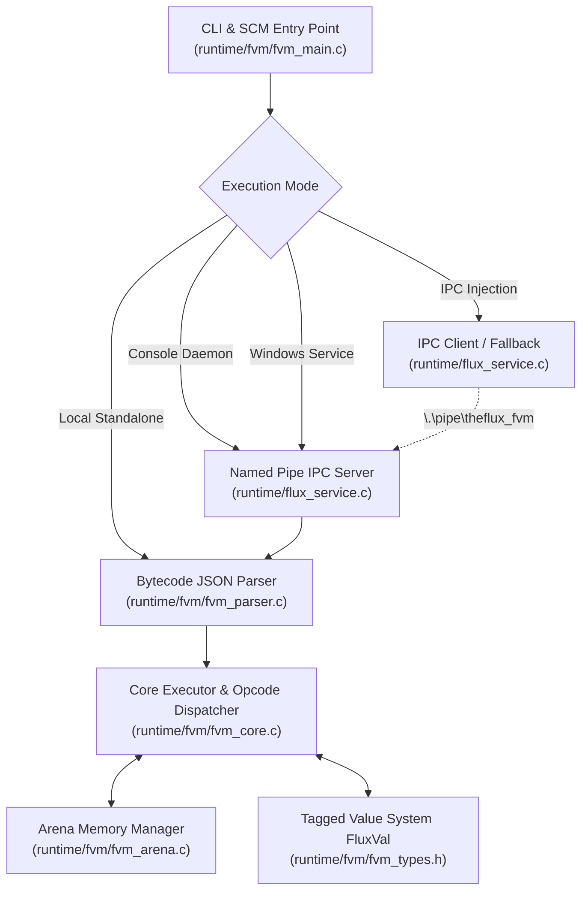

# ⚡ FVM Architecture and Technical Overview (TheFlux Fast Virtual Machine)

> **Official Binary**: `bin/fluxvm.exe (Windows) / bin/fluxvm (Linux)`  
> **Engine Source Code**: [`runtime/fvm/`](file:///D:/Projetos/TheFlux/runtime/fvm) and [`runtime/flux_service.c`](file:///D:/Projetos/TheFlux/runtime/flux_service.c)  
> **Supported Version**: `v1.0.0`  
> **Status**: ✅ Official Canonical Subsystem of TheFlux v1.0.0

---

## 1. Overview and Architectural Role

The **TheFlux Fast Virtual Machine (FVM)** is the high-performance native bytecode interpreter designed to execute compiled bytecode files (`.fvmbc`) within TheFlux programming ecosystem. Developed in clean C with an arena-based memory management model, FVM provides a lightweight, instant-startup runtime decoupled from external C/LLVM toolchain dependencies.

FVM implements a unique dual-mode architecture:
1. **Standalone Mode (Isolated Local Execution)**: Instant on-demand execution for standalone scripts, utilities, and continuous integration suites.
2. **Resident Daemon / Windows Service Mode (Named Pipe IPC)**: A persistent execution daemon listening on a Windows Named Pipe (`\.\pipe\theflux_fvm`). The pre-warmed VM accepts injected bytecodes (`--inject`) with ultra-low turnaround times of approximately **0.10 ms** (100 microseconds). If the background daemon is not running, clients execute a **transparent automatic fallback** to local execution without process failure.

---

## 2. Internal Components of the C Engine

The physical implementation of FVM resides in [`runtime/fvm/`](file:///D:/Projetos/TheFlux/runtime/fvm):



| Source File | Header | Technical Purpose |
|---|---|---|
| [`fvm_arena.c`](file:///D:/Projetos/TheFlux/runtime/fvm/fvm_arena.c) | `fvm_arena.h` | 64 KB chunk contiguous arena memory allocator, preventing repeated `malloc` calls and enabling instant block deallocation without heap fragmentation. |
| [`fvm_parser.c`](file:///D:/Projetos/TheFlux/runtime/fvm/fvm_parser.c) | `fvm_parser.h` | High-speed JSON deserializer and loader for `.fvmbc` bytecode structures into in-memory `FvmProgram` representations. |
| [`fvm_core.c`](file:///D:/Projetos/TheFlux/runtime/fvm/fvm_core.c) | `fvm_core.h` | Execution engine with direct dispatch loop over **92 canonical opcodes**, evaluation stack, and register table. |
| [`fvm_types.h`](file:///D:/Projetos/TheFlux/runtime/fvm/fvm_types.h) | `fvm_types.h` | Opcode definitions, 16 primitive value type enumerations, and 16-byte aligned tagged value structure (`FluxVal`). |
| [`flux_service.c`](file:///D:/Projetos/TheFlux/runtime/flux_service.c) | `flux_service.h` | Windows platform bridge: SCM service management, multi-instance Named Pipe server, and IPC injection client. |
| [`fvm_main.c`](file:///D:/Projetos/TheFlux/runtime/fvm/fvm_main.c) | - | CLI command-line interface, argument routing, high-resolution performance benchmarking via Windows `QueryPerformanceCounter`. |

---

## 3. Detailed Operating Modes

### 3.1 Standalone Mode (Direct Local Execution)
`fluxvm.exe` loads the target `.fvmbc` bytecode file, initializes a local arena state, and executes the bytecode program directly:
```bash
fluxvm t_fvmbc/ExampleOfAsync.fvmbc
```
- **Advantages**: Complete process isolation, no reliance on background daemons or services.
- **Use Cases**: Unit testing, automated batch jobs, one-off scripts, and environments with restricted background execution rights.

### 3.2 Console Daemon Mode (Resident without Administrator Privileges)
Starts the resident Named Pipe server directly in a user console or background task without requiring elevated privileges:
```bash
fluxvm --daemon
```
The server listens for incoming connections on `\\.\pipe\theflux_fvm`. When an injection client connects (`--inject`), the daemon processes the payload and returns stdout, stderr, and exit codes over the pipe.

### 3.3 Windows Service Mode (Service Control Manager - SCM)
For production deployments and dedicated build nodes, FVM registers as a standard Windows Service configured with automatic startup (`SERVICE_AUTO_START`):
- **Install**: `fluxvm --service install` (requires Administrator)
- **Start**: `fluxvm --service start`
- **Check Status**: `fluxvm --service status` or `fluxvm --status`
- **Stop**: `fluxvm --service stop`
- **Uninstall**: `fluxvm --service uninstall`

### 3.4 IPC Bytecode Injection with Automatic Fallback
Clients inject bytecode directly into the running instance:
```bash
fluxvm --inject program.fvmbc --bench
```
- **Service/Daemon Active**: Bytecode is executed over IPC in ~0.10 ms.
- **Service Inactive**: FVM intercepts the IPC status `-2` and **automatically falls back to local execution**, ensuring that injection commands never fail due to an unstarted daemon.

---

## 4. Command-Line Interface (CLI) Reference

| Option | Argument | Description |
|---|---|---|
| `<file.fvmbc>` | Required in direct mode | Executes the bytecode file locally in standalone mode. |
| `--inject` | `<file.fvmbc>` or `-` | Injects bytecode into the Windows Service or Daemon via Named Pipe (supports STDIN via `-`). |
| `--status`, `--ping` | - | Queries whether the FVM service or daemon is active (`active` / `inactive`). |
| `--bench` | - | Enables high-resolution benchmarking, displaying execution time (ms), instruction count, and IPC latency. |
| `--stdin` | `<text>` | Feeds simulated standard input text through CLI parameters. |
| `--service install` | - | Registers `TheFluxFvmService` in Windows SCM with automatic startup. |
| `--service uninstall` | - | Removes `TheFluxFvmService` from Windows SCM. |
| `--service start` | - | Starts the registered Windows service. |
| `--service stop` | - | Stops the running Windows service. |
| `--service status` | - | Queries and displays the SCM service operational status. |
| `--service run` | - | Internal entrypoint dispatched by SCM when managing the service lifecycle. |
| `--daemon` | - | Launches the resident Named Pipe server in console space (without admin elevation). |
| `--version`, `-v` | - | Prints the installed FVM version (`1.0.0`). |
| `--help`, `-h` | - | Displays usage manual and command options. |

---

## 5. Performance and Benchmarking Metrics

Benchmarks measured using Windows high-resolution performance counters (`QueryPerformanceCounter`) demonstrate:

| Execution Mode | Typical Turnaround Time | Process Spawn Overhead |
|---|---|---|
| **IPC Named Pipe Injection** (`--inject`) | **0.08 ms to 0.12 ms** (80–120 µs) | Zero (pre-warmed resident instance) |
| **Local Standalone** (`fluxvm <file>`) | **0.02 ms to 0.04 ms** (post-spawn) | ~15 ms (operating system process startup) |
| **Automatic Fallback** (daemon inactive) | **0.02 ms to 0.04 ms** | Immediate execution after 50 ms timeout |
