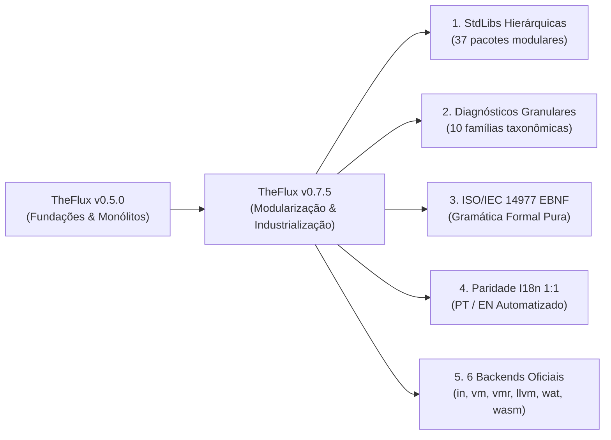

# TheFlux v0.7.5 Release Notes

> **Data de Lançamento**: Outubro de 2026  
> **Versão**: `0.7.5`  
> **Status**: Estável / Produção  
> **Licença**: GNU General Public License v3.0 (GPL-3.0)  
> **Conformidade Multi-Backend**: **100,0% PASS** nos 6 backends oficiais (`in`, `vm`, `vmr`, `llvm`, `wat`, `wasm`)

---

## 🌟 1. Resumo Executivo: Maturidade Industrial e Científica

A versão **0.7.5** da linguagem de programação **TheFlux** consolida um marco fundamental na história da linguagem: a transição de um ecossistema experimental para uma plataforma de engenharia de software e computação científica de padrão industrial.

Este lançamento formaliza a arquitetura modular definitiva das **37 bibliotecas padrão**, introduz um sistema de **diagnósticos granulares prescritivos** de última geração com compilação AOT (Ahead-of-Time) em Python e runtime C/LLVM, unifica as especificações formais sob a norma internacional **ISO/IEC 14977 (EBNF)** e atinge a **simetria internacional bilíngue estrita 1:1** em toda a documentação técnica (Português e Inglês).



---

## 🚀 2. Principais Destaques da Versão 0.7.5

### 2.1 Arquitetura Modular Canônica das 37 Bibliotecas Padrão (`stdlib/`)
As 37 bibliotecas do ecossistema TheFlux foram completamente refatoradas de arquivos monolíticos planos para **pacotes modulares hierárquicos**. A nova arquitetura é governada por três princípios rígidos documentados em [`docs/pt/StdLibs.md`](file:///D:/Projetos/TheFlux/docs/pt/StdLibs.md):
1. **Tríade do Arquivo Agregador Mestre (`<Lib>StdLib.fdsl`)**:
   - **Tipos Globais**: Todas as estruturas (`struct`) e enumerações (`enum`) de visibilidade compartilhada são declaradas no cabeçalho do agregador mestre (ex.: `CompressStats`, `DecompressQuota`, `FinDecimal`, `SymbolicNode`).
   - **Manifesto Declarativo**: O agregador expõe formalmente seus submódulos via diretiva `use <Dominio>.fdsl`.
   - **Operações Utilitárias Compartilhadas (`op _*`)**: Operações consumidas por dois ou mais módulos de domínio residem exclusivamente no corpo do agente agregador.
2. **Contratos Formais Obrigatórios de Domínio**: Todo módulo filho implementa rigorosamente um contrato tipado (`contract (<Dominio>Contract)` e `agent (<Lib>StdLib) impl <DominioContract>`).
3. **Zero Arquivos Órfãos**: Módulos utilitários desvinculados foram integrados ou eliminados (remoção total de `FormatUtility.fdsl`, `FsmUtility.fdsl` e `StructUtility.fdsl`).

### 2.2 Taxonomia Granular de Diagnósticos e Dicas Acionáveis
O sistema de mensagens de erro foi reconstruído para oferecer diagnósticos precisos, com localização espacial exata e **dicas acionáveis (`hint`)** que instruem o programador sobre como corrigir o problema:
- **10 Famílias Taxonômicas**: Códigos mnemônicos estruturados em 6 caracteres:
  - `LEX001`: Erros de leitura léxica e caracteres não-ASCII proibidos fora de strings.
  - `SYN100` a `SYN161`: Erros sintáticos, shape estático obrigatório para `tensor`, tipos obrigatórios em `list` e `set`.
  - `IMP201` a `IMP204`: Importação e resolução de módulos cíclicos ou inexistentes.
  - `SEM301` a `SEM372`: Resolução de escopo, duplicidade e integridade semântica.
  - `TYP401` a `TYP499`: Validação estrita de tipos escalares, numéricos e matrizes complexas.
  - `OWN501` a `OWN505`: Sistema de posse, garantia de imutabilidade e coleções mutáveis.
  - `RES601` a `RES602`: Limites de memória e cotas de descompressão (*Zip Bomb protection*).
  - `RT701` a `RT709`: Erros de runtime e violações matemáticas de domínio ($\div 0$, $\ln(x \le 0)$, $\sqrt{x < 0}$).
  - `MOD801` a `MOD802`: Conformidade de contratos modulares e assinaturas de agentes.
  - `SYS901` a `SYS902`: Esgotamento de recursos e falhas de sistema/hardware.

### 2.3 Compilação AOT (Ahead-of-Time) do Catálogo de Erros
A sincronização do catálogo de erros agora é executada via compilação antecipada ([`scripts/sync_errors_catalog.py`](file:///D:/Projetos/TheFlux/scripts/sync_errors_catalog.py)):
- **Python**: Gera [`src/flux_proto/diagnostics/catalog_data.py`](file:///D:/Projetos/TheFlux/src/flux_proto/diagnostics/catalog_data.py) com dicionários pré-indexados para lookups em $O(1)$ sem parsing em tempo de execução.
- **C / LLVM Runtime**: Gera o cabeçalho [`src/flux_proto/llvm/runtime/flux_errors.h`](file:///D:/Projetos/TheFlux/src/flux_proto/llvm/runtime/flux_errors.h), unificando as mensagens emitidas por binários nativos compilados com as do interpretador.
- **Documentação Sincronizada**: Gera simultaneamente [`docs/pt/Errors.md`](file:///D:/Projetos/TheFlux/docs/pt/Errors.md) e [`docs/en/Errors.md`](file:///D:/Projetos/TheFlux/docs/en/Errors.md).

### 2.4 Gramática Formal ISO/IEC 14977 (EBNF) e Sincronização Automatizada
A especificação da linguagem TheFlux foi formalizada sob o padrão internacional **ISO/IEC 14977**:
- Criação dos artefatos canônicos:
  - [`docs/pt/TheFlux.ebnf`](file:///D:/Projetos/TheFlux/docs/pt/TheFlux.ebnf) e [`docs/en/TheFlux.ebnf`](file:///D:/Projetos/TheFlux/docs/en/TheFlux.ebnf) (Especificação formal da linguagem).
  - [`docs/pt/Gramatica.ebnf`](file:///D:/Projetos/TheFlux/docs/pt/Gramatica.ebnf) e [`docs/en/Grammar.ebnf`](file:///D:/Projetos/TheFlux/docs/en/Grammar.ebnf) (Gramática concreta do compilador).
  - [`docs/shared/TheFlux.ebnf`](file:///D:/Projetos/TheFlux/docs/shared/TheFlux.ebnf) (Fonte de referência compartilhada).
- Ferramenta dedicada de sincronização ([`scripts/docs/sync_ebnf.py`](file:///D:/Projetos/TheFlux/scripts/docs/sync_ebnf.py)) que garante 100% de paridade entre arquivos `.ebnf` e blocos de código embutidos em documentos Markdown.

### 2.5 Internacionalização Estrita 1:1 e Suíte de Governança
- **Organização de Diretórios**: Todas as especificações residem exclusivamente nas árvores de idioma [`docs/pt/`](file:///D:/Projetos/TheFlux/docs/pt/) e [`docs/en/`](file:///D:/Projetos/TheFlux/docs/en/), mantendo a raiz de `docs/` limpa de arquivos duplicados ou residuais.
- **Capitalização Rigorosa por Idioma**: Nomes em português capitalizado em `pt/` (ex.: `Compilacao.md`, `Gramatica.md`, `Gramatica.ebnf`) e nomes em inglês capitalizado em `en/` (ex.: `Compilation.md`, `Grammar.md`, `Grammar.ebnf`).
- **Linter Automatizado de Paridade** ([`scripts/docs/check_i18n_parity.py`](file:///D:/Projetos/TheFlux/scripts/docs/check_i18n_parity.py)): Valida correspondência biunívoca, cardinalidade de seções, paridade de códigos de erro e integridade do repositório.
- **Orquestrador Unificado de Build** ([`scripts/docs/build_docs.py`](file:///D:/Projetos/TheFlux/scripts/docs/build_docs.py)): Constrói todo o ecossistema de documentação (EBNF $\rightarrow$ Paridade $\rightarrow$ Catálogo de Erros $\rightarrow$ Índices $\rightarrow$ HTML Interativo) em ~2 segundos.

---

## ⚙️ 3. A Matriz dos 6 Backends Oficiais

TheFlux v0.7.5 garante **Semântica Invariante Absoluta**: qualquer programa `.flux` válido produz exatamente o mesmo comportamento determinístico, saída de texto e códigos de erro nos 6 backends de compilação e execução:

| Backend | Flag CLI | Papel Arquitetural | Alvo de Execução | Status v0.7.5 |
| :--- | :--- | :--- | :--- | :---: |
| **Interpretador AST** | `in` / `--backend in` | Avaliação em memória da árvore sintática para prototipagem e depuração | Host (Python) | ✅ 100% PASS |
| **VM Bytecode** | `vm` / `--backend vm` | Execução baseada em pilha via bytecode proprietário `.fvmbc` | FVM Engine | ✅ 100% PASS |
| **VM Runner** | `vmr` / `--backend vmr` | Execução otimizada com registradores virtuais lineares e validação de bytecode | FVM Register Engine | ✅ 100% PASS |
| **LLVM Nativo** | `llvm` / `--backend llvm` | Compilação AOT para código de máquina nativo de alto desempenho | Binário Nativo (.exe) | ✅ 100% PASS |
| **WASM Text** | `wat` / `--backend wat` | Emissão textual S-Expressions para inspeção e auditoria WebAssembly | Node / Wasmtime | ✅ 100% PASS |
| **WASM Binário** | `wasm` / `--backend wasm` | Compilação direta para binário WebAssembly de alta velocidade | Wasmer / Wasmtime | ✅ 100% PASS |

---

## 📊 4. Matriz Comparativa: v0.5.0 vs v0.7.5

| Dimensão / Recurso | TheFlux v0.5.0 | TheFlux v0.7.5 | Benefício Arquitetural |
| :--- | :--- | :--- | :--- |
| **Estrutura das StdLibs** | Arquivos monolíticos planos | Pacotes hierárquicos com agregador mestre e módulos de domínio | Alta coesão, modularidade limpa e eliminação de acoplamentos circulares |
| **Contratos das StdLibs** | Mistos (funções soltas em alguns arquivos) | 100% dos submódulos implementam contratos tipados formais | Garantia estrita de interface e interoperabilidade segura |
| **Tratamento de Helpers (`op _*`)** | Arquivos auxiliares órfãos (`*Utility.fdsl`) | Helpers compartilhados no agregador; de escopo único no módulo | Eliminação de dependências cruzadas e arquivos órfãos |
| **Catálogo de Diagnósticos** | Códigos genéricos legados (`PAR001`, `SEM001`) | Taxonomia granular em 10 famílias com 82+ códigos específicos | Localização exata da falha e dicas acionáveis prescritivas |
| **Compilação do Catálogo** | Leitura dinâmica em disco | Compilação AOT para Python (`catalog_data.py`) e C (`flux_errors.h`) | Lookup $O(1)$, zero I/O em runtime e paridade perfeita entre Python e LLVM |
| **Especificação Gramatical** | Pseudo-BNF com comentários C | ISO/IEC 14977 (EBNF) pura com arquivos dedicados `.ebnf` | Conformidade com padrões internacionais de linguagens |
| **Internacionalização (I18n)** | Estrutura dispersa com arquivos residuais | Paridade estrita 1:1 em pastas isoladas (`pt/` e `en/`) e linter CI | Experiência de desenvolvimento e documentação global |
| **Organização da Pasta Docs** | Arquivos duplicados na raiz de `docs/` | Raiz de `docs/` limpa; pastas dedicadas `pt/`, `en/`, `shared/` e `site/` | Separação de responsabilidades e governança de repositório |

---

## 🛠️ 5. Guia de Migração: Atualizando de v0.5.0 para v0.7.5

### 5.1 Importação das StdLibs Modularizadas
Na versão 0.5.0, era possível referenciar arquivos utilitários auxiliares. Na versão 0.7.5, todas as chamadas devem ser feitas exclusivamente através do agregador mestre ou dos contratos de domínio:

```flux
#L ANTES (v0.5.0 - Propenso a acoplamentos)
use FormatUtility.fdsl
mut as int64: n = _fmtParseInt("123")

#L AGORA (v0.7.5 - Padrão Arquitetural Canônico)
use FormatStdLib.fdsl
mut as int64: n = FormatStdLib._fmtParseInt("123")
```

### 5.2 Formato de Diagnóstico de Erros
Os testes de conformidade e scripts de automação que dependiam de mnemônicos legados devem ser atualizados para a nova taxonomia:
- Substitua `PAR001` por `SYN100` (Unexpected Token) ou `SYN150` (Tensor Requires Shape).
- Substitua `SEM001` por `SEM303` (Undefined Identifier) ou `IMP201` (Module Not Found).
- Substitua `RUN001` por `RT701` (Division By Zero), `RT706` (Log Domain) ou `RT707` (Sqrt Negative).

### 5.3 Invocações de CLI
A interface de linha de comando agora unifica o direcionamento de backend através do argumento `--backend`:
```powershell
# Execução direta via backend desejado
flux run --backend in program.flux     # Interpretador
flux run --backend vm program.flux     # Virtual Machine
flux run --backend vmr program.flux    # VM Register Runner
flux run --backend llvm program.flux   # Compilador LLVM AOT Nativo
flux run --backend wat program.flux    # WebAssembly Text
flux run --backend wasm program.flux   # WebAssembly Binary
```

---

## 🗺️ 6. Próximos Passos no Roteiro

Com a entrega da versão **0.7.5**, o ecossistema TheFlux entra na reta final de preparação para a versão **1.0.0 LTS**:
1. **Dataflow Não-Linear**: Evolução do pipeline linear atual (`-->`, `==>`) para suporte pleno a grafos de fluxo de dados assíncronos ramificados com join paralelo.
2. **JIT Tiering no Backend VMR**: Otimização dinâmica de loops e hot-paths diretamente na máquina virtual de registradores.
3. **Gerenciador de Pacotes (`fluxpkg`)**: Sistema integrado de publicação, versionamento semântico e distribuição segura de módulos e contratos TheFlux.

---

*TheFlux Core Engineering Team — Outubro de 2026.*
