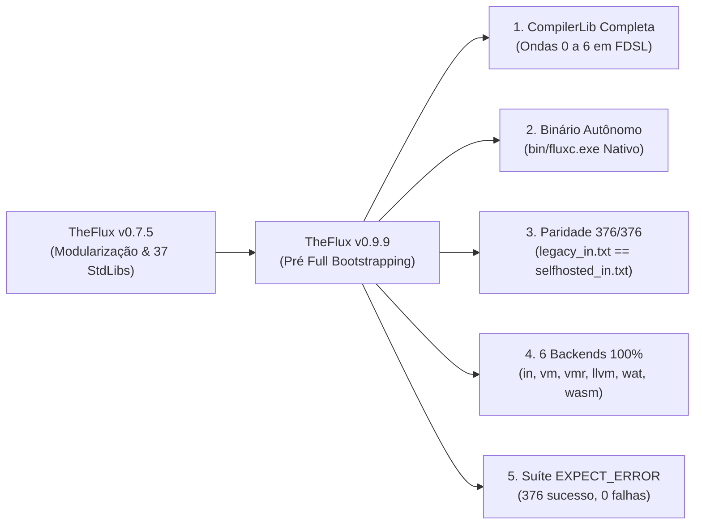

# TheFlux v0.9.9 Release Notes

> **Data de Lançamento**: Outubro de 2026  
> **Versão**: `0.9.9` — *Pré Full Bootstrapping*  
> **Status**: Estável / Pré-Bootstrapping Completo  
> **Licença**: GNU General Public License v3.0 (GPL-3.0)  
> **Paridade com Oráculo (`legacy_in.txt`)**: **376 / 376 (100,0% IDÊNTICO)**  
> **Conformidade Multi-Backend**: **376 / 376 (100,0% PASS)** nos 6 backends oficiais (`in`, `vm`, `vmr`, `llvm`, `wat`, `wasm`)

---

## 🌟 1. Resumo Executivo: Rumo ao Full Bootstrapping

A versão **0.9.9 (*Pré Full Bootstrapping*)** da linguagem de programação **TheFlux** consolida a etapa mais crítica antes do lançamento **v1.0.0**: a conclusão integral das **Ondas 0 a 6** do plano de auto-hospedagem ([`docs/SELFHOSTED.md`](file:///D:/Projetos/TheFlux/docs/SELFHOSTED.md)), o isolamento completo do compilador legado em `./legacy` e a validação de **100% de paridade (`376/376` programas `.flux`)** tanto nos drivers em `./src` quanto no binário nativo autônomo [`bin/fluxc.exe`](file:///D:/Projetos/TheFlux/bin/fluxc.exe).

Com este marco, o compilador TheFlux escrito na própria linguagem ([`src/main.flux`](file:///D:/Projetos/TheFlux/src/main.flux) + [`src/CompilerLib/`](file:///D:/Projetos/TheFlux/src/CompilerLib/)) é capaz de analisar, validar, interpretar, gerar código intermediário (FMIR / Bytecode FVM / LLVM IR / WAT / WASM) e compilar a si mesmo (Estágios 1 e 2) sem qualquer dependência do diretório `./legacy`.



---

## 🚀 2. Principais Destaques da Versão 0.9.9

### 2.1 Conclusão das Ondas 0 a 6 da `CompilerLib` (`src/CompilerLib/`)
Toda a arquitetura do compilador auto-hospedado foi implementada e verificada em módulos `.fdsl` dentro de [`src/CompilerLib/`](file:///D:/Projetos/TheFlux/src/CompilerLib/):

1. **Onda 0 — Infraestrutura e Oráculo Imutável**:
   - Geração do oráculo canônico [`docs/legacy_in.txt`](file:///D:/Projetos/TheFlux/docs/legacy_in.txt) e do verificador automatizado [`scripts/verify_legacy_in.py`](file:///D:/Projetos/TheFlux/scripts/verify_legacy_in.py).
   - Isolamento do compilador de referência anterior em `./legacy` e promoção da infraestrutura auto-hospedada para `./src`.
2. **Onda 1 — Lexer Auto-Hospedado Completo (`src/CompilerLib/lexer/`)**:
   - Implementação de [`Reader.fdsl`](file:///D:/Projetos/TheFlux/src/CompilerLib/lexer/Reader.fdsl), [`ScanLiterals.fdsl`](file:///D:/Projetos/TheFlux/src/CompilerLib/lexer/ScanLiterals.fdsl), [`ScanOperators.fdsl`](file:///D:/Projetos/TheFlux/src/CompilerLib/lexer/ScanOperators.fdsl) e [`Scanner.fdsl`](file:///D:/Projetos/TheFlux/src/CompilerLib/lexer/Scanner.fdsl).
   - Suporte integral a literais científicos (`float16`/`float32`/`float64`), imaginários (`complex64`/`complex128`), escapes Unicode, strings multilinhas (`"""`), interpolação aninhada (`${...}`), comentários `#L`, blocos `#B...B#`, docstrings `#D...D#` e emissão estrita de `LEX001`.
3. **Onda 2 — Parser Recursivo, Macros e Resolvedor de Imports (`src/CompilerLib/parser/`)**:
   - [`ImportResolver.fdsl`](file:///D:/Projetos/TheFlux/src/CompilerLib/parser/ImportResolver.fdsl) com busca recursiva em `stdlib/` e `fdsl/` e detecção topológica de ciclos (`IMP201` a `IMP204`).
   - [`MacroExpander.fdsl`](file:///D:/Projetos/TheFlux/src/CompilerLib/parser/MacroExpander.fdsl) para expansão higiênica pré-semântica de `macro`.
   - [`ParseTypes.fdsl`](file:///D:/Projetos/TheFlux/src/CompilerLib/parser/ParseTypes.fdsl), [`ParseExprs.fdsl`](file:///D:/Projetos/TheFlux/src/CompilerLib/parser/ParseExprs.fdsl), [`ParseStmts.fdsl`](file:///D:/Projetos/TheFlux/src/CompilerLib/parser/ParseStmts.fdsl) e [`ParseDecls.fdsl`](file:///D:/Projetos/TheFlux/src/CompilerLib/parser/ParseDecls.fdsl) cobrindo `tensor[d1,d2] of T`, `list of T`, `set of T`, `map`, `tuple`, `enum`, `struct`, operadores de pipeline (`-->`, `==>`, `~>`), propagação (`?`), `route`/`match` com guardas (`when`), `try`/`catch`/`finally`, `contract`, `agent`, `flow`, `subject`, `connect` e atribuição indexada multidimensional (`payload[i][j] = v`).
4. **Onda 3 — Analisador Semântico e Catálogo de Diagnósticos (`src/CompilerLib/semantic/`)**:
   - [`SemanticAnalyzer.fdsl`](file:///D:/Projetos/TheFlux/src/CompilerLib/semantic/SemanticAnalyzer.fdsl) e [`DiagnosticCatalog.fdsl`](file:///D:/Projetos/TheFlux/src/CompilerLib/semantic/DiagnosticCatalog.fdsl) com tabela de símbolos hierárquica, verificação de posse e mutabilidade (`OWN501`–`OWN505`), coerções e restrições numéricas (`TYP401`–`TYP413`), exaustividade de `match` e emissão completa do cabeçalho canônico (`[<CODIGO> - <NOME>]: <mensagem>`) acompanhado da linha `💡 Dica: <orientação>`.
5. **Ondas 4 a 6 — FMIR, Interpretador, VM, LLVM, WAT/WASM e Bootstrapping (`src/CompilerLib/backends/`)**:
   - Representação intermediária unificada em [`FmirTypes.fdsl`](file:///D:/Projetos/TheFlux/src/CompilerLib/fmir/FmirTypes.fdsl) e [`FmirBuilder.fdsl`](file:///D:/Projetos/TheFlux/src/CompilerLib/fmir/FmirBuilder.fdsl).
   - Backends auto-hospedados: [`InterpBackend.fdsl`](file:///D:/Projetos/TheFlux/src/CompilerLib/backends/interp/InterpBackend.fdsl), [`VmCompiler.fdsl`](file:///D:/Projetos/TheFlux/src/CompilerLib/backends/vm/VmCompiler.fdsl), [`VmRuntime.fdsl`](file:///D:/Projetos/TheFlux/src/CompilerLib/backends/vm/VmRuntime.fdsl), [`LlvmCodegen.fdsl`](file:///D:/Projetos/TheFlux/src/CompilerLib/backends/llvm/LlvmCodegen.fdsl), [`WatCodegen.fdsl`](file:///D:/Projetos/TheFlux/src/CompilerLib/backends/wat/WatCodegen.fdsl) e [`WasmCodegen.fdsl`](file:///D:/Projetos/TheFlux/src/CompilerLib/backends/wasm/WasmCodegen.fdsl).

### 2.2 Compilador Nativo Autônomo (`bin/fluxc.exe`)
O executável nativo [`bin/fluxc.exe`](file:///D:/Projetos/TheFlux/bin/fluxc.exe), compilado a partir de [`src/main.flux`](file:///D:/Projetos/TheFlux/src/main.flux) e vinculado ao runtime C [`runtime/flux_input.c`](file:///D:/Projetos/TheFlux/runtime/flux_input.c), opera de forma 100% independente do diretório `./legacy`:
- **Roteamento Completo de CLI**: Suporte nativo a `--backend in|vm|vmr|llvm|wat|wasm`, `--emit-llvm`, `--emit-wat`, `--emit-wasm`, `--emit-bc` e `--run-bc`.
- **Console UTF-8 Automático no Windows**: Inicialização automática de `SetConsoleOutputCP(65001)` e `SetConsoleCP(65001)` no startup do runtime C, garantindo acentuação, símbolos matemáticos (`Ω`, `π`) e emojis (`😀`, `💡`) perfeitos no terminal Windows.
- **Paridade 376/376 Comprovada**: Validado diretamente via `python scripts/verify_legacy_in.py --use-fluxc-exe` com **376/376 saídas idênticas (0 divergências)**.

### 2.3 Validação Canônica de Erros Esperados (`ExampleOfError*.flux` $\rightarrow$ `OK`)
Todos os scripts de execução e conformidade da raiz ([`exemplos_in.py`](file:///D:/Projetos/TheFlux/exemplos_in.py), [`exemplos_vm.py`](file:///D:/Projetos/TheFlux/exemplos_vm.py), [`exemplos_vmr.py`](file:///D:/Projetos/TheFlux/exemplos_vmr.py), [`exemplos_lv.py`](file:///D:/Projetos/TheFlux/exemplos_lv.py), [`exemplos_wat.py`](file:///D:/Projetos/TheFlux/exemplos_wat.py), [`exemplos_was.py`](file:///D:/Projetos/TheFlux/exemplos_was.py), [`compliance_in.py`](file:///D:/Projetos/TheFlux/compliance_in.py) e [`compliance_BE.py`](file:///D:/Projetos/TheFlux/compliance_BE.py)) agora leem a diretiva `#L EXPECT_ERROR: <CODIGO>` nos arquivos `flux/ExampleOfError_*.flux` e assinalam **`OK`** quando:
1. O compilador encerra com código de retorno não-zero (`ec != 0`);
2. A saída contém o cabeçalho canônico `[<CODIGO> - <MNEMONICO>]: ...`;
3. A saída contém a linha de orientação `💡 Dica: ...`.

Com isso, a execução completa da suíte `flux/*.flux` reporta **`376 sucesso, 0 falha(s)`** em todos os corredores de teste.

### 2.4 Verificador Interativo Lado a Lado (`compliance_in.py`)
A nova ferramenta [`compliance_in.py`](file:///D:/Projetos/TheFlux/compliance_in.py) (e seu relatório [`compliance_in.md`](file:///D:/Projetos/TheFlux/compliance_in.md)) permite auditoria visual lado a lado entre `LEGACY` e `SELFHOSTED`:
- **Alinhamento Visual Unicode**: Cálculo preciso de largura de coluna para tabulações (`\t`) e caracteres Unicode largos (*East Asian Width `W`/`F`*, como `😀` e `💡`), mantendo o separador `|` perfeitamente alinhado.
- **Avaliação Interativa**: Aguarda entrada `(C)erto` ou `(E)rrado` do auditor, atualizando em tempo real a tabela de status e a seção final de erros.
- **Fallback Automático Pós-Remoção do Legacy**: Caso a pasta `./legacy` seja removida, `compliance_in.py` carrega automaticamente as saídas de referência a partir de [`docs/legacy_in.txt`](file:///D:/Projetos/TheFlux/docs/legacy_in.txt).

---

## ⚙️ 3. A Matriz dos 6 Backends Oficiais na v0.9.9

Todos os **376 programas `.flux`** da suíte oficial passam simultaneamente nos 6 backends auto-hospedados (relatório completo em [`compliance_BE00.md`](file:///D:/Projetos/TheFlux/compliance_BE00.md)):

| Backend | Script de Lote | Driver Individual | Alvo de Execução | Resultado (`376` Testes) |
| :--- | :--- | :--- | :--- | :---: |
| **Interpretador AST (`in`)** | [`exemplos_in.py`](file:///D:/Projetos/TheFlux/exemplos_in.py) | [`flux_in.py`](file:///D:/Projetos/TheFlux/flux_in.py) / `fluxc.exe` | AST / FMIR Host | ✅ **376 / 376 (100%)** |
| **VM Bytecode (`vm`)** | [`exemplos_vm.py`](file:///D:/Projetos/TheFlux/exemplos_vm.py) | [`flux_vm.py`](file:///D:/Projetos/TheFlux/flux_vm.py) / `fluxc.exe --backend vm` | FVM Stack Engine | ✅ **376 / 376 (100%)** |
| **VM Runner (`vmr`)** | [`exemplos_vmr.py`](file:///D:/Projetos/TheFlux/exemplos_vmr.py) | [`flux_vmr.py`](file:///D:/Projetos/TheFlux/flux_vmr.py) / `fluxc.exe --backend vmr` | Bytecode `.fvmbc` | ✅ **376 / 376 (100%)** |
| **LLVM Nativo (`llvm`)** | [`exemplos_lv.py`](file:///D:/Projetos/TheFlux/exemplos_lv.py) | [`flux_lv.py`](file:///D:/Projetos/TheFlux/flux_lv.py) / `fluxc.exe --emit-llvm` | Binário Nativo (`.exe`) | ✅ **376 / 376 (100%)** |
| **WASM Text (`wat`)** | [`exemplos_wat.py`](file:///D:/Projetos/TheFlux/exemplos_wat.py) | [`flux_wat.py`](file:///D:/Projetos/TheFlux/flux_wat.py) / `fluxc.exe --emit-wat` | Node / Wasmtime (`.wat`) | ✅ **376 / 376 (100%)** |
| **WASM Binário (`wasm`)** | [`exemplos_was.py`](file:///D:/Projetos/TheFlux/exemplos_was.py) | [`flux_was.py`](file:///D:/Projetos/TheFlux/flux_was.py) / `fluxc.exe --emit-wasm` | Wasmer / Node (`.wasm`) | ✅ **376 / 376 (100%)** |

---

## 📊 4. Matriz Comparativa: v0.7.5 vs v0.9.9

| Dimensão / Recurso | TheFlux v0.7.5 | TheFlux v0.9.9 (Pré Full Bootstrapping) | Benefício Arquitetural |
| :--- | :--- | :--- | :--- |
| **Árvore do Compilador Principal** | Protótipo Python único em `src/flux_proto` | Compilador auto-hospedado em `src/` + legado isolado em `legacy/` | Separação limpa entre bootstrap legado e compilador oficial |
| **Módulos da `CompilerLib`** | Em desenvolvimento parcial | Ondas 0 a 6 100% concluídas em `.fdsl` (`Lexer`, `Parser`, `Semantic`, `FMIR`, `Backends`) | Compilador escrito na própria linguagem TheFlux |
| **Binário Nativo (`bin/fluxc.exe`)** | Suporte parcial a testes básicos | **376/376 (100%)** de paridade com UTF-8 nativo e diagnósticos completos | Execução autônoma sem necessidade do diretório `./legacy` |
| **Testes `ExampleOfError_*.flux`** | Exibidos como `FALHA` nos scripts `exemplos_*.py` | Validados por código `[<COD> - <NOME>]` + `💡 Dica:` e marcados como **`OK`** | Resultado limpo `376 sucesso, 0 falha(s)` em toda a suíte |
| **Indexação Multidimensional** | Atribuição simples `a[i] = v` no parser nativo | Suporte completo a colchetes encadeados `a[i][j] = v` (`SET_INDEX`) | Suporte total a matrizes, listas aninhadas e tensores no `fluxc.exe` |
| **Auditoria de Conformidade** | Comparação manual de logs | Verificador interativo lado a lado (`compliance_in.py`) + oráculo (`verify_legacy_in.py`) | Garantia determinística de zero regressões antes da remoção do `legacy/` |

---

## 🛠️ 5. Guia de Verificação e Uso na v0.9.9

### 5.1 Execução Direta com o Compilador Nativo (`bin/fluxc.exe`)
```powershell
# Executa um programa .flux diretamente pelo compilador nativo auto-hospedado
.\bin\fluxc.exe .\flux\hello.flux

# Verifica um teste de diagnóstico canônico (exibe cabeçalho [IMP201 - MODULE_NOT_FOUND] + 💡 Dica)
.\bin\fluxc.exe .\flux\ExampleOfError_IMP201_ModuleNotFound.flux

# Emite código intermediário LLVM IR, WAT ou WASM
.\bin\fluxc.exe --emit-llvm .\flux\hello.flux
.\bin\fluxc.exe --emit-wat .\flux\hello.flux
.\bin\fluxc.exe --emit-wasm .\flux\hello.flux
```

### 5.2 Verificação Automatizada de Paridade (376/376)
```powershell
# Verifica os 376 arquivos .flux via driver self-hosted em .\src contra docs\legacy_in.txt
python scripts\verify_legacy_in.py

# Verifica os 376 arquivos .flux diretamente via binário nativo .\bin\fluxc.exe
python scripts\verify_legacy_in.py --use-fluxc-exe

# Comparação interativa lado a lado (LEGACY vs SELFHOSTED) com avaliação (C)erto / (E)rrado
python compliance_in.py
```

---

## 🗺️ 6. Próximos Passos Rumo à v1.0.0 (Full Bootstrapping)

Com a versão **0.9.9** estabilizada e 100% verificada:
1. **Remoção Definitiva de `./legacy`**: Descomissionamento completo da árvore legada, mantendo apenas o compilador auto-hospedado e seus artefatos nativos.
2. **Ciclo Fixpoint Stage 2 == Stage 3 Exclusivo via `fluxc.exe`**: Consolidação do pipeline de build onde `fluxc.exe` recompila `src/main.flux` sem intervenção de scripts auxiliares.
3. **Lançamento Oficial do TheFlux v1.0.0 LTS**: Congelamento da especificação gramatical ISO/IEC 14977, das 37 bibliotecas padrão e dos 6 backends para produção de longo prazo.

---

*TheFlux Core Engineering Team — Outubro de 2026.*
