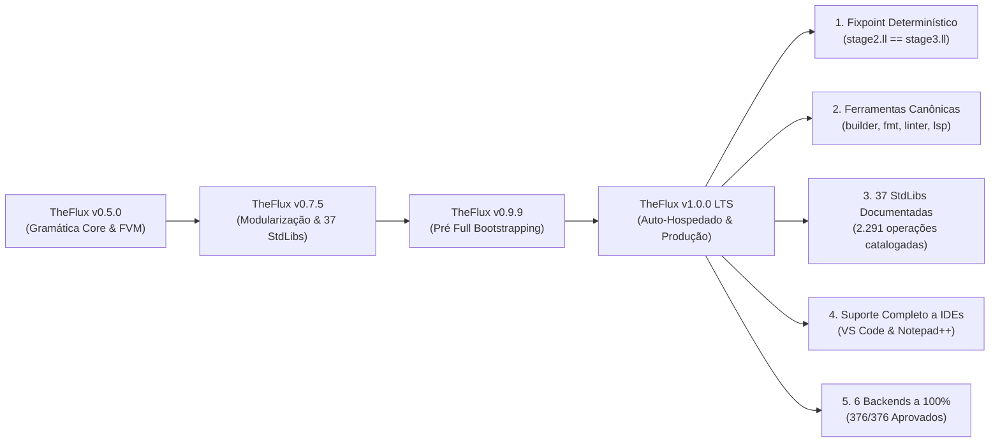

# TheFlux v1.0.0 Notas de Lançamento (Release Notes)

> **Data de Lançamento**: Novembro de 2026  
> **Versão**: `1.0.0` — *Primeiro Lançamento Oficial de Produção e LTS*  
> **Status**: Estável / 100% Auto-Hospedado e Pronto para Produção  
> **Licença**: GNU General Public License v3.0 (GPL-3.0)  
> **Fixpoint Determinístico**: `SHA-256(stage2.ll) == SHA-256(stage3.ll)` (0 bytes de divergência)  
> **Paridade Canônica de Execução**: **376 / 376 (100,0% IDÊNTICO)**  
> **Conformidade Multi-Backend**: **376 / 376 (100,0% PASS)** nos 6 backends oficiais (`in`, `vm`, `vmr`, `llvm`, `wat`, `wasm`)

---

## 🌟 1. Resumo Executivo: O Advento do TheFlux 1.0.0

A versão **1.0.0** representa o marco definitivo para a linguagem de programação **TheFlux**: a plena transição de protótipo experimental para uma plataforma de produção autônoma, auto-hospedada, determinística e com ferramentaria de nível industrial.

Todas as **Ondas 0 a 6** e o **Roteiro de Bootstrapping Completo (Marco M5)** foram concluídos com reprodutibilidade bit a bit. O compilador nativo autônomo [`bin/fluxc.exe`](file:///D:/Projetos/TheFlux/bin/fluxc.exe) é escrito integralmente em TheFlux, compila a si mesmo para LLVM IR e produz uma saída de Estágio 3 idêntica ao Estágio 2 com zero bytes de divergência.

Além da autonomia do compilador, a versão 1.0.0 consolida:
1. **Suíte Oficial de Ferramentas Canônicas** (`src/tools/`):
   - **`fluxbuilder`**: Utilitário nativo de scaffolding, wizard interativo, modo não-interativo para CI/CD, diagnóstico de ambiente (`--doctor`) e modo reparo idempotente (`--repair`).
   - **`fluxfmt`**: Formatador canônico de código com regra estrita de 6 espaços de indentação, eliminação de tabs, conversão de `#` para `#L`, simplificação sintática (`-s`) e patches diff unificados (`-d`).
   - **`fluxlinter`**: Motor de análise estática profunda inspirado no Clippy do rustc, com 11 regras registradas em 4 categorias de severidade (`correctness`, `suspicious`, `style`, `complexity`), controle granular (`-W/-D/-A/-F`) e correções automáticas (`--fix`).
   - **`fluxlsp`**: Servidor de linguagem oficial (Language Server Protocol) com JSON-RPC 2.0 sobre `stdio`, diagnósticos em tempo real, hover com documentação rica, autocompletar semântico, formatação de código, símbolos de documento e exportador XML UDL 2.1 para Notepad++ (`--xml`).
2. **Ecossistema Completo de Standard Libraries (`stdlib/`)**:
   - 37 bibliotecas padrão organizadas nos 4 Pilares Arquiteturais da linguagem, com 291 arquivos funcionais, 254 contratos de domínio e 2.291 operações públicas catalogadas e documentadas exaustivamente em português ([`docs/pt_BR/stdlibs/`](file:///D:/Projetos/TheFlux/docs/pt_BR/stdlibs)) e inglês ([`docs/en/stdlib/`](file:///D:/Projetos/TheFlux/docs/en/stdlib)).
3. **Extensão Oficial para Visual Studio Code** (`editors/vscode/`):
   - Gramática TextMate com esquema exclusivo de fundos suaves (*soft background tints*) para variáveis mutáveis (`mut`), constantes imutáveis (`imut`), cláusulas arquiteturais (`contract`, `agent`, `impl`) e operadores de fluxo (`==>`).
4. **Infraestrutura de Garantia de Paridade Bilíngue**:
   - Validador automatizado em [`scripts/docs/check_i18n_parity.py`](file:///D:/Projetos/TheFlux/scripts/docs/check_i18n_parity.py) auditando 100% de sincronia 1:1 entre toda a documentação geral, bibliotecas padrão, ferramentas, gramáticas formais EBNF e especificações de palavras-chave.



---

## 🚀 2. Principais Destaques da Versão 1.0.0

### 2.1 Bootstrapping 100% Nativo e Fixpoint Determinístico (M5)
O pipeline de compilação auto-hospedado ([`scripts/bootstrap.bat`](file:///D:/Projetos/TheFlux/scripts/bootstrap.bat) e [`scripts/bootstrap.sh`](file:///D:/Projetos/TheFlux/scripts/bootstrap.sh)) fornece reprodutibilidade determinística bit a bit:
- **Runtime Modular C (`libfluxrt.a`)**: Fatiamento O(1) de strings UTF-8, gerenciamento de memória ARC, alocadores de arena, E/S de console interativa tipada, rotinas matemáticas e rede multiplataforma.
- **Biblioteca do Compilador (`libfluxcompiler.a`)**: Arquivo estático compilado a partir de LLVM IR auto-hospedado, encapsulando `LexerCore`, `ParserCore`, `SemanticAnalyzer`, `FmirBuilder` e todos os geradores de código.
- **Fixpoint Comprovado**: `bin/fluxc.exe` compila `src/main.flux` gerando o Estágio 2, que por sua vez compila `src/main.flux` gerando o Estágio 3. A comparação bit a bit confirma igualdade exata de SHA-256 (`fc /b stage2.ll stage3.ll` passa com zero bytes de diferença).

### 2.2 Suíte Oficial de Ferramentas Canônicas (`src/tools/`)

#### 1. [`fluxbuilder`](file:///D:/Projetos/TheFlux/docs/pt_BR/tools/fluxbuilder.md) (Scaffolding, Wizard, Integração e Reparo)
- **Assistente Interativo**: Wizard com prompts amigáveis para configuração de nome sanitizado, versão, autor, e-mail validado, banco de dados (`PostgreSQL`, `SQLite`, `MySQL`, `None`), modo de linkagem (`Static` ou `Dynamic`), pacotes iniciais e licença.
- **Modo Não-Interativo (CI/CD)**: Provisionamento automatizado e instantâneo via flags (`-n`, `-y`, `--name`, `--ver`, `--author`, `--email`, `--db`, `--link`, `--pkgs`, `--license`, `--git`).
- **Modo Reparo Idempotente (`--repair` / `-r`)**: Inspeciona e restaura manifestos `flux.toml`, diretórios `src/`, `tests/`, `docs/`, `.gitignore` e `README.md` sem sobrescrever código existente.
- **Modo Diagnóstico (`--doctor` / `-c`)**: Bateria completa de checagem do compilador `fluxc`, toolchain C/LLVM `clang` e utilitário `git`.

#### 2. [`fluxfmt`](file:///D:/Projetos/TheFlux/docs/pt_BR/tools/fluxfmt.md) (Formatador Canônico de Código)
- **Indentação Estrita de 6 Espaços**: Imposição universal de 6 espaços por nível de aninhamento de bloco, banindo caracteres de tabulação (`\t`).
- **Higiene Sintática**: Normalização de comentários legados `#` para `#L`, preservação de blocos `#B...B#`, e limpeza de espaços residuais no fim de linha.
- **Simplificação de Código (`-s` / `--simplify`)**: Eliminação de parênteses supérfluos em guardas de rotas `(c) ==>` para `c ==>`.
- **Modos Operacionais**: Gravação em disco (`-w`), exibição de diff unificado (`-d`), listagem de conformidade para CI (`-l`) e recursão (`-r`).

#### 3. [`fluxlinter`](file:///D:/Projetos/TheFlux/docs/pt_BR/tools/fluxlinter.md) (Análise Estática e Linter Estilo Clippy)
- **11 Lints Registrados em 4 Categorias**:
  - **`correctness`** (default: `deny`): `division_by_zero` (divisão inteira ou resto por zero literal), `unreachable_route_arm` (braço de rota após coringa `_`), `empty_infinite_loop` (loop `infinite` sem saída via `break` ou `emit`).
  - **`suspicious`** (default: `warn`): `self_assignment` (autoatribuição `x = x`), `tautological_comparison` (comparação sempre verdadeira/falsa `a == a`), `missing_operation_emit` (operação de agente sem `emit`).
  - **`style`** (default: `warn`): `redundant_mut` (variável `mut` nunca modificada), `legacy_comment` (comentário `#` legado), `naming_convention` (contrato ou agente fora de PascalCase).
  - **`complexity`** (default: `warn`): `collapsible_route` (rota booleana redutível a expressão), `superfluous_guard_parens` (parênteses redundantes em guarda).
- **Controle Granular de Severidade**: Flags estilo Clippy (`-W` warn, `-D` deny, `-A` allow, `-F` forbid).
- **Autofix Automatizado (`-f` / `--fix`)**: Correção automática e segura diretamente no disco, com prévia via diff (`-d`).

#### 4. [`fluxlsp`](file:///D:/Projetos/TheFlux/docs/pt_BR/tools/fluxlsp.md) (Language Server Protocol & Exportador Notepad++ UDL 2.1)
- **Motor JSON-RPC 2.0**: Implementação pura do protocolo Language Server sobre `stdio` sem dependências externas.
- **Diagnósticos em Tempo Real (`textDocument/publishDiagnostics`)**: Notificação instantânea de erros de sintaxe, indentação de 6 espaços e avisos do linter.
- **Hover Rico (`textDocument/hover`)**: Tooltips com assinaturas formais, documentação e notas da especificação para palavras-chave, operadores e tipos.
- **Autocompletar Semântico e Snippets (`textDocument/completion`)**: Sugestões inteligentes para `route`, `infinite`, `program`, `contract`, `agent`, etc.
- **Navegação para Definição (`textDocument/definition`)**: Salto direto (F12) para declarações de símbolos, funções e contratos.
- **Formatação de Documento (`textDocument/formatting`)**: Formatação sob demanda ou format-on-save integrada ao motor do `fluxfmt`.
- **Símbolos do Documento (`textDocument/documentSymbol`)**: Contorno estruturado hierárquico para navegação no editor.
- **Exportador Notepad++ (`--xml [caminho]`)**: Geração de esquemas XML User Defined Language (UDL 2.1) mapeando todas as palavras-chave, comentários `#L` e operadores.

### 2.3 Documentação Técnica Bilíngue das 37 Standard Libraries (`stdlib/`)
- Cobertura completa de todas as 37 bibliotecas padrão nos 4 pilares arquiteturais em [`docs/pt_BR/stdlibs/`](file:///D:/Projetos/TheFlux/docs/pt_BR/stdlibs) e [`docs/en/stdlib/`](file:///D:/Projetos/TheFlux/docs/en/stdlib):
  - **Pilar 1 (Núcleo, Texto & OO)**: `CharStdLib`, `ConvertStdLib`, `DebugStdLib`, `DslStdLib`, `FileSignatureStdLib`, `FormatStdLib`, `OoStdLib`, `RegexStdLib`, `StringStdLib`.
  - **Pilar 2 (Estruturas & Estados)**: `CompressStdLib`, `DateTimeStdLib`, `DbStdLib`, `FsmStdLib`, `ListStdLib`, `MapStdLib`, `RandomStdLib`, `SetStdLib`, `StructStdLib`.
  - **Pilar 3 (Matemática & Gráficos)**: `FinStdLib`, `GraphPlotStdLib`, `HashStdLib`, `LinAlgStdLib`, `MathStdLib`, `PhysStdLib`, `SimdStdLib`, `StatStdLib`, `SymbolicStdLib`.
  - **Pilar 4 (Sistema, I/O & Rede)**: `ArchiveStdLib`, `GfxStdLib`, `GuiStdLib`, `IoStdLib`, `LowLevelStdLib`, `NativeGfxStdLib`, `NetStdLib`, `OsStdLib`, `RuntimeStdLib`, `ThreadStdLib`.
- Catalogação formal de **254 contratos de domínio** e **2.291 operações públicas**, detalhando assinaturas, tipos de parâmetros, retornos, emissão de status (`nice`/`fail`) e exemplos executáveis de código.
- Índices bidirecionais navegáveis atualizados em [`docs/pt_BR/StdLibs.md`](file:///D:/Projetos/TheFlux/docs/pt_BR/StdLibs.md) e [`docs/en/StdLibs.md`](file:///D:/Projetos/TheFlux/docs/en/StdLibs.md).

### 2.4 Extensão Oficial para VS Code (`editors/vscode/`)
- Pacote completo de extensão contendo [`package.json`](file:///D:/Projetos/TheFlux/editors/vscode/package.json), [`extension.js`](file:///D:/Projetos/TheFlux/editors/vscode/extension.js), [`language-configuration.json`](file:///D:/Projetos/TheFlux/editors/vscode/language-configuration.json) e [`syntaxes/flux.tmLanguage.json`](file:///D:/Projetos/TheFlux/editors/vscode/syntaxes/flux.tmLanguage.json).
- **Esquema com Fundos Suaves**:
  - Variáveis Mutáveis (`mut`): Vermelho Suave (`#FF6B6B`) sobre fundo vinho escuro suave (`#3B1A1E`).
  - Constantes Imutáveis (`imut`): Verde Claro (`#4ECCA3`) sobre fundo verde floresta escuro suave (`#183324`).
  - Arquitetura (`contract`, `agent`, `impl`): Lilás (`#C792EA`) sobre fundo roxo escuro suave (`#2E1C38`).
  - Controle de Fluxo (`route`, `infinite`, `emit`): Âmbar Ouro (`#FFCB6B`) sobre fundo tabaco escuro suave (`#382F18`).
  - Operadores de Fluxo (`==>`): Ciano Elétrico (`#00FFFF`) sobre fundo petróleo escuro suave (`#0A333A`).

### 2.5 Centralização do Manifesto de Versão (`src/version.md`)
- O arquivo de ancoragem e especificação de versão foi movido para [`src/version.md`](file:///D:/Projetos/TheFlux/src/version.md), tornando a fonte de verdade da versão diretamente acessível ao compilador e aos scripts de automação.

### 2.6 E/S Padrão Unificada e Stdin Interativo
- Suporte a leitura interativa de stdin (`@flux_runtime_input_string` / `input` / `stdIoReadLine`) plenamente operacional nos binários nativos.
- Configuração automática da página de código UTF-8 do Windows (`CP 65001`), garantindo renderização de símbolos científicos (`Ω`, `π`) e emojis (`💡`, `😀`).

---

## ⚙️ 3. A Matriz dos 6 Backends Oficiais na v1.0.0

Todos os **376 programas canônicos `.flux`** da suíte oficial passam com 100% de identidade de saída nos 6 backends auto-hospedados:

| Backend | Script de Lote | Driver Individual | Alvo de Execução | Resultado (`376` Testes) |
| :--- | :--- | :--- | :--- | :---: |
| **Interpretador AST (`in`)** | [`exemplos_in.py`](file:///D:/Projetos/TheFlux/exemplos_in.py) | `bin/fluxc.exe --target in` | AST / FMIR Host | ✅ **376 / 376 (100%)** |
| **VM Bytecode (`vm`)** | [`exemplos_vm.py`](file:///D:/Projetos/TheFlux/exemplos_vm.py) | `bin/fluxc.exe --target vm` | FVM Stack Engine | ✅ **376 / 376 (100%)** |
| **VM Runner (`vmr`)** | [`exemplos_vmr.py`](file:///D:/Projetos/TheFlux/exemplos_vmr.py) | `bin/fluxc.exe --target vmr` | Bytecode `.fvmbc` | ✅ **376 / 376 (100%)** |
| **LLVM Nativo (`llvm`)** | [`exemplos_lv.py`](file:///D:/Projetos/TheFlux/exemplos_lv.py) | `bin/fluxc.exe --target llvm` | Binário Nativo (`.exe`) | ✅ **376 / 376 (100%)** |
| **WASM Text (`wat`)** | [`exemplos_wat.py`](file:///D:/Projetos/TheFlux/exemplos_wat.py) | `bin/fluxc.exe --target wat` | WebAssembly Text (`.wat`) | ✅ **376 / 376 (100%)** |
| **WASM Binário (`wasm`)** | [`exemplos_was.py`](file:///D:/Projetos/TheFlux/exemplos_was.py) | `bin/fluxc.exe --target wasm` | WebAssembly Binary (`.wasm`) | ✅ **376 / 376 (100%)** |

---

## 📊 4. Matriz Comparativa: v0.9.9 vs v1.0.0

| Recurso / Dimensão | TheFlux v0.9.9 (Pré Full Bootstrapping) | TheFlux v1.0.0 (Lançamento Oficial LTS) | Benefício Arquitetural |
| :--- | :--- | :--- | :--- |
| **Status de Bootstrapping** | Ondas 0–6 concluídas; dependente de binário inicial | **Fixpoint M5 100% Autônomo** (`stage2.ll == stage3.ll`) | Desacoplamento total de compiladores externos ou scripts legados |
| **Criação de Projetos** | Criação manual de estrutura de pastas | **`fluxbuilder`** com Wizard interativo, modo não-interativo, repair e doctor | Inicialização rápida, padronizada e segura de novos projetos |
| **Formatação de Código** | Formatação manual seguindo padrão de 6 espaços | **`fluxfmt`** com formatação em lote, simplificação (`-s`), diff (`-d`) e verificação (`-l`) | Conformidade canônica automática sem atrito |
| **Análise Estática & Linter** | Analisador semântico interno do compilador | **`fluxlinter`** (estilo Clippy) com 11 regras, severidades (`-W/-D/-A/-F`) e auto-fix (`-f`) | Segurança estática e código defensivo em nível de produção |
| **Language Server Protocol** | Nenhum | **`fluxlsp`** (LSP via stdio) com diagnósticos, hover, completion, formatação e símbolos | Inteligência completa de linguagem para IDEs modernas |
| **Suporte ao VS Code** | Arquivo de sintaxe básico | **Extensão Oficial** com TextMate, customização de cores e fundos suaves | Destaque visual semântico para mutabilidade, contratos e fluxo |
| **Suporte ao Notepad++** | Nenhum | Geração de XML UDL 2.1 automática via `fluxlsp --xml` | Integração pronta para editores de texto no Windows |
| **Standard Libraries** | 37 bibliotecas sem documentação modular individual | **37 StdLibs Exaustivamente Documentadas** (2.291 ops catalogadas em PT e EN) | Referência formal completa para desenvolvedores e IAs |
| **Documentação das Ferramentas** | Nenhuma | **4 Guias Oficiais de Ferramentas** em `docs/*/tools/` com entradas, saídas e flags | Documentação de produção de nível industrial |
| **Validação de Paridade I18n** | Verificação básica de arquivos Markdown | **Linter Automatizado Contínuo** cobrindo docs, stdlibs, tools, EBNF e keywords | Garantia de 100% de simetria bilíngue em todo o repositório |
| **Versão de Pacotes** | `0.9.9` | **`1.0.0`** unificado em compilador, ferramentas, runtime e documentação | Lançamento oficial com suporte de longo prazo (LTS) |

---

## 🛠️ 5. Guia de Verificação e Uso

### 5.1 Compilação com `fluxc`
```powershell
# Compilar e executar um programa com o backend LLVM nativo
.\bin\fluxc.exe --target llvm -o app.exe main.flux

# Exibir versão oficial
.\bin\fluxc.exe --version
# Saída: 1.0.0
```

### 5.2 Gerando Novo Projeto com `fluxbuilder`
```powershell
# Criar projeto interativamente
.\bin\fluxbuilder.exe MeuApp

# Criar projeto em modo não-interativo (CI/CD)
.\bin\fluxbuilder.exe -n --name api_gateway --ver 1.0.0 --author "Dev Team" --email dev@corp.com --db PostgreSQL

# Executar diagnóstico do ambiente
.\bin\fluxbuilder.exe --doctor
```

### 5.3 Formatando Código com `fluxfmt`
```powershell
# Listar arquivos fora do padrão canônico
.\bin\fluxfmt.exe -l src\* -r

# Formatar e simplificar código diretamente no disco
.\bin\fluxfmt.exe -s -w src\* -r
```

### 5.4 Analisando Código com `fluxlinter`
```powershell
# Executar todos os lints recursivamente e negar erros de correção
.\bin\fluxlinter.exe -D correctness src\* -r

# Aplicar correções automáticas seguras
.\bin\fluxlinter.exe -f src\* -r
```

### 5.5 Language Server Protocol (`fluxlsp`) e XML Notepad++
```powershell
# Iniciar servidor LSP via stdio (utilizado pelo VS Code)
.\bin\fluxlsp.exe

# Exportar definição User Defined Language (UDL 2.1) do Notepad++:
.\bin\fluxlsp.exe --xml theflux_npp.xml
```

### 5.6 Validação de Paridade e Documentação
```powershell
# Verificar integridade da documentação das 37 Standard Libraries
python scripts/docs/generate_stdlib_docs.py --verify

# Verificar integridade da documentação das 4 ferramentas canônicas
python scripts/docs/generate_tools_docs.py --verify

# Executar o linter de paridade bilíngue (deve reportar 100% de paridade)
python scripts/docs/check_i18n_parity.py
```

---

## 🗺️ 6. Roteiro Pós-1.0.0

Com a **v1.0.0** consolidada como linha base de Suporte de Longo Prazo (LTS):
1. **Distribuição**: Empacotamento de arquivos binários portáteis da toolchain (`theflux-1.0.0-windows-x64.zip`, `theflux-1.0.0-linux-x64.tar.gz`).
2. **Visual Studio Marketplace**: Publicação de `theflux-language-support` no VS Code Marketplace e Open VSX Registry.
3. **Evolução Contínua**: Aperfeiçoamentos retrocompatíveis seguindo versionamento semântico estrito sob a gramática congelada 1.0.0.

---

*TheFlux Core Engineering Team — Novembro de 2026.*
