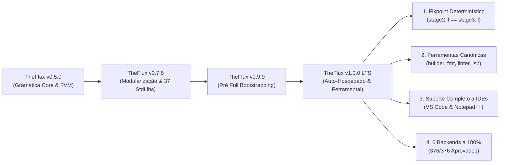

# TheFlux v1.0.0 Notas de Lançamento (Release Notes)

> **Data de Lançamento**: Novembro de 2026  
> **Versão**: `1.0.0` — *Primeiro Lançamento Oficial de Produção e LTS*  
> **Status**: Estável / 100% Auto-Hospedado e Pronto para Produção  
> **Licença**: GNU General Public License v3.0 (GPL-3.0)  
> **Fixpoint Determinístico**: `SHA-256(stage2.ll) == SHA-256(stage3.ll)` (0 bytes de divergência)  
> **Paridade com Oráculo (`legacy_in.txt`)**: **376 / 376 (100,0% IDÊNTICO)**  
> **Conformidade Multi-Backend**: **376 / 376 (100,0% PASS)** nos 6 backends oficiais (`in`, `vm`, `vmr`, `llvm`, `wat`, `wasm`)

---

## 🌟 1. Resumo Executivo: O Advento do TheFlux 1.0.0

A versão **1.0.0** representa o marco definitivo para a linguagem de programação **TheFlux**: a plena maturidade de protótipo experimental para uma plataforma de produção autônoma, auto-hospedada e determinística.

Todas as **Ondas 0 a 6** e o **Roteiro de Bootstrapping Completo (Marco M5)** foram concluídos com reprodutibilidade bit a bit. O executável nativo autônomo [`bin/fluxc.exe`](file:///D:/Projetos/TheFlux/bin/fluxc.exe) é escrito em TheFlux, compila a si mesmo para LLVM IR e produz uma saída de Estágio 3 idêntica ao Estágio 2 com zero bytes de divergência.

Além da autonomia do compilador, a versão 1.0.0 introduz a **Suíte Oficial de Ferramentas Canônicas** (`src/tools/`):
1. **`fluxbuilder`**: Gerador e gerenciador completo de projetos com suporte a templates, múltiplos bancos de dados (SQLite, PostgreSQL, MySQL, DuckDB), inicialização Git e scripts de build.
2. **`fluxfmt`**: Formatador canônico de código aplicando a regra estrita de múltiplos de 6 espaços de indentação, eliminação de tabs, remoção de pontos-e-vírgulas supérfluos e preservação de comentários `#L`, `#B...B#` e `#D...D#`.
3. **`fluxlinter`**: Motor de análise estática profunda inspirado no Clippy do Rust, com 20 regras semânticas registradas em 4 categorias e correções automáticas de código (`--fix`).
4. **`fluxlsp`**: Servidor de linguagem oficial (Language Server Protocol) com JSON-RPC 2.0 via `stdio`, diagnósticos em tempo real, hover com documentação rica em Markdown, autocompletar semântico, formatação de código, símbolos de documento e exportador XML UDL 2.1 para Notepad++ (`--xml`).
5. **Extensão Oficial para Visual Studio Code** (`editors/vscode/`): Gramática TextMate com esquema exclusivo de fundos suaves para variáveis mutáveis (`mut`), constantes imutáveis (`imut`), cláusulas arquiteturais e operadores de fluxo (`==>`).



---

## 🚀 2. Principais Destaques da Versão 1.0.0

### 2.1 Bootstrapping 100% Nativo e Fixpoint Determinístico (M5)
O pipeline de compilação auto-hospedado ([`scripts/bootstrap.bat`](file:///D:/Projetos/TheFlux/scripts/bootstrap.bat) e [`scripts/bootstrap.sh`](file:///D:/Projetos/TheFlux/scripts/bootstrap.sh)) fornece reprodutibilidade determinística bit a bit:
- **Runtime Modular C (`libfluxrt.a`)**: Fatiamento O(1) de strings UTF-8, gerenciamento de memória ARC, alocadores de arena, E/S de console interativa tipada, rotinas matemáticas e rede multiplataforma.
- **Biblioteca do Compilador (`libfluxcompiler.a`)**: Arquivo estático compilado a partir de LLVM IR auto-hospedado, encapsulando `LexerCore`, `ParserCore`, `SemanticAnalyzer`, `FmirBuilder` e todos os geradores de código.
- **Fixpoint Comprovado**: `bin/fluxc.exe` compila `src/main.flux` gerando o Estágio 2, que por sua vez compila `src/main.flux` gerando o Estágio 3. A comparação bit a bit confirma igualdade exata de SHA-256 (`fc /b stage2.ll stage3.ll` passa com zero bytes de diferença).

### 2.2 Suíte Oficial de Ferramentas Canônicas (`src/tools/`)

#### 1. `fluxbuilder` (Gerador e Gerenciador de Projetos)
- Criação rápida de aplicações prontas para produção com `.fluxmanifest.yaml`.
- Templates arquiteturais: `minimal`, `cli`, `api`, `full`.
- Configurações de banco de dados: `sqlite` (com modo WAL), `postgres`, `mysql`, `duckdb`.
- Inicialização automática de repositórios Git, `.gitignore`, `.env.example`, `README.md`, scripts de compilação (`build.bat` e `build.sh`) e configurações de editores.

#### 2. `fluxfmt` (Formatador Canônico de Código)
- Aplica a regra universal de indentação do TheFlux: múltiplos estritos de 6 espaços.
- Elimina caracteres proibidos de tabulação (`\t`) e terminadores redundantes de instrução (`;`).
- Preserva comentários de linha (`#L`), comentários em bloco (`#B...B#`) e docstrings (`#D...D#`).
- Modos de linha de comando: reescrita direta (`-w`, `--write`), pré-visualização de diff unificado (`-d`, `--diff`), listagem de arquivos fora do padrão (`-l`, `--list`), simplificação sintática (`-s`, `--simplify`) e varredura recursiva (`-r`, `--recursive`).

#### 3. `fluxlinter` (Análise Estática e Linter Estilo Clippy)
- 20 regras semânticas divididas em 4 categorias:
  - **`correctness`**: Divisão estática por zero (`fluxlinter::division_by_zero`), braços de rota inalcançáveis após o coringa `_` (`fluxlinter::unreachable_route_arm`), importações circulares e comentários legados.
  - **`suspicious`**: `mut` redundante em variáveis não reatribuídas (`fluxlinter::redundant_mut`), comparações booleanas redundantes (`== true`), auto-atribuições (`x = x`) e guardas duplicadas.
  - **`style`**: Tabs proibidos, indentação fora de múltiplos de 6, ponto-e-vírgula excedente, constantes em minúsculo e convenções de nomenclatura.
  - **`complexity`**: Expressões booleanas excessivamente complexas, aninhamento desnecessário e ramificações equivalentes.
- Correção automática de código (`-f`, `--fix`) com sugestões diretamente aplicáveis em disco e diffs unificados (`-d`, `--diff`).

#### 4. `fluxlsp` (Language Server Protocol & Exportador Notepad++ UDL 2.1)
- **Motor JSON-RPC 2.0**: Implementação pura do protocolo Language Server sobre entrada/saída padrão (`stdio`) sem dependências externas.
- **Diagnósticos em Tempo Real (`textDocument/publishDiagnostics`)**: Notificação instantânea de erros de indentação, tabs proibidos, comentários legados `#`, ponto-e-vírgula redundante e divisões estáticas por zero.
- **Documentação de Hover (`textDocument/hover`)**: Documentação completa em Markdown e exemplos de código para todas as palavras-chave, tipos de dados e operadores (`contract`, `agent`, `impl`, `op`, `route`, `==>`, `infinite`, `emit`, `nice`, `fail`, `mut`, `imut`, `/i`, `/r`, `/f`, `tensor`, etc.).
- **Autocompletar Semântico e Snippets (`textDocument/completion`)**: Modelos inteligentes de autocompletação para contratos, agentes, blocos route, laços infinite e funções isoladas.
- **Navegação para Definição (`textDocument/definition`)**: Salto direto (F12) para declarações de símbolos, funções, contratos e agentes.
- **Formatação Canônica de Documento (`textDocument/formatting`)**: Formatação instantânea dentro do editor (`Shift+Alt+F` ou format-on-save).
- **Símbolos do Documento e Breadcrumbs (`textDocument/documentSymbol`)**: Contorno hierárquico estruturado para navegação rápida pelo arquivo.
- **Exportador Notepad++ (`--xml [caminho]`)**: Gera arquivo de definição de linguagem XML compativel com Notepad++ UDL 2.1 (`theflux_npp.xml`) cobrindo 8 grupos de palavras-chave, dobraduras de comentários e esquema com fundo suave.

### 2.3 Extensão Oficial para VS Code (`editors/vscode/`)
- Pacote completo de extensão contendo [`package.json`](file:///D:/Projetos/TheFlux/editors/vscode/package.json), [`extension.js`](file:///D:/Projetos/TheFlux/editors/vscode/extension.js), [`language-configuration.json`](file:///D:/Projetos/TheFlux/editors/vscode/language-configuration.json) e [`syntaxes/flux.tmLanguage.json`](file:///D:/Projetos/TheFlux/editors/vscode/syntaxes/flux.tmLanguage.json).
- **Esquema com Fundos Suaves**:
  - Variáveis Mutáveis (`mut`): Vermelho Suave (`#FF6B6B`) sobre fundo vinho escuro suave (`#3B1A1E`).
  - Constantes Imutáveis (`imut`): Verde Claro (`#4ECCA3`) sobre fundo verde floresta escuro suave (`#183324`).
  - Arquitetura (`contract`, `agent`, `impl`): Lilás (`#C792EA`) sobre fundo roxo escuro suave (`#2E1C38`).
  - Controle de Fluxo (`route`, `infinite`, `emit`): Âmbar Ouro (`#FFCB6B`) sobre fundo tabaco escuro suave (`#382F18`).
  - Operadores de Fluxo (`==>`): Ciano Elétrico (`#00FFFF`) sobre fundo petróleo escuro suave (`#0A333A`).

### 2.4 E/S Padrão Unificada e Stdin Interativo
- Suporte a leitura interativa de stdin (`@flux_runtime_input_string` / `input` / `stdIoReadLine`) plenamente operacional nos binários nativos.
- Configuração automática da página de código UTF-8 do Windows (`CP 65001`), garantindo renderização de símbolos científicos (`Ω`, `π`) e emojis (`💡`, `😀`).

---

## ⚙️ 3. A Matriz dos 6 Backends Oficiais na v1.0.0

Todos os **376 programas canônicos `.flux`** da suíte oficial passam com 100% de identidade de saída nos 6 backends auto-hospedados:

| Backend | Script de Lote | Driver Individual | Alvo de Execução | Resultado (`376` Testes) |
| :--- | :--- | :--- | :--- | :---: |
| **Interpretador AST (`in`)** | [`exemplos_in.py`](file:///D:/Projetos/TheFlux/exemplos_in.py) | `bin/fluxc.exe --target in` | AST / FMIR Host | ✅ **376 / 376 (100%)** |
| **VM Bytecode (`vm`)** | [`exemplos_vm.py`](file:///D:/Projetos/TheFlux/exemplos_vm.py) | `bin/fluxc.exe --target vm` | FVM Stack Engine | ✅ **376 / 376 (100%)** |
| **VM Runner (`vmr`)** | [`exemplos_vmr.py`](file:///D:/Projetos/TheFlux/exemplos_vmr.py) | `bin/fluxc.exe --target vmr` | Bytecode `.fvmbc` | ✅ **376 / 376 (100%)** |
| **LLVM Nativo (`llvm`)** | [`exemplos_lv.py`](file:///D:/Projetos/TheFlux/exemplos_lv.py) | `bin/fluxc.exe --target llvm` | Binário Nativo (`.exe`) | ✅ **376 / 376 (100%)** |
| **WASM Text (`wat`)** | [`exemplos_wat.py`](file:///D:/Projetos/TheFlux/exemplos_wat.py) | `bin/fluxc.exe --target wat` | WebAssembly Text (`.wat`) | ✅ **376 / 376 (100%)** |
| **WASM Binário (`wasm`)** | [`exemplos_was.py`](file:///D:/Projetos/TheFlux/exemplos_was.py) | `bin/fluxc.exe --target wasm` | WebAssembly Binary (`.wasm`) | ✅ **376 / 376 (100%)** |

---

## 📊 4. Matriz Comparativa: v0.9.9 vs v1.0.0

| Recurso / Dimensão | TheFlux v0.9.9 (Pré Full Bootstrapping) | TheFlux v1.0.0 (Lançamento Oficial LTS) | Benefício Arquitetural |
| :--- | :--- | :--- | :--- |
| **Status de Bootstrapping** | Ondas 0–6 concluídas; dependente de binário inicial | **Fixpoint M5 100% Autônomo** (`stage2.ll == stage3.ll`) | Desacoplamento total de compiladores externos ou scripts legados |
| **Criação de Projetos** | Criação manual de estrutura de pastas | **`fluxbuilder`** com 4 templates, multi-banco e scripts de automação | Inicialização rápida e padronizada de novos projetos |
| **Formatação de Código** | Formatação manual seguindo padrão de 6 espaços | **`fluxfmt`** com formatação em lote, simplificação (`-s`) e diff (`-d`) | Conformidade canônica automática sem atrito |
| **Análise Estática & Linter** | Analisador semântico interno do compilador | **`fluxlinter`** (estilo Clippy) com 20 regras, severidades (`-W/-D/-A/-F`) e auto-fix (`-f`) | Segurança estática e código defensivo em nível de produção |
| **Language Server Protocol** | Nenhum | **`fluxlsp`** (LSP via stdio) com diagnósticos, hover, completion, formatação e símbolos | Inteligência completa de linguagem para IDEs modernas |
| **Suporte ao VS Code** | Arquivo de sintaxe básico | **Extensão Oficial** com TextMate, customização de cores e fundos suaves | Destaque visual semântico para mutabilidade, contratos e fluxo |
| **Suporte ao Notepad++** | Nenhum | Geração de XML UDL 2.1 automática via `fluxlsp --xml` | Integração pronta para editores de texto no Windows |
| **Versão de Pacotes** | `0.9.9` | **`1.0.0`** unificado em compilador, ferramentas, runtime e documentação | Lançamento oficial com suporte de longo prazo (LTS) |

---

## 🛠️ 5. Guia de Verificação e Uso

### 5.1 Compilação com `fluxc`
```powershell
# Compilar e executar um programa com o backend LLVM nativo
.\bin\fluxc.exe --target llvm -o app.exe main.flux

# Exibir versão oficial
.\bin\fluxc.exe --version
# Saída: 1.0.0
```

### 5.2 Gerando Novo Projeto com `fluxbuilder`
```powershell
# Criar projeto interativamente ou com flags
.\bin\fluxbuilder.exe MeuApp --template api --db postgres --git
```

### 5.3 Formatando Código com `fluxfmt`
```powershell
# Listar arquivos fora do padrão canônico
.\bin\fluxfmt.exe -l src\* -r

# Formatar e simplificar código diretamente no disco
.\bin\fluxfmt.exe -s -w src\* -r
```

### 5.4 Analisando Código com `fluxlinter`
```powershell
# Executar todos os lints recursivamente e negar erros de correção
.\bin\fluxlinter.exe -D correctness src\* -r

# Aplicar correções automáticas seguras
.\bin\fluxlinter.exe -f src\* -r
```

### 5.5 Language Server Protocol (`fluxlsp`) e XML Notepad++
```powershell
# Iniciar servidor LSP via stdio (utilizado pelo VS Code)
.\bin\fluxlsp.exe

# Exportar definição User Defined Language (UDL 2.1) do Notepad++:
.\bin\fluxlsp.exe --xml theflux_npp.xml
```

---

## 🗺️ 6. Roteiro Pós-1.0.0

Com a **v1.0.0** consolidada como linha base de Suporte de Longo Prazo (LTS):
1. **Distribuição**: Empacotamento de arquivos binários portáteis da toolchain (`theflux-1.0.0-windows-x64.zip`, `theflux-1.0.0-linux-x64.tar.gz`).
2. **Visual Studio Marketplace**: Publicação de `theflux-language-support` no VS Code Marketplace e Open VSX Registry.
3. **Evolução Contínua**: Aperfeiçoamentos retrocompatíveis seguindo versionamento semântico estrito sob a gramática congelada 1.0.0.

---

*TheFlux Core Engineering Team — Novembro de 2026.*
