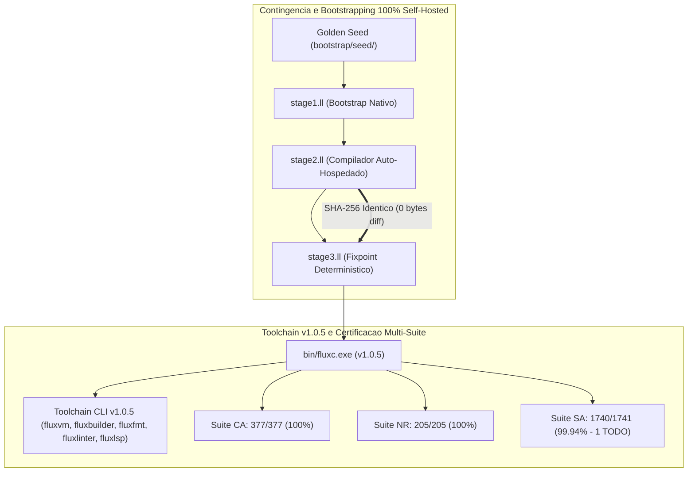

# TheFlux v1.0.5 Notas de Lançamento (Release Notes)

> **Data de Lançamento**: Novembro de 2026  
> **Versão**: `1.0.5` — *Autonomia 100% Auto-Hospedada, Eliminação do Legado, Certificação Multi-Suite e Padronização da Toolchain*  
> **Status**: Estável / 100% Auto-Hospedado e Livre de Legado  
> **Licença**: GNU General Public License v3.0 (GPL-3.0)  
> **Fixpoint Determinístico**: `SHA-256(stage2.ll) == SHA-256(stage3.ll)` (`39239abd85674d70f550d26339443b9c3a0c0a20c968c6dd23d95e1d192610fe`, 0 bytes de divergência)  
> **Baseline Canônica Oficial**: [`examples/00_Standarts/00_IN.txt`](file:///D:/Projetos/TheFlux/examples/00_Standarts/00_IN.txt) (substituindo definitivamente `00_Legacy.txt`)  
> **Conformidade Multi-Suite (5 Backends)**: **2.322 / 2.323 programas** (**11.610 / 11.615 execuções = 99,96%** — CA `377/377` 100%, NR `205/205` 100%, SA `1.740/1.741` 99,94%)  
> **Política WebAssembly**: WebAssembly 1.0 MVP congelado durante a estabilização Self-Hosted (migração para 3.0 na seção TODO)

---

## 🌟 1. Resumo Executivo: Consolidação da Versão 1.0.5

A versão **1.0.5** marca a transição definitiva do **TheFlux** para um ecossistema **100% auto-hospedado e autossuficiente**, eliminando integralmente o protótipo legado em Python e consolidando certificação em larga escala nos 5 backends oficiais (`in`, `vm`, `llvm`, `wat`, `was`):

1. **Eliminação Definitiva do Legado e Desacoplamento Total da `CompilerLib`**:
   - Remoção completa do diretório `legacy-0.9.9/`, do gerador `bootstrap/seed/prepare_compiler_lib.py` e das bibliotecas estáticas legadas `lib/fluxcompiler.lib` e `lib/libfluxcompiler.a`.
   - Os **44 módulos FDSL** da `CompilerLib` passam a ser compilados e incorporados diretamente no binário autônomo [`bin/fluxc.exe`](file:///D:/Projetos/TheFlux/bin/fluxc.exe), sem dependência externa `-lfluxcompiler`.
   - Ciclo de *bootstrapping* em 3 estágios ([`scripts/bootstrap.bat`](file:///D:/Projetos/TheFlux/scripts/bootstrap.bat) / [`scripts/bootstrap.sh`](file:///D:/Projetos/TheFlux/scripts/bootstrap.sh)) validado ponta a ponta (`Boot-0` a `Boot-5`) com determinismo bit a bit:
     `SHA-256(stage2.ll) == SHA-256(stage3.ll) == 39239abd85674d70f550d26339443b9c3a0c0a20c968c6dd23d95e1d192610fe`.
2. **Infraestrutura de Contingência, Golden Seed e Rollback em 3 Níveis**:
   - Criação da semente versionada imutável em [`bootstrap/seed/`](file:///D:/Projetos/TheFlux/bootstrap/seed/) com manifesto criptográfico ([`manifest.sha256`](file:///D:/Projetos/TheFlux/bootstrap/seed/manifest.sha256)) e rotina de recuperação a frio sem legado ([`emergency_cold_seed.bat`](file:///D:/Projetos/TheFlux/bootstrap/seed/emergency_cold_seed.bat)).
   - Snapshots transacionais automáticos (`build/lkg/prev/` e `build/lkg/last-good/`) gerenciados por [`scripts/rollback_bootstrap.bat`](file:///D:/Projetos/TheFlux/scripts/rollback_bootstrap.bat) e [`scripts/rollback_bootstrap.sh`](file:///D:/Projetos/TheFlux/scripts/rollback_bootstrap.sh) (`--prev`, `--last-good`, `--golden`).
3. **Nova Baseline Canônica (`00_IN.txt`) e Certificação Multi-Suite (CA, NR e SA)**:
   - Remoção definitiva de `00_Legacy.txt` e adoção de [`examples/00_Standarts/00_IN.txt`](file:///D:/Projetos/TheFlux/examples/00_Standarts/00_IN.txt) como referência oficial gerada pelo interpretador nativo auto-hospedado (**377 testes**, **5.315 linhas**, **216.418 bytes**).
   - Certificação multi-backend em **2.323 programas** distribuídos em 3 suítes independentes: **CA (`377/377` = 100%)**, **NR (`205/205` = 100%)** e **SA (`1.740/1.741` = 99,94%)**, restando apenas 1 exemplo conhecido com quebra/timeout em SA (`ExampleOfFundamentosOrdenacaoBurst.flux`, registrado na seção TODO).
4. **Padronização Completa da Toolchain v1.0.5**:
   - Sincronização de versão (`1.0.5`) em [`src/version.md`](file:///D:/Projetos/TheFlux/src/version.md), compilador, runtime C, contratos FVM e nas 5 ferramentas satélite.
   - Unificação da identidade CLI `--version` / `-v` em `fluxbuilder`, `fluxfmt`, `fluxlinter`, `fluxlsp` e `fluxvm`.



---

## 🚀 2. Detalhamento Técnico das Correções e Melhorias

### 2.1 Desacoplamento 100% Self-Hosted, Contingência e Rollback

- **Compilador Autônomo**: Atualização de [`src/main.flux`](file:///D:/Projetos/TheFlux/src/main.flux), [`scripts/build_tools.bat`](file:///D:/Projetos/TheFlux/scripts/build_tools.bat) e [`scripts/build_tools.sh`](file:///D:/Projetos/TheFlux/scripts/build_tools.sh) removendo `-lfluxcompiler` e compilando integralmente os 44 módulos da `CompilerLib` em código nativo LLVM.
- **Semente Dourada e Recuperação**: [`bootstrap/seed/`](file:///D:/Projetos/TheFlux/bootstrap/seed/) preserva binários certificados (`fluxc.exe`, `fluxvm.exe`), bibliotecas de runtime (`libfluxrt.a`, `fluxrt.lib`), `stage1.ll`, [`manifest.sha256`](file:///D:/Projetos/TheFlux/bootstrap/seed/manifest.sha256) e [`emergency_cold_seed.bat`](file:///D:/Projetos/TheFlux/bootstrap/seed/emergency_cold_seed.bat) sem nenhuma dependência Python/legada.
- **Rollback Transacional**: [`scripts/rollback_bootstrap.bat`](file:///D:/Projetos/TheFlux/scripts/rollback_bootstrap.bat) e [`scripts/rollback_bootstrap.sh`](file:///D:/Projetos/TheFlux/scripts/rollback_bootstrap.sh) implementam restauração determinística em 3 camadas (`--prev`, `--last-good`, `--golden`), protegida pelos portões de integridade `Boot-0` a `Boot-5` em [`scripts/bootstrap.bat`](file:///D:/Projetos/TheFlux/scripts/bootstrap.bat).

### 2.2 Runtime Modular em C e Otimizações de Memória/Desempenho

- **Eliminação de `VirtualQuery` no Caminho Crítico**: Validações de ponteiro via syscall Win32 isoladas sob `#ifdef FLUX_DEBUG_POINTERS` em [`runtime/src/collections/list.c`](file:///D:/Projetos/TheFlux/runtime/src/collections/list.c) e [`runtime/src/collections/map.c`](file:///D:/Projetos/TheFlux/runtime/src/collections/map.c), combinadas com cache de regiões `MEM_IMAGE` para eliminar gargalos de kernel em loops intensivos.
- **Arenas TLS Imortais e Ring Buffer de Tags**: Introdução de arenas TLS imortais em [`runtime/src/memory/arena.c`](file:///D:/Projetos/TheFlux/runtime/src/memory/arena.c) e ring buffer TLS de 16 slots para rastreamento de tags de floats/coleções em [`list.c`](file:///D:/Projetos/TheFlux/runtime/src/collections/list.c), [`map.c`](file:///D:/Projetos/TheFlux/runtime/src/collections/map.c), [`set.c`](file:///D:/Projetos/TheFlux/runtime/src/collections/set.c), [`string.c`](file:///D:/Projetos/TheFlux/runtime/src/strings/string.c) e [`str_fast.c`](file:///D:/Projetos/TheFlux/runtime/src/strings/str_fast.c).
- **Semântica Imutável em Listas Heterogêneas**: Adição de `flux_list_push_back_copy` em [`runtime/src/collections/list.c`](file:///D:/Projetos/TheFlux/runtime/src/collections/list.c), preservando integralmente as tuplas `(tag, val, sval)` e eliminando poluição de `g_flux_last_tag` ao combinar inteiros, booleanos e valores `data`.
- **Contrato de Versão de Runtime**: Atualização da versão de host de runtime para `1.0.5` em [`runtime/src/intrinsics/std_runtime.c`](file:///D:/Projetos/TheFlux/runtime/src/intrinsics/std_runtime.c), [`runtime/flux_input.c`](file:///D:/Projetos/TheFlux/runtime/flux_input.c), [`src/CompilerLib/backends/interp/InterpBackend.fdsl`](file:///D:/Projetos/TheFlux/src/CompilerLib/backends/interp/InterpBackend.fdsl) e [`src/CompilerLib/backends/interp/StdLibBridge.fdsl`](file:///D:/Projetos/TheFlux/src/CompilerLib/backends/interp/StdLibBridge.fdsl).

### 2.3 Evoluções no Frontend, Backend LLVM e Bibliotecas Padrão

- **Correção das 38 Regressões da Suíte CA e 78 Falhas da Suíte SA** em [`src/CompilerLib/backends/llvm/LlvmBackend.fdsl`](file:///D:/Projetos/TheFlux/src/CompilerLib/backends/llvm/LlvmBackend.fdsl), [`src/CompilerLib/parser/ParseExprs.fdsl`](file:///D:/Projetos/TheFlux/src/CompilerLib/parser/ParseExprs.fdsl) e [`src/CompilerLib/parser/ParserCore.fdsl`](file:///D:/Projetos/TheFlux/src/CompilerLib/parser/ParserCore.fdsl):
  - **Tipagem `list of bool`**: Separação estrita de `elem_t == "bool"` (`icmp ne i64 %raw, 0` → `i1`) em `GET_INDEX`, `COLL_GET` e parâmetros `list`/`set`, além de coerção defensiva em `UNARY_not` e `BINOP_and`/`BINOP_or` (67 correções em `llvm`).
  - **Guarda de Literais no Parser**: Proteção para que literais string `".."` e `"comptime"` não sejam capturados como operador de intervalo ou palavra-chave sintática (`ParseExprs.fdsl`).
  - **Expressões Lógicas Multilinha (`and`/`or`)**: `parseLogicalAnd` e `parseLogicalOr` agora toleram tokens `NEWLINE` após o operador lógico.
  - **Coleções Aninhadas e Operações Bitwise**: Propagação de `list_inner_elem_types` para `list of list of int64` e unboxing defensivo (`ptrtoint`/`zext`) em `^`, `&`, `|`, `<<`, `>>`, `>>>`.
  - **Passagem `int64 -> data` e `listPushBack`**: Emissão de `@flux_set_last_tag` na conversão para parâmetros `data` e lowering direto de `listPushBack` para `@flux_list_push_back_copy`.
- **Refinamentos em Bibliotecas Padrão (`stdlib/`)**: Ajustes de robustez e consistência em [`HashChecksum.fdsl`](file:///D:/Projetos/TheFlux/stdlib/HashStdLib/HashChecksum.fdsl), [`HashCrypto.fdsl`](file:///D:/Projetos/TheFlux/stdlib/HashStdLib/HashCrypto.fdsl), [`MatrixEigen.fdsl`](file:///D:/Projetos/TheFlux/stdlib/LinAlgStdLib/MatrixEigen.fdsl), [`MatrixQR.fdsl`](file:///D:/Projetos/TheFlux/stdlib/LinAlgStdLib/MatrixQR.fdsl) e [`TensorArithmetic.fdsl`](file:///D:/Projetos/TheFlux/stdlib/LinAlgStdLib/TensorArithmetic.fdsl).

### 2.4 Backends WAT e WASM (WebAssembly 1.0 MVP Congelado)

Mantendo o congelamento na especificação **WebAssembly 1.0 MVP** durante a estabilização Self-Hosted:

- **Listas em Memória Linear WebAssembly 1.0**: Implementação completa em [`src/CompilerLib/backends/wat/WatBackend.fdsl`](file:///D:/Projetos/TheFlux/src/CompilerLib/backends/wat/WatBackend.fdsl) e [`src/CompilerLib/backends/wasm/WasmBackend.fdsl`](file:///D:/Projetos/TheFlux/src/CompilerLib/backends/wasm/WasmBackend.fdsl) dos helpers nativos `$flux_alloc`, `$flux_list_new`, `$flux_list_push`, `$flux_list_get`, `$flux_list_set`, `$flux_list_len` e `$flux_list_take`, com cabeçalho de 16 bytes (`magic = 0x464C5354`), alinhamento de 8 bytes e crescimento dinâmico via `memory.grow`.
- **Operações de Coleção e `CAST`**: Suporte completo a `LIST_INIT`, `LIST_PUSH`, `SET_INIT`, `SET_ADD`, `GET_INDEX`, `SET_INDEX` (1D e N-D), `COLL_LEN`, `COLL_GET`, `CAST` pass-through, `listPushBack`, `listLength` e `listTake`, eliminando integralmente os timeouts de `wat`/`was` em NR e SA.

### 2.5 Matriz de Conformidade Multi-Suite e Padrões Canônicos

#### Conformidade Multi-Suite (Self-Hosted v1.0.5)

| Suíte | Relatório Oficial | `in` | `vm` | `llvm` | `wat` | `was` | Execuções Totais | Taxa | Observação |
| :--- | :--- | :---: | :---: | :---: | :---: | :---: | :---: | :---: | :--- |
| **CA — Core Architecture (Canon)** | [`compliance_CA01.md`](file:///D:/Projetos/TheFlux/examples/00_Standarts/compliance_CA01.md) | 377/377 | 377/377 | 377/377 | 377/377 | 377/377 | **1.885 / 1.885** | **100,00%** | 361 positivos + 16 diagnósticos; 0 regressões vs `CA00` |
| **NR — Numerical Recipes v3** | [`compliance_NR01.md`](file:///D:/Projetos/TheFlux/examples/00_Standarts/compliance_NR01.md) | 205/205 | 205/205 | 205/205 | 205/205 | 205/205 | **1.025 / 1.025** | **100,00%** | 22 capítulos clássicos; 0 regressões vs `NR00` |
| **SA — Scientific Algorithms** | [`compliance_SA01.md`](file:///D:/Projetos/TheFlux/examples/00_Standarts/compliance_SA01.md) | 1740/1741 | 1740/1741 | 1740/1741 | 1740/1741 | 1740/1741 | **8.700 / 8.705** | **99,94%** | 1 pendência conhecida (`ExampleOfFundamentosOrdenacaoBurst.flux` — ver TODO #5) |
| **Consolidado Geral** | **CA + NR + SA** | **2322/2323** | **2322/2323** | **2322/2323** | **2322/2323** | **2322/2323** | **11.610 / 11.615** | **99,96%** | 5 backends verificados em paralelo |

#### Matriz dos 8 Padrões Canônicos Ativos em `examples/00_Standarts/`

Com a retirada permanente de `00_Legacy.txt` e a renomeação de `00_SelfHosted.txt` para [`00_IN.txt`](file:///D:/Projetos/TheFlux/examples/00_Standarts/00_IN.txt), a pasta [`examples/00_Standarts/`](file:///D:/Projetos/TheFlux/examples/00_Standarts/) consolida 8 padrões ativos:

| Arquivo de Padrão | Tipo | Universo | Linhas Totais | Linhas de Saída (`\|`) | Papel na Arquitetura |
| :--- | :--- | :---: | :---: | :---: | :--- |
| [`00_IN.txt`](file:///D:/Projetos/TheFlux/examples/00_Standarts/00_IN.txt) | Runtime (Interpretador Self-Hosted) | 377 | 5.315 | 4.936 | Nova baseline canônica oficial (`364 OK / 13 FALHA`) |
| [`00_LLVM.txt`](file:///D:/Projetos/TheFlux/examples/00_Standarts/00_LLVM.txt) | Runtime (Nativo LLVM) | 377 | 5.242 | 4.863 | Referência nativa LLVM (`364 OK / 13 FALHA`) |
| [`00_VM.txt`](file:///D:/Projetos/TheFlux/examples/00_Standarts/00_VM.txt) | Compilação (FVM Bytecode) | 377 | 743 | 0 | Validação de geração `.fvmbc` |
| [`00_VMR.txt`](file:///D:/Projetos/TheFlux/examples/00_Standarts/00_VMR.txt) | Runtime (FVM Runtime) | 364 | 5.284 | 4.918 | Referência de execução FVM |
| [`00_WAS.txt`](file:///D:/Projetos/TheFlux/examples/00_Standarts/00_WAS.txt) | Compilação (Wasm Binário) | 377 | 743 | 0 | Validação de geração `.wasm` |
| [`00_WASR.txt`](file:///D:/Projetos/TheFlux/examples/00_Standarts/00_WASR.txt) | Runtime (Wasmer `.wasm`) | 364 | 5.284 | 4.918 | Referência de execução binária Wasm |
| [`00_WAT.txt`](file:///D:/Projetos/TheFlux/examples/00_Standarts/00_WAT.txt) | Compilação (WAT Texto) | 377 | 743 | 0 | Validação de geração `.wat` |
| [`00_WATR.txt`](file:///D:/Projetos/TheFlux/examples/00_Standarts/00_WATR.txt) | Runtime (Wasmer `.wat`) | 364 | 5.284 | 4.918 | Referência de execução textual WAT |

---

## 🛠️ 3. Padronização da Toolchain CLI, Scripts e Higienização

### 3.1 Identidade Unificada `--version` / `-v` (v1.0.5)

Todos os executáveis oficiais foram recompilados na versão `1.0.5` e tiveram suas saídas de `--version` / `-v` padronizadas:

| Binário | Código-Fonte Principal | Saída Oficial (`--version`) |
| :--- | :--- | :--- |
| [`bin/fluxc.exe`](file:///D:/Projetos/TheFlux/bin/fluxc.exe) | [`src/main.flux`](file:///D:/Projetos/TheFlux/src/main.flux) | `1.0.5` |
| [`bin/fluxvm.exe`](file:///D:/Projetos/TheFlux/bin/fluxvm.exe) | [`src/Fvm/fluxvm.flux`](file:///D:/Projetos/TheFlux/src/Fvm/fluxvm.flux) / [`runtime/fvm/fvm_main.c`](file:///D:/Projetos/TheFlux/runtime/fvm/fvm_main.c) | `fluxvm version 1.0.5 (TheFlux Fast Virtual Machine)` |
| [`bin/fluxbuilder.exe`](file:///D:/Projetos/TheFlux/bin/fluxbuilder.exe) | [`src/tools/fluxbuilder/fluxbuilder.flux`](file:///D:/Projetos/TheFlux/src/tools/fluxbuilder/fluxbuilder.flux) | `fluxbuilder version 1.0.5 (TheFlux Project Builder & Integrator)` |
| [`bin/fluxfmt.exe`](file:///D:/Projetos/TheFlux/bin/fluxfmt.exe) | [`src/tools/fluxfmt/fluxfmt.flux`](file:///D:/Projetos/TheFlux/src/tools/fluxfmt/fluxfmt.flux) | `fluxfmt version 1.0.5 (TheFlux Canonical Code Formatter)` |
| [`bin/fluxlinter.exe`](file:///D:/Projetos/TheFlux/bin/fluxlinter.exe) | [`src/tools/fluxlinter/fluxlinter.flux`](file:///D:/Projetos/TheFlux/src/tools/fluxlinter/fluxlinter.flux) | `fluxlinter version 1.0.5 (TheFlux Static Analyzer & Linter)` |
| [`bin/fluxlsp.exe`](file:///D:/Projetos/TheFlux/bin/fluxlsp.exe) | [`src/tools/fluxlsp/fluxlsp.flux`](file:///D:/Projetos/TheFlux/src/tools/fluxlsp/fluxlsp.flux) | `fluxlsp version 1.0.5 (TheFlux Language Server Protocol & IDE Support)` |

### 3.2 Scripts, Auditores e Higienização

1. **Auditores Paralelos Multi-Backend**: Inclusão de [`examples/compliance_CA.py`](file:///D:/Projetos/TheFlux/examples/compliance_CA.py), [`examples/compliance_NR.py`](file:///D:/Projetos/TheFlux/examples/compliance_NR.py) e [`examples/compliance_SA.py`](file:///D:/Projetos/TheFlux/examples/compliance_SA.py) com detecção automática de regressões frente às baselines fixas (`CA00`, `NR00`, `SA00`).
2. **Normalização de Scripts e SDK**: Renomeação de `examples/example_wasr.bat` → [`examples/examples_wasr.bat`](file:///D:/Projetos/TheFlux/examples/examples_wasr.bat) e `examples/example_watr.bat` → [`examples/examples_watr.bat`](file:///D:/Projetos/TheFlux/examples/examples_watr.bat), atualização da checagem de SDK em [`fluxbuilder.flux`](file:///D:/Projetos/TheFlux/src/tools/fluxbuilder/fluxbuilder.flux) para `lib/fluxrt.lib` e sincronização de versão em [`FvmClient.fdsl`](file:///D:/Projetos/TheFlux/src/Fvm/FvmClient.fdsl) / [`FvmContract.fdsl`](file:///D:/Projetos/TheFlux/src/Fvm/FvmContract.fdsl).
3. **Paridade Bilíngue de Documentação**: Registro das notas de lançamento v1.0.5 em [`scripts/docs/check_i18n_parity.py`](file:///D:/Projetos/TheFlux/scripts/docs/check_i18n_parity.py), preservando 100% de simetria 1:1 entre `docs/pt_BR` e `docs/en`.

---

## 📊 4. Como Validar a Versão 1.0.5

### 4.1 Validação de Bootstrapping e Fixpoint Determinístico
```powershell
# Executar ciclo completo de bootstrap 100% self-hosted (Boot-0 a Boot-5)
.\scripts\bootstrap.bat

# Comprovar determinismo bit a bit (deve retornar hashes SHA-256 identicos)
python -c "import hashlib; [print(f, hashlib.sha256(open(f, 'rb').read()).hexdigest()) for f in ['build/intermediates/stage2.ll', 'build/intermediates/stage3.ll']]"
```

### 4.2 Verificação da Toolchain CLI v1.0.5
```powershell
foreach ($tool in 'fluxc','fluxvm','fluxbuilder','fluxfmt','fluxlinter','fluxlsp') {
    & ".\bin\$tool.exe" --version
}
```

### 4.3 Auditoria das Suítes de Conformidade Multi-Backend
```powershell
# Suite CA (Canon — 377 programas)
python examples/compliance_CA.py --jobs 8

# Suite NR (Numerical Recipes v3 — 205 programas)
python examples/compliance_NR.py --jobs 8

# Suite SA (Scientific Algorithms — 1.741 programas)
python examples/compliance_SA.py --jobs 8
```

### 4.4 Verificação de Paridade Bilíngue da Documentação
```powershell
python scripts/docs/check_i18n_parity.py
```

---

## 📋 5. TODO (Pendências e Próximos Passos)

1. **Ajuste da indentação (3 ou 4 espaços)**:
   - Revisar a regra atual de indentação fixa de 6 espaços especificada em [`docs/pt_BR/Gramatica.md`](file:///D:/Projetos/TheFlux/docs/pt_BR/Gramatica.md) e aplicada em [`src/CompilerLib/lexer/IndentTracker.fdsl`](file:///D:/Projetos/TheFlux/src/CompilerLib/lexer/IndentTracker.fdsl), [`fluxfmt`](file:///D:/Projetos/TheFlux/src/tools/fluxfmt/fluxfmt.flux), [`fluxlinter`](file:///D:/Projetos/TheFlux/src/tools/fluxlinter/fluxlinter.flux) e [`fluxlsp`](file:///D:/Projetos/TheFlux/src/tools/fluxlsp/fluxlsp.flux), avaliando a migração ou padronização para **3 ou 4 espaços** em todo o ecossistema e suítes de código.
2. **Ajuste de quebra de linha (documentado e não implementado e/ou testado)**:
   - Implementar integralmente e cobrir com testes canônicos as regras de continuação e quebra de linha lógica já documentadas em [`docs/pt_BR/Gramatica.md`](file:///D:/Projetos/TheFlux/docs/pt_BR/Gramatica.md#L250-L266) (supressão de `eol` após operadores infixos/dataflow, dentro de `()`/`[]` e `pending_line`), alinhando [`src/CompilerLib/lexer/LexerCore.fdsl`](file:///D:/Projetos/TheFlux/src/CompilerLib/lexer/LexerCore.fdsl) e o parser à especificação formal.
3. **Teste de `web_wasm` (legacy DEPRECATED era funcional, não testado em SelfHosted)**:
   - Validar ponta a ponta o playground interativo WebAssembly em [`web_wasm/server.py`](file:///D:/Projetos/TheFlux/web_wasm/server.py), [`web_wasm/index.html`](file:///D:/Projetos/TheFlux/web_wasm/index.html) e [`web_wasm/wasi_worker.js`](file:///D:/Projetos/TheFlux/web_wasm/wasi_worker.js) consumindo módulos `.wasm` gerados pelo compilador 100% Self-Hosted — funcionalidade que operava no compilador legado (`legacy-0.9.9`, descontinuado/removido), mas ainda não foi testada e certificada em Self-Hosted.
4. **Migração de WebAssembly para versão 3.0**:
   - Iniciar a Fase 2 do roteiro técnico ([`docs/TODO.md`](file:///D:/Projetos/TheFlux/docs/TODO.md)) evoluindo [`WatBackend.fdsl`](file:///D:/Projetos/TheFlux/src/CompilerLib/backends/wat/WatBackend.fdsl) e [`WasmBackend.fdsl`](file:///D:/Projetos/TheFlux/src/CompilerLib/backends/wasm/WasmBackend.fdsl) do WebAssembly 1.0 MVP congelado para a **especificação WebAssembly 3.0** (Wasm IR compartilhado, eliminação do pré-bake `interpExecuteFmir`, WasmGC, Multi-Value, `try_table`, chamadas em cauda e WASI moderno).
5. **Ajuste de SciAlgo com quebra no código (`ExampleOfFundamentosOrdenacaoBurst.flux`)**:
   - Investigar e corrigir a quebra/timeout em [`examples/ScientificAlgorithms/01_foundations/ExampleOfFundamentosOrdenacaoBurst.flux`](file:///D:/Projetos/TheFlux/examples/ScientificAlgorithms/01_foundations/ExampleOfFundamentosOrdenacaoBurst.flux) — única pendência remanescente registrada em [`compliance_SA01.md`](file:///D:/Projetos/TheFlux/examples/00_Standarts/compliance_SA01.md#L1861-L1871) (`1.740 / 1.741`, com timeout em `in`, `vm`, `wat` e `was` impedindo a validação de referência de `llvm`) — para restaurar **100% (`1.741 / 1.741`)** na suíte Scientific Algorithms.

---

*TheFlux Core Engineering Team — Novembro de 2026.*
