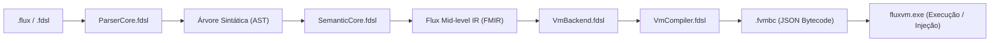

# 📜 Especificação do Formato .fvmbc e Catálogo dos 92 Opcodes Canônicos

> **Cabeçalho de Tipos e Opcodes**: [`runtime/fvm/fvm_types.h`](file:///D:/Projetos/TheFlux/runtime/fvm/fvm_types.h)  
> **Emissor no Compilador**: [`src/CompilerLib/backends/vm/VmCompiler.fdsl`](file:///D:/Projetos/TheFlux/src/CompilerLib/backends/vm/VmCompiler.fdsl)  
> **Versão Oficial**: `v1.0.0`  
> **Status**: ✅ Especificação Canônica Oficial do TheFlux v1.0.0

---

## 1. Visão Geral do Formato `.fvmbc`

O arquivo de bytecode **`.fvmbc`** (Fast Virtual Machine Bytecode) é a representação intermediária serializada em formato JSON gerada pelo backend VM do compilador self-hosted (`fluxc --target vm`). Ele encapsula o código executável, constantes tipadas, definições de funções e metadados estruturais de um programa TheFlux.

### Estrutura Geral do JSON `.fvmbc`

```json
{
  "version": "1.0.0",
  "constants": [
    {"type": "int", "value": 42},
    {"type": "string", "value": "Olá, TheFlux!"}
  ],
  "functions": [
    {
      "name": "main",
      "params": [],
      "locals_count": 8,
      "instructions": [
        {"op": "LOAD_CONST", "arg": 0},
        {"op": "PRINT"},
        {"op": "HALT"}
      ]
    }
  ],
  "metadata": {
    "target": "fvm",
    "compiler": "fluxc-1.0.0"
  }
}
```

---

## 2. Pipeline de Compilação e Emissão

A compilação para FVM segue o fluxo formal do compilador nativo:



1. **Geração de FMIR**: O compilador traduz as declarações, contratos e programas para a representação intermediária unificada FMIR.
2. **Emissão de Instruções VM**: O módulo `VmBackend.fdsl` percorre o grafo de blocos básicos do FMIR, convertendo instruções de alto nível nos 92 opcodes canônicos da FVM.
3. **Serialização JSON**: `VmCompiler.fdsl` empacota a tabela de constantes e o array de instruções gerando o arquivo final `.fvmbc`.

---

## 3. Catálogo dos 92 Opcodes Canônicos

A enumeração oficial de opcodes reside em [`runtime/fvm/fvm_types.h`](file:///D:/Projetos/TheFlux/runtime/fvm/fvm_types.h) (`FvmOpcode`), categorizada em 9 grupos funcionais:

### 3.1 Controle do Ciclo de Vida e Pilha (Opcodes 0–5, 17–18)
| Opcode | ID | Descrição |
|---|---|---|
| `OP_HALT` | 0 | Encerra a execução da máquina virtual retornando o valor do topo da pilha como exit code. |
| `OP_PUSH` | 1 | Empilha uma constante da tabela de constantes no topo da pilha. |
| `OP_LOAD` | 2 | Carrega o valor de uma variável local ou registrador para a pilha. |
| `OP_STORE` | 3 | Armazena o valor do topo da pilha em uma variável local ou slot de memória. |
| `OP_MAKE_REF` | 4 | Cria uma referência mutável a um slot de variável. |
| `OP_DECLARE` | 5 | Declara uma nova variável no escopo corrente com tipo inicial. |
| `OP_DUP` | 17 | Duplica o elemento no topo da pilha de operandos. |
| `OP_POP` | 18 | Descarta o elemento no topo da pilha de operandos. |

### 3.2 Aritmética e Matemática (Opcodes 6–15, 60–61)
| Opcode | ID | Descrição |
|---|---|---|
| `OP_ADD` | 6 | Soma aritmética entre os dois valores no topo da pilha (`a + b`). |
| `OP_SUB` | 7 | Subtração aritmética (`a - b`). |
| `OP_MUL` | 8 | Multiplicação aritmética (`a * b`). |
| `OP_DIV` | 9 | Divisão real de ponto flutuante (`a / b`). |
| `OP_IDIV` | 10 | Divisão inteira truncada (`a /i b`). |
| `OP_REM` | 11 | Resto inteiro da divisão (`a /r b`). |
| `OP_POW_E` | 12 | Potenciação exata (`a ^e b`). |
| `OP_POW_R` | 13 | Potenciação real (`a ^r b`). |
| `OP_NEG` | 14 | Negação aritmética unária (`-a`). |
| `OP_ROUND` | 60 | Arredondamento numérico com modo configurável. |
| `OP_ROUND_COMPLEX` | 61 | Arredondamento de partes real e imaginária de número complexo. |

### 3.3 Comparações e Lógica Booleana (Opcodes 16, 19–26)
| Opcode | ID | Descrição |
|---|---|---|
| `OP_NOT` | 16 | Negação lógica (`not a`). |
| `OP_EQ` | 19 | Comparação de igualdade (`a == b`). |
| `OP_NE` | 20 | Comparação de desigualdade (`a != b`). |
| `OP_LT` | 21 | Menor que (`a < b`). |
| `OP_LE` | 22 | Menor ou igual (`a <= b`). |
| `OP_GT` | 23 | Maior que (`a > b`). |
| `OP_GE` | 24 | Maior ou igual (`a >= b`). |
| `OP_AND` | 25 | Operação lógica E (`a and b`). |
| `OP_OR` | 26 | Operação lógica OU (`a or b`). |

### 3.4 Operações Bitwise (Opcodes 27–33)
| Opcode | ID | Descrição |
|---|---|---|
| `OP_BAND` | 27 | E bit a bit (`&`). |
| `OP_BOR` | 28 | OU bit a bit (`&#124;`). |
| `OP_BXOR` | 29 | OU exclusivo bit a bit (`^`). |
| `OP_BSHL` | 30 | Deslocamento de bits para esquerda (`<<`). |
| `OP_BSHR` | 31 | Deslocamento de bits aritmético para direita (`>>`). |
| `OP_BSHRU` | 32 | Deslocamento de bits lógico (sem sinal) para direita (`>>>`). |
| `OP_BNOT` | 33 | Negação bit a bit (`~`). |

### 3.5 Entrada, Saída e Depuração (Opcodes 34–36, 86)
| Opcode | ID | Descrição |
|---|---|---|
| `OP_PRINT` | 34 | Imprime o valor no topo da pilha sem quebra de linha. |
| `OP_PRINTLN` | 35 | Imprime o valor no topo da pilha com quebra de linha. |
| `OP_INPUT` | 36 | Lê uma linha de entrada de stdin. |
| `OP_SPY` | 86 | Inspeciona e imprime o estado interno de um registrador ou valor em depuração. |

### 3.6 Saltos, Funções e Controle de Escopo (Opcodes 37–43)
| Opcode | ID | Descrição |
|---|---|---|
| `OP_JMP` | 37 | Salto incondicional para o endereço de instrução alvo. |
| `OP_JZ` | 38 | Salto condicional se o topo da pilha for falso ou zero. |
| `OP_JNZ` | 39 | Salto condicional se o topo da pilha for verdadeiro ou não-zero. |
| `OP_CALL` | 40 | Invoca uma função passando argumentos da pilha. |
| `OP_RET` | 41 | Retorna da função corrente para o chamador. |
| `OP_SCOPE_ENTER` | 42 | Abre um novo escopo léxico de variáveis locais. |
| `OP_SCOPE_EXIT` | 43 | Encerra o escopo léxico corrente, liberando variáveis. |

### 3.7 Contratos, Agentes e Tratamento de Erros (Opcodes 44–46)
| Opcode | ID | Descrição |
|---|---|---|
| `OP_EMIT` | 44 | Emite um resultado de operação de agente (`emit(nice, val, msg)`). |
| `OP_FAIL` | 45 | Dispara um erro estruturado de falha de contrato. |
| `OP_IS_FAIL` | 46 | Verifica se um resultado retornado contém sinalização de falha. |

### 3.8 Estruturas, Enums, Tuplas e Pattern Matching (Opcodes 47–59, 74–79)
| Opcode | ID | Descrição |
|---|---|---|
| `OP_MAKE_STRUCT` | 47 | Cria uma nova instância de struct com campos inicializados. |
| `OP_FIELD_ACCESS` | 48 | Acessa um campo de struct pelo nome ou índice. |
| `OP_FIELD_SET` | 49 | Atribui um novo valor a um campo de struct. |
| `OP_TO_STRING` | 50 | Converte qualquer valor *tagged* em representação textual string. |
| `OP_JUMP_IF_NOT_MATCH` | 51 | Salto condicional para arm alternativo caso o padrão não case. |
| `OP_MATCH_BIND` | 53 | Vincula valores desestruturados a variáveis de padrão. |
| `OP_ENUM_NEW` | 55 | Cria uma nova variante de enum com tag e campos associados. |
| `OP_ENUM_TAG` | 56 | Extrai a tag de discriminante de um enum. |
| `OP_INDEX` | 62 | Acesso indexado em listas, mapas ou tensores (`col[idx]`). |
| `OP_INDEX_ASSIGN` | 63 | Atribuição indexada (`col[idx] = val`). |
| `OP_SLICE` | 69 | Fatiamento de coleções ou strings (`col[ini..fim]`). |
| `OP_IN` | 70 | Teste de pertencimento de elemento em coleção (`item in col`). |

### 3.9 Tensores, Coleções e Iteradores (Opcodes 64–68, 71–73, 83–85, 87)
| Opcode | ID | Descrição |
|---|---|---|
| `OP_TGET` | 64 | Leitura de elemento multidimensional em tensor. |
| `OP_TSET` | 65 | Escrita de elemento multidimensional em tensor. |
| `OP_TENSOR_PACK` | 66 | Empacota elementos em buffer contíguo de tensor numérico. |
| `OP_TSLICE` | 67 | Fatiamento multidimensional de tensor. |
| `OP_TMAT` | 68 | Operação de multiplicação de matrizes de tensor. |
| `OP_MAKE_LIST` | 71 | Cria uma nova lista dinâmica de elementos. |
| `OP_MAKE_SET` | 72 | Cria um novo conjunto hash set de valores únicos. |
| `OP_MAKE_MAP` | 73 | Cria um novo mapa hash map chave-valor. |
| `OP_ITER_NEW` | 83 | Cria um novo iterador sobre uma coleção. |
| `OP_ITER_NEXT` | 84 | Avança o iterador e retorna o próximo elemento. |
| `OP_UNWRAP_NICE` | 85 | Desempacota o valor de um resultado `nice` de emissão de agente. |
| `OP_NOP` | 87 | Nenhuma operação (usado para alinhamento ou pontos de inserção de saltos). |

---

## 4. O Sistema de Tipos Tagged (`FluxVal`) e Gerenciador de Arena

Para atingir performance máxima sem o overhead de coletor de lixo (GC) tradicional em tempo de execução, a FVM utiliza duas técnicas de engenharia de software de ponta:

### 4.1 Estrutura `FluxVal` (16 bytes alinhados)
Todo valor em tempo de execução na FVM é representado pela struct unificada `FluxVal` definida em [`runtime/fvm/fvm_types.h`](file:///D:/Projetos/TheFlux/runtime/fvm/fvm_types.h):

```c
typedef struct FluxVal {
    uint8_t type;       /* 16 tipos primitivos: VAL_INT, VAL_FLOAT, VAL_STRING, etc. */
    uint8_t flags;      /* Flags de mutabilidade e GC */
    uint16_t aux;       /* Metadados auxiliares de enum / comprimento curto */
    int32_t len;        /* Comprimento de strings, coleções ou tensores */
    union {
        int64_t i64;    /* Inteiros signed de 64 bits */
        double f64;     /* Números de ponto flutuante IEEE 754 de 64 bits */
        uint32_t ch;    /* Caracteres UTF-32 */
        void *ptr;      /* Ponteiros para objetos na arena (strings, listas, mapas) */
    } as;
} FluxVal;
```

### 4.2 Gerenciamento de Memória por Arena (`FvmArena`)
- **Alocação Rápida (Bump Allocation)**: Strings, listas, mapas e structs são alocados linearmente em blocos contíguos de 64 KB (`fvm_arena.c`), com ponteiro de offset que avança em tempo O(1).
- **Zero Fragmentação e Limpeza Instantânea**: Quando uma execução é concluída, a arena inteira é reinicializada instantaneamente em O(1), liberando todos os objetos alocados sem custo de varredura ou pausas de *stop-the-world*.
