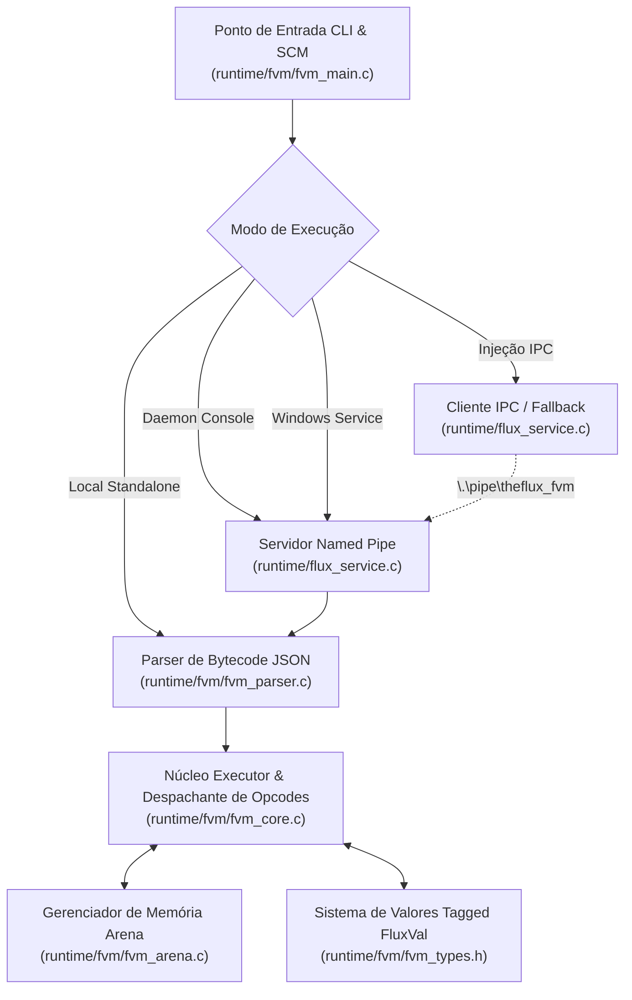

# ⚡ Visão Geral e Arquitetura da FVM (TheFlux Fast Virtual Machine)

> **Binário Oficial**: `bin/fluxvm.exe (Windows) / bin/fluxvm (Linux)`  
> **Código-Fonte do Motor**: [`runtime/fvm/`](file:///D:/Projetos/TheFlux/runtime/fvm) e [`runtime/flux_service.c`](file:///D:/Projetos/TheFlux/runtime/flux_service.c)  
> **Versão Homologada**: `v1.0.0`  
> **Status**: ✅ Componente Canônico Oficial do TheFlux v1.0.0

---

## 1. Visão Geral e Papel Arquitetural

A **TheFlux Fast Virtual Machine (FVM)** é o motor de execução nativo de alta performance projetado para interpretar arquivos de bytecode compilados (`.fvmbc`) do ecossistema TheFlux. Desenvolvida em C puro com alocação em blocos de memória arena, a FVM oferece um ambiente de execução leve, desacoplado de dependências externas de compilação C/LLVM e com tempo de inicialização na ordem de fração de milissegundo.

A FVM opera sob uma arquitetura dual única no ecossistema:
1. **Modo Standalone (Execução Local Isolada)**: Inicialização instantânea sob demanda para scripts, utilitários e suítes de teste locais.
2. **Modo Residente / Serviço do Windows (IPC via Named Pipe)**: Um servidor de execução residente (`\.\pipe\theflux_fvm`) que mantém a máquina virtual pré-aquecida em memória, recebendo bytecodes via injeção (`--inject`) com latência de resposta de apenas **0.10 ms** (100 microssegundos). Se o serviço não estiver ativo, o cliente realiza **fallback automático transparente** para execução local sem qualquer falha de processo.

---

## 2. Componentes Internos do Motor C

A implementação física da FVM reside no diretório [`runtime/fvm/`](file:///D:/Projetos/TheFlux/runtime/fvm):



| Módulo Fonte | Header | Responsabilidade Técnica |
|---|---|---|
| [`fvm_arena.c`](file:///D:/Projetos/TheFlux/runtime/fvm/fvm_arena.c) | `fvm_arena.h` | Alocador de memória em blocos contíguos (Arena Allocator) de 64 KB, eliminando chamadas repetidas a `malloc` e permitindo desalocação instantânea de ciclo de vida com zero fragmentação de heap. |
| [`fvm_parser.c`](file:///D:/Projetos/TheFlux/runtime/fvm/fvm_parser.c) | `fvm_parser.h` | Parser de alta velocidade para carregar e desserializar o formato de bytecode JSON (`.fvmbc`) em estruturas nativas em memória (`FvmProgram`). |
| [`fvm_core.c`](file:///D:/Projetos/TheFlux/runtime/fvm/fvm_core.c) | `fvm_core.h` | Núcleo de execução com loop de despacho direto sobre os **92 opcodes canônicos**, pilha de operandos e tabela de registradores. |
| [`fvm_types.h`](file:///D:/Projetos/TheFlux/runtime/fvm/fvm_types.h) | `fvm_types.h` | Definição dos opcodes, enumeração dos 16 tipos primitivos e estrutura de valores *tagged* de 16 bytes alinhados (`FluxVal`). |
| [`flux_service.c`](file:///D:/Projetos/TheFlux/runtime/flux_service.c) | `flux_service.h` | Camada de integração com o sistema operacional Windows: controle do SCM (instalação, início, parada), servidor Named Pipe multi-instância e cliente de injeção IPC. |
| [`fvm_main.c`](file:///D:/Projetos/TheFlux/runtime/fvm/fvm_main.c) | - | Interface de linha de comando CLI, despacho de flags, benchmarking via contadores de alta precisão do Windows (`QueryPerformanceCounter`) e orquestração. |

---

## 3. Modos de Operação Detalhados

### 3.1 Modo Standalone (Execução Local Direta)
Neste modo, o binário `fluxvm.exe` recebe o caminho de um arquivo `.fvmbc`, lê seu conteúdo, instancia uma máquina virtual com arena local e executa as instruções até o término:
```bash
fluxvm t_fvmbc/ExampleOfAsync.fvmbc
```
- **Vantagem**: Isolamento absoluto de processo, sem dependência de serviços em execução em segundo plano.
- **Caso de uso**: Testes unitários, tarefas em lote (batch), scripts pontuais e ambientes restritos sem permissão para daemons.

### 3.2 Modo Daemon Console (Residente sem Privilégios de Administrador)
Permite inicializar o servidor de Named Pipe diretamente em uma janela de console ou processo em segundo plano do usuário corrente, sem requerer privilégios administrativos:
```bash
fluxvm --daemon
```
O servidor escuta continuamente conexões no canal `\\.\pipe\theflux_fvm`. Ao receber conexões de clientes injetores (`--inject`), processa o bytecode recebido e envia a resposta de volta pelo mesmo pipe.

### 3.3 Modo Serviço do Windows (Service Control Manager - SCM)
Para implantações de produção e servidores dedicados, a FVM pode ser instalada formalmente como um Serviço do Windows com inicialização automática (`SERVICE_AUTO_START`):
- **Instalar**: `fluxvm --service install` (requer Administrador)
- **Iniciar**: `fluxvm --service start`
- **Consultar Status**: `fluxvm --service status` ou `fluxvm --status`
- **Parar**: `fluxvm --service stop`
- **Desinstalar**: `fluxvm --service uninstall`

### 3.4 Modo Injeção de Bytecode (IPC) com Fallback Transparente
O comando de injeção transmite o bytecode diretamente para o processo residente:
```bash
fluxvm --inject programa.fvmbc --bench
```
- **Com Serviço/Daemon Ativo**: O bytecode é despachado via IPC em ~0.10 ms.
- **Com Serviço Inativo**: A FVM detecta o retorno IPC `-2` e **imediatamente executa o programa localmente** em fallback automático, garantindo que comandos de injeção nunca falhem por ausência do serviço.

---

## 4. Tabela de Opções de Linha de Comando (CLI)

| Opção | Parâmetro | Descrição |
|---|---|---|
| `<arquivo.fvmbc>` | Obrigatório no modo direto | Executa o arquivo de bytecode localmente em modo standalone. |
| `--inject` | `<arquivo.fvmbc>` ou `-` | Injeta o bytecode no serviço Windows ou Daemon via Named Pipe (suporta leitura de STDIN com `-`). |
| `--status`, `--ping` | - | Verifica se o serviço ou daemon FVM está ativo e respondendo (`active` / `inactive`). |
| `--bench` | - | Habilita cronometragem de alta resolução, exibindo tempo de execução (ms) e contagem de instruções / latência IPC. |
| `--stdin` | `<texto>` | Fornece texto de entrada padrão simulado via argumento de linha de comando. |
| `--service install` | - | Registra formalmente `TheFluxFvmService` no Windows SCM com autostart. |
| `--service uninstall` | - | Remove o serviço `TheFluxFvmService` do Windows SCM. |
| `--service start` | - | Inicia o serviço Windows registrado no SCM. |
| `--service stop` | - | Interrompe a execução do serviço Windows no SCM. |
| `--service status` | - | Consulta e exibe o estado operacional do serviço no SCM. |
| `--service run` | - | Ponto de entrada interno invocado pelo SCM ao despachar o serviço. |
| `--daemon` | - | Inicia o servidor residente em console de usuário (sem requerer elevação de privilégios). |
| `--version`, `-v` | - | Exibe a versão oficial instalada da FVM (`1.0.0`). |
| `--help`, `-h` | - | Exibe o manual de ajuda e opções na tela. |

---

## 5. Métricas de Performance e Benchmarking

Testes executados com contadores de performance de alta precisão do Windows (`QueryPerformanceCounter`) demonstram os seguintes tempos de turnaround médios:

| Modo de Execução | Tempo Típico de Turnaround | Overhead de Processo |
|---|---|---|
| **Injeção IPC via Named Pipe** (`--inject`) | **0.08 ms a 0.12 ms** (80–120 µs) | Zero (instância quente residente pré-alocada) |
| **Standalone Local** (`fluxvm <arquivo>`) | **0.02 ms a 0.04 ms** (após spawn) | ~15 ms (tempo de spawn do processo pelo OS) |
| **Fallback Automático** (sem serviço) | **0.02 ms a 0.04 ms** | Transparente e imediato após timeout de 50 ms |
