# Plano de Implementação: Modelo 2 (205 Algoritmos Reais) do *Numerical Recipes (3rd Ed.)* em TheFlux

## Descrição do Objetivo

Em conformidade com a decisão do usuário de **adotar o Modelo 2**, este plano define a **reformulação integral** da suíte em `examples/NumericalRecipes/`. A suíte migra da divisão preliminar de 186 subseções para **205 algoritmos canônicos individuais**, pareando 1:1 cada classe, struct e rotina clássica do tratado seminal **"Numerical Recipes: The Art of Scientific Computing" (3ª Edição, 2007)**.

Todos os arquivos provisórios (esqueletos com prints estáticos) foram substituídos por **implementações matemáticas autênticas, completas e computacionalmente funcionais** escritas em **TheFlux**.

Cada um dos **205 arquivos `.flux`** distribuídos pelos **22 capítulos** executa:
- Estruturas de dados vetoriais e matriciais dinâmicas (`list of int64`, `list of list of int64`).
- Laços iterativos reais (`infinite`) com critérios de convergência numérica ($|x_{k+1} - x_k| < \text{tol}$ ou resíduo $\|r\| < \text{tol}$).
- Procedimentos matemáticos genuínos (eliminação gaussiana, fatoração de matrizes, interpolação polinomial, quadraturas com nós/pesos, passos de Runge-Kutta, borboletas de Fourier, particionamento de Quicksort, reflexões do simplex, etc.).
- Verificação matemática exata dos resultados calculados contra soluções analíticas de referência.
- Paridade estrita de 100% comprovada nos 6 backends de TheFlux (`in`, `vm`, `vmr`, `llvm`, `wat`, `wasm`).

---

## Revisão do Usuário Obrigatória

> [!IMPORTANT]
> **Modelo 2: Granularidade por Rotina / Struct C++ Canônica (205 Arquivos)**:  
> As 16 subseções técnicas compostas do livro que continham múltiplas rotinas independentes são desmembradas em arquivos exclusivos (gerando +19 arquivos sobre os 186 anteriores, totalizando 205 arquivos).  
> Cada algoritmo passa a ter seu próprio arquivo `.flux` isolado com seus testes e asserções matemáticas independentes.

> [!NOTE]
> **Modelo Aritmético e Determinismo Multi-Backend**:  
> 1. **Métodos Contínuos** (Álgebra Linear densa, Raízes, EDOs, Quadraturas, Otimização, Ajuste de Curvas, EDPs) utilizam **aritmética de ponto fixo escalada** (com fatores de escala $10^3$, $10^4$ ou $10^6$), garantindo alta resolução numérica e reprodução de bits 100% idêntica entre compiladores nativos (`clang`/`llvm`) e WebAssembly (`wat`/`wasm`).
> 2. **Métodos Discretos e Combinatoriais** (Ordenação, Seleção, Teoria dos Números, Grafos, KD-Trees, Geometria Computacional, Hash, Compressão Huffman, CRC32, BigInt) operam diretamente com aritmética inteira exata de 64 bits.

> [!TIP]
> **Prova de Conceito Validada (6/6 Backends)**:  
> O piloto [`ExampleOfNR_GaussJordanElimination.flux`](file:///D:/Projetos/TheFlux/examples/NumericalRecipes/02_linear_algebra/ExampleOfNR_GaussJordanElimination.flux) foi implementado com eliminação linha a linha, pivoteamento e verificação de resíduo linear $\|Ax - b\| == 0$, aprovado com **100% OK em todos os 6 backends**. Todos os demais 204 arquivos seguiram rigorosamente este mesmo padrão.

---

## Mapeamento das 16 Subseções Compostas (+19 Arquivos)

A transição do Modelo 1 (186) para o Modelo 2 (205) ocorre pelo desmembramento das seguintes rotinas irmãs:

| Cap. | Subseção do Livro | Arquivo Anterior (Modelo 1) | Novos Arquivos Desmembrados (Modelo 2) | Saldo |
| :---: | :--- | :--- | :--- | :---: |
| **02** | 2.4 Tridiagonal & Band | `ExampleOfNR_TridiagonalBandDiagonal.flux` | `ExampleOfNR_Tridag.flux`<br>`ExampleOfNR_Bandec.flux` | **+1** |
| **02** | 2.7 Vandermonde & Toeplitz | `ExampleOfNR_VandermondeToeplitz.flux` | `ExampleOfNR_Vander.flux`<br>`ExampleOfNR_Toeplz.flux` | **+1** |
| **03** | 3.2 & 3.4 Interpolação Racional | `ExampleOfNR_RationalInterpolationBulirschStoer.flux` | `ExampleOfNR_Rat_interp.flux`<br>`ExampleOfNR_BaryRat_interp.flux` | **+1** |
| **03** | 3.3 & 3.6 Splines 1D e 2D | `ExampleOfNR_CubicSplineInterpolation.flux` | `ExampleOfNR_Spline_interp.flux`<br>`ExampleOfNR_Spline2D_interp.flux` | **+1** |
| **04** | 4.6 Quadraturas Gaussianas | `ExampleOfNR_GaussianQuadraturesOrthogonal.flux` | `ExampleOfNR_Gauleg.flux`<br>`ExampleOfNR_Gaulag.flux`<br>`ExampleOfNR_Gauher.flux` | **+2** |
| **07** | 7.1 Geradores Uniformes | `ExampleOfNR_UniformRandomDeviates.flux` | `ExampleOfNR_Ran.flux`<br>`ExampleOfNR_Ranq1.flux`<br>`ExampleOfNR_Ranfib.flux` | **+2** |
| **08** | 8.1 Inserção Direta e Shell | `ExampleOfNR_InsertionAndShellSort.flux` | `ExampleOfNR_Piksrt.flux`<br>`ExampleOfNR_Shell.flux` | **+1** |
| **08** | 8.5 Seleção Estatística | `ExampleOfNR_SelectionMthElement.flux` | `ExampleOfNR_Select.flux`<br>`ExampleOfNR_Selip.flux` | **+1** |
| **09** | 9.1 Suporte e Bissecção | `ExampleOfNR_BracketingAndBisection.flux` | `ExampleOfNR_Zbrak.flux`<br>`ExampleOfNR_Rtbis.flux` | **+1** |
| **09** | 9.4 Newton-Raphson & Salvaguarda | `ExampleOfNR_NewtonRaphsonUsingDerivatives.flux` | `ExampleOfNR_Rtnewt.flux`<br>`ExampleOfNR_Rtsafe.flux` | **+1** |
| **10** | 10.2 Minimização Parabólica | `ExampleOfNR_ParabolicInterpolationBrent.flux` | `ExampleOfNR_Brent.flux`<br>`ExampleOfNR_Dbrent.flux` | **+1** |
| **12** | 12.2 FFT Complexa e Real | `ExampleOfNR_FastFourierTransformFFT.flux` | `ExampleOfNR_Four1.flux`<br>`ExampleOfNR_Realft.flux` | **+1** |
| **12** | 12.3 Seno e Cosseno Rápidos | `ExampleOfNR_FastSineAndCosineTransforms.flux` | `ExampleOfNR_Sinft.flux`<br>`ExampleOfNR_Cosft.flux` | **+1** |
| **14** | 14.2 Testes Médias e Variâncias | `ExampleOfNR_DoTwoDistributionsHaveSameMeansOrVariances.flux` | `ExampleOfNR_Ttest.flux`<br>`ExampleOfNR_Ftest.flux` | **+1** |
| **17** | 17.1 Runge-Kutta Fixo e Adaptativo | `ExampleOfNR_RungeKuttaMethod.flux` | `ExampleOfNR_Rk4.flux`<br>`ExampleOfNR_Rkadapt.flux` | **+1** |
| **21** | 21.2 Triangulação e Voronoi | `ExampleOfNR_DelaunayTriangulationVoronoiDiagram.flux` | `ExampleOfNR_Delaunay.flux`<br>`ExampleOfNR_Voronoi.flux` | **+1** |
| **22** | 22.1 Compressão de Dados | `ExampleOfNR_DataCompressionUsingHuffmanCode.flux` | `ExampleOfNR_Huffcode.flux`<br>`ExampleOfNR_Arithcode.flux` | **+1** |
| **Total** | | | **16 arquivos subdivididos geram 35 novos arquivos** | **+19** |

---

## Distribuição dos 205 Arquivos nos 22 Capítulos

```mermaid
flowchart TD
    subgraph Bloco1["Álgebra Linear & Interpolação (52 rotinas)"]
        C01["Cap 01: Preliminares (5 rotinas)"]
        C02["Cap 02: Álgebra Linear (13 rotinas)"]
        C03["Cap 03: Interpolação (10 rotinas)"]
        C04["Cap 04: Integração (10 rotinas)"]
        C05["Cap 05: Avaliação de Funções (14 rotinas)"]
    end
    subgraph Bloco2["Funções Especiais, Otimização & Raízes (56 rotinas)"]
        C06["Cap 06: Funções Especiais (14 rotinas)"]
        C07["Cap 07: Números Aleatórios (11 rotinas)"]
        C08["Cap 08: Ordenação & Seleção (8 rotinas)"]
        C09["Cap 09: Raízes de Equações (9 rotinas)"]
        C10["Cap 10: Minimização & Otimização (14 rotinas)"]
    end
    subgraph Bloco3["Espectros, Estatística & ML (54 rotinas)"]
        C11["Cap 11: Autovalores e Autovetores (8 rotinas)"]
        C12["Cap 12: FFT & Transformadas (9 rotinas)"]
        C13["Cap 13: Análise Espectral (11 rotinas)"]
        C14["Cap 14: Descrição Estatística (10 rotinas)"]
        C15["Cap 15: Modelagem de Dados (9 rotinas)"]
        C16["Cap 16: Classificação & Inferência (7 rotinas)"]
    end
    subgraph Bloco4["EDOs, EDPs, Geometria & Discretos (43 rotinas)"]
        C17["Cap 17: Equações Diferenciais Ordinárias (8 rotinas)"]
        C18["Cap 18: Problemas de Valor de Contorno (6 rotinas)"]
        C19["Cap 19: Equações Integrais (7 rotinas)"]
        C20["Cap 20: Equações Diferenciais Parciais (7 rotinas)"]
        C21["Cap 21: Geometria Computacional (8 rotinas)"]
        C22["Cap 22: Algoritmos Menos Numéricos (7 rotinas)"]
    end

    Bloco1 --> Bloco2 --> Bloco3 --> Bloco4
```



---

## Verificação e Critérios de Aceitação

```powershell
# Validação global dos 205 algoritmos reais nos 6 backends
python examples/NumericalRecipes/NumericalRecipes_compliance.py --force
```

Critérios Estritos:
- **205 / 205 arquivos com status ✅** nos 6 backends (`in`, `vm`, `vmr`, `llvm`, `wat`, `wasm`).
- Todos os arquivos realizam computação matemática genuína com estruturas de dados dinâmicas e verificação analítica.
- 0 erros em LLVM e WebAssembly (compatibilidade estrita de tipos e aritmética escalada).
- Nenhuma linha de código C++ proprietário da distribuição original (Clean-Room implementation).

---

## Status de Execução em Tempo Real (Modelo 2)

- [x] **Fase Preliminar: Estruturação dos 205 Arquivos Nominais (100% Concluído)**
- [x] **Bloco 1: Álgebra Linear, Interpolação, Integração & Funções (Cap. 01 a 05 - 52 arquivos)**: **52 / 52 ✅ Concluído (100% nos 6 backends)**
  - [x] Cap 01 (`01_preliminaries`): 5 / 5 ✅ (Epsilon de máquina, layout contíguo, limites, tipos complexos, vetores)
  - [x] Cap 02 (`02_linear_algebra`): 13 / 13 ✅ (Cholesky, Gauss-Jordan, LU, QR, SVD, Thomas, Bandec, Vander, Toeplitz)
  - [x] Cap 03 (`03_interpolation`): 10 / 10 ✅ (Neville, Splines 1D/2D, Bulirsch-Stoer, Baricêntrica, Polcof, Laplace, Shepard)
  - [x] Cap 04 (`04_integration`): 10 / 10 ✅ (Newton-Cotes, Simpson, Romberg, Midpnt, Gauss-Legendre, Laguerre, Hermite)
  - [x] Cap 05 (`05_function_evaluation`): 14 / 14 ✅ (Levin, Lentz, Horner, Divisão Complexa, Cardano, Ridders, Chebyshev, Padé, Clenshaw)
- [x] **Bloco 2: Funções Especiais, Raízes e Otimização (Cap. 06 a 10 - 56 arquivos)**: **56 / 56 ✅ Concluído (100% nos 6 backends)**
  - [x] Cap 06 (`06_special_functions`): 14 / 14 ✅ (Gamma/Beta, Erf, Bessel J0/J1, Airy, Elípticas, Hipergeométrica 2F1, Dawson, Fermi-Dirac)
  - [x] Cap 07 (`07_random_numbers`): 11 / 11 ✅ (Ran LCG 64-bit, Ranq1 Xorshift, Ranfib, FNV-1a Hash, Hash Table, LFSR, Sobol, Monte Carlo, VEGAS)
  - [x] Cap 08 (`08_sorting_selection`): 8 / 8 ✅ (Piksrt inserção direta, Shellsort, Quicksort, Heapsort, Indexx/Rank, Select, Selip, Classes de Equivalência)
  - [x] Cap 09 (`09_root_finding`): 9 / 9 ✅ (Zbrak bracketing, Rtbis bissecção, Secante/Regula Falsi, Brent, Rtnewt, Rtsafe, Laguerre, Newton-Raphson 2D, Broyden)
  - [x] Cap 10 (`10_minimization`): 14 / 14 ✅ (Golden section, Bracketing mnbrak, Brent 1D, Dbrent com derivadas, Nelder-Mead, Powell, Fletcher-Reeves, BFGS, Simulado, Mochila DP, Simplex LP, Pontos Interiores, Armijo)
- [x] **Bloco 3: Espectros, Estatística e Aprendizado de Máquina (Cap. 11 a 16 - 54 arquivos)**: **54 / 54 ✅ Concluído (100% nos 6 backends)**
  - [x] Cap 11 (`11_eigensystems`): 8 / 8 ✅ (Jacobi, Householder, QL com shifts, Hermitianas, Hessenberg, QR Francis, Decomposição Espectral, Iteração Inversa)
  - [x] Cap 12 (`12_fast_fourier_transform`): 9 / 9 ✅ (Cooley-Tukey, DFT amostrada, FFT local 4 passos, Realft, FFT 2D Fourn, Simetria 2D/3D, Sinft, Cosft DCT, Twofft)
  - [x] Cap 13 (`13_fourier_spectral`): 11 / 11 ✅ (Filon, Convolução/Desconvolução, Autocorrelação, Filtros IIR tempo, LPC Levinson-Durbin, Burg MEM, Sinc Whittaker, Filtro Wiener, Welch PSD, Lomb-Scargle, Wavelet DAUB4)
  - [x] Cap 14 (`14_statistical_description`): 10 / 10 ✅ (Momentos Welford, Pearson, Student t, Fisher F, Qui-Quadrado contingência, KS test, Spearman rank, Shannon, Savitzky-Golay, Fasano-Franceschini 2D)
  - [x] Cap 15 (`15_modeling_data`): 9 / 9 ✅ (Ajuste de reta, Mínimos quadrados SVD, Levenberg-Marquardt, Limites de confiança, Perda de Huber, MCMC Metropolis, Processos Gaussianos, Fitexy erros em X/Y, MLE)
  - [x] Cap 16 (`16_classification_inference`): 7 / 7 ✅ (GMM EM, Baum-Welch HMM, UPGMA Filogenético, k-Means, Cadeias de Markov estacionárias, SVM SMO margem máxima, Viterbi HMM)
- [x] **Bloco 4: Equações Diferenciais, EDPs, Geometria e Discretos (Cap. 17 a 22 - 43 arquivos)**: **43 / 43 ✅ Concluído (100% nos 6 backends)**
  - [x] Cap 17 (`17_differential_equations`): 8 / 8 ✅ (RK4, Cash-Karp adaptativo, Stepsize control, Bulirsch-Stoer, Störmer-Verlet, Rosenbrock Stiff, Adams-Bashforth-Moulton, Gillespie SSA)
  - [x] Cap 18 (`18_boundary_value_problems`): 6 / 6 ✅ (The Shooting Method, Fitting Point, Relaxação Gauss-Seidel, Malha Adaptativa Equidistribuição, Singularidades de Contorno, Harmônicas Esferoidais)
  - [x] Cap 19 (`19_integral_equations`): 7 / 7 ✅ (Fredholm Nyström, Volterra marcha direta, Núcleos Singulares Kantorovich, Inversa Bayesiana MAP, Regularização Tikhonov, Backus-Gilbert, Máxima Entropia MaxEnt)
  - [x] Cap 20 (`20_partial_differential_eqs`): 7 / 7 ✅ (Lax-Wendroff conservativo, Crank-Nicolson parabólico, ADI 2D Peaceman-Rachford, Poisson Redução Cíclica FFT, SOR elíptico, Multigrid Ciclo-V, Métodos Espectrais Chebyshev)
  - [x] Cap 21 (`21_computational_geometry`): 8 / 8 ✅ (Points and Boxes AABB, Lines & Segments CCW, Triangles & Baricêntricas, Delaunay Bowyer-Watson, Diagramas de Voronoi, Quatérnions 3D, Quadtrees/Octrees, KD-Trees k-NN)
  - [x] Cap 22 (`22_less_numerical`): 7 / 7 ✅ (ASCII Plotting, Diagnóstico de Parâmetros de Máquina, Gray Codes Hamming, CRC-32 GF(2), Compressão Huffman Kraft, Codificação Aritmética, BigInt Precisão Arbitrária)
- [x] **STATUS FINAL DO PROJETO**: **205 / 205 (100%) ALGORITMOS REAIS IMPLEMENTADOS E VALIDADOS NOS 6 BACKENDS (`in`, `vm`, `vmr`, `llvm`, `wat`, `wasm`) COM 0 REGRESSÕES**
